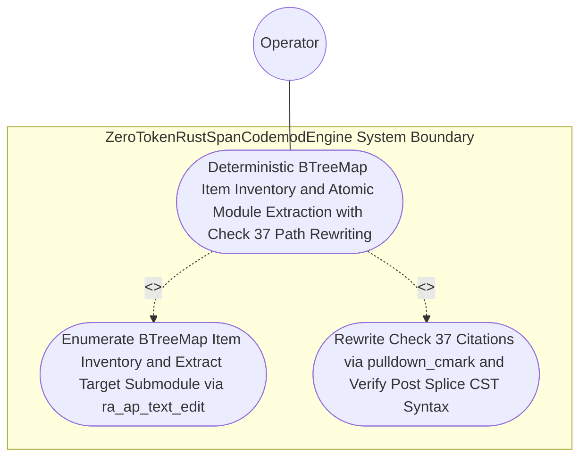
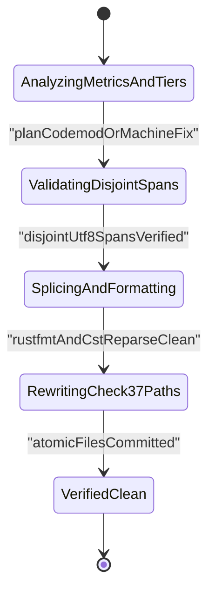

| Attribute | Specification Detail |
| :--- | :--- |
| **Issue ID** | #767 |
| **Title** | Use Case 39: Deterministic B Tree Map Item Inventory and Atomic Module Extraction with Check 37 Path Rewriting |
| **Type** | use-case |
| **Primary Actor** | Operator |
| **Scope** | AirGappedCargoLockGovernor |
| **Level** | User Goal |
| **Generation Mode** | subagent |
| **Specification Source** | [schema/model.sysml](../../schema/model.sysml) |

# Use Case 39: Deterministic B Tree Map Item Inventory and Atomic Module Extraction with Check 37 Path Rewriting

## UML Diagrams

### Use Case Diagram

### State Machine Diagram

## 1. Actors
- `Operator`

## 2. Preconditions
- An existing workspace module `<name>.rs` referenced in `docs/architecture/blueprints/*.md` and `README.md`, containing multiple top-level structs and functions with leading `///` docblocks and outer attributes inside an isolated temporary workspace fixture.

## 3. Trigger
- compile-sysml --list-rust-items <name>.rs followed by compile-sysml --extract-rust-module --from <name>/mod.rs --to <name>/.rs --items <ItemA,ItemB> is executed after transitioning <name>.rs to <name>/mod.rs.

## 4. Main Success Scenario
1. `Operator` invokes `compile-sysml --list-rust-items <name>.rs` on `ZeroTokenRustSpanCodemodEngine` (`runtime_llm_token_count = 0`) via `codemod_command_in`, delegating `list_rust_items` to `LosslessRustCstAnalyzer`.
2. `LosslessRustCstAnalyzer` emits a deterministic `BTreeMap`-ordered `RustItemInventory` on `item_inventory_out` recording each item's kind, identifier, `DocTier`, and composite UTF-8 `TextRange` byte/line span (including leading `///` docblocks and outer attributes).
3. `Operator` invokes `compile-sysml --extract-rust-module --from <name>/mod.rs --to <name>/.rs --items <ItemA,ItemB>` on `ZeroTokenRustSpanCodemodEngine`, which executes `extract_rust_module` inside `< 380` exec SLOC submodules (`deap_core_rust_cst_extract_module`).
4. `ZeroTokenRustSpanCodemodEngine` slices the non-overlapping composite `TextRange` spans in reverse byte order, synthesizes `<name>/.rs` with its `//!` module header, inserts `mod ;` and `pub use` re-exports in `<name>/mod.rs`, and re-parses both files via `ra_ap_syntax::SourceFile::parse` to verify zero CST syntax errors.
5. `ZeroTokenRustSpanCodemodEngine` formats both modules via `rustfmt --edition 2021`, atomically updates `<name>.rs` citations to `<name>/mod.rs` across `docs/architecture/blueprints/*.md` and `README.md` (`rewrite_check37_citations = true`), and emits `atomic_patch_out` with exit code 0.

## 5. Alternate and Exception Flows
- 3a. Requested item identifier in `--items <ItemA,ItemB>` does not exist in `<name>/mod.rs` (`Diagnostic: DEAP-E0801`):
  - `ZeroTokenRustSpanCodemodEngine` aborts extraction before any filesystem mutation, emits single-line JSON diagnostic `DEAP-E0801` on `codemod_error_out`, and exits fail-closed with code 1.
- 4a. Extracted `<name>/mod.rs` or `<name>/.rs` buffer fails post-splice `ra_ap_syntax::SourceFile::parse` verification (`Diagnostic: DEAP-E0803`):
  - `ZeroTokenRustSpanCodemodEngine` rolls back the in-memory splice transaction without writing to disk, emits `DEAP-E0803` on `codemod_error_out`, and terminates fail-closed with exit code 1.
- 5a. Blueprint or `README.md` citation path rewrite fails Check 37 existence verification:
  - `ZeroTokenRustSpanCodemodEngine` restores the pre-extraction workspace state, preserves prior verified state, and notifies `Operator`.

## 6. Postconditions
- **Success Guarantee:** `--list-rust-items` emits a deterministic `BTreeMap`-ordered inventory, `--extract-rust-module` atomically extracts `<name>/.rs` and updates `<name>/mod.rs` with zero syntax errors inside `< 380`-SLOC submodules (`crates/deap-core/src/rust_cst/extract_module.rs`), and Check 37 citations in `docs/architecture/blueprints/*.md` and `README.md` are losslessly rewritten via `pulldown-cmark` and `pulldown-cmark-to-cmark`.
- **Failure Guarantee:** Any missing symbol (`DEAP-E0801`), span collision (`DEAP-E0802`), or post-splice syntax error (`DEAP-E0803`) rolls back the in-memory transaction without mutating disk files and exits fail-closed with code 1.

## 7. Operational Context
- **Contract A (100% Normative OMG SysML v2.0 + KerML 1.0 Grammar Coverage)**: Preserves full Definition and Usage symmetry across the OMG SysML v2.0 and KerML 1.0 textual grammar with zero 16-construct caps.
- **Contract B (Official Rust Compiler, Cargo, `rust-analyzer` & Markdown AST Crate Stack)**: Uses `ra_ap_syntax`, `ra_ap_vfs`, `ra_ap_paths`, `ra_ap_line_index`, `ra_ap_text_edit`, `rowan`, `camino`, `ignore`, `pulldown-cmark`, `pulldown-cmark-to-cmark`, `cargo-lock`, `cargo_metadata`, `cargo-util-schemas`, `cargo-platform`, and `toml_edit` with explicit net-negative deletion of ~19,700+ lines of hand-rolled scanners (retiring `crates/deap-core/src/rust_cst.rs`, `crates/compile-sysml/src/docstring.rs`, `crates/verify-baseline/src/checks/docstring_tier_rules.rs`, `crates/verify-baseline/src/checks/structural.rs`, `crates/deap-core/src/workspace.rs`, and `crates/verify-baseline/src/ratchet_table.rs`).
- **3-Layer Definition of Done (DoD)**:
  - **Layer 1 (Domain State & Data Model)**: `BTreeMap`-ordered `RustItemInventory`, `SpanSpliceEdit` (`ra_ap_text_edit::TextEdit` + `rowan::TextRange`), and `pulldown-cmark` AST events.
  - **Layer 2 (Logic & State Management)**: Reverse-byte-order span extraction, post-splice `ra_ap_syntax::SourceFile::parse` verification, and Check 37 Markdown AST rewriting (`C_CST_05` `runtime_llm_token_count == 0`, `Invariant_REQ_0608_SC_02`) inside `< 380`-SLOC submodules (`crates/deap-core/src/rust_cst/{items,extract_module}.rs`, `crates/compile-sysml/src/codemod/`).
  - **Layer 3 (Presentation & Actuator Interface Binding)**: Binds `codemod_command_in`, `item_inventory_out`, `atomic_patch_out`, and `codemod_error_out` across `ZeroTokenRustSpanCodemodEngine` and `LosslessRustCstAnalyzer`.

## 8. Realization Matrix
| Specification Item | Type | Link / Reference |
| :--- | :--- | :--- |
| **#803** | User Story | [User Story 54: list rust items](../user-stories/US-54-list_rust_items.md) |
| **#804** | User Story | [User Story 55: extract rust module](../user-stories/US-55-extract_rust_module.md) |
| **#746** | Feature | [Feature 40: [BP 08 Lossless Rust CST Codemod Engine and Unified rustc Compatible JSON Diagnostics] ZeroTokenRustSpanCodemodEngine](../features/FEAT-40-ZeroTokenRustSpanCodemodEngine.md) |
| **#743** | Feature | [Feature 37: [BP 08 Lossless Rust CST Codemod Engine and Unified rustc Compatible JSON Diagnostics] LosslessRustCstAnalyzer](../features/FEAT-37-LosslessRustCstAnalyzer.md) |

### Required User Stories
- [ ] #803 - [User Story 54: list rust items](../user-stories/US-54-list_rust_items.md) (generates the deterministic `BTreeMap`-ordered `RustItemInventory` with composite `TextRange` spans)
- [ ] #804 - [User Story 55: extract rust module](../user-stories/US-55-extract_rust_module.md) (executes atomic reverse-byte-order submodule extraction and `pulldown-cmark` Check 37 citation rewriting)

### Required Features
- [ ] #746 - [Feature 40: [BP 08 Lossless Rust CST Codemod Engine and Unified rustc Compatible JSON Diagnostics] ZeroTokenRustSpanCodemodEngine](../features/FEAT-40-ZeroTokenRustSpanCodemodEngine.md) (realizes the zero-LLM-token span-splice codemod engine and Check 37 path rewriter)
- [ ] #743 - [Feature 37: [BP 08 Lossless Rust CST Codemod Engine and Unified rustc Compatible JSON Diagnostics] LosslessRustCstAnalyzer](../features/FEAT-37-LosslessRustCstAnalyzer.md) (provides `list_rust_items` inventory generation and post-splice CST verification)

## Source References
Use case operational flows and lifecycle activity references:
- System Architecture Model: `schema/model.sysml`
- Normative Systems Engineering Standard: ISO/IEC/IEEE 29148:2018 §6.4.2 Concept of Operations

Operational use case realization and traceability links derive from `schema/model.sysml` pursuant to ISO/IEC/IEEE 29148.
