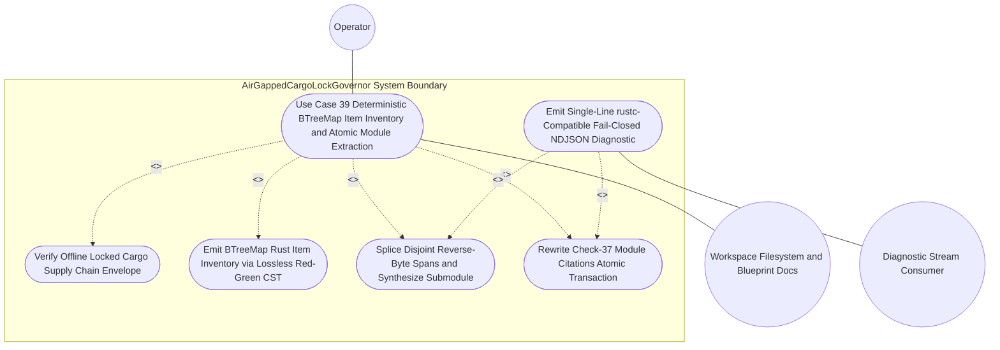

| Attribute | Specification Detail |
| :--- | :--- |
| **Issue ID** | TBD |
| **Title** | Use Case 39: Deterministic B Tree Map Item Inventory and Atomic Module Extraction with Check 37 Path Rewriting |
| **Type** | use-case |
| **Primary Actor** | Operator |
| **Scope** | AirGappedCargoLockGovernor |
| **Level** | User Goal |
| **Generation Mode** | subagent |
| **Specification Source** | [schema/model.sysml](../../schema/model.sysml) |

# Use Case 39: Deterministic B Tree Map Item Inventory and Atomic Module Extraction with Check 37 Path Rewriting

## UML Diagrams

## 1. Actors
- **Primary Actor:** `Operator` (Compiler engineer or deterministic build pipeline invoking `compile-sysml --list-rust-items` and `compile-sysml --extract-rust-module` over `codemod_command_in` using the `CstCodemodCommand` protocol).
- **Secondary Actors:**
  - `AirGappedCargoLockGovernor` (`manifest_lock_in` / `lock_receipt_out` ports enforcing `--offline --locked` `Cargo.toml` and `Cargo.lock` SHA-256 supply-chain integrity via `SupplyChainVerificationReceipt`).
  - `LosslessRustCstAnalyzer` (`rust_source_in` / `item_inventory_out` ports constructing `ra_ap_syntax` and `rowan` Red/Green syntax trees and emitting `BTreeOrderedItemInventory`).
  - `ZeroTokenRustSpanCodemodEngine` (`codemod_command_in` / `atomic_patch_out` / `codemod_error_out` ports executing zero-LLM-token reverse-byte-order `TextRange` splicing and Check-37 path rewriting).
  - `UnifiedRustcJsonDiagnosticEmitter` (`finding_in` / `ndjson_out` ports serializing single-line `compiler-message` NDJSON diagnostics when `--message-format=json` is active).

## 2. Preconditions
- Workspace `Cargo.toml` and `Cargo.lock` satisfy `AirGappedCargoLockGovernor` invariants (`offline_locked_enforced == true`, `vendor_bundle_supported == true`, and verified 64-hex-digit SHA-256 package checksums sealed by `verifyOfflineLockedBuild`).
- Target Rust source module (such as an existing monolithic `.rs` unit being transitioned to a directory module layout like `crates/deap-core/src/sysml_ast/mod.rs` inside an isolated workspace or temporary fixture) is valid UTF-8, parses cleanly into a lossless `ra_ap_syntax::SourceFile` Red/Green tree with zero syntax errors, and contains top-level items (`struct`, `enum`, `trait`, `impl`, `fn`, `type`, `const`) carrying leading `///` docblocks and outer `derive` or `cfg(test)` attribute annotations.
- Blueprint architectural documentation (`docs/architecture/blueprints/`) and `README.md` contain workspace-relative Check-37 source path citations referencing the module prior to extraction, while self-hosted generated code under `crates/compile-sysml/src/modular_codegen/generated/` remains isolated (`skip_generated_tree == true`).
- Zero runtime LLM tokens are permitted across inventory and extraction passes (`runtime_llm_token_count == 0`, **C_CST_05**).

## 3. Trigger
- `Operator` executes `compile-sysml --list-rust-items <module_path>` to inspect the deterministic `BTreeMap`-ordered CST item inventory, transitions `<module>.rs` to `<module>/mod.rs`, and executes `compile-sysml --extract-rust-module --from <module>/mod.rs --to <module>/<submodule>.rs --items <ItemA,ItemB>` (with optional `--message-format=json` diagnostic binding).

## 4. Main Success Scenario
1. `Operator` invokes `compile-sysml --list-rust-items` targeting a workspace Rust module, causing `AirGappedCargoLockGovernor` to verify `--offline --locked` manifest and lockfile SHA-256 parity (`verifyOfflineLockedBuild`) and return `reply_SupplyChainVerificationReceipt` before authorizing CST inspection.
2. `LosslessRustCstAnalyzer` ingests the raw UTF-8 source buffer on `rust_source_in` (`Utf8RustSourceBuffer`), parses the file via `ra_ap_syntax::SourceFile::parse` into a `rowan` Red/Green tree within `MAX_AST_DEPTH = 64`, asserts bit-for-bit root `GreenNode` byte equality against the input buffer (**Invariant_REQ_0608_SC_01**), and isolates `cfg(test)` module subtrees and unit `test` functions from production `DocTier` scope.
3. `LosslessRustCstAnalyzer` emits `reply_RustItemInventory` over `item_inventory_out` (`BTreeOrderedItemInventory` protocol), serializing a deterministic `BTreeMap`-keyed inventory of top-level AST items reporting item kind, canonical identifier, inclusive UTF-8 `TextRange` byte and 1-based line spans covering leading `///` or `doc` attribute docblocks and outer attributes, visibility, and `DocTier` classification (`DocTier::RustTierA` or `DocTier::RustTierBC`) with `runtime_llm_token_count == 0` (**C_CST_05**).
4. `Operator` transitions the module path from `<module>.rs` to `<module>/mod.rs` (exemplified in workspace layout by `crates/deap-core/src/sysml_ast/mod.rs`) and invokes `compile-sysml --extract-rust-module --from <module>/mod.rs --to <module>/<submodule>.rs --items <ItemA,ItemB>`, delivering `CstCodemodCommand` on `codemod_command_in` to `ZeroTokenRustSpanCodemodEngine`.
5. `ZeroTokenRustSpanCodemodEngine` resolves every requested identifier in `<ItemA,ItemB>` against the `BTreeMap` item inventory of `<module>/mod.rs`, computes each item's full trivia-inclusive `TextRange` interval `[a_i, b_i)` using bounds-checked `.get()` indexing and `saturating_*` / checked offset arithmetic, and verifies `DisjointValid` constraints (`0 <= a_i <= b_i <= N_S`, UTF-8 `is_char_boundary` endpoints, and sorted pairwise non-overlap `b_i <= a_{i+1}` per **Invariant_REQ_0608_SC_03**).
6. `ZeroTokenRustSpanCodemodEngine` performs reverse-byte-order `TextRange` splicing in memory to remove `<ItemA,ItemB>` from `<module>/mod.rs`, injects deterministic `mod <submodule>;` and visibility-preserving re-export declarations into `<module>/mod.rs`, and constructs `<module>/<submodule>.rs` (exemplified by `crates/deap-core/src/sysml_ast/actions.rs`) with a Check-36 `DocTier::RustTierA` `//!` module safety header preserving `#![forbid(unsafe_code)]` domain purity.
7. `ZeroTokenRustSpanCodemodEngine` applies deterministic formatting and re-parses both `<module>/mod.rs` and `<module>/<submodule>.rs` in memory via `LosslessRustCstAnalyzer` to verify the `AdmissibleCommit` zero-syntax-error invariant (`errors().len() == 0`, **Invariant_REQ_0608_SC_03**) alongside DEAP v2.0 AST bounds (`max_fn_exec_sloc <= 50` per **C_CST_01**, `max_fn_param_count <= 5` excluding receivers per **C_CST_02**, and `max_mut_bool_flags == 0` per **C_CST_03**).
8. With `rewrite_check37_citations == true`, `ZeroTokenRustSpanCodemodEngine` scans `docs/architecture/blueprints/` and `README.md` in deterministic `BTreeSet` path order (excluding `crates/compile-sysml/src/modular_codegen/generated/` per `skip_generated_tree == true`), rewrites `<module>.rs` citations to `<module>/mod.rs`, commits all modified Rust and Markdown files via staged temporary-file atomic rename (`atomic_patch_out`, `AtomicWorkspacePatch`), confirms `stage_fixed_point_mismatch_files == 0` (**C_CST_04**), and exits with code `0`.

## 5. Alternate and Exception Flows
- 5a. **Unlocked or Drifted Supply-Chain Precondition Breach (`FM-BP08-001`, `FM-BP08-002` -- Failure Category Input/Boundary and State/Ordering, Branches from Basic Flow step 1):**
  1. `AirGappedCargoLockGovernor` detects `offline_locked_enforced == false`, a missing or malformed `Cargo.toml` / `Cargo.lock` payload on `manifest_lock_in`, an unpinned dependency or invalid 64-hex SHA-256 package checksum, or an out-of-order codemod invocation prior to `reply_SupplyChainVerificationReceipt`.
  2. `AirGappedCargoLockGovernor` short-circuits before `ParsingLosslessCst`, delegates a `DEAP-E0804` (**SC-BP08-01**, **SC-BP08-02**) finding to `UnifiedRustcJsonDiagnosticEmitter` to emit a single-line zero-ANSI `compiler-message` NDJSON record on `ndjson_out`, leaves all workspace files untouched, and terminates fail-closed with exit code `1`.
- 5b. **Non-UTF-8 Source, Malformed Input Syntax, Path Traversal, or Missing AST Symbol (`FM-BP08-005`, `FM-BP08-017` -- Failure Category Input/Boundary and Malformed Syntax, Branches from Basic Flow steps 2 and 5):**
  1. `LosslessRustCstAnalyzer` or `ZeroTokenRustSpanCodemodEngine` detects invalid UTF-8 bytes or pre-existing `ra_ap_syntax::SourceFile::parse` errors on `rust_source_in`, a non-canonical `--from` / `--to` path containing `..` or a leading `/`, or an identifier in `--items` that does not match any top-level AST item in `<module>/mod.rs`.
  2. `ZeroTokenRustSpanCodemodEngine` transitions immediately from `ValidatingDisjointSpans` to `EmittingJsonDiagnostics`, emits `DEAP-E0801` (missing symbol or invalid path boundary, **SC-BP08-03**) or `DEAP-E0803` (input CST syntax failure, **SC-BP08-05**) via `codemod_error_out`, performs zero filesystem writes, and exits with code `1`.
- 5c. **Overlapping `TextRange` Collision, Mid-Codepoint Boundary, or `cfg(test)` Scope Leakage (`FM-BP08-006`, `FM-BP08-008`, `FM-BP08-018` -- Failure Category State/Concurrency and Ordering, Branches from Basic Flow steps 3 and 5):**
  1. During `ValidatingDisjointSpans`, `ZeroTokenRustSpanCodemodEngine` detects overlapping or unsorted `TextRange` intervals (`b_i > a_{i+1}`), a byte offset failing UTF-8 `is_char_boundary`, detached leading `///` or `doc` trivia spans, or unbalanced `cfg(test)` scope boundaries threatening production `DocTier` classification.
  2. `ZeroTokenRustSpanCodemodEngine` triggers `rejectSpanCollisionOrMissingSymbol`, aborts reverse-span splicing in memory, emits a single-line `DEAP-E0802` (**SC-BP08-06**, **SC-BP08-08**, **SC-BP08-03**) `rustc`-compatible JSON diagnostic carrying the colliding `byte_start` and `byte_end` coordinates, and exits with code `1` without mutating `<module>/mod.rs`.
- 5d. **CST Nesting Depth Breach, Arithmetic Overflow, or Symlink Cycle During Check-37 Scan (`FM-BP08-007`, `FM-BP08-019` -- Failure Category Resource/Depth/Arithmetic Exhaustion, Branches from Basic Flow steps 2, 6, and 8):**
  1. `LosslessRustCstAnalyzer` encounters syntax nesting deeper than `MAX_AST_DEPTH = 64`, or `ZeroTokenRustSpanCodemodEngine` detects checked/saturating integer overflow on `TextRange` splice delta calculations or a directory symlink cycle while traversing `docs/architecture/blueprints/` during Check-37 path rewriting.
  2. The engine aborts traversal within `O(N_S + M_E log M_E)` time and `O(N_S + M_E)` space ceilings, discards uncommitted in-memory buffers, emits `DEAP-E0804` (**SC-BP08-07**, **SC-BP08-04**) over `UnifiedRustcJsonDiagnosticEmitter`, and terminates fail-closed with exit code `1`.
- 5e. **Post-Splice CST Syntax Error, Torn Multi-File Staging Failure, or Stage-1/Stage-2 Fixed-Point Drift (`FM-BP08-010`, `FM-BP08-016`, `FM-BP08-020` -- Failure Category Output/Serialization and Partial-Write Integrity, Branches from Basic Flow steps 7 and 8):**
  1. Re-parsing the spliced `<module>/mod.rs` or synthesized `<module>/<submodule>.rs` buffer yields `SourceFile::parse` errors (`errors().len() > 0`, violating `AdmissibleCommit` in **Invariant_REQ_0608_SC_03**), Check-37 citation staging fails validation, or `crates/compile-sysml/src/modular_codegen/generated/` fixed-point verification reports `stage_fixed_point_mismatch_files > 0`.
  2. `ZeroTokenRustSpanCodemodEngine` invokes `rejectPostSpliceSyntaxError` (or `rejectFixedPointDriftE0705`), unlinks all isolated temporary staging files prior to rename so on-disk `<module>/mod.rs`, `<module>/<submodule>.rs`, `docs/architecture/blueprints/`, and `README.md` retain their exact pre-invocation bytes, emits single-line `DEAP-E0803` (**SC-BP08-16**, **SC-BP08-03**) or `DEAP-E0705` (**SC-BP08-10**) NDJSON free of `0x0A` and `0x1B` bytes, and exits with code `1`.

## 6. Postconditions
- **Success Guarantee:**
  - `--list-rust-items` emits a byte-deterministic `BTreeMap`-ordered inventory of all top-level AST items with exact UTF-8 `TextRange` spans (inclusive of leading `///` docblocks and outer attributes) and `cfg(test)`-excluded `DocTier` classifications while consuming `0` LLM tokens (**C_CST_05**).
  - `--extract-rust-module` atomically commits `<module>/mod.rs` (retaining non-extracted items plus `mod <submodule>;` and visibility-preserving re-exports) and `<module>/<submodule>.rs` (carrying a Check-36 `DocTier::RustTierA` `//!` header), both re-parsed with `0` `ra_ap_syntax` errors (**Invariant_REQ_0608_SC_03**) and obeying **C_CST_01**..**C_CST_06**.
  - All `<module>.rs` Check-37 path citations across `docs/architecture/blueprints/` and `README.md` are atomically rewritten to `<module>/mod.rs`, while `crates/compile-sysml/src/modular_codegen/generated/` preserves `SHA-256(Stage 1) == SHA-256(Stage 2)` parity (`stage_fixed_point_mismatch_files == 0`, **C_CST_04**).
- **Failure Guarantee:**
  - On any validation, span-collision, depth-ceiling, post-splice syntax, or I/O staging error (`5a` through `5e`), execution halts fail-closed with exit code `1`, zero partial or torn writes reach the workspace filesystem, and `UnifiedRustcJsonDiagnosticEmitter` emits a single-line zero-ANSI `compiler-message` NDJSON diagnostic (`DEAP-E0801`..`DEAP-E0804` or `DEAP-E0705`).

## 7. Operational Context
Use Case 39 realizes **REQ-0608** (`BP-08`, `UC_AC_02_Deterministic_BTreeMap_Item_Inventory_and_Atomic_Module_Extraction_with_Check_37_Path_Rewriting`) across `crates/deap-core/src/source_ast.rs`, `crates/deap-core/src/diagnostics.rs`, `crates/deap-core/src/error.rs`, `crates/compile-sysml/src/cli.rs`, and `crates/compile-sysml/src/driver.rs`. It enables deterministic, zero-token decomposition of large Rust modules (such as refactoring monolithic AST modules into `crates/deap-core/src/sysml_ast/mod.rs` and focused submodules like `crates/deap-core/src/sysml_ast/actions.rs`) under DO-178C Level A and DO-330 TQL-4 air-gapped verification rules without breaking Check-37 documentation traceability (`crates/verify-baseline/src/audit_code.rs`).

### 3-Layer Definition of Done Contract
1. **Layer 1 -- Domain State and Data Model (`crates/deap-core/src/source_ast.rs`, `crates/deap-core/src/error.rs`):** Defines strongly typed, immutable CST item descriptors (`RustItemInventoryEntry`, `DocTier`, `SpanSpliceEdit`, `AtomicWorkspacePatch`) stored exclusively in deterministic `BTreeMap` and `BTreeSet` collections (`0` hash-randomized iteration paths) and structured failure enums (`CstCodemodError` mapping bijectively to `DEAP-E0801`..`DEAP-E0804` and `DEAP-E0705`) with `0` `Result<T, String>` signatures and `#![forbid(unsafe_code)]` domain enforcement.
2. **Layer 2 -- Logic and State Management (`crates/deap-core/src/source_ast.rs`, `crates/compile-sysml/src/driver.rs`):** Implements total, panic-free CST traversal and reverse-byte-order `TextRange` splicing governed by `BP_08_Lossless_Rust_CST_Codemod_Engine_and_Unified_rustc_Compatible_JSON_Diagnostics_LifecycleState`, enforcing `MAX_AST_DEPTH = 64` recursion/worklist bounds, total functions within `<= 50` executable SLOC (**C_CST_01**, satisfying the `<= 80` workspace executable SLOC ceiling), `<= 5` parameters excluding `self`/`&self`/`&mut self` receivers (**C_CST_02**), `0` mutable boolean flags (**C_CST_03**), bounds-safe `.get()` slice indexing verified via `str::is_char_boundary`, `saturating_*` and `checked_*` offset arithmetic, `runtime_llm_token_count == 0` (**C_CST_05**), and staged temp-file atomic rename rollback.
3. **Layer 3 -- Presentation and CLI / `--message-format=json` NDJSON Interface Binding (`crates/compile-sysml/src/cli.rs`, `crates/compile-sysml/src/main.rs`, `crates/deap-core/src/diagnostics.rs`):** Exposes `--list-rust-items <PATH>`, `--extract-rust-module --from <MOD_RS> --to <SUB_RS> --items <CSV>`, and `--message-format=json` CLI surface bindings wired through `UnifiedRustcJsonDiagnosticEmitter` (`formatNdjsonLine`), guaranteeing single-line `rustc`-compatible NDJSON frames (`reason: "compiler-message"`, `DEAP-E*` codes, exact UTF-8 `byte_start`/`byte_end` and 1-based line/column spans, `0` embedded `0x0A` newline bytes, and `0` `0x1B` ANSI escape bytes) with deterministic process exit codes (`0` on verified atomic commit, `1` on fail-closed rejection).

### Mathematical Formulations and Safety Invariants

$$
\begin{aligned}
\sum_{i=1}^{k} \lvert R(t_i) \rvert &= N_S \\
0 \le a_i \le b_i &\le N_S \\
b_i &\le a_{i+1} \\
E_{\text{parse}}(S_{\text{mod}}) + E_{\text{parse}}(S_{\text{sub}}) &= 0 \\
L_{\text{exec}}(f) \le L_{\text{max}} \land P_{\text{fn}}(f) &\le P_{\text{max}} \\
K_{\text{LLM}} = 0 \land \Delta_{\text{stage}} &= 0 \\
T_{\text{codemod}}(N_S, M_E) &= O(N_S + M_E \log M_E)
\end{aligned}
$$

- Parameter Definitions & Engineering Units:
- $R(t_i)$: UTF-8 byte interval of token $t_i$ in the `rowan` Green tree Partition of source buffer $S$ (bytes).
- $N_S$: Total byte length of input UTF-8 Rust source buffer $S$ (bytes, bounded with `MAX_AST_DEPTH = 64` CST depth ceiling).
- $a_i, b_i$: Inclusive start and exclusive end UTF-8 character-boundary byte offsets of extracted item span $i$ in sorted `BTreeMap` splice schedule ($1 \le i \le M_E$, bytes, satisfying $b_i \le a_{i+1}$ for $1 \le i < M_E$).
- $M_E$: Cardinality of disjoint `SpanSpliceEdit` operations in the extraction transaction (edits).
- $E_{\text{parse}}(S_{\text{mod}}), E_{\text{parse}}(S_{\text{sub}})$: Syntax error counts returned by `ra_ap_syntax::SourceFile::parse` on post-splice `<module>/mod.rs` and `<module>/<submodule>.rs` buffers (errors, required to equal $0$ under `AdmissibleCommit`).
- $L_{\text{exec}}(f), L_{\text{max}}$: Per-function executable source lines of code excluding comments, docblocks, attributes, blank lines, and `cfg(test)` blocks, bounded by $L_{\text{max}} = 50$ SLOC under **C_CST_01** (within the $80$ SLOC workspace total-function ceiling).
- $P_{\text{fn}}(f), P_{\text{max}}$: Per-function formal parameter count excluding `self`, `&self`, and `&mut self` receivers, bounded by $P_{\text{max}} = 5$ parameters under **C_CST_02**.
- $K_{\text{LLM}}$: Runtime large-language-model token consumption during item listing, module extraction, and Check-37 rewriting ($0$ tokens under **C_CST_05**).
- $\Delta_{\text{stage}}$: Count of Stage-1 versus Stage-2 SHA-256 mismatched generated files under `crates/compile-sysml/src/modular_codegen/generated/` ($0$ files under **C_CST_04**).
- $T_{\text{codemod}}(N_S, M_E)$: Asymptotic time complexity of lossless CST parsing, `BTreeMap` ordering, and reverse-byte-order splicing ($O(N_S + M_E \log M_E)$ operations in $O(N_S + M_E)$ byte space).

## 8. Realization Matrix
| Specification Item | Type | Link / Reference | Semantic Realization & Verification Linkage |
| :--- | :--- | :--- | :--- |
| **UC-39** | Use Case | [Use Case 39](../use-cases/UC-39-Deterministic_BTreeMap_Item_Inventory_and_Atomic_Module_Extraction_with_Check_37_Path_Rewriting.md) | End-to-end system interaction contract for `UC_AC_02` deterministic `BTreeMap` item inventory, atomic submodule extraction, and Check-37 citation rewriting. |
| **US-52** | User Story | [User Story 52: list Rust Items](../user-stories/US-52-listRustItems.md) | Realizes `listRustItems(path)` lossless `ra_ap_syntax` + `rowan` CST parsing and `BTreeOrderedItemInventory` emission (Basic Flow steps 1-3). |
| **US-53** | User Story | [User Story 53: extract Rust Module](../user-stories/US-53-extractRustModule.md) | Realizes `extractRustModule(fromPath, toPath, itemsCsv)` disjoint reverse-span splicing, Tier A `//!` header synthesis, `AdmissibleCommit` re-parse, and atomic Check-37 path rewriting (Basic Flow steps 4-8). |
| **FEAT-45** | Feature | [Feature 45: ZeroTokenRustSpanCodemodEngine](../features/FEAT-45-ZeroTokenRustSpanCodemodEngine.md) | Primary realizing component enforcing `runtime_llm_token_count == 0` (**C_CST_05**), `DisjointValid` reverse-byte splicing, `rewrite_check37_citations == true`, and staged atomic commits (`FM-BP08-017`..`FM-BP08-020`). |
| **FEAT-42** | Feature | [Feature 42: LosslessRustCstAnalyzer](../features/FEAT-42-LosslessRustCstAnalyzer.md) | Provides lossless Red/Green CST construction (`MAX_AST_DEPTH = 64`), `cfg(test)`-excluded `DocTier` classification, and **C_CST_01**..**C_CST_03** metric verification (`FM-BP08-005`..`FM-BP08-008`). |
| **FEAT-44** | Feature | [Feature 44: UnifiedRustcJsonDiagnosticEmitter](../features/FEAT-44-UnifiedRustcJsonDiagnosticEmitter.md) | Serializes fail-closed `DEAP-E0801`..`DEAP-E0804` and `DEAP-E0705` findings as single-line zero-ANSI `compiler-message` NDJSON diagnostics (`FM-BP08-013`..`FM-BP08-016`). |
| **FEAT-41** | Feature | [Feature 41: AirGappedCargoLockGovernor](../features/FEAT-41-AirGappedCargoLockGovernor.md) | Guards Use Case entry with `--offline --locked` `Cargo.toml` and `Cargo.lock` SHA-256 supply-chain verification (`FM-BP08-001`..`FM-BP08-004`). |
| **EPIC-08** | Epic | [Epic 08: BP 08 Lossless Rust CST Codemod Engine and Unified rustc Compatible JSON Diagnostics](../epics/EPIC-08-BP_08_Lossless_Rust_CST_Codemod_Engine_and_Unified_rustc_Compatible_JSON_Diagnostics.md) | Parent architectural epic governing **REQ-0608** (`BP-08`) lossless Rust CST refactoring and unified `rustc`-compatible JSON diagnostics. |
| **TEST-BP08-UC39-01** | Test Case | `crates/deap-core/src/source_ast.rs` (`AC_02` unit `test` suite) | Verifies deterministic `BTreeMap` `--list-rust-items` output, atomic `--extract-rust-module` extraction to `<module>/mod.rs` and `<module>/<submodule>.rs`, and Check-37 blueprint/`README.md` path rewriting. |
| **TEST-BP08-UC39-02** | Test Case | `crates/compile-sysml/src/driver.rs` (`AC_03` unit `test` suite) | Verifies fail-closed exit code `1`, untouched on-disk workspace files, and single-line `DEAP-E0801`..`DEAP-E0804` NDJSON emission on missing items, overlapping spans, depth breaches, and post-splice syntax errors. |

## Source References
Use case operational flows and lifecycle activity references:
- System Architecture Model: `schema/model.sysml` (`docs/designs/blueprint-08-rust-analyzer-cst-refactoring-and-json-diagnostics.sysml`)
- Component Failure Mode Registry: `docs/research/FAILURE_MODE_REGISTRY.md` (`FM-BP08-001` through `FM-BP08-020`)
- Normative Systems Engineering Standard: ISO/IEC/IEEE 29148:2018 Section 6.4.2 Concept of Operations; DO-178C Level A / DO-330 TQL-4

Operational use case realization and traceability links derive from `schema/model.sysml` pursuant to ISO/IEC/IEEE 29148.
