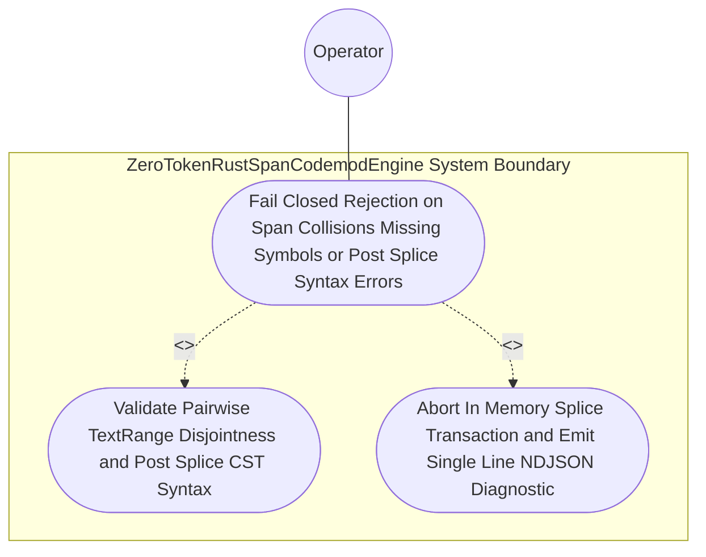

| Attribute | Specification Detail |
| :--- | :--- |
| **Issue ID** | #768 |
| **Title** | Use Case 40: Fail Closed Rejection on Span Collisions Missing Symbols or Post Splice Syntax Errors |
| **Type** | use-case |
| **Primary Actor** | Operator |
| **Scope** | AirGappedCargoLockGovernor |
| **Level** | User Goal |
| **Generation Mode** | subagent |
| **Specification Source** | [schema/model.sysml](../../schema/model.sysml) |

# Use Case 40: Fail Closed Rejection on Span Collisions Missing Symbols or Post Splice Syntax Errors

## UML Diagrams

### Use Case Diagram


### State Machine Diagram
```sysml
stateDiagram-v2
    [*] --> ValidatingDisjointSpans
    ValidatingDisjointSpans --> EmittingJsonDiagnostics : "rejectSpanCollisionOrMissingSymbol"
    ValidatingDisjointSpans --> SplicingAndFormatting : "disjointUtf8SpansVerified"
    SplicingAndFormatting --> EmittingJsonDiagnostics : "rejectPostSpliceSyntaxError"
    EmittingJsonDiagnostics --> [*]
```

## 1. Actors
- `Operator`

## 2. Preconditions
- An --extract-rust-module or --apply-machine-fixes invocation targeting either an overlapping pair of TextRange byte intervals, a non-existent AST item identifier, or a replacement payload that introduces a CST syntax error.

## 3. Trigger
- ZeroTokenRustSpanCodemodEngine or UnifiedRustcJsonDiagnosticEmitter evaluates the proposed SpanSpliceEdit transaction.

## 4. Main Success Scenario
1. `Operator` invokes `--extract-rust-module` or `--apply-machine-fixes` on `ZeroTokenRustSpanCodemodEngine` (`codemod_command_in`) or `UnifiedRustcJsonDiagnosticEmitter` (`machine_fix_inout`) with a candidate `SpanSpliceEdit` transaction.
2. `ZeroTokenRustSpanCodemodEngine` parses the target `.rs` file via `LosslessRustCstAnalyzer` (`ra_ap_syntax::SourceFile::parse`) inside `< 380` exec SLOC submodules (`crates/deap-core/src/rust_cst/`) and resolves requested item identifiers and `TextRange` byte intervals.
3. `ZeroTokenRustSpanCodemodEngine` evaluates pairwise interval disjointness (`b_i <= a_j` or `b_j <= a_i`) and UTF-8 character boundary alignment across all proposed `SpanSpliceEdit` entries under `Invariant_REQ_0608_SC_02`.
4. Upon detecting a missing AST symbol, an overlapping `TextRange` pair, or a post-splice `ra_ap_syntax` syntax error in the candidate buffer, `ZeroTokenRustSpanCodemodEngine` aborts the in-memory transaction before touching the filesystem.
5. `UnifiedRustcJsonDiagnosticEmitter` invokes `format_ndjson_line` to emit a single-line `rustc`-compatible JSON diagnostic (`DEAP-E0801` missing item, `DEAP-E0802` overlapping span collision, or `DEAP-E0803` post-splice syntax error) on `ndjson_out`, leaving all workspace files bit-for-bit unchanged and exiting with code 1.

## 5. Alternate and Exception Flows
- 3a. Requested AST item identifier is absent from `RustItemInventory` (`Diagnostic: DEAP-E0801`):
  - `ZeroTokenRustSpanCodemodEngine` rejects the command, emits single-line NDJSON diagnostic `DEAP-E0801` on `codemod_error_out`, and exits fail-closed with code 1.
- 4a. Two or more `SpanSpliceEdit` intervals overlap in UTF-8 byte range (`Diagnostic: DEAP-E0802`):
  - `ZeroTokenRustSpanCodemodEngine` aborts the splice batch without mutating any file, emits `DEAP-E0802` with both colliding `TextRange` spans, and terminates fail-closed with exit code 1.
- 5a. Candidate spliced buffer introduces a `ra_ap_syntax` CST parse error (`Diagnostic: DEAP-E0803`):
  - `ZeroTokenRustSpanCodemodEngine` discards the in-memory candidate buffer, emits `DEAP-E0803` on `codemod_error_out`, preserves prior verified state, and exits with code 1.

## 6. Postconditions
- **Success Guarantee:** Valid disjoint `SpanSpliceEdit` transactions that re-parse cleanly via `ra_ap_syntax::SourceFile::parse` commit atomically.
- **Failure Guarantee:** Execution fails closed with exit code 1, emits a single-line `rustc`-compatible JSON diagnostic (`DEAP-E0801`, `DEAP-E0802`, or `DEAP-E0803`), and leaves all workspace files bit-for-bit unchanged.

## 7. Operational Context
- **Contract A (100% Normative OMG SysML v2.0 + KerML 1.0 Grammar Coverage)**: Preserves full Definition and Usage symmetry across the OMG SysML v2.0 and KerML 1.0 textual grammar with zero 16-construct caps.
- **Contract B (Official Rust Compiler, Cargo, `rust-analyzer` & Markdown AST Crate Stack)**: Uses `ra_ap_syntax`, `ra_ap_vfs`, `ra_ap_paths`, `ra_ap_line_index`, `ra_ap_text_edit`, `rowan`, `camino`, `ignore`, `pulldown-cmark`, `pulldown-cmark-to-cmark`, `cargo-lock`, `cargo_metadata`, `cargo-util-schemas`, `cargo-platform`, and `toml_edit` with explicit net-negative deletion of ~19,700+ lines of hand-rolled scanners.
- **3-Layer Definition of Done (DoD)**:
  - **Layer 1 (Domain State & Data Model)**: `SpanSpliceEdit` (`rowan::TextRange` + `ra_ap_text_edit::TextEdit`) and `RustcJsonEnvelope` (`DEAP-E0801..E0803`).
  - **Layer 2 (Logic & State Management)**: Pairwise interval disjointness (`b_i <= a_j` or `b_j <= a_i`), UTF-8 char boundary checks, and post-splice `ra_ap_syntax::SourceFile::parse` validation under `Invariant_REQ_0608_SC_02` inside `< 380`-SLOC submodules (`crates/deap-core/src/rust_cst/{extract_module,diagnostics_ndjson}.rs`).
  - **Layer 3 (Presentation & Actuator Interface Binding)**: Routes codemod errors across `BP_08_CodemodToDiagnosticEmitterConnection` (`codemod_error_out -> finding_in`) to emit single-line NDJSON on `ndjson_out`.

## 8. Realization Matrix
| Specification Item | Type | Link / Reference |
| :--- | :--- | :--- |
| **#804** | User Story | [User Story 55: extract rust module](../user-stories/US-55-extract_rust_module.md) |
| **#806** | User Story | [User Story 57: format ndjson line](../user-stories/US-57-format_ndjson_line.md) |
| **#746** | Feature | [Feature 40: [BP 08 Lossless Rust CST Codemod Engine and Unified rustc Compatible JSON Diagnostics] ZeroTokenRustSpanCodemodEngine](../features/FEAT-40-ZeroTokenRustSpanCodemodEngine.md) |
| **#745** | Feature | [Feature 39: [BP 08 Lossless Rust CST Codemod Engine and Unified rustc Compatible JSON Diagnostics] UnifiedRustcJsonDiagnosticEmitter](../features/FEAT-39-UnifiedRustcJsonDiagnosticEmitter.md) |

### Required User Stories
- [ ] #804 - [User Story 55: extract rust module](../user-stories/US-55-extract_rust_module.md) (validates symbol presence, pairwise `TextRange` disjointness, and post-splice CST syntax during module extraction)
- [ ] #806 - [User Story 57: format ndjson line](../user-stories/US-57-format_ndjson_line.md) (serializes `DEAP-E0801`, `DEAP-E0802`, and `DEAP-E0803` rejections as single-line NDJSON diagnostics)

### Required Features
- [ ] #746 - [Feature 40: [BP 08 Lossless Rust CST Codemod Engine and Unified rustc Compatible JSON Diagnostics] ZeroTokenRustSpanCodemodEngine](../features/FEAT-40-ZeroTokenRustSpanCodemodEngine.md) (enforces atomic in-memory splice rollback under `Invariant_REQ_0608_SC_02`)
- [ ] #745 - [Feature 39: [BP 08 Lossless Rust CST Codemod Engine and Unified rustc Compatible JSON Diagnostics] UnifiedRustcJsonDiagnosticEmitter](../features/FEAT-39-UnifiedRustcJsonDiagnosticEmitter.md) (formats and emits fail-closed `rustc`-compatible NDJSON diagnostics)

## Source References
Use case operational flows and lifecycle activity references:
- System Architecture Model: `schema/model.sysml`
- Normative Systems Engineering Standard: ISO/IEC/IEEE 29148:2018 §6.4.2 Concept of Operations

Operational use case realization and traceability links derive from `schema/model.sysml` pursuant to ISO/IEC/IEEE 29148.
