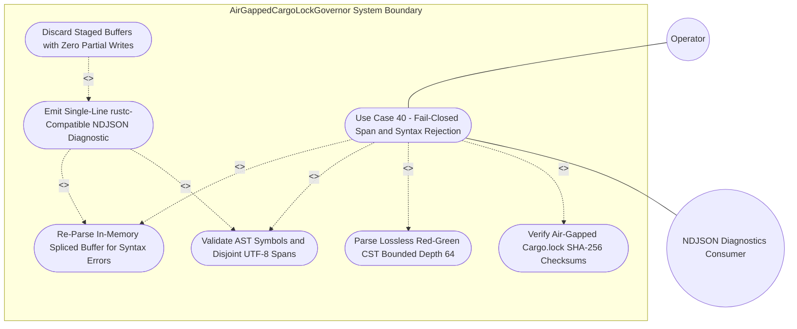

| Attribute | Specification Detail |
| :--- | :--- |
| **Issue ID** | TBD |
| **Title** | Use Case 40: Fail Closed Rejection on Span Collisions Missing Symbols or Post Splice Syntax Errors |
| **Type** | use-case |
| **Parent Epic** | [EPIC-08: BP 08 Lossless Rust CST Codemod Engine and Unified rustc Compatible JSON Diagnostics](../epics/EPIC-08-BP_08_Lossless_Rust_CST_Codemod_Engine_and_Unified_rustc_Compatible_JSON_Diagnostics.md) |
| **Schema Containers** | `BP_08_Lossless_Rust_CST_Codemod_Engine_and_Unified_rustc_Compatible_JSON_Diagnostics::UC_AC_03_Fail_Closed_Rejection_on_Span_Collisions_Missing_Symbols_or_Post_Splice_Syntax_Errors` |
| **Primary Actor** | Operator |
| **Scope** | AirGappedCargoLockGovernor |
| **Level** | User Goal |
| **Generation Mode** | subagent |
| **Specification Source** | [schema/model.sysml](../../schema/model.sysml) |

# Use Case 40: Fail Closed Rejection on Span Collisions Missing Symbols or Post Splice Syntax Errors

## Parent Epic
- [ ] **EPIC-08** - [BP 08 Lossless Rust CST Codemod Engine and Unified rustc Compatible JSON Diagnostics](../epics/EPIC-08-BP_08_Lossless_Rust_CST_Codemod_Engine_and_Unified_rustc_Compatible_JSON_Diagnostics.md) (governs **REQ-0608** lossless Red-Green CST byte-span splicing, fail-closed transaction rollback, and unified single-line `rustc`-compatible NDJSON diagnostics across all five workspace CLIs)

## UML Diagrams

## 1. Actors
- **Primary Actor:** `Operator` (invokes `compile-sysml --extract-rust-module`, `compile-sysml --compact-tier-bc`, or `--apply-machine-fixes --message-format=json` across the five unified workspace CLIs on `codemod_command_in` or `machine_fix_inout`).
- **Secondary Actors:**
  - `AirGappedCargoLockGovernor` (subject `part def` enforcing `offline_locked_enforced == true` and `vendor_bundle_supported == true` over `manifest_lock_in` and `lock_receipt_out`).
  - `LosslessRustCstAnalyzer` (`part def` in `crates/deap-core/src/source_ast.rs` constructing `ra_ap_syntax` and `rowan` lossless Red-Green syntax trees over `rust_source_in` and emitting `BTreeOrderedItemInventory` on `item_inventory_out`).
  - `ZeroTokenRustSpanCodemodEngine` (`part def` evaluating zero-LLM-token reverse-byte-order `SpanSpliceEdit` transactions over `codemod_command_in`, `atomic_patch_out`, and `codemod_error_out`).
  - `UnifiedRustcJsonDiagnosticEmitter` (`part def` in `crates/deap-core/src/diagnostics.rs` filtering `"MachineApplicable"` child spans on `machine_fix_inout` and serializing single-line `compiler-message` NDJSON frames on `ndjson_out` across `compile-sysml`, `verify-baseline`, `ingest-sysml`, `assemble-conops`, and `reconcile-backlog`).
  - `StructuredModularCodegenSynthesizer` (`part def` enforcing `skip_generated_tree == true` exclusion and Stage-1 to Stage-2 SHA-256 fixed-point identity **DEAP-E0705**).
  - `NDJSON Diagnostics Consumer` (automated CI gate or editor tooling consuming line-delimited `RustcNdjsonLineStream` output on standard output).

## 2. Preconditions
- `BP_08_Lossless_Rust_CST_Codemod_Engine_and_Unified_rustc_Compatible_JSON_Diagnostics_LifecycleState` resides in `Idle` with `AirGappedCargoLockGovernor` configured to `offline_locked_enforced == true` and `vendor_bundle_supported == true` against pinned workspace `Cargo.toml` and `Cargo.lock` 64-hex-digit SHA-256 package checksums.
- `ZeroTokenRustSpanCodemodEngine` enforces `runtime_llm_token_count == 0` (**C_CST_05**), `tier_bc_max_doc_lines == 2` (**C_CST_06**), `skip_generated_tree == true`, and `rewrite_check37_citations == true`.
- `UnifiedRustcJsonDiagnosticEmitter` enforces `cli_binary_count == 5`, `envelope_reason == "compiler-message"`, `zero_ansi_in_json_mode == true`, and `machine_applicable_only == true`.
- `LosslessRustCstAnalyzer` enforces `lossless_roundtrip_required == true`, `max_fn_exec_sloc <= 50` (**C_CST_01**, bounded within the workspace `<= 80` executable SLOC function ceiling), `max_fn_param_count <= 5` (**C_CST_02**), `max_mut_bool_flags == 0` (**C_CST_03**), `max_predicate_arity == 3`, and iterative CST traversal ceiling `MAX_AST_DEPTH = 64`.
- Target workspace `.rs` modules (such as `crates/deap-core/src/sysml_ast/mod.rs` or isolated temporary workspace fixtures), `docs/architecture/blueprints/`, and `README.md` exist in a clean baseline prior to receiving an `--extract-rust-module`, `--compact-tier-bc`, or `--apply-machine-fixes` request targeting overlapping `TextRange` intervals, a missing AST symbol identifier, or a syntax-invalid replacement payload (**AC-03**).

## 3. Trigger
- `Operator` submits an `--extract-rust-module`, `--compact-tier-bc`, or `--apply-machine-fixes --message-format=json` command carrying a candidate `SpanSpliceEdit` transaction to `ZeroTokenRustSpanCodemodEngine` (`codemod_command_in`) or `UnifiedRustcJsonDiagnosticEmitter` (`machine_fix_inout`) for fail-closed admissibility evaluation under **REQ-0608** (**Invariant_REQ_0608_SC_03**).

## 4. Main Success Scenario
1. `Operator` invokes `compile-sysml --extract-rust-module` or `--apply-machine-fixes --message-format=json` across one of the five unified workspace CLIs (`compile-sysml`, `verify-baseline`, `ingest-sysml`, `assemble-conops`, `reconcile-backlog`), delivering a `CstCodemodCommand` or `AtomicSpanFixTransaction` input under `AirGappedCargoLockGovernor` supervision.
2. `AirGappedCargoLockGovernor` executes `verifyOfflineLockedBuild` over `manifest_lock_in` (`CargoTomlAndLockfile` protocol), verifying `offline_locked_enforced == true` and 64-hex-digit SHA-256 `Cargo.lock` package digests before returning `reply_SupplyChainVerificationReceipt` to `LosslessRustCstAnalyzer`.
3. `LosslessRustCstAnalyzer` transitions from `Idle` to `ParsingLosslessCst` on `parseRustCst`, parses the target UTF-8 buffer on `rust_source_in` (`Utf8RustSourceBuffer`) into an immutable `ra_ap_syntax::SourceFile` and `rowan` Red-Green CST via an iterative worklist bounded by `MAX_AST_DEPTH = 64` nodes, confirms bit-for-bit root `GreenNode` byte equality (`lossless_roundtrip_required == true`), and transitions to `AnalyzingMetricsAndTiers` (`losslessRedGreenTreeReady`).
4. `ZeroTokenRustSpanCodemodEngine` dispatches `listRustItems` to `LosslessRustCstAnalyzer` and receives `reply_RustItemInventory` (`BTreeOrderedItemInventory` on `item_inventory_out`) ordered deterministically in a `BTreeMap` with leading `///` outer doc-comment trivia spans, outer item attributes, `cfg(test)` module and unit-test function exclusion flags, and UTF-8 `TextRange` byte offsets, advancing to `ValidatingDisjointSpans` (`planCodemodOrMachineFix`).
5. `ZeroTokenRustSpanCodemodEngine` or `UnifiedRustcJsonDiagnosticEmitter` validates the proposed `BTreeMap`-sorted `SpanSpliceEdit` set against **Invariant_REQ_0608_SC_03** using `.get(byte_start..byte_end)` slice bounds and `str::is_char_boundary` checks, verifying symbol presence, `"MachineApplicable"` applicability filtering (`machine_applicable_only == true`), and pairwise interval disjointness (`prev_byte_end <= next_byte_start`).
6. Upon detecting an unresolved AST item symbol (**DEAP-E0801**), an overlapping or mid-codepoint `TextRange` span collision (**DEAP-E0802**), or -- after staging reverse-byte-order replacements inside an in-memory buffer in `SplicingAndFormatting` -- a post-splice `ra_ap_syntax::SourceFile::parse` syntax error (`errors().len() > 0` errors, **DEAP-E0803**), the engine halts promotion prior to `RewritingCheck37Paths` and blocks all disk mutations.
7. `ZeroTokenRustSpanCodemodEngine` invokes `formatNdjsonLine` on `UnifiedRustcJsonDiagnosticEmitter` (`finding_in`, `DeapDiagnosticFinding`) and transitions to `EmittingJsonDiagnostics`, constructing a single-line `rustc`-compatible JSON object (`reason: "compiler-message"`, `message.code.code` in `{"DEAP-E0801", "DEAP-E0802", "DEAP-E0803"}`, 1-based line/column and UTF-8 `byte_start`/`byte_end` byte coordinates, `zero_ansi_in_json_mode == true`) verified free of `0x0A` newline bytes and `0x1B` ANSI escape bytes (**Invariant_REQ_0608_SC_04_REQ_0608**).
8. `UnifiedRustcJsonDiagnosticEmitter` flushes `reply_RustcNdjsonLineStream` to `ndjson_out` under an exclusive line-atomic stdout lock, drops all staged in-memory splice buffers with zero partial writes (`runtime_llm_token_count == 0` tokens), and terminates the CLI process fail-closed with exit code `1`.

## 5. Alternate and Exception Flows
5a. **Missing Target AST Symbol, Unbalanced Test-Scope Attribution, or Mid-Codepoint UTF-8 Boundary Rejection -- FM-BP08-006, FM-BP08-013, FM-BP08-017 (Failure Category Input-Boundary: Malformed Syntax and Boundary Guards) (Branches from Basic Flow step 5):**
  1. `ZeroTokenRustSpanCodemodEngine` or `UnifiedRustcJsonDiagnosticEmitter` queries the `BTreeMap`-keyed `BTreeOrderedItemInventory` (with `cfg(test)` conditional test modules, unit-test functions, `rt_loop` real-time loop annotations, and `self` / `&self` / `&mut self` receivers deterministically classified) and evaluates `.get(byte_start..byte_end)` plus `str::is_char_boundary`, detecting a non-existent AST item identifier, inverted range (`byte_start > byte_end`), out-of-bounds offset (`byte_end > len`), or path-traversing `--from` / `--to` argument (`..` or leading `/`).
  2. The engine instantiates typed domain error `CstCodemodError::MissingSymbolOrInvalidBoundary` mapped to **DEAP-E0801** (**SC-BP08-03**, **SC-BP08-06**, **SC-BP08-13**) and transitions from `ValidatingDisjointSpans` to `EmittingJsonDiagnostics` via `rejectSpanCollisionOrMissingSymbol`.
  3. `UnifiedRustcJsonDiagnosticEmitter` emits a single-line **DEAP-E0801** `compiler-message` NDJSON record on `ndjson_out`, preserves all workspace `.rs` files, `docs/architecture/blueprints/`, and `README.md` untouched, and exits fail-closed with exit status `1`.
5b. **Overlapping TextRange Span Collision or Non-MachineApplicable Suggestion Filtering -- FM-BP08-008, FM-BP08-014, FM-BP08-018 (Failure Category State-Ordering: Concurrency and Interval Monotonicity) (Branches from Basic Flow step 5):**
  1. While ordering candidate `SpanSpliceEdit` ranges in deterministic `BTreeMap` sequence prior to reverse-byte-order splicing, `ValidatingDisjointSpans` encounters either an overlapping interval pair (`prev_byte_end > next_byte_start`) violating `DisjointValid` (**Invariant_REQ_0608_SC_03**), a truncated leading `///` outer doc-comment attribute span, or mixed `"MaybeIncorrect"` child replacement spans during `--apply-machine-fixes`.
  2. `UnifiedRustcJsonDiagnosticEmitter` excludes all non-`"MachineApplicable"` suggestions (`machine_applicable_only == true`), and upon confirming any remaining `TextRange` overlap or trivia misalignment, raises typed error `CstCodemodError::OverlappingSpanCollision` (**DEAP-E0802**, **SC-BP08-08**, **SC-BP08-14**).
  3. Execution aborts prior to `SplicingAndFormatting`, flushes a single-line **DEAP-E0802** NDJSON diagnostic under an exclusive stdout lock, leaves on-disk files byte-identical, and exits with exit status `1`.
5c. **Post-Splice Lossless CST Syntax Error or Dropped Requirement Traceability Docline -- FM-BP08-005, FM-BP08-016, FM-BP08-020 (Failure Category Output-Integrity: Serialization and Zero-Partial-Write Guarantees) (Branches from Basic Flow step 6):**
  1. After applying reverse-byte-ordered replacements in memory during `SplicingAndFormatting`, `LosslessRustCstAnalyzer` re-parses the spliced UTF-8 buffer via `ra_ap_syntax::SourceFile::parse` and detects syntax errors (`errors().len() > 0` errors), a root `rowan` `GreenNode` byte-projection mismatch, mutated non-trivia executable tokens during `--compact-tier-bc`, or omission of a `/// Realises: [REQ-*]` line on `DocTier::RustTierBC` items (**C_CST_06**).
  2. `ZeroTokenRustSpanCodemodEngine` cancels atomic temp-and-rename persistence on `atomic_patch_out` and `machine_fix_inout`, discards all uncommitted staging buffers before `RewritingCheck37Paths`, and transitions to `EmittingJsonDiagnostics` via `rejectPostSpliceSyntaxError` with typed error **DEAP-E0803** (**SC-BP08-05**, **SC-BP08-16**).
  3. `UnifiedRustcJsonDiagnosticEmitter` asserts `0` embedded newline bytes and `0` ANSI escape bytes in the serialized record, writes the single-line **DEAP-E0803** NDJSON diagnostic citing the post-splice offending `TextRange`, and returns exit status `1` with `0` partial disk writes.
5d. **Air-Gapped Cargo.lock Checksum Drift or Unlocked Supply-Chain Precondition Breach -- FM-BP08-001, FM-BP08-002, FM-BP08-004 (Failure Category Input-Boundary and State-Ordering: Supply-Chain Lock Verification) (Branches from Basic Flow step 2):**
  1. During `verifyOfflineLockedBuild`, `AirGappedCargoLockGovernor` detects `offline_locked_enforced == false`, malformed `Cargo.toml` or `Cargo.lock` syntax on `manifest_lock_in`, unpinned wildcard or git dependencies, truncated non-hex SHA-256 package checksums, or concurrent lockfile drift against `--offline --locked`.
  2. `AirGappedCargoLockGovernor` blocks emission of `reply_SupplyChainVerificationReceipt` on `lock_receipt_out`, preventing entry into `ParsingLosslessCst`, and raises typed error `CstCodemodError::SupplyChainLockViolation` (**DEAP-E0804**, **SC-BP08-01**, **SC-BP08-02**, **SC-BP08-04**).
  3. `UnifiedRustcJsonDiagnosticEmitter` emits a single-line zero-ANSI **DEAP-E0804** `compiler-message` NDJSON object and terminates fail-closed with exit status `1` before reading or splicing workspace Rust sources.
5e. **CST Traversal Depth Ceiling Breach or Checked Span Arithmetic Exhaustion -- FM-BP08-003, FM-BP08-007, FM-BP08-015, FM-BP08-019 (Failure Category Resource-Depth: Arithmetic and Stack-Bound Protection) (Branches from Basic Flow step 3):**
  1. During iterative `ra_ap_syntax` and `rowan` syntax-node traversal, `O(log N)` line-table binary search, or reverse-splice capacity calculation, the analyzer detects AST nesting exceeding `MAX_AST_DEPTH = 64` nodes, cyclic directory symlinks, or checked arithmetic overflow/underflow (`checked_add` / `checked_sub` returning `None`, while `saturating_add` / `saturating_sub` bounds diagnostic summary counters).
  2. `LosslessRustCstAnalyzer` or `ZeroTokenRustSpanCodemodEngine` aborts traversal immediately without recursive call-stack overflow or integer wraparound, raising typed error `CstCodemodError::ResourceOrDepthExhausted` (**DEAP-E0804**, **SC-BP08-07**, **SC-BP08-15**).
  3. Execution transitions directly to `EmittingJsonDiagnostics`, emits a single-line **DEAP-E0804** NDJSON diagnostic frame, frees all in-memory buffers, and terminates with exit status `1`.
5f. **Protected Self-Hosted Generated Subtree Isolation or Stage-1/Stage-2 Fixed-Point Drift -- FM-BP08-009, FM-BP08-010, FM-BP08-011, FM-BP08-012 (Failure Category State-Ordering and Output-Integrity: Metacircular Fixed-Point Guard) (Branches from Basic Flow step 4):**
  1. When `--compact-tier-bc` traverses workspace directories, `ZeroTokenRustSpanCodemodEngine` enforces `skip_generated_tree == true` to skip `crates/compile-sysml/src/modular_codegen/` generated Stage-1 files; if `StructuredModularCodegenSynthesizer` subsequently evaluates `verifyStageFixedPoint` in `VerifyingSelfHostFixedPoint` (bounded by `MAX_AST_DEPTH = 64` nodes across `quote`, `syn::parse2`, and `prettyplease::unparse`) and observes `stage_fixed_point_mismatch_files > 0` files (**C_CST_04**), it fires `rejectFixedPointDriftE0705`.
  2. `StructuredModularCodegenSynthesizer` discards staged `PrettypleaseRustUnit` buffers before committing to `formatted_rust_out` and transitions to `EmittingJsonDiagnostics` with typed error **DEAP-E0705** (**SC-BP08-09**, **SC-BP08-10**, **SC-BP08-11**, **SC-BP08-12**).
  3. `UnifiedRustcJsonDiagnosticEmitter` serializes a single-line zero-ANSI **DEAP-E0705** `compiler-message` NDJSON diagnostic and exits fail-closed with exit status `1`.

## 6. Postconditions
- **Success Guarantee (Deterministic Fail-Closed Rejection):** Execution terminates with exit status `1`; `UnifiedRustcJsonDiagnosticEmitter` emits single-line `rustc`-compatible NDJSON diagnostic objects (`reason: "compiler-message"`, `code.code` in `{"DEAP-E0801", "DEAP-E0802", "DEAP-E0803", "DEAP-E0804", "DEAP-E0705"}`) containing exact UTF-8 `byte_start`/`byte_end` byte coordinates and `0` embedded newline or ANSI escape bytes; `runtime_llm_token_count == 0` tokens (**C_CST_05**) holds; and all workspace `.rs` sources, `docs/architecture/blueprints/`, and `README.md` remain bit-for-bit unchanged.
- **Failure Guarantee (Atomic Staging Rollback Guarantee):** Under any mid-transaction syntax failure, I/O interruption, or resource bound breach, `0` partial file writes or incomplete Check-37 citation rewrites reach persistent disk storage; isolated temporary staging buffers are discarded cleanly and the process exits with exit status `1`.

## 7. Operational Context
Use Case 40 (**UC_AC_03_Fail_Closed_Rejection_on_Span_Collisions_Missing_Symbols_or_Post_Splice_Syntax_Errors**) realizes **REQ-0608** (**BP-08** / `DEAP-BP-DET-08`) across `crates/deap-core/src/source_ast.rs`, `crates/deap-core/src/diagnostics.rs`, `crates/deap-core/src/error.rs`, `crates/deap-core/src/sysml_ast/mod.rs`, `crates/compile-sysml/src/cli.rs`, `crates/compile-sysml/src/driver.rs`, and `crates/verify-baseline/src/runner.rs`. In deterministic air-gapped DO-178C Level A and DO-330 TQL-4 compiler pipelines, automated Rust module extraction (`--extract-rust-module`), Tier B/C docstring compaction (`--compact-tier-bc`), and machine-applicable diagnostic auto-fixes (`--apply-machine-fixes`) operate purely over lossless `ra_ap_syntax` and `rowan` Red-Green concrete syntax trees without consuming runtime LLM tokens, guaranteeing atomic fail-closed rejection whenever spans collide, symbols are absent, or post-splice buffers fail lossless CST re-parsing.

### Mathematical Formulations & Safety Invariants
$$
\begin{aligned}
D_{\text{disjoint}}(S, E) &\iff \forall i \in \{1, \dots, m\}, \quad 0 \le a_i \le b_i \le L_S \land B_{\text{utf8}}(S, a_i) \land B_{\text{utf8}}(S, b_i) \\
O_{\text{monotone}}(E) &\iff \forall i \in \{1, \dots, m - 1\}, \quad b_i \le a_{i+1} \\
A_{\text{commit}}(S, E) &\iff D_{\text{disjoint}}(S, E) \land O_{\text{monotone}}(E) \land N_{\text{err}}(P_{\text{cst}}(S_{\text{splice}}(S, E))) = 0 \\
C_{\text{ndjson}}(d_j) &\iff N_{\text{lf}}(d_j) = 0 \land N_{\text{esc}}(d_j) = 0 \land K_{\text{llm}} = 0
\end{aligned}
$$

- Parameter Definitions & Engineering Units:
- $S$: Input UTF-8 Rust compilation unit byte buffer ingested on `rust_source_in` (unit: bytes).
- $L_S$: Total byte length of input source buffer $S$ verified via lossless root `rowan` `GreenNode` round-trip projection (unit: bytes).
- $E$: Ordered sequence of $m$ candidate `SpanSpliceEdit` intervals $(a_i, b_i, r_i)$ keyed in deterministic `BTreeMap` order (unit: edit spans).
- $a_i, b_i$: Zero-based inclusive start and exclusive end offsets (`byte_start`, `byte_end`) of edit $i$ within $S$ (unit: bytes).
- $B_{\text{utf8}}(S, x)$: Boolean UTF-8 codepoint boundary predicate (`str::is_char_boundary`) at byte offset $x$ (dimensionless boolean).
- $D_{\text{disjoint}}(S, E)$ and $O_{\text{monotone}}(E)$: Bounded UTF-8 range validity and pairwise non-overlapping monotonicity predicates; violation raises **DEAP-E0801** or **DEAP-E0802** (dimensionless boolean).
- $S_{\text{splice}}(S, E)$: In-memory candidate UTF-8 buffer produced by applying edits $i = m, \dots, 1$ strictly in reverse byte order in $O(N + M \log M)$ time and $O(N + M)$ space (unit: bytes).
- $P_{\text{cst}}(\cdot)$ and $N_{\text{err}}(\cdot)$: Lossless `ra_ap_syntax::SourceFile::parse` operator (bounded to `MAX_AST_DEPTH = 64` nodes) and resulting syntax error cardinality; $N_{\text{err}} > 0$ raises **DEAP-E0803** with `0` disk writes (unit: syntax errors).
- $A_{\text{commit}}(S, E)$: Necessary and sufficient admissibility predicate gating atomic temp-and-rename persistence on `atomic_patch_out` and `machine_fix_inout` (dimensionless boolean).
- $d_j$, $N_{\text{lf}}(d_j)$, $N_{\text{esc}}(d_j)$: Serialized `compiler-message` NDJSON diagnostic line and embedded raw line-feed byte count (`0` bytes) and ANSI escape byte count (`0` bytes) emitted on `ndjson_out` (unit: bytes).
- $K_{\text{llm}}$: Runtime LLM token consumption across CST inspection, splicing, and diagnostic serialization, constrained to exactly `0` tokens per **C_CST_05** (unit: tokens).

### 3-Layer Definition of Done
1. **Layer 1 -- Domain State & Data Model (`crates/deap-core/src/source_ast.rs`, `crates/deap-core/src/diagnostics.rs`, `crates/deap-core/src/error.rs`, `crates/deap-core/src/sysml_ast/mod.rs`):** Enforces `#![forbid(unsafe_code)]` across pure domain modules; models all codemod and diagnostic rejection states with exhaustive typed Rust enums (`CstCodemodError`, `DeapDiagnosticCode` covering `DEAP-E0801`..`DEAP-E0804` and `DEAP-E0705`, `SuggestionApplicability`, and `DocTier`) with zero `Result<T, String>` signatures; and stores all AST item inventories, `SpanSpliceEdit` schedules, `cfg(test)` module and unit-test exclusion spans, and Check-37 rewrite mappings in deterministic `BTreeMap` and `BTreeSet` structures.
2. **Layer 2 -- Logic & State Management (`crates/deap-core/src/source_ast.rs`, `crates/compile-sysml/src/driver.rs`, `crates/verify-baseline/src/runner.rs`):** Implements total, non-panicking transition functions obeying `<= 50` executable SLOC per Blueprint-08 function (**C_CST_01**) within the workspace `<= 80` executable SLOC ceiling, `<= 5` parameters excluding `self` / `&self` / `&mut self` (**C_CST_02**), and `0` mutable local boolean flags (**C_CST_03**); bounds iterative CST walks to `MAX_AST_DEPTH = 64` nodes; accesses source slices exclusively via `.get(byte_start..byte_end)` and `str::is_char_boundary`; computes span offsets with `checked_add` / `checked_sub` and `saturating_add` / `saturating_sub` diagnostic counters; applies `"MachineApplicable"` edits in reverse byte order; re-parses spliced buffers in memory (`errors().len() == 0` errors); and commits multi-file updates solely via atomic temp-file rename (`runtime_llm_token_count == 0` tokens).
3. **Layer 3 -- Presentation & Actuator / CLI `--message-format=json` NDJSON Interface Binding (`crates/compile-sysml/src/cli.rs`, `crates/verify-baseline/src/runner.rs`, `crates/deap-core/src/diagnostics.rs`):** Binds `--extract-rust-module`, `--compact-tier-bc`, `--apply-machine-fixes`, and `--message-format=json` across all five workspace CLI binaries (`compile-sysml`, `verify-baseline`, `ingest-sysml`, `assemble-conops`, `reconcile-backlog`) to emit line-atomic single-line `rustc`-compatible `compiler-message` NDJSON objects (`0` embedded line-feed bytes and `0` ANSI escape bytes) to stdout and terminate fail-closed with exit code `1` on any span collision, missing symbol, lockfile breach, or post-splice syntax error.

## 8. Realization Matrix

| Trace Layer | Specification ID | Artifact / Symbol | Realization & Verification Role |
| :--- | :--- | :--- | :--- |
| **Use Case** | **UC-40** | `UC_AC_03_Fail_Closed_Rejection_on_Span_Collisions_Missing_Symbols_or_Post_Splice_Syntax_Errors` | System-level fail-closed rejection and zero-partial-write guarantee (`UC-40 -> US-53/US-55 -> FEAT-45/FEAT-44 -> EPIC-08 -> TEST-BP08-AC03-*`, **AC-03**). |
| **User Story** | **US-53** | [User Story 53: extractRustModule](../user-stories/US-53-extractRustModule.md) | Realizes `extractRustModule` reverse-span CST splicing, missing-item (**DEAP-E0801**), overlap (**DEAP-E0802**), and post-splice reparse (**DEAP-E0803**) guards. |
| **User Story** | **US-55** | [User Story 55: formatNdjsonLine](../user-stories/US-55-formatNdjsonLine.md) | Realizes `formatNdjsonLine` single-line `compiler-message` NDJSON serialization and `"MachineApplicable"` auto-fix span filtering. |
| **User Story** | **US-52** | [User Story 52: listRustItems](../user-stories/US-52-listRustItems.md) | Supplies deterministic `BTreeMap`-ordered `BTreeOrderedItemInventory` with outer `///` doc-comment spans and `cfg(test)` exclusion. |
| **User Story** | **US-51** | [User Story 51: verifyOfflineLockedBuild](../user-stories/US-51-verifyOfflineLockedBuild.md) | Supplies air-gapped `--offline --locked` `Cargo.lock` SHA-256 supply-chain precondition (**DEAP-E0804**). |
| **Feature** | **FEAT-45** | [Feature 45: ZeroTokenRustSpanCodemodEngine](../features/FEAT-45-ZeroTokenRustSpanCodemodEngine.md) | Owns zero-token CST span validation, reverse-byte-order splicing, atomic staging rollback, and Check-37 path rewriting. |
| **Feature** | **FEAT-44** | [Feature 44: UnifiedRustcJsonDiagnosticEmitter](../features/FEAT-44-UnifiedRustcJsonDiagnosticEmitter.md) | Owns 5-CLI `--message-format=json` NDJSON emission (`0` embedded newline/ANSI bytes) and `--apply-machine-fixes` transaction filtering. |
| **Feature** | **FEAT-42** | [Feature 42: LosslessRustCstAnalyzer](../features/FEAT-42-LosslessRustCstAnalyzer.md) | Owns lossless `ra_ap_syntax` + `rowan` Red-Green CST construction (`MAX_AST_DEPTH = 64` nodes) and post-splice zero-error re-verification. |
| **Feature** | **FEAT-41** | [Feature 41: AirGappedCargoLockGovernor](../features/FEAT-41-AirGappedCargoLockGovernor.md) | Owns subject `AirGappedCargoLockGovernor` offline lockfile verification gating all CST codemod invocations. |
| **Epic** | **EPIC-08** | [Epic 08: BP 08 Lossless Rust CST Codemod Engine and Unified rustc Compatible JSON Diagnostics](../epics/EPIC-08-BP_08_Lossless_Rust_CST_Codemod_Engine_and_Unified_rustc_Compatible_JSON_Diagnostics.md) | Parent architectural epic governing **REQ-0608** (`BP-08` / `DEAP-BP-DET-08`). |
| **Test Suite** | **TEST-BP08-AC03-01** | `fn test_codemod_rejects_missing_symbol_and_mid_utf8_span_e0801` (`crates/deap-core/src/source_ast.rs`) | Verifies **DEAP-E0801** exit code `1`, single-line NDJSON emission, and untouched disk fixtures on missing AST symbol or non-UTF-8 boundary. |
| **Test Suite** | **TEST-BP08-AC03-02** | `fn test_reverse_splice_rejects_overlapping_spans_and_filters_maybe_incorrect_e0802` (`crates/deap-core/src/diagnostics.rs`) | Verifies **DEAP-E0802** rejection on colliding `TextRange` pairs and strict `"MachineApplicable"` filtering. |
| **Test Suite** | **TEST-BP08-AC03-03** | `fn test_post_splice_syntax_error_aborts_atomically_with_zero_partial_writes_e0803` (`crates/deap-core/src/source_ast.rs`) | Verifies **DEAP-E0803** atomic rollback when an injected replacement introduces a `SourceFile::parse` syntax error. |
| **Test Suite** | **TEST-BP08-AC03-04** | `fn test_cst_depth_64_and_offline_lock_fail_closed_single_line_ndjson_e0804` (`crates/verify-baseline/src/runner.rs`) | Verifies **DEAP-E0804** fail-closed single-line NDJSON emission on `MAX_AST_DEPTH = 64` node breach or unlocked `Cargo.lock` drift. |

- [ ] **US-53** - [User Story 53: extractRustModule](../user-stories/US-53-extractRustModule.md) (executes reverse-byte-order CST span extraction and triggers fail-closed **DEAP-E0801**, **DEAP-E0802**, and **DEAP-E0803** aborts on missing symbols, span collisions, or post-splice syntax errors)
- [ ] **US-55** - [User Story 55: formatNdjsonLine](../user-stories/US-55-formatNdjsonLine.md) (serializes single-line `rustc`-compatible `compiler-message` NDJSON diagnostics free of embedded newline and ANSI escape bytes and enforces `"MachineApplicable"` auto-fix span filtering)
- [ ] **US-52** - [User Story 52: listRustItems](../user-stories/US-52-listRustItems.md) (constructs deterministic `BTreeMap`-ordered AST item and docblock `TextRange` inventories consumed during `ValidatingDisjointSpans`)
- [ ] **US-51** - [User Story 51: verifyOfflineLockedBuild](../user-stories/US-51-verifyOfflineLockedBuild.md) (enforces air-gapped `--offline --locked` `Cargo.lock` SHA-256 verification prior to CST parsing)
- [ ] **FEAT-45** - [Feature 45: ZeroTokenRustSpanCodemodEngine](../features/FEAT-45-ZeroTokenRustSpanCodemodEngine.md) (provides zero-LLM-token disjoint `TextRange` validation, reverse-order splicing, `skip_generated_tree` isolation, and atomic temp-and-rename rollback)
- [ ] **FEAT-44** - [Feature 44: UnifiedRustcJsonDiagnosticEmitter](../features/FEAT-44-UnifiedRustcJsonDiagnosticEmitter.md) (provides unified `--message-format=json` NDJSON serialization and `--apply-machine-fixes` atomic span fix transactions across all five CLIs)
- [ ] **FEAT-42** - [Feature 42: LosslessRustCstAnalyzer](../features/FEAT-42-LosslessRustCstAnalyzer.md) (provides lossless `ra_ap_syntax` and `rowan` Red-Green CST parsing and post-splice zero-error syntax verification)
- [ ] **FEAT-41** - [Feature 41: AirGappedCargoLockGovernor](../features/FEAT-41-AirGappedCargoLockGovernor.md) (provides subject boundary supply-chain lockfile governance for reproducible offline execution)

## Source References
Use case operational flows and lifecycle activity references:
- System Architecture Model: `schema/model.sysml` ([schema/model.sysml](../../schema/model.sysml))
- Engineering Blueprint Metamodel: `docs/designs/blueprint-08-rust-analyzer-cst-refactoring-and-json-diagnostics.sysml` (**REQ-0608**, **Invariant_REQ_0608_SC_01** through **Invariant_REQ_0608_SC_04_REQ_0608**)
- Component Failure Mode Registry: `.pipeline/upstream/docs/research/FAILURE_MODE_REGISTRY.md` (`FM-BP08-001` through `FM-BP08-020`)
- Target Implementation Modules: `crates/deap-core/src/source_ast.rs`, `crates/deap-core/src/diagnostics.rs`, `crates/deap-core/src/error.rs`, `crates/deap-core/src/sysml_ast/mod.rs`, `crates/compile-sysml/src/cli.rs`, `crates/compile-sysml/src/driver.rs`, `crates/verify-baseline/src/runner.rs`
- Normative Systems Engineering Standards: ISO/IEC/IEEE 29148:2018 Section 6.4.2 Concept of Operations; RFC 2119; DO-178C Level A; DO-330 TQL-4; ISO 26262 ASIL D; ECSS-E-ST-40C

Operational use case realization and traceability links derive from `schema/model.sysml` pursuant to ISO/IEC/IEEE 29148.

