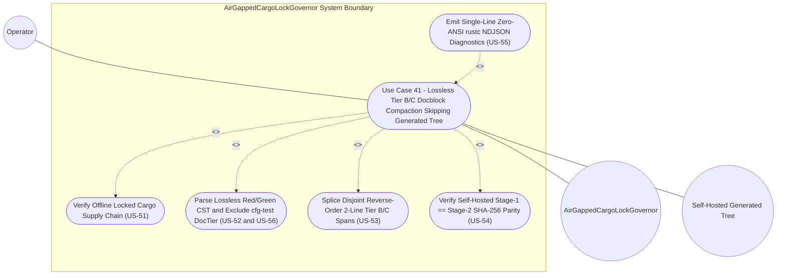

| Attribute | Specification Detail |
| :--- | :--- |
| **Issue ID** | TBD |
| **Title** | Use Case 41: Lossless Tier B C Docblock Compaction Skipping Self Hosted Generated Modules |
| **Type** | use-case |
| **Parent Epic** | [EPIC-08: BP 08 Lossless Rust CST Codemod Engine and Unified rustc Compatible JSON Diagnostics](../epics/EPIC-08-BP_08_Lossless_Rust_CST_Codemod_Engine_and_Unified_rustc_Compatible_JSON_Diagnostics.md) |
| **Primary Actor** | Operator |
| **Scope** | AirGappedCargoLockGovernor |
| **Schema Containers** | `BP_08_Lossless_Rust_CST_Codemod_Engine_and_Unified_rustc_Compatible_JSON_Diagnostics::UC_AC_04_Lossless_Tier_B_C_Docblock_Compaction_Skipping_Self_Hosted_Generated_Modules` |
| **Level** | User Goal |
| **Generation Mode** | subagent |
| **Specification Source** | [schema/model.sysml](../../schema/model.sysml) |

# Use Case 41: Lossless Tier B C Docblock Compaction Skipping Self Hosted Generated Modules

## Parent Epic
- [ ] **EPIC-08** - [BP 08 Lossless Rust CST Codemod Engine and Unified rustc Compatible JSON Diagnostics](../epics/EPIC-08-BP_08_Lossless_Rust_CST_Codemod_Engine_and_Unified_rustc_Compatible_JSON_Diagnostics.md) (governs zero-token lossless `ra_ap_syntax` and `rowan` CST Tier B/C docstring compaction under **REQ-0608** while preserving **REQ-0607** Stage-1 to Stage-2 self-hosted fixed-point parity)

## UML Diagrams

### Use Case Diagram

## 1. Actors
- **Primary Actor:** `Operator` (invokes deterministic `compile-sysml --compact-tier-bc <DIR>` CLI workflows across workspace Rust crates with optional `--message-format=json` diagnostic streaming)
- **Secondary Actors:**
  - `AirGappedCargoLockGovernor` (`manifest_lock_in` / `lock_receipt_out` supply-chain gate enforcing `--offline --locked` `Cargo.lock` SHA-256 integrity prior to codemod execution)
  - `LosslessRustCstAnalyzer` (`rust_source_in` / `item_inventory_out` / `metrics_report_out` Red/Green `ra_ap_syntax` and `rowan` CST engine classifying `cfg(test)`-attribute-excluded `DocTier::RustTierA` and `DocTier::RustTierBC` items)
  - `ZeroTokenRustSpanCodemodEngine` (`codemod_command_in` / `atomic_patch_out` / `codemod_error_out` deterministic byte-span splicer enforcing `runtime_llm_token_count == 0`, `tier_bc_max_doc_lines == 2`, and `skip_generated_tree == true`)
  - `StructuredModularCodegenSynthesizer` (`lowered_ir_in` / `formatted_rust_out` Stage-1/Stage-2 SHA-256 fixed-point verifier safeguarding `crates/compile-sysml/src/modular_codegen/generated/`)
  - `UnifiedRustcJsonDiagnosticEmitter` (`finding_in` / `ndjson_out` / `machine_fix_inout` single-line `rustc`-compatible NDJSON emitter)

## 2. Preconditions
- Workspace `Cargo.toml` and `Cargo.lock` dependency manifests are pinned with 64-hex SHA-256 package checksums verified by `AirGappedCargoLockGovernor` under `offline_locked_enforced == true` and `vendor_bundle_supported == true` (**SC-BP08-01**).
- The target workspace directory `<DIR>` is a canonicalized workspace-relative Rust source tree containing: (a) `DocTier::RustTierA` public API items and `//!` module headers carrying 7-section DO-178C safety docstrings, (b) `DocTier::RustTierBC` private and `pub(crate)` items carrying legacy 28-line 7-section outer `///` docblocks with `Realises: [REQ-*]` bindings, (c) inline `cfg(test)` attribute modules and `test` attribute unit-test functions, and (d) the self-hosted Stage-1 codegen subtree `crates/compile-sysml/src/modular_codegen/generated/`.
- `BP_08_Lossless_Rust_CST_Codemod_Engine_and_Unified_rustc_Compatible_JSON_Diagnostics_LifecycleState` resides in `Idle` with `runtime_llm_token_count == 0` (**C-CST-05**), `tier_bc_max_doc_lines == 2` (**C-CST-06**), `skip_generated_tree == true`, and `stage_fixed_point_mismatch_files == 0` (**C-CST-04** / **C-MOD-04**).

## 3. Trigger
- `Operator` executes `compile-sysml --compact-tier-bc <DIR>` (with or without `--message-format=json`) on `ZeroTokenRustSpanCodemodEngine::codemod_command_in` (`CstCodemodCommand` protocol).

## 4. Main Success Scenario
1. `Operator` dispatches `compile-sysml --compact-tier-bc <DIR>` to `ZeroTokenRustSpanCodemodEngine` via `codemod_command_in` (`crates/compile-sysml/src/cli.rs`), initiating preflight validation under `AirGappedCargoLockGovernor`.
2. `AirGappedCargoLockGovernor` executes `verifyOfflineLockedBuild` on `manifest_lock_in` (`CargoTomlAndLockfile` protocol), validates pinned `Cargo.toml` and `Cargo.lock` SHA-256 package checksums under `--offline --locked`, and emits `reply_SupplyChainVerificationReceipt` on `lock_receipt_out` (**SC-BP08-01**, **SC-BP08-02**).
3. `ZeroTokenRustSpanCodemodEngine` enumerates `.rs` compilation units under `<DIR>` in deterministic `BTreeSet` lexical path order with `runtime_llm_token_count == 0` (**C-CST-05**) and `skip_generated_tree == true`, unconditionally skipping `crates/compile-sysml/src/modular_codegen/generated/` so all Stage-1 generated units retain their Check-36 7-section DO-178C `///` and `doc`-attribute headers (**SC-BP08-10**, **SC-BP07-34**).
4. For each non-generated `.rs` file, `LosslessRustCstAnalyzer` transitions from `Idle` to `ParsingLosslessCst` (`parseRustCst`), parses `rust_source_in` (`Utf8RustSourceBuffer`) into an immutable `ra_ap_syntax` and `rowan` Red/Green syntax tree via iterative worklist descent capped at `MAX_AST_DEPTH = 64` (**SC-BP08-07**), and confirms zero syntax errors plus bit-for-bit root `GreenNode` byte equality against the input buffer (**Invariant_REQ_0608_SC_01**).
5. `LosslessRustCstAnalyzer` transitions to `AnalyzingMetricsAndTiers` (`losslessRedGreenTreeReady` in `crates/deap-core/src/source_ast.rs`), excludes subtree-scoped `cfg(test)` attribute modules and `test` attribute functions from production `DocTier` and `production_exec_sloc` accounting (**SC-BP08-06**, **SC-BP07-02**), marks `DocTier::RustTierA` public items and `//!` inner module docblocks as read-only 7-section contracts, and emits a `BTreeMap`-ordered `reply_RustItemInventory` on `item_inventory_out` (`BTreeOrderedItemInventory`) identifying every `DocTier::RustTierBC` private or `pub(crate)` item carrying a legacy multi-line docblock.
6. `ZeroTokenRustSpanCodemodEngine` transitions to `ValidatingDisjointSpans` (`planCodemodOrMachineFix` in `crates/compile-sysml/src/docstring.rs`), extracts the primary summary sentence and all `Realises: [REQ-*]` requirement anchors from each legacy 28-line `DocTier::RustTierBC` outer docblock `TextRange` without disturbing adjacent outer attributes (such as `must_use` or `rt_loop` item attributes), constructs 2-line `/// 
` + `/// Realises: [REQ-*]` `SpanSpliceEdit` payloads (`tier_bc_max_doc_lines == 2`, **C-CST-06**), and verifies pairwise-disjoint UTF-8 character-boundary spans (`0 <= a_i <= b_i <= len` and `b_i <= a_{i+1}`, **Invariant_REQ_0608_SC_03**).
7. `ZeroTokenRustSpanCodemodEngine` transitions through `SplicingAndFormatting` and `RewritingCheck37Paths` (`crates/compile-sysml/src/driver.rs`), applies `SpanSpliceEdit` replacements in reverse byte order using `.get(...)` slice indexing and checked/saturating offset arithmetic, re-parses each post-splice buffer via `ra_ap_syntax::SourceFile::parse` to verify zero syntax errors and 100% unchanged non-trivia executable tokens, preserves Check-37 path citations across `docs/architecture/blueprints/` and `README.md`, and commits updated `.rs` files atomically via temp-file rename on `atomic_patch_out` (`AtomicWorkspacePatch`, **SC-BP08-03**).
8. `StructuredModularCodegenSynthesizer` transitions to `VerifyingSelfHostFixedPoint` (`atomicFilesCommitted` -> `verifyStageFixedPoint` in `crates/compile-sysml/src/modular_codegen/mod.rs`), verifies that `crates/compile-sysml/src/modular_codegen/generated/` matches Stage-2 re-emission bit-for-bit (`stage_fixed_point_mismatch_files == 0`, **C-CST-04** / **C-MOD-04**), transitions to `VerifiedClean`, and returns exit code `0` to `Operator` (streaming single-line zero-ANSI `compiler-message` NDJSON summary frames via `UnifiedRustcJsonDiagnosticEmitter` when `--message-format=json` is active).

## 5. Alternate and Exception Flows
- 5a. **Unlocked Cargo Supply Chain, Path Traversal, or Non-UTF-8 / Malformed Rust Syntax Input (Branches from Main Success Scenario steps 2 and 4 -- Failure Category Input/Boundary & Malformed Syntax; `FM-BP08-001`, `FM-BP08-005`, `FM-BP08-017`, `FM-BP07-001`):**
  1. `AirGappedCargoLockGovernor` detects `Cargo.toml` / `Cargo.lock` checksum drift (`offline_locked_enforced == true`), `ZeroTokenRustSpanCodemodEngine` rejects a `<DIR>` argument containing `..` parent traversal, leading `/`, or NUL bytes, or `LosslessRustCstAnalyzer` detects invalid UTF-8 bytes, pre-existing `ra_ap_syntax::SourceFile::parse` errors, or root `rowan` `GreenNode` round-trip divergence on `rust_source_in`.
  2. Execution short-circuits directly to `EmittingJsonDiagnostics` prior to `ValidatingDisjointSpans`, constructing a typed `DeapDiagnosticFinding` (**DEAP-E0804** for lockfile/path boundary violations or **DEAP-E0803** for malformed CST input) in `crates/deap-core/src/diagnostics.rs`.
  3. `UnifiedRustcJsonDiagnosticEmitter` emits a single-line zero-ANSI (`0x0A`-free, `0x1B`-free) `compiler-message` NDJSON record on `ndjson_out` and exits fail-closed with status `1` and zero filesystem writes (**SC-BP08-01**, **SC-BP08-05**).

- 5b. **Self-Hosted Generated Tree Compaction-Skip Enforcement and Stage-1/Stage-2 Fixed-Point Drift Trap (Branches from Main Success Scenario steps 3 and 8 -- Failure Category State/Concurrency & Ordering; `FM-BP08-010`, `FM-BP08-012`, `FM-BP08-018`, `FM-BP07-018`, `FM-BP07-034`, `FM-BP07-036`):**
  1. When `<DIR>` encompasses `crates/compile-sysml/src/modular_codegen/generated/` (or targets it directly), `ZeroTokenRustSpanCodemodEngine` enforces `skip_generated_tree == true` and skips every Stage-1 generated file so its Check-36 7-section DO-178C safety docstrings (`enforce_seven_section_docs == true`) remain intact for metacircular bootstrap verification.
  2. If `skip_generated_tree == false` configuration tampering or external concurrent mutation alters any file under `crates/compile-sysml/src/modular_codegen/generated/` such that `verifyStageFixedPoint` computes `stage_fixed_point_mismatch_files > 0` (`SHA-256(Stage 1) != SHA-256(Stage 2)`, violating **C-CST-04** and **C-MOD-04**), `StructuredModularCodegenSynthesizer` fires `rejectFixedPointDriftE0705` and transitions to `EmittingJsonDiagnostics`.
  3. `ZeroTokenRustSpanCodemodEngine` aborts uncommitted staging buffers, `UnifiedRustcJsonDiagnosticEmitter` emits single-line **DEAP-E0705** NDJSON diagnostics detailing the mismatched Stage-1/Stage-2 path digests, and `compile-sysml` terminates fail-closed with exit code `1` (**SC-BP08-10**, **SC-BP08-12**, **SC-BP07-36**).

- 5c. **Subtree-Scoped `cfg(test)` / `test` Attribute Exclusion and `DocTier::RustTierA` Preservation Guard (Branches from Main Success Scenario step 5 -- Failure Category State/Concurrency & Ordering; `FM-BP08-006`, `FM-BP08-008`, `FM-BP07-002`, `FM-BP07-010`):**
  1. During `AnalyzingMetricsAndTiers`, `LosslessRustCstAnalyzer` inspects AST items inside `cfg(test)` attribute modules, standalone `test` attribute functions, and `DocTier::RustTierA` `pub` items adjacent to `DocTier::RustTierBC` private or `pub(crate)` items.
  2. `LosslessRustCstAnalyzer` excludes all `cfg(test)` and `test` attribute subtrees from `DocTier` compaction planning and `production_exec_sloc` metrics (preventing test helpers from distorting `< 380` / `500` module SLOC ceilings or `DocTier` rules) while preserving full 7-section docstrings on `DocTier::RustTierA` public items.
  3. If malformed attribute tokens or unbalanced module braces induce `cfg(test)` lexical scope leakage across production items, `LosslessRustCstAnalyzer` aborts item inventory emission with **DEAP-E0801**, transitions to `EmittingJsonDiagnostics`, and leaves all workspace files untouched (**SC-BP08-06**, **SC-BP07-02**).

- 5d. **Overlapping `TextRange` Span Collision, Mid-Codepoint Boundary, or Missing `Realises: [REQ-*]` Binding (Branches from Main Success Scenario step 6 -- Failure Category Span Boundary & Ordering; `FM-BP08-013`, `FM-BP08-014`, `FM-BP08-017`, `FM-BP08-018`):**
  1. In `ValidatingDisjointSpans`, `ZeroTokenRustSpanCodemodEngine` detects overlapping `TextRange` intervals (`b_i > a_{i+1}`), a byte offset failing `str::is_char_boundary`, or a legacy `DocTier::RustTierBC` docblock lacking a valid `Realises: [REQ-*]` anchor required to populate line 2 of the compacted `tier_bc_max_doc_lines == 2` contract (**C-CST-06**).
  2. `ZeroTokenRustSpanCodemodEngine` triggers `rejectSpanCollisionOrMissingSymbol`, transitions to `EmittingJsonDiagnostics` without executing byte splices, and raises **DEAP-E0802** (overlapping or mid-codepoint span) or **DEAP-E0801** (missing `REQ-*` contract token).
  3. `UnifiedRustcJsonDiagnosticEmitter` serializes a single-line `compiler-message` NDJSON error containing exact 1-based line/column and UTF-8 `byte_start`/`byte_end` coordinates on `ndjson_out` and exits with status `1` (**SC-BP08-03**, **SC-BP08-14**).

- 5e. **CST Depth Ceiling Breach (`MAX_AST_DEPTH = 64`), Directory Symlink Cycle, or Arithmetic Overflow (Branches from Main Success Scenario steps 3, 4, and 7 -- Failure Category Resource/Depth/Arithmetic Exhaustion; `FM-BP08-003`, `FM-BP08-007`, `FM-BP08-011`, `FM-BP08-015`, `FM-BP08-019`, `FM-BP07-003`, `FM-BP07-035`):**
  1. Iterative `ra_ap_syntax` / `rowan` syntax-tree traversal exceeds `MAX_AST_DEPTH = 64`, canonical `<DIR>` walking encounters a cyclic symlink, or checked/saturating arithmetic (`checked_add`, `checked_sub`, `saturating_add`) flags a byte-span capacity or line-counter overflow.
  2. The active engine halts bounded traversal immediately without stack exhaustion or wrapped slice indexing, transitioning fail-closed to `EmittingJsonDiagnostics` with diagnostic code **DEAP-E0804**.
  3. Staged in-memory allocations are released, `UnifiedRustcJsonDiagnosticEmitter` flushes a single-line zero-ANSI **DEAP-E0804** NDJSON record under an exclusive stdout lock, and `compile-sysml` returns exit code `1` (**SC-BP08-04**, **SC-BP08-07**, **SC-BP08-15**).

- 5f. **Post-Splice CST Syntax Error, Executable Token Drift, or Interrupted Atomic File Rename (Branches from Main Success Scenario step 7 -- Failure Category Output/Serialization & Partial-Write Integrity; `FM-BP08-008`, `FM-BP08-016`, `FM-BP08-020`, `FM-BP07-004`, `FM-BP07-020`):**
  1. During `SplicingAndFormatting`, re-parsing a compacted buffer via `ra_ap_syntax::SourceFile::parse` yields non-empty syntax errors, non-trivia token verification detects an altered executable token (**Invariant_REQ_0608_SC_01** violation), compacted `DocTier::RustTierBC` docblocks exceed `tier_bc_max_doc_lines == 2` (**C-CST-06**), or temporary staging I/O fails before atomic rename.
  2. `ZeroTokenRustSpanCodemodEngine` invokes `rejectPostSpliceSyntaxError`, cleans up all temporary staging files without mutating target `.rs` modules, `docs/architecture/blueprints/`, or `README.md`, and transitions to `EmittingJsonDiagnostics`.
  3. `UnifiedRustcJsonDiagnosticEmitter` emits a single-line zero-ANSI **DEAP-E0803** NDJSON diagnostic on `codemod_error_out` / `ndjson_out` and terminates with exit code `1`, preserving 100% atomic rollback integrity (**SC-BP08-03**, **SC-BP08-16**, **SC-BP07-04**).

## 6. Postconditions
- **Success Guarantee:**
  - Every `DocTier::RustTierBC` private and `pub(crate)` item outside `crates/compile-sysml/src/modular_codegen/generated/` and outside `cfg(test)` / `test` attribute scopes has its legacy 28-line docblock losslessly compacted to an exact 2-line `/// 
` + `/// Realises: [REQ-*]` contract (`tier_bc_max_doc_lines == 2`, **C-CST-06**).
  - `DocTier::RustTierA` public items and `//!` module headers retain complete 7-section DO-178C safety docstrings, 100% of non-trivia executable Rust tokens remain byte-identical (**Invariant_REQ_0608_SC_01**), and all re-parsed `.rs` units produce zero `ra_ap_syntax::SourceFile::parse` errors (**Invariant_REQ_0608_SC_03**).
  - `crates/compile-sysml/src/modular_codegen/generated/` remains completely untouched (`skip_generated_tree == true`), preserving `SHA-256(Stage 1) == SHA-256(Stage 2)` metacircular fixed-point identity (`stage_fixed_point_mismatch_files == 0`, **C-CST-04** / **C-MOD-04**) with `runtime_llm_token_count == 0` (**C-CST-05**).
- **Failure Guarantee:**
  - On any supply-chain lock fault (**DEAP-E0804**), missing symbol or `cfg(test)` scope fault (**DEAP-E0801**), overlapping or mid-codepoint `TextRange` fault (**DEAP-E0802**), pre/post-splice CST syntax or executable-token drift fault (**DEAP-E0803**), or Stage-1/Stage-2 fixed-point parity drift (**DEAP-E0705**), all temporary staging buffers are discarded, zero workspace files are partially written or mutated, a single-line zero-ANSI `rustc`-compatible `compiler-message` NDJSON diagnostic is emitted when `--message-format=json` is active, and `compile-sysml` exits with non-zero code `1`.

## 7. Operational Context
Use Case 41 operationalizes **REQ-0608** (`BP-08` / `AC-04`) in concert with **REQ-0607** (`BP-07` / `AC-03` & `AC-05`) inside air-gapped DO-178C Level A / DO-330 TQL-4 compiler workspaces. Hand-authored internal helper functions (`DocTier::RustTierBC`) across `crates/deap-core/src/` and `crates/compile-sysml/src/` compact verbose 28-line docblocks down to dense 2-line requirement-anchored contracts without consuming LLM tokens (`runtime_llm_token_count == 0`), while strictly isolating `crates/compile-sysml/src/modular_codegen/generated/` so `ModularRustMultiFileEmitter` (`syn::parse2` + `quote` + `prettyplease::unparse`) preserves deterministic Check-36 7-section headers and Stage-1 to Stage-2 SHA-256 bootstrap parity.

### Mathematical Formulations & Safety Invariants
$$
\begin{aligned}
\text{Lossless}(S) &\iff \sum_{i=1}^{k} \lvert r_i \rvert = \lvert S \rvert \\
\text{Disjoint}(S, \mathcal{E}) &\iff \forall i \in \{1, \dots, m - 1\}, \quad 0 \le a_i \le b_i \le a_{i+1} \le b_{m} \le \lvert S \rvert \\
\text{CompactValid}(S, S') &\iff \text{ExecTokens}(S') = \text{ExecTokens}(S) \land \forall d \in \mathcal{D}_{\text{BC}}(S' \setminus \mathcal{T}_{\text{test}}), \quad \text{DocLines}(d) = L_{\text{BC}} \\
\Delta_{\text{gen}}(\mathcal{T}_{1}, \mathcal{T}_{2}) &= \lvert \{ p \in \mathcal{P}_{\text{gen}} \mid H_{1}(p) \neq H_{2}(p) \} \rvert = 0 \\
T_{\text{cst}}(N, M) &= O(N + M \log M), \quad S_{\text{cst}}(N, M) = O(N + M), \quad K_{\text{LLM}} = 0
\end{aligned}
$$

- Parameter Definitions & Engineering Units:
- $S, S'$: Pre-compaction and post-compaction UTF-8 `.rs` source buffers measured in bytes.
- $r_i$: Contiguous `rowan` `GreenNode` token `TextRange` span $i \in \{1, \dots, k\}$ measured in UTF-8 bytes (**Invariant_REQ_0608_SC_01**).
- $\mathcal{E}$: Ordered sequence of $m$ `SpanSpliceEdit` byte-interval replacements $(a_i, b_i)$ aligned on UTF-8 character boundaries (**Invariant_REQ_0608_SC_03**).
- $a_i, b_i$: Start and end UTF-8 byte offsets for edit $i$ satisfying `str::is_char_boundary`.
- $\mathcal{D}_{\text{BC}}(S' \setminus \mathcal{T}_{\text{test}})$: Set of outer docblocks attached to `DocTier::RustTierBC` private and `pub(crate)` items outside `cfg(test)` and `test` attribute subtrees $\mathcal{T}_{\text{test}}$ and outside `crates/compile-sysml/src/modular_codegen/generated/`.
- $L_{\text{BC}}$: Target compacted Tier B/C docblock line count constant equal to `2` lines (`/// 
` + `/// Realises: [REQ-*]`, **C-CST-06**).
- $\mathcal{P}_{\text{gen}}$: Canonical relative file path set under `crates/compile-sysml/src/modular_codegen/generated/` skipped during `--compact-tier-bc` (`skip_generated_tree == true`).
- $\mathcal{T}_{1}, \mathcal{T}_{2}$: Committed Stage-1 and re-emitted Stage-2 self-hosted modular codegen file trees (**Invariant_REQ_0608_SC_02**, **Invariant_REQ_0607_SC_03**).
- $H_{1}(p), H_{2}(p)$: 256-bit SHA-256 digests of relative path $p$ in Stage 1 and Stage 2.
- $\Delta_{\text{gen}}$: Count of mismatched self-hosted generated files (`stage_fixed_point_mismatch_files == 0` files, **C-CST-04** / **C-MOD-04**).
- $N, M$: Input CST byte length $N$ (bytes) and proposed `SpanSpliceEdit` count $M$ (edits), bounded by $T_{\text{cst}}(N, M) = O(N + M \log M)$ time and $S_{\text{cst}}(N, M) = O(N + M)$ space (**Invariant_REQ_0608_SC_04_REQ_0608**).
- $K_{\text{LLM}}$: Runtime LLM token consumption during CST analysis and docstring compaction, mandated equal to `0` tokens (**C-CST-05**).

## 8. Realization Matrix

### End-to-End Traceability Chain (`UC -> US -> FEAT -> EPIC -> TEST`)
| Use Case | User Story (`US-*`) | Feature (`FEAT-*`) | Parent Epic (`EPIC-*`) | Verification Test Case (`TEST-*`) |
| :--- | :--- | :--- | :--- | :--- |
| **UC-41** | [US-53: extractRustModule](../user-stories/US-53-extractRustModule.md) | [FEAT-45: ZeroTokenRustSpanCodemodEngine](../features/FEAT-45-ZeroTokenRustSpanCodemodEngine.md) | [EPIC-08: BP-08 Lossless Rust CST Codemod Engine](../epics/EPIC-08-BP_08_Lossless_Rust_CST_Codemod_Engine_and_Unified_rustc_Compatible_JSON_Diagnostics.md) | `TEST-BP08-AC04-COMPACT-TIER-BC` (verifies 28-line to 2-line `DocTier::RustTierBC` compaction under **C-CST-06** with zero executable token drift and `runtime_llm_token_count == 0`) |
| **UC-41** | [US-54: verifyStageFixedPoint](../user-stories/US-54-verifyStageFixedPoint.md) | [FEAT-43: StructuredModularCodegenSynthesizer](../features/FEAT-43-StructuredModularCodegenSynthesizer.md) | [EPIC-08: BP-08 Lossless Rust CST Codemod Engine](../epics/EPIC-08-BP_08_Lossless_Rust_CST_Codemod_Engine_and_Unified_rustc_Compatible_JSON_Diagnostics.md) | `TEST-BP08-AC04-SKIP-GENERATED-TREE` & `TEST-BP08-AC05-STAGE1-STAGE2-SHA256-PARITY` (verifies `modular_codegen/generated/` skip and `SHA-256(Stage 1) == SHA-256(Stage 2)` fixed-point identity under **C-CST-04**) |
| **UC-41** | [US-52: listRustItems](../user-stories/US-52-listRustItems.md) & [US-56: analyzeMetrics](../user-stories/US-56-analyzeMetrics.md) | [FEAT-42: LosslessRustCstAnalyzer](../features/FEAT-42-LosslessRustCstAnalyzer.md) | [EPIC-08: BP-08 Lossless Rust CST Codemod Engine](../epics/EPIC-08-BP_08_Lossless_Rust_CST_Codemod_Engine_and_Unified_rustc_Compatible_JSON_Diagnostics.md) | `TEST-BP08-AC01-CFG-TEST-DOCTIER-EXCLUSION` (verifies lossless Red/Green CST round-trip, `BTreeMap` item inventory, `DocTier::RustTierA` preservation, and `cfg(test)` / `test` attribute exclusion) |
| **UC-41** | [US-55: formatNdjsonLine](../user-stories/US-55-formatNdjsonLine.md) | [FEAT-44: UnifiedRustcJsonDiagnosticEmitter](../features/FEAT-44-UnifiedRustcJsonDiagnosticEmitter.md) | [EPIC-08: BP-08 Lossless Rust CST Codemod Engine](../epics/EPIC-08-BP_08_Lossless_Rust_CST_Codemod_Engine_and_Unified_rustc_Compatible_JSON_Diagnostics.md) | `TEST-BP08-AC03-DISJOINT-SPAN-FAIL-CLOSED` & `TEST-BP08-AC06-NDJSON-DIAGNOSTIC-STREAM` (verifies fail-closed **DEAP-E0801**..**DEAP-E0804** and **DEAP-E0705** single-line zero-ANSI NDJSON emission) |
| **UC-41** | [US-51: verifyOfflineLockedBuild](../user-stories/US-51-verifyOfflineLockedBuild.md) | [FEAT-41: AirGappedCargoLockGovernor](../features/FEAT-41-AirGappedCargoLockGovernor.md) | [EPIC-08: BP-08 Lossless Rust CST Codemod Engine](../epics/EPIC-08-BP_08_Lossless_Rust_CST_Codemod_Engine_and_Unified_rustc_Compatible_JSON_Diagnostics.md) | `TEST-BP08-AC07-OFFLINE-LOCKED-SUPPLY-CHAIN` (verifies `--offline --locked` `Cargo.lock` checksum gate prior to CST codemod execution) |

### Required User Stories
- [ ] **US-53** - [User Story 53: extractRustModule](../user-stories/US-53-extractRustModule.md) (executes reverse-byte-order disjoint `TextRange` CST span splicing, atomic staging commits, and Check-37 citation preservation shared with `--compact-tier-bc`)
- [ ] **US-54** - [User Story 54: verifyStageFixedPoint](../user-stories/US-54-verifyStageFixedPoint.md) (enforces `crates/compile-sysml/src/modular_codegen/generated/` compaction-skip isolation and verifies `SHA-256(Stage 1) == SHA-256(Stage 2)` post-compaction fixed-point identity)
- [ ] **US-52** - [User Story 52: listRustItems](../user-stories/US-52-listRustItems.md) (produces deterministic `BTreeMap`-ordered CST item and outer-docblock `TextRange` inventories)
- [ ] **US-56** - [User Story 56: analyzeMetrics](../user-stories/US-56-analyzeMetrics.md) (computes `cfg(test)`-attribute-excluded `DocTier::RustTierA` vs `DocTier::RustTierBC` classifications and `production_exec_sloc` invariants)
- [ ] **US-55** - [User Story 55: formatNdjsonLine](../user-stories/US-55-formatNdjsonLine.md) (serializes single-line zero-ANSI `rustc`-compatible `compiler-message` NDJSON diagnostics on fail-closed codemod rejection)
- [ ] **US-51** - [User Story 51: verifyOfflineLockedBuild](../user-stories/US-51-verifyOfflineLockedBuild.md) (gates CST codemod execution behind verified `--offline --locked` `Cargo.lock` supply-chain receipts)

### Required Features
- [ ] **FEAT-45** - [Feature 45: ZeroTokenRustSpanCodemodEngine](../features/FEAT-45-ZeroTokenRustSpanCodemodEngine.md) (realizes `--compact-tier-bc` 2-line `DocTier::RustTierBC` compaction with `runtime_llm_token_count == 0` and `skip_generated_tree == true`)
- [ ] **FEAT-43** - [Feature 43: StructuredModularCodegenSynthesizer](../features/FEAT-43-StructuredModularCodegenSynthesizer.md) (protects Stage-1/Stage-2 `prettyplease` AST emission parity across `crates/compile-sysml/src/modular_codegen/generated/`)
- [ ] **FEAT-42** - [Feature 42: LosslessRustCstAnalyzer](../features/FEAT-42-LosslessRustCstAnalyzer.md) (provides lossless `ra_ap_syntax` and `rowan` Red/Green syntax parsing and `cfg(test)`-attribute-excluded `DocTier` classification)
- [ ] **FEAT-44** - [Feature 44: UnifiedRustcJsonDiagnosticEmitter](../features/FEAT-44-UnifiedRustcJsonDiagnosticEmitter.md) (provides unified `--message-format=json` single-line NDJSON reporting for **DEAP-E0801**..**DEAP-E0804** and **DEAP-E0705**)
- [ ] **FEAT-41** - [Feature 41: AirGappedCargoLockGovernor](../features/FEAT-41-AirGappedCargoLockGovernor.md) (enforces air-gapped DO-330 TQL-4 dependency lock reproducibility as the use case subject boundary)

## 9. Three-Layer Definition of Done
1. **Layer 1 -- Domain State & Data Model (`crates/deap-core/src/source_ast.rs`, `crates/deap-core/src/diagnostics.rs`, `crates/deap-core/src/error.rs`, `crates/deap-core/src/sysml_ast/mod.rs`):**
   - Define `#![forbid(unsafe_code)]` value-semantic domain records (`DocTier::RustTierA`, `DocTier::RustTierBC`, `SpanSpliceEdit`, `TierBcCompactionPlan`, `RustItemDescriptor`, and `GeneratedTreeManifest`) backed exclusively by deterministic `BTreeMap` and `BTreeSet` collections (zero `HashMap`/`HashSet`).
   - Encode all failure conditions via exhaustive typed error enums (`CstCodemodError` and `DeapDiagnosticCode` variants for **DEAP-E0801**, **DEAP-E0802**, **DEAP-E0803**, **DEAP-E0804**, and **DEAP-E0705**) with zero `Result<T, String>` signatures and explicit subtree-scoped `cfg(test)` / `test` attribute exclusion metadata.
2. **Layer 2 -- Logic & State Management (`crates/compile-sysml/src/docstring.rs`, `crates/compile-sysml/src/driver.rs`, `crates/compile-sysml/src/modular_codegen/mod.rs`):**
   - Implement total, side-effect-isolated state transitions across `BP_08_Lossless_Rust_CST_Codemod_Engine_and_Unified_rustc_Compatible_JSON_Diagnostics_LifecycleState` with every function obeying `<= 50` exec SLOC (**C-CST-01**, strictly within the `<= 80` workspace exec SLOC ceiling), `<= 5` formal parameters excluding `self`/`&self`/`&mut self` (**C-CST-02**), `0` mutable local `bool` flags (**C-CST-03**), and `0` runtime LLM tokens (**C-CST-05**).
   - Enforce iterative CST descent bounded by `MAX_AST_DEPTH = 64`, safe slice/map access via `.get(...)` indexing (zero panicking `[]`, `.unwrap()`, or `.expect()`), overflow-safe offset math via `checked_add`, `checked_sub`, and `saturating_add` / `saturating_sub`, unconditional `crates/compile-sysml/src/modular_codegen/generated/` compaction skip (`skip_generated_tree == true`), reverse-byte-order disjoint `TextRange` splicing, zero-error `ra_ap_syntax::SourceFile::parse` re-verification, and temp-staged atomic file rename.
3. **Layer 3 -- Presentation & CLI / `--message-format=json` NDJSON Interface Binding (`crates/compile-sysml/src/cli.rs`, `crates/deap-core/src/diagnostics.rs`):**
   - Bind `compile-sysml --compact-tier-bc <DIR>` and `--message-format=json` CLI flags deterministically into `ZeroTokenRustSpanCodemodEngine` and `UnifiedRustcJsonDiagnosticEmitter`.
   - Emit line-atomic, single-line `rustc`-compatible NDJSON frames (`reason: "compiler-message"`, `"DEAP-E*"` codes, exact 1-based line/column and UTF-8 `byte_start`/`byte_end` `TextRange` spans, and `"MachineApplicable"` vs `"MaybeIncorrect"` applicability classifications) verified free of embedded `0x0A` newline and `0x1B` ANSI escape bytes, returning exit code `0` on `VerifiedClean` and exit code `1` fail-closed on any diagnostic rejection.

## Source References
Use case operational flows and lifecycle activity references:
- System Architecture Model: [schema/model.sysml](../../schema/model.sysml)
- Component Failure Mode Registry: [docs/research/FAILURE_MODE_REGISTRY.md](../research/FAILURE_MODE_REGISTRY.md) (`FM-BP08-001`..`FM-BP08-020`, `FM-BP07-001`..`FM-BP07-004`, `FM-BP07-018`..`FM-BP07-020`, `FM-BP07-034`..`FM-BP07-036`)
- Engineering Design Blueprints: `docs/designs/blueprint-08-rust-analyzer-cst-refactoring-and-json-diagnostics.sysml` (**REQ-0608**) and `docs/designs/blueprint-07-self-hosting-modular-codegen-compiler.sysml` (**REQ-0607**)
- Normative Systems Engineering Standard: ISO/IEC/IEEE 29148:2018 Section 6.4.2 Concept of Operations

Operational use case realization and traceability links derive from `schema/model.sysml` pursuant to ISO/IEC/IEEE 29148.
