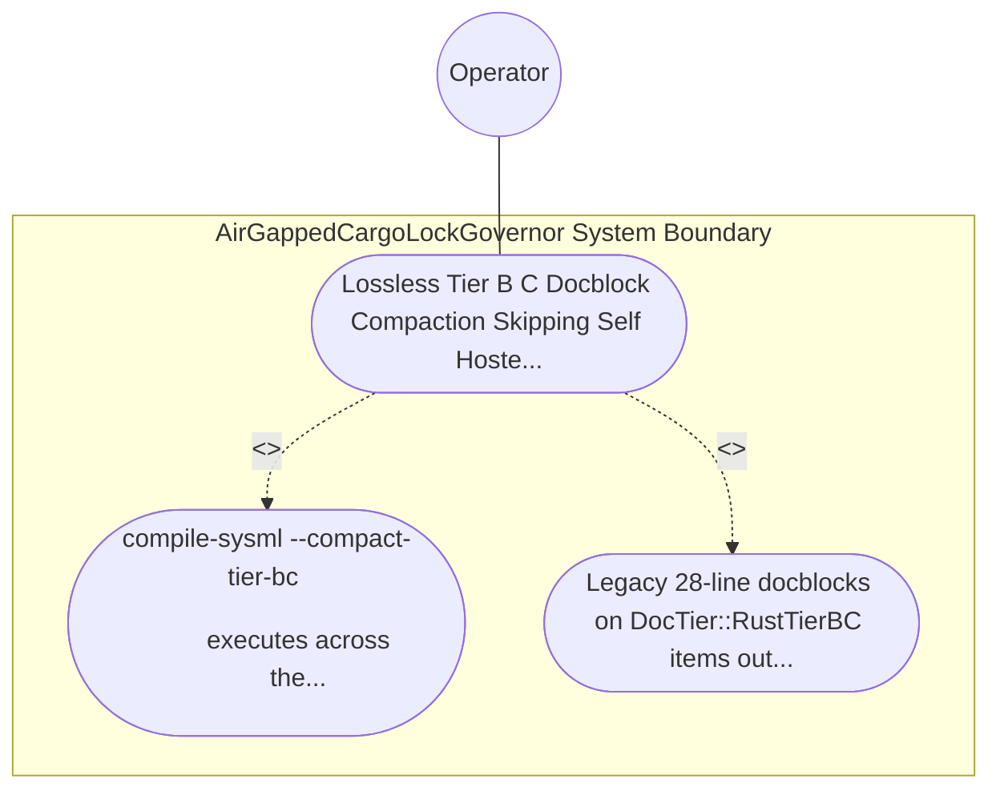

| Attribute | Specification Detail |
| :--- | :--- |
| **Issue ID** | #769 |
| **Title** | Use Case 41: Lossless Tier B C Docblock Compaction Skipping Self Hosted Generated Modules |
| **Type** | use-case |
| **Primary Actor** | Operator |
| **Scope** | AirGappedCargoLockGovernor |
| **Level** | User Goal |
| **Generation Mode** | subagent |
| **Specification Source** | [schema/model.sysml](../../schema/model.sysml) |

# Use Case 41: Lossless Tier B C Docblock Compaction Skipping Self Hosted Generated Modules

## UML Diagrams

## 1. Actors
- `Operator`

## 2. Preconditions
- A Rust directory tree containing `DocTier::RustTierA` public items with 7-section docstrings, `DocTier::RustTierBC` private/`pub(crate)` items carrying legacy 28-line 7-section docblocks with `Realises: REQ-*` bindings, and a `crates/compile-sysml/src/modular_codegen/generated/` subtree.

## 3. Trigger
- compile-sysml --compact-tier-bc <DIR> executes across the directory tree.

## 4. Main Success Scenario
1. `Operator` invokes `compile-sysml --compact-tier-bc <DIR>` on `ZeroTokenRustSpanCodemodEngine` (`tier_bc_max_doc_lines = 2`, `skip_generated_tree = true`, `runtime_llm_token_count = 0`) via `codemod_command_in`.
2. `ZeroTokenRustSpanCodemodEngine` traverses `<DIR>` while skipping `crates/compile-sysml/src/modular_codegen/generated/` (`skip_generated_tree = true`) so self-hosted Stage-1 generated modules remain untouched.
3. For each non-generated `.rs` file, `LosslessRustCstAnalyzer` parses the `ra_ap_syntax` CST and classifies items into `DocTier::RustTierA` (`pub` items) and `DocTier::RustTierBC` (`pub(crate)` and private items).
4. `ZeroTokenRustSpanCodemodEngine` compacts legacy 28-line docblocks on `DocTier::RustTierBC` items into 2-line `/// 
` + `/// Realises: (REQ-*)` contracts (`C_CST_06`) via reverse-byte-order `TextRange` splices while leaving `DocTier::RustTierA` 7-section docstrings and all executable tokens untouched.
5. `ZeroTokenRustSpanCodemodEngine` re-parses each compacted `.rs` buffer via `ra_ap_syntax::SourceFile::parse` to verify zero syntax errors and commits the compacted files atomically on `atomic_patch_out` with exit code 0.

## 5. Alternate and Exception Flows
- 3a. Target `.rs` file contains pre-existing CST syntax errors (`Diagnostic: DEAP-E0803`):
  - `ZeroTokenRustSpanCodemodEngine` refuses to compact the malformed file, emits single-line NDJSON diagnostic `DEAP-E0803` on `codemod_error_out`, and exits fail-closed with code 1.
- 4a. Docblock `TextRange` spans collide or fail UTF-8 boundary checks (`Diagnostic: DEAP-E0802`):
  - `ZeroTokenRustSpanCodemodEngine` aborts compaction on the file without writing to disk, emits `DEAP-E0802`, and terminates fail-closed with exit code 1.
- 5a. Post-compaction buffer mutates any non-trivia executable token or `DocTier::RustTierA` docstring under `Invariant_REQ_0608_SC_02`:
  - `ZeroTokenRustSpanCodemodEngine` rolls back the transaction, preserves prior verified state, and notifies `Operator`.

## 6. Postconditions
- Legacy 28-line docblocks on `DocTier::RustTierBC` items outside `generated/` are losslessly compacted to 2-line `/// 
` + `/// Realises: (REQ-*)` contracts (`C_CST_06`) without mutating executable tokens or `DocTier::RustTierA` docstrings.

## 8. Realization Matrix
| Specification Item | Type | Link / Reference |
| :--- | :--- | :--- |
| **TBD** | User Story | [User Story 56: verify stage fixed point](../user-stories/US-56-verify_stage_fixed_point.md) |
| **TBD** | Feature | [Feature 36: [BP 08 Lossless Rust CST Codemod Engine and Unified rustc Compatible JSON Diagnostics] AirGappedCargoLockGovernor](../features/FEAT-36-AirGappedCargoLockGovernor.md) |

## Source References
Use case operational flows and lifecycle activity references:
- System Architecture Model: `schema/model.sysml`
- Normative Systems Engineering Standard: ISO/IEC/IEEE 29148:2018 §6.4.2 Concept of Operations

Operational use case realization and traceability links derive from `schema/model.sysml` pursuant to ISO/IEC/IEEE 29148.
