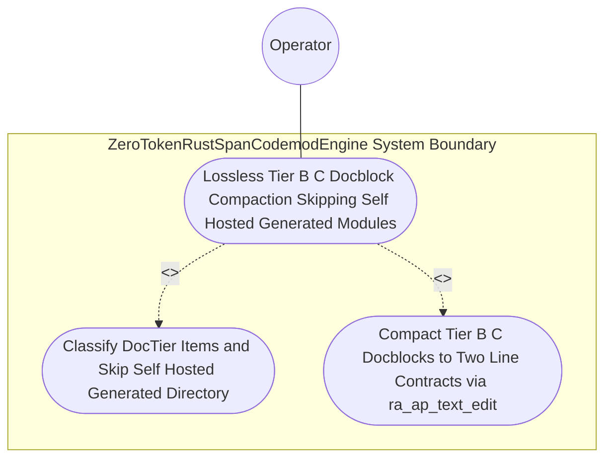

| Attribute | Specification Detail |
| :--- | :--- |
| **Issue ID** | #770 |
| **Title** | Use Case 41: Lossless Tier B C Docblock Compaction Skipping Self Hosted Generated Modules |
| **Type** | use-case |
| **Primary Actor** | Operator |
| **Scope** | AirGappedCargoLockGovernor |
| **Level** | User Goal |
| **Generation Mode** | subagent |
| **Specification Source** | [schema/model.sysml](../../schema/model.sysml) |

# Use Case 41: Lossless Tier B C Docblock Compaction Skipping Self Hosted Generated Modules

## UML Diagrams

### Use Case Diagram


### State Machine Diagram
```sysml
stateDiagram-v2
    [*] --> AnalyzingMetricsAndTiers
    AnalyzingMetricsAndTiers --> ValidatingDisjointSpans : "planCodemodOrMachineFix"
    ValidatingDisjointSpans --> SplicingAndFormatting : "disjointUtf8SpansVerified"
    SplicingAndFormatting --> VerifiedClean : "rustfmtAndCstReparseClean"
    VerifiedClean --> [*]
```

## 1. Actors
- `Operator`

## 2. Preconditions
- A Rust directory tree containing `DocTier::RustTierA` public items with 7-section docstrings, `DocTier::RustTierBC` private/`pub(crate)` items carrying legacy 28-line 7-section docblocks with `Realises: REQ-*` bindings, and a `crates/compile-sysml/src/modular_codegen/generated/` subtree.

## 3. Trigger
- compile-sysml --compact-tier-bc <DIR> executes across the directory tree.

## 4. Main Success Scenario
1. `Operator` invokes `compile-sysml --compact-tier-bc <DIR>` on `ZeroTokenRustSpanCodemodEngine` (`tier_bc_max_doc_lines = 2`, `skip_generated_tree = true`, `runtime_llm_token_count = 0`) via `codemod_command_in`.
2. `ZeroTokenRustSpanCodemodEngine` traverses `<DIR>` while skipping `crates/compile-sysml/src/modular_codegen/generated/` (`skip_generated_tree = true`) so self-hosted Stage-1 generated modules remain untouched.
3. For each non-generated `.rs` file, `LosslessRustCstAnalyzer` parses the `ra_ap_syntax` CST and classifies items into `DocTier::RustTierA` (`pub` items) and `DocTier::RustTierBC` (`pub(crate)` and private items).
4. `ZeroTokenRustSpanCodemodEngine` compacts legacy 28-line docblocks on `DocTier::RustTierBC` items into 2-line `/// <summary>` + `/// Realises: (REQ-*)` contracts (`C_CST_06`) via reverse-byte-order `TextRange` splices while leaving `DocTier::RustTierA` 7-section docstrings and all executable tokens untouched.
5. `ZeroTokenRustSpanCodemodEngine` re-parses each compacted `.rs` buffer via `ra_ap_syntax::SourceFile::parse` to verify zero syntax errors and commits the compacted files atomically on `atomic_patch_out` with exit code 0.

## 5. Alternate and Exception Flows
- 3a. Target `.rs` file contains pre-existing CST syntax errors (`Diagnostic: DEAP-E0803`):
  - `ZeroTokenRustSpanCodemodEngine` refuses to compact the malformed file, emits single-line NDJSON diagnostic `DEAP-E0803` on `codemod_error_out`, and exits fail-closed with code 1.
- 4a. Docblock `TextRange` spans collide or fail UTF-8 boundary checks (`Diagnostic: DEAP-E0802`):
  - `ZeroTokenRustSpanCodemodEngine` aborts compaction on the file without writing to disk, emits `DEAP-E0802`, and terminates fail-closed with exit code 1.
- 5a. Post-compaction buffer mutates any non-trivia executable token or `DocTier::RustTierA` docstring under `Invariant_REQ_0608_SC_02`:
  - `ZeroTokenRustSpanCodemodEngine` rolls back the transaction, preserves prior verified state, and notifies `Operator`.

## 6. Postconditions
- **Success Guarantee:** Legacy 28-line docblocks on `DocTier::RustTierBC` items outside `generated/` are losslessly compacted to 2-line `/// <summary>` + `/// Realises: (REQ-*)` contracts (`C_CST_06`) without mutating executable tokens or `DocTier::RustTierA` docstrings.
- **Failure Guarantee:** Any pre-existing CST syntax error (`DEAP-E0803`) or span collision (`DEAP-E0802`) aborts compaction without mutating files on disk and exits fail-closed with code 1.

## 7. Operational Context
- **Contract A (100% Normative OMG SysML v2.0 + KerML 1.0 Grammar Coverage)**: Preserves full Definition and Usage symmetry across the OMG SysML v2.0 and KerML 1.0 textual grammar with zero 16-construct caps.
- **Contract B (Official Rust Compiler, Cargo, `rust-analyzer` & Markdown AST Crate Stack)**: Uses `ra_ap_syntax` (`ast::HasDocComments`), `ra_ap_vfs`, `ra_ap_paths`, `ra_ap_line_index`, `ra_ap_text_edit`, `rowan`, `camino`, `ignore`, `pulldown-cmark`, `pulldown-cmark-to-cmark`, `cargo-lock`, `cargo_metadata`, `cargo-util-schemas`, `cargo-platform`, and `toml_edit` with explicit net-negative deletion of ~19,700+ lines of hand-rolled scanners (retiring `crates/compile-sysml/src/docstring.rs` (549 lines) and `crates/verify-baseline/src/checks/docstring_tier_rules.rs` (729 lines)).
- **3-Layer Definition of Done (DoD)**:
  - **Layer 1 (Domain State & Data Model)**: `DocTier::RustTierA` / `DocTier::RustTierBC` item classifications and docblock `TextRange` spans.
  - **Layer 2 (Logic & State Management)**: Enforces `C_CST_05` (`runtime_llm_token_count == 0`), `C_CST_06` (`tier_bc_max_doc_lines == 2`), `skip_generated_tree = true`, and `Invariant_REQ_0608_SC_02` inside `< 380`-SLOC submodules (`crates/deap-core/src/rust_cst/doc_edit.rs`).
  - **Layer 3 (Presentation & Actuator Interface Binding)**: Binds `codemod_command_in`, `atomic_patch_out`, and `codemod_error_out` on `ZeroTokenRustSpanCodemodEngine`.

## 8. Realization Matrix
| Specification Item | Type | Link / Reference |
| :--- | :--- | :--- |
| **#804** | User Story | [User Story 54: list rust items](../user-stories/US-54-list_rust_items.md) |
| **#805** | User Story | [User Story 55: extract rust module](../user-stories/US-55-extract_rust_module.md) |
| **#838** | Feature | [Feature 40: [BP 08 Lossless Rust CST Codemod Engine and Unified rustc Compatible JSON Diagnostics] ZeroTokenRustSpanCodemodEngine](../features/FEAT-40-ZeroTokenRustSpanCodemodEngine.md) |
| **#835** | Feature | [Feature 37: [BP 08 Lossless Rust CST Codemod Engine and Unified rustc Compatible JSON Diagnostics] LosslessRustCstAnalyzer](../features/FEAT-37-LosslessRustCstAnalyzer.md) |

### Required User Stories
- [ ] #804 - [User Story 54: list rust items](../user-stories/US-54-list_rust_items.md) (classifies `DocTier::RustTierA` vs `DocTier::RustTierBC` items and extracts outer docblock `TextRange` spans)
- [ ] #805 - [User Story 55: extract rust module](../user-stories/US-55-extract_rust_module.md) (applies reverse-byte-order `ra_ap_text_edit::TextEdit` splices with post-splice CST verification)

### Required Features
- [ ] #838 - [Feature 40: [BP 08 Lossless Rust CST Codemod Engine and Unified rustc Compatible JSON Diagnostics] ZeroTokenRustSpanCodemodEngine](../features/FEAT-40-ZeroTokenRustSpanCodemodEngine.md) (executes `--compact-tier-bc` enforcing `tier_bc_max_doc_lines == 2` and `skip_generated_tree = true`)
- [ ] #835 - [Feature 37: [BP 08 Lossless Rust CST Codemod Engine and Unified rustc Compatible JSON Diagnostics] LosslessRustCstAnalyzer](../features/FEAT-37-LosslessRustCstAnalyzer.md) (provides `ra_ap_syntax` CST parsing and non-trivia token identity verification)

## Source References
Use case operational flows and lifecycle activity references:
- System Architecture Model: `schema/model.sysml`
- Normative Systems Engineering Standard: ISO/IEC/IEEE 29148:2018 §6.4.2 Concept of Operations

Operational use case realization and traceability links derive from `schema/model.sysml` pursuant to ISO/IEC/IEEE 29148.
