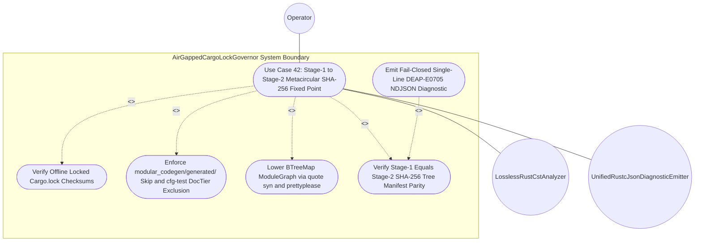

| Attribute | Specification Detail |
| :--- | :--- |
| **Issue ID** | TBD |
| **Title** | Use Case 42: Structured Codegen Boundary Preserving Stage 1 to Stage 2 Metacircular SHA 256 Fixed Point |
| **Type** | use-case |
| **Parent Epic** | [Epic 08: BP 08 Lossless Rust CST Codemod Engine and Unified rustc Compatible JSON Diagnostics](../epics/EPIC-08-BP_08_Lossless_Rust_CST_Codemod_Engine_and_Unified_rustc_Compatible_JSON_Diagnostics.md) |
| **Schema Containers** | `BP_08_Lossless_Rust_CST_Codemod_Engine_and_Unified_rustc_Compatible_JSON_Diagnostics::UC_AC_05_Structured_Codegen_Boundary_Preserving_Stage_1_to_Stage_2_Metacircular_SHA_256_Fixed_Point` |
| **Primary Actor** | Operator |
| **Scope** | AirGappedCargoLockGovernor |
| **Level** | User Goal |
| **Generation Mode** | subagent |
| **Specification Source** | [schema/model.sysml](../../schema/model.sysml) |

# Use Case 42: Structured Codegen Boundary Preserving Stage 1 to Stage 2 Metacircular SHA 256 Fixed Point

## Parent Epic
- [ ] **EPIC-08** - [Epic 08: BP 08 Lossless Rust CST Codemod Engine and Unified rustc Compatible JSON Diagnostics](../epics/EPIC-08-BP_08_Lossless_Rust_CST_Codemod_Engine_and_Unified_rustc_Compatible_JSON_Diagnostics.md) (governs lossless Red/Green CST codemod isolation, `--compact-tier-bc` generated-tree exclusion, unified single-line `rustc`-compatible NDJSON diagnostics, and `syn` + `quote` + `prettyplease` Stage-1 to Stage-2 SHA-256 fixed-point enforcement under **REQ-0608** and **REQ-0607**)

## UML Diagrams

## 1. Actors
- **Primary Actor:** `Operator` (invokes `compile-sysml` and `verify-baseline` self-hosting fixed-point verification across `.pipeline/upstream/schema/modular_codegen.sysml` and `crates/compile-sysml/src/modular_codegen/generated/`, optionally binding `--message-format=json`).
- **Secondary Actors:**
  - `AirGappedCargoLockGovernor` (`manifest_lock_in` / `lock_receipt_out` -- enforces `--offline --locked` `Cargo.toml` and `Cargo.lock` 64-hex-digit SHA-256 checksum parity prior to CST analysis and Stage-2 synthesis).
  - `StructuredModularCodegenSynthesizer` (`lowered_ir_in` / `formatted_rust_out` in `crates/compile-sysml/src/modular_codegen/mod.rs` -- lowers `LoweredModuleGraphIr` through `proc_macro2`, `quote`, `syn::parse2`, and `prettyplease::unparse` and verifies `E0705` Stage-1 == Stage-2 SHA-256 identity).
  - `ZeroTokenRustSpanCodemodEngine` (`codemod_command_in` / `atomic_patch_out` -- enforces `skip_generated_tree == true` and `runtime_llm_token_count == 0` so `--compact-tier-bc` never mutates `crates/compile-sysml/src/modular_codegen/generated/`).
  - `LosslessRustCstAnalyzer` (`rust_source_in` / `metrics_report_out` in `crates/deap-core/src/source_ast.rs` -- constructs `ra_ap_syntax` + `rowan` lossless Red/Green syntax trees within `MAX_AST_DEPTH = 64` levels and evaluates `cfg(test)`-excluded `DocTier` and executable SLOC invariants).
  - `UnifiedRustcJsonDiagnosticEmitter` (`finding_in` / `ndjson_out` in `crates/deap-core/src/diagnostics.rs` -- serializes single-line, zero-ANSI `rustc`-compatible `compiler-message` NDJSON diagnostics across all 5 workspace CLIs).

## 2. Preconditions
- Workspace `Cargo.toml` and `Cargo.lock` dependency graphs are pinned for air-gapped `--offline --locked` resolution (`offline_locked_enforced == true`, `vendor_bundle_supported == true` on `AirGappedCargoLockGovernor`).
- The authoritative self-hosting modular codegen schema `.pipeline/upstream/schema/modular_codegen.sysml` is parseable into canonical SysML v2 AST nodes (`crates/deap-core/src/sysml_ast/mod.rs`) and committed Stage-1 Rust units reside under `crates/compile-sysml/src/modular_codegen/generated/`.
- `ZeroTokenRustSpanCodemodEngine` holds `skip_generated_tree == true`, `runtime_llm_token_count == 0` (**C-CST-05**), and `tier_bc_max_doc_lines == 2` lines (**C-CST-06** outside `modular_codegen/generated/`), preserving unique 7-section Check-36 `///` and `//!` safety docblock headers on Stage-1 generated units.
- `StructuredModularCodegenSynthesizer` holds `in_process_prettyplease == true`, `stage_fixed_point_mismatch_files == 0` files (**C-CST-04** and **C-MOD-04**), and `fail_closed_transactional == true`.

## 3. Trigger
- `Operator` (or `verify-baseline` self-hosting verification gate) dispatches `verifyStageFixedPoint` (`verifyFixedPointHash`) on `compile-sysml` to re-emit `.pipeline/upstream/schema/modular_codegen.sysml` from the Stage-1-linked compiler into an isolated Stage-2 temporary directory and verify `SHA-256(Stage 1) == SHA-256(Stage 2)` across `crates/compile-sysml/src/modular_codegen/generated/`.

## 4. Main Success Scenario
1. `Operator` invokes `compile-sysml` self-hosting Stage-1 to Stage-2 fixed-point verification (`crates/compile-sysml/src/cli.rs`, `crates/compile-sysml/src/driver.rs`), triggering `AirGappedCargoLockGovernor` (`verifyOfflineLockedBuild` on `manifest_lock_in`) to validate `--offline --locked` `Cargo.toml` and `Cargo.lock` 64-hex-digit SHA-256 package checksums and publish `SupplyChainVerificationReceipt` on `lock_receipt_out`.
2. `LosslessRustCstAnalyzer` (`crates/deap-core/src/source_ast.rs`) parses Rust modules under `crates/compile-sysml/src/modular_codegen/` into `ra_ap_syntax` and `rowan` lossless Red/Green syntax trees (`ParsingLosslessCst -> AnalyzingMetricsAndTiers`, iterative depth ceiling `MAX_AST_DEPTH = 64` levels), verifying bit-for-bit root `GreenNode` byte equality and excluding subtree-scoped `cfg(test)` modules and `test`-annotated unit-test items from `DocTier` (`DocTier::RustTierA` / `DocTier::RustTierBC`) classification and `production_exec_sloc` metrics (**SC-BP08-06**, **SC-BP07-02**).
3. `ZeroTokenRustSpanCodemodEngine` enforces `skip_generated_tree == true` across any preceding `--compact-tier-bc` or Check-37 citation rewrite pass (`RewritingCheck37Paths -> VerifyingSelfHostFixedPoint`), leaving `crates/compile-sysml/src/modular_codegen/generated/` untouched so committed Stage-1 7-section DO-178C `///` and `//!` docblock headers are never compacted into 2-line `DocTier::RustTierBC` stubs (**SC-BP08-10**, **SC-BP07-34**).
4. `TopologicalLayerDagVerifier` and `FourLevelAstPartitionerAndHoister` (`crates/compile-sysml/src/modular_codegen/mod.rs`) ingest `.pipeline/upstream/schema/modular_codegen.sysml` (`crates/deap-core/src/sysml_ast/mod.rs`), confirm acyclic iterative Kahn topological order (`zero_recursion_kahn == true`) and monotonic `@Layer` ordinals (`Domain = 1`, `Application = 2`, `Presentation = 3`, `importer_tier >= imported_tier`), and partition all packages, facets, sequential action stages, `step_from_*` state handlers, and ANF boolean subpredicates (`active_level_count == 4` levels) into an immutable `BTreeMap`-ordered `LoweredModuleGraphIr` stream on `lowered_ir_in`.
5. `StructuredModularCodegenSynthesizer` (`in_process_prettyplease == true`) lowers each `CompilationUnitSpec` in deterministic `BTreeMap` relative-path and symbol order into `proc_macro2` and `quote` token streams, validates every `TokenStream` in-process via `syn::parse2` (`MAX_AST_DEPTH = 64` levels), and formats canonical Rust source buffers via `prettyplease::unparse` with zero external formatter subprocesses (**SC-BP08-09**, **SC-BP07-29**).
6. `StructuredModularCodegenSynthesizer` and `ModularRustMultiFileEmitter` re-verify every `prettyplease::unparse` buffer in memory via `syn::parse2` and `LosslessRustCstAnalyzer` to confirm `E0705`-preserving AST round-trip idempotence, `cfg(test)`-excluded `DocTier` 7-section `///` and `//!` docblock completeness, and modularity bounds (`50 <= max_file_lines <= 400` LOC **C-MOD-01**, `1 <= max_items_per_file <= 12` items **C-MOD-02**, `1 <= max_cyclomatic_complexity <= 8` vG **C-MOD-03**, total functions `<= 80` SLOC / `<= 50` SLOC CST bound **C-CST-01**, `<= 5` parameters **C-CST-02**, and `0` mutable `bool` flags **C-CST-03**) before staging the Stage-2 tree in an isolated temporary directory (**SC-BP07-32**).
7. `StructuredModularCodegenSynthesizer` (`verifyStageFixedPoint`) constructs `BTreeMap`-ordered `GeneratedTreeManifest` SHA-256 tables for both the committed Stage-1 tree (`crates/compile-sysml/src/modular_codegen/generated/`) and the isolated Stage-2 directory using fallible `.get()` lookups and checked/saturating counters (`checked_add`, `saturating_add`), confirming `SHA-256(Stage 1) == SHA-256(Stage 2)` across 100% of relative paths (`stage_fixed_point_mismatch_files == 0` files, **C-CST-04** and **C-MOD-04**).
8. `StructuredModularCodegenSynthesizer` transitions `VerifyingSelfHostFixedPoint -> VerifiedClean` (`stage1EqualsStage2Sha256`), seals the verified `PrettypleaseRustUnit` and `GeneratedTreeManifest` receipt without mutating Stage-1 workspace files, and returns exit code `0` to `Operator` via `UnifiedRustcJsonDiagnosticEmitter` (`crates/deap-core/src/diagnostics.rs`) with zero error diagnostics on `ndjson_out`.

## 5. Alternate and Exception Flows
5a. **Malformed `quote` TokenStream, Out-of-Boundary Relative Path, or Disabled In-Process `prettyplease` (`FM-BP08-009`, `FM-BP07-017`, `FM-BP07-029` -- Input and Boundary Failure Category) (Branches from Basic Flow step 5):**
  1. `StructuredModularCodegenSynthesizer` detects an input or boundary violation on `lowered_ir_in`: `in_process_prettyplease == false`, a non-canonical `relative_path` escaping `crates/compile-sysml/src/modular_codegen/generated/` (`..`, leading `/`, or NUL byte), or a malformed `quote` `TokenStream` rejected by `syn::parse2` prior to `prettyplease::unparse`.
  2. `StructuredModularCodegenSynthesizer` aborts emission in memory before touching disk, discards uncommitted Stage-2 buffers, transitions to `EmittingJsonDiagnostics`, and invokes `UnifiedRustcJsonDiagnosticEmitter` (`formatNdjsonLine`) to emit a single-line zero-ANSI (`0x0A`-free, `0x1B`-free) `DEAP-E0803` / `DEAP-E0701` `compiler-message` NDJSON diagnostic (**SC-BP08-09**, **SC-BP07-17**) with exit code `1`.
5b. **Violated `modular_codegen/generated/` Compaction Skip, Mis-Scoped `cfg(test)` `DocTier` Leakage, or Out-of-Order Lifecycle Dispatch (`FM-BP08-010`, `FM-BP08-018`, `FM-BP08-006`, `FM-BP07-002`, `FM-BP07-034` -- State and Ordering Failure Category) (Branches from Basic Flow step 3):**
  1. `ZeroTokenRustSpanCodemodEngine`, `LosslessRustCstAnalyzer`, or `StructuredModularCodegenSynthesizer` detects an ordering or scope isolation breach: `verifyStageFixedPoint` is dispatched before `atomicFilesCommitted` (or `VerifyingBounds`), `skip_generated_tree` is bypassed so `--compact-tier-bc` rewrote Stage-1 7-section `///` and `//!` docblock headers inside `crates/compile-sysml/src/modular_codegen/generated/`, non-`BTreeMap` map ordering permuted AST items, or unbalanced attribute spans caused `cfg(test)` module / `test` item scopes to leak into or out of production `DocTier` and `production_exec_sloc` accumulators.
  2. `StructuredModularCodegenSynthesizer` traps the violation fail-closed (`rejectFixedPointDriftE0705`, **SC-BP08-10**, **SC-BP08-06**, **SC-BP07-02**), preserves the workspace without partial writes, emits single-line `DEAP-E0705` (or `DEAP-E0801` / `DEAP-E0802`) NDJSON on `ndjson_out`, and exits with code `1`.
5c. **`syn::parse2` / CST Nesting Ceiling Breach (`64` levels) or Checked Counter Exhaustion (`FM-BP08-011`, `FM-BP08-007`, `FM-BP07-019`, `FM-BP07-031`, `FM-BP07-035` -- Resource and Arithmetic Failure Category) (Branches from Basic Flow step 6):**
  1. During in-process `quote` -> `syn::parse2` -> `prettyplease::unparse` synthesis or `ra_ap_syntax` CST re-parse, `StructuredModularCodegenSynthesizer` or `LosslessRustCstAnalyzer` detects token-tree or syntax-node depth exceeding `MAX_AST_DEPTH = 64` levels, post-render unit metrics exceeding **C-MOD-01**..**C-MOD-03** (`max_file_lines > 400` LOC, `max_items_per_file > 12` items, `max_cyclomatic_complexity > 8` vG, function exec SLOC exceeding `<= 80` SLOC / `<= 50` SLOC, or formal parameter count exceeding `<= 5` parameters), or `checked_add` overflow while accumulating `stage_fixed_point_mismatch_files` and SHA-256 manifest byte totals.
  2. `StructuredModularCodegenSynthesizer` halts iterative traversal immediately without call-stack overflow or integer wraparound (**SC-BP08-11**, **SC-BP08-07**, **SC-BP07-19**), removes the isolated Stage-2 staging directory, emits single-line `DEAP-E0804` / `DEAP-E0704` NDJSON via `UnifiedRustcJsonDiagnosticEmitter`, and terminates fail-closed with exit code `1`.
5d. **Stage-1 versus Stage-2 Metacircular SHA-256 Fixed-Point Drift (`E0705`) or Partial-Write Trap (`FM-BP08-012`, `FM-BP07-020`, `FM-BP07-032`, `FM-BP07-036` -- Output and Serialization Failure Category) (Branches from Basic Flow step 7):**
  1. `StructuredModularCodegenSynthesizer` compares Stage-1 (`crates/compile-sysml/src/modular_codegen/generated/`) and Stage-2 `BTreeMap` `GeneratedTreeManifest` SHA-256 digests via `.get()` lookup and detects one or more missing, extra, or digest-divergent relative paths (`stage_fixed_point_mismatch_files != 0` files, breaching **C-CST-04** and **C-MOD-04** due to non-idempotent `syn`/`quote`/`prettyplease` AST emission or formatting drift).
  2. `StructuredModularCodegenSynthesizer` blocks atomic temp-and-rename commit onto `formatted_rust_out` (`fail_closed_transactional == true`), guarantees zero partial writes or orphan `.rs` files inside `crates/compile-sysml/src/modular_codegen/generated/`, transitions `VerifyingSelfHostFixedPoint -> EmittingJsonDiagnostics` via `rejectFixedPointDriftE0705`, and emits a single-line zero-ANSI `DEAP-E0705` (`E0705`) `compiler-message` NDJSON diagnostic (**SC-BP08-12**, **SC-BP07-36**) reporting the mismatched paths and SHA-256 digests with exit code `1`.
5e. **Air-Gapped `--offline --locked` Lockfile Drift or Directed Topological Cycle / Upward Layer Edge (`FM-BP08-001`, `FM-BP08-004`, `FM-BP07-038`, `FM-BP07-040` -- Precondition and DAG Guard) (Branches from Basic Flow step 1):**
  1. `AirGappedCargoLockGovernor` detects missing, unpinned, or SHA-256-mismatched `Cargo.toml` / `Cargo.lock` entries during `--offline --locked` verification (`FM-BP08-001`), or `TopologicalLayerDagVerifier` (`crates/compile-sysml/src/modular_codegen/mod.rs`) detects a directed dependency cycle (`visited_count != vertex_count`) or upward cross-layer dependency (`importer_tier < imported_tier`) in `.pipeline/upstream/schema/modular_codegen.sysml` (`FM-BP07-038`).
  2. Execution aborts transactionally before entering 4-level lowering or Stage-2 synthesis, leaving zero Stage-2 files written, and `UnifiedRustcJsonDiagnosticEmitter` flushes a single-line zero-ANSI `DEAP-E0804` (supply-chain lockfile drift), `DEAP-E0702` (dependency cycle), or `DEAP-E0703` (illegal upward layer edge) NDJSON frame with exit code `1`.

## 6. Postconditions
- **Success Guarantee:** `SHA-256(Stage 1) == SHA-256(Stage 2)` holds bit-for-bit across 100% of relative paths in `crates/compile-sysml/src/modular_codegen/generated/` (**C-CST-04** and **C-MOD-04** `stage_fixed_point_mismatch_files == 0` files), `crates/compile-sysml/src/modular_codegen/generated/` remains untouched by `--compact-tier-bc` (`skip_generated_tree == true`), every emitted Rust unit satisfies `syn::parse2` + `prettyplease::unparse` AST round-trip idempotence and `cfg(test)`-excluded `DocTier` and modularity bounds (**C-MOD-01**..**C-MOD-05**, **C-CST-01**..**C-CST-06**), and the CLI exits with code `0`.
- **Failure Guarantee:** On any precondition, AST syntax, `MAX_AST_DEPTH = 64` levels ceiling, `cfg(test)` `DocTier` scope, compaction-skip, or Stage-1/Stage-2 SHA-256 parity violation, `StructuredModularCodegenSynthesizer` aborts fail-closed (`fail_closed_transactional == true`), discards all isolated temporary staging buffers with zero partial mutations to `crates/compile-sysml/src/modular_codegen/generated/`, emits a single-line zero-ANSI `rustc`-compatible `compiler-message` NDJSON diagnostic (`DEAP-E0701`..`DEAP-E0705` or `DEAP-E0801`..`DEAP-E0804`) when `--message-format=json` is active, and exits with code `1`.

## 7. Operational Context
Within the `DEAP01-spec-core` self-hosting MBSE compiler architecture (**REQ-0608** / `BP-08` and **REQ-0607** / `BP-07`), hand-authored CST codemods (`ZeroTokenRustSpanCodemodEngine`) and self-hosted multi-file Rust code generation (`StructuredModularCodegenSynthesizer`) are strictly partitioned along a structured AST boundary. While hand-authored Rust sources outside `crates/compile-sysml/src/modular_codegen/generated/` undergo lossless `ra_ap_syntax` + `rowan` Red/Green CST analysis and `DocTier::RustTierBC` 2-line docstring compaction (`--compact-tier-bc`), self-hosted generated compiler modules inside `crates/compile-sysml/src/modular_codegen/generated/` are lowered exclusively from `.pipeline/upstream/schema/modular_codegen.sysml` via `proc_macro2`, `quote`, `syn::parse2`, and in-process `prettyplease::unparse`, skipped during `--compact-tier-bc`, and gated on metacircular Stage-1 == Stage-2 SHA-256 fixed-point identity (`E0705`).

### Mathematical Formulations & Safety Invariants
$$
\begin{aligned}
E_{\text{mod}}(M) &= U_{\text{pretty}}(P_{\text{syn}}(Q_{\text{quote}}(M))) \\
\Delta_{\text{mismatch}}(T_{1}, T_{2}) &= \lvert \{ p \in P(T_{1} \cup T_{2}) \mid H_{256}(T_{1}, p) \neq H_{256}(T_{2}, p) \} \rvert = 0 \\
D_{\text{ast}}(T_{\text{syn}}) &\le D_{\max} \\
L_{\text{exec}}(f) &\le L_{\max,f} \land N_{\text{param}}(f) \le P_{\max} \land N_{\text{mutbool}}(f) = 0 \\
C_{\text{byte}}(d_{j}, b_{\text{nl}}) &= 0 \land C_{\text{byte}}(d_{j}, b_{\text{esc}}) = 0
\end{aligned}
$$

- Parameter Definitions & Engineering Units:
- $E_{\text{mod}}(M)$: Deterministic in-process Rust compilation-unit emission operator over lowered `BTreeMap`-ordered module descriptor $M$ (**REQ-0608** `Invariant_REQ_0608_SC_02`).
- $Q_{\text{quote}}$, $P_{\text{syn}}$, $U_{\text{pretty}}$: Sequential `quote` token-stream projection, `syn::parse2` AST validation, and `prettyplease::unparse` canonical formatting operators (dimensionless AST transforms, `0` subprocesses, `0` tokens per **C-CST-05**).
- $T_{1}$, $T_{2}$: Committed Stage-1 generated tree (`crates/compile-sysml/src/modular_codegen/generated/`) and isolated Stage-2 re-emitted generated tree manifests.
- $P(T_{1} \cup T_{2})$: Union of normalized workspace-relative file paths across Stage-1 and Stage-2 trees.
- $H_{256}(T_{k}, p)$: 256-bit SHA-256 content digest (64 lowercase hexadecimal characters) for relative path $p$ in tree $T_{k}$ (undefined sentinel if $p \notin T_{k}$).
- $\Delta_{\text{mismatch}}(T_{1}, T_{2})$: Count of divergent files between Stage-1 and Stage-2 trees, constrained to 0 files (**C-CST-04** and **C-MOD-04** `stage_fixed_point_mismatch_files == 0` files; non-zero triggers `DEAP-E0705`).
- $D_{\text{ast}}(T_{\text{syn}})$, $D_{\max}$: Measured AST/CST nesting depth of syntax tree $T_{\text{syn}}$ and hard traversal depth ceiling $D_{\max} = 64$ levels (`MAX_AST_DEPTH = 64` levels).
- $L_{\text{exec}}(f)$, $L_{\max,f}$: `cfg(test)`-excluded executable line count of production function $f$ and upper SLOC bound (80 SLOC total-function ceiling; 50 SLOC **C-CST-01** CST analyzer ceiling).
- $N_{\text{param}}(f)$, $P_{\max}$: Formal parameter count of callable $f$ excluding `self`, `&self`, and `&mut self` receivers, bounded by $P_{\max} = 5$ parameters (**C-CST-02**).
- $N_{\text{mutbool}}(f)$: Count of local mutable boolean state flags (`let mut flag: bool`) inside function $f$, constrained to 0 flags (**C-CST-03**).
- $C_{\text{byte}}(d_{j}, b_{\text{nl}})$, $C_{\text{byte}}(d_{j}, b_{\text{esc}})$: Byte occurrence counts of raw newline $b_{\text{nl}}$ (`0x0A`) and ANSI escape $b_{\text{esc}}$ (`0x1B`) within serialized NDJSON diagnostic frame $d_{j}$, both constrained to 0 bytes (**REQ-0608** `Invariant_REQ_0608_SC_04_REQ_0608`).

### 3-Layer Definition of Done
1. **Layer 1 -- Domain State & Data Model (`crates/deap-core/src/sysml_ast/mod.rs`, `crates/deap-core/src/source_ast.rs`, `crates/deap-core/src/error.rs`):** Immutable value structures (`LoweredModuleGraphIr`, `CompilationUnitSpec`, `GeneratedTreeManifest`, `DocTier`, `TextRange`, `SupplyChainVerificationReceipt`) keyed exclusively by deterministic `BTreeMap` and `BTreeSet` collections under `#![forbid(unsafe_code)]`, paired with strongly typed error and diagnostic enums (`DeapError`, `ModularCodegenError`, `DeapDiagnosticCode` spanning `DEAP-E0701`..`DEAP-E0705` and `DEAP-E0801`..`DEAP-E0804`) and zero `Result<T, String>` signatures.
2. **Layer 2 -- Logic & State Management (`crates/compile-sysml/src/modular_codegen/mod.rs`, `crates/deap-core/src/source_ast.rs`):** Deterministic lifecycle execution (`Idle -> ParsingLosslessCst -> AnalyzingMetricsAndTiers -> ValidatingDisjointSpans -> SplicingAndFormatting -> RewritingCheck37Paths -> VerifyingSelfHostFixedPoint -> VerifiedClean`) implemented via total functions obeying `<= 80` SLOC (`<= 50` SLOC CST **C-CST-01** target), `<= 5` parameters (**C-CST-02**), `0` flags (**C-CST-03**), iterative AST/CST traversal bounded by `MAX_AST_DEPTH = 64` levels, fallible `.get()` indexing (zero unchecked slice indexing or `.unwrap()` / `.expect()`), checked and saturating integer arithmetic (`checked_add`, `checked_sub`, `saturating_add`), unconditional `crates/compile-sysml/src/modular_codegen/generated/` skip during `--compact-tier-bc`, subtree-scoped `cfg(test)` module and `test` item exclusion from `DocTier` and `production_exec_sloc`, and in-process `quote` -> `syn::parse2` -> `prettyplease::unparse` Stage-1 == Stage-2 SHA-256 verification.
3. **Layer 3 -- Presentation & CLI / `--message-format=json` NDJSON Interface Binding (`crates/compile-sysml/src/cli.rs`, `crates/compile-sysml/src/driver.rs`, `crates/deap-core/src/diagnostics.rs`):** CLI command and flag actuator binding across `compile-sysml` and `verify-baseline` supporting `--message-format=json`, routing all fixed-point drift (`DEAP-E0705`) and CST/codemod rejection (`DEAP-E0801`..`DEAP-E0804`) diagnostics through `UnifiedRustcJsonDiagnosticEmitter` (`formatNdjsonLine`) onto line-locked standard output as single-line (`0x0A`-free), zero-ANSI (`0x1B`-free) `rustc`-compatible `compiler-message` NDJSON objects with exact UTF-8 `byte_start` / `byte_end` and 1-based line/column spans, atomic temp-directory rollback (`0` files partially written), and deterministic exit codes (`0` on verified parity, `1` on fail-closed rejection).

## 8. Realization Matrix

| Use Case | User Story | Feature | Parent Epic | Verification Test Case (`TEST-*`) |
| :--- | :--- | :--- | :--- | :--- |
| `UC-42` | [US-54: verifyStageFixedPoint](../user-stories/US-54-verifyStageFixedPoint.md) | [FEAT-43: StructuredModularCodegenSynthesizer](../features/FEAT-43-StructuredModularCodegenSynthesizer.md) | [EPIC-08: BP 08 Lossless Rust CST Codemod Engine and Unified rustc Compatible JSON Diagnostics](../epics/EPIC-08-BP_08_Lossless_Rust_CST_Codemod_Engine_and_Unified_rustc_Compatible_JSON_Diagnostics.md) | `TEST-BP08-AC05-STAGE1-STAGE2-SHA256-FIXED-POINT` |
| `UC-42` | [US-53: extractRustModule](../user-stories/US-53-extractRustModule.md) | [FEAT-45: ZeroTokenRustSpanCodemodEngine](../features/FEAT-45-ZeroTokenRustSpanCodemodEngine.md) | [EPIC-08: BP 08 Lossless Rust CST Codemod Engine and Unified rustc Compatible JSON Diagnostics](../epics/EPIC-08-BP_08_Lossless_Rust_CST_Codemod_Engine_and_Unified_rustc_Compatible_JSON_Diagnostics.md) | `TEST-BP08-AC04-GENERATED-TREE-COMPACTION-SKIP` |
| `UC-42` | [US-56: analyzeMetrics](../user-stories/US-56-analyzeMetrics.md) | [FEAT-42: LosslessRustCstAnalyzer](../features/FEAT-42-LosslessRustCstAnalyzer.md) | [EPIC-08: BP 08 Lossless Rust CST Codemod Engine and Unified rustc Compatible JSON Diagnostics](../epics/EPIC-08-BP_08_Lossless_Rust_CST_Codemod_Engine_and_Unified_rustc_Compatible_JSON_Diagnostics.md) | `TEST-BP08-AC01-CFG-TEST-EXCLUDED-DOCTIER` |
| `UC-42` | [US-55: formatNdjsonLine](../user-stories/US-55-formatNdjsonLine.md) | [FEAT-44: UnifiedRustcJsonDiagnosticEmitter](../features/FEAT-44-UnifiedRustcJsonDiagnosticEmitter.md) | [EPIC-08: BP 08 Lossless Rust CST Codemod Engine and Unified rustc Compatible JSON Diagnostics](../epics/EPIC-08-BP_08_Lossless_Rust_CST_Codemod_Engine_and_Unified_rustc_Compatible_JSON_Diagnostics.md) | `TEST-BP08-AC06-SINGLE-LINE-NDJSON-E0705` |
| `UC-42` | [US-51: verifyOfflineLockedBuild](../user-stories/US-51-verifyOfflineLockedBuild.md) | [FEAT-41: AirGappedCargoLockGovernor](../features/FEAT-41-AirGappedCargoLockGovernor.md) | [EPIC-08: BP 08 Lossless Rust CST Codemod Engine and Unified rustc Compatible JSON Diagnostics](../epics/EPIC-08-BP_08_Lossless_Rust_CST_Codemod_Engine_and_Unified_rustc_Compatible_JSON_Diagnostics.md) | `TEST-BP08-AC07-AIR-GAPPED-OFFLINE-LOCKED-BUILD` |

### Required User Stories
- [ ] **US-54** - [User Story 54: verifyStageFixedPoint](../user-stories/US-54-verifyStageFixedPoint.md) (primary behavioral story executing in-process `quote` -> `syn::parse2` -> `prettyplease::unparse` Stage-2 synthesis and verifying `SHA-256(Stage 1) == SHA-256(Stage 2)` with `stage_fixed_point_mismatch_files == 0` files)
- [ ] **US-53** - [User Story 53: extractRustModule](../user-stories/US-53-extractRustModule.md) (enforces `skip_generated_tree == true` and atomic Check-37 path rewriting prior to `VerifyingSelfHostFixedPoint`)
- [ ] **US-56** - [User Story 56: analyzeMetrics](../user-stories/US-56-analyzeMetrics.md) (enforces `MAX_AST_DEPTH = 64` levels lossless CST parsing and `cfg(test)`-excluded `DocTier` and executable SLOC verification)
- [ ] **US-55** - [User Story 55: formatNdjsonLine](../user-stories/US-55-formatNdjsonLine.md) (serializes fail-closed `DEAP-E0705` and `DEAP-E0801`..`DEAP-E0804` diagnostics as single-line zero-ANSI `rustc`-compatible NDJSON frames)
- [ ] **US-51** - [User Story 51: verifyOfflineLockedBuild](../user-stories/US-51-verifyOfflineLockedBuild.md) (establishes the `--offline --locked` `Cargo.lock` SHA-256 supply-chain precondition receipt on `AirGappedCargoLockGovernor`)

### Required Features
- [ ] **FEAT-43** - [Feature 43: StructuredModularCodegenSynthesizer](../features/FEAT-43-StructuredModularCodegenSynthesizer.md) (primary realizing subsystem lowering `LoweredModuleGraphIr` through `syn`, `quote`, and `prettyplease` while enforcing **C-CST-04** / `E0705` Stage-1 == Stage-2 SHA-256 parity)
- [ ] **FEAT-45** - [Feature 45: ZeroTokenRustSpanCodemodEngine](../features/FEAT-45-ZeroTokenRustSpanCodemodEngine.md) (isolates `crates/compile-sysml/src/modular_codegen/generated/` from `--compact-tier-bc` rewriting via `skip_generated_tree == true`)
- [ ] **FEAT-42** - [Feature 42: LosslessRustCstAnalyzer](../features/FEAT-42-LosslessRustCstAnalyzer.md) (provides `ra_ap_syntax` + `rowan` lossless Red/Green CST round-trip and `cfg(test)`-excluded `DocTier` / SLOC validation)
- [ ] **FEAT-44** - [Feature 44: UnifiedRustcJsonDiagnosticEmitter](../features/FEAT-44-UnifiedRustcJsonDiagnosticEmitter.md) (binds `--message-format=json` single-line `compiler-message` NDJSON reporting across `compile-sysml` and `verify-baseline`)
- [ ] **FEAT-41** - [Feature 41: AirGappedCargoLockGovernor](../features/FEAT-41-AirGappedCargoLockGovernor.md) (governs air-gapped `--offline --locked` workspace build reproducibility for `UC_AC_05`)

### Verification Test Cases
- [ ] `TEST-BP08-AC05-STAGE1-STAGE2-SHA256-FIXED-POINT` -- Verifies `AC_05_Structured_Codegen_Boundary_Preserving_Stage_1_to_Stage_2_Metacircular_SHA_256_Fixed_Point` (**REQ-0608**) and `AC_03_Metacircular_Self_Hosting_Stage_1_to_Stage_2_SHA_256_Fixed_Point_Identity` (**REQ-0607**): asserts `SHA-256(Stage 1) == SHA-256(Stage 2)` (`stage_fixed_point_mismatch_files == 0` files) and fail-closed `DEAP-E0705` rejection on injected formatting or AST drift.
- [ ] `TEST-BP08-AC04-GENERATED-TREE-COMPACTION-SKIP` -- Verifies `AC_04_Lossless_Tier_B_C_Docblock_Compaction_Skipping_Self_Hosted_Generated_Modules`: asserts `--compact-tier-bc` skips `crates/compile-sysml/src/modular_codegen/generated/` (`skip_generated_tree == true`) while compacting non-generated `DocTier::RustTierBC` items.
- [ ] `TEST-BP08-AC01-CFG-TEST-EXCLUDED-DOCTIER` -- Verifies `AC_01_Lossless_Red_Green_CST_Roundtrip_and_Exact_DEAP_v2_0_AST_Metrics_Extraction`: asserts `cfg(test)` and `test`-annotated subtrees are excluded from `DocTier` and `production_exec_sloc` within `MAX_AST_DEPTH = 64` levels.
- [ ] `TEST-BP08-AC06-SINGLE-LINE-NDJSON-E0705` -- Verifies `AC_06_Unified_rustc_Compatible_Single_Line_JSON_Diagnostics_and_MachineApplicable_Auto_Fix_Across_All_Five_CLIs`: asserts `--message-format=json` emits single-line (`0x0A`-free), zero-ANSI (`0x1B`-free) `compiler-message` NDJSON with `"code": "DEAP-E0705"` and zero partial target writes.
- [ ] `TEST-BP08-AC07-AIR-GAPPED-OFFLINE-LOCKED-BUILD` -- Verifies `AC_07_Air_Gapped_Offline_Cargo_Lock_Reproducibility_and_Twelve_Gate_Blueprint_Conformance`: asserts `--offline --locked` `Cargo.lock` SHA-256 verification succeeds without network access.

## Source References
Use case operational flows and lifecycle activity references:
- System Architecture Model: `schema/model.sysml` and `.pipeline/upstream/schema/modular_codegen.sysml`
- Blueprint Metamodels: `docs/designs/blueprint-08-rust-analyzer-cst-refactoring-and-json-diagnostics.sysml` (**REQ-0608**) and `docs/designs/blueprint-07-self-hosting-modular-codegen-compiler.sysml` (**REQ-0607**)
- Component Failure Mode Registry: `docs/research/FAILURE_MODE_REGISTRY.md` (`FM-BP08-009`..`FM-BP08-012`, `FM-BP08-001`, `FM-BP08-006`..`FM-BP08-007`, `FM-BP08-018`, `FM-BP07-002`, `FM-BP07-017`..`FM-BP07-020`, `FM-BP07-029`..`FM-BP07-040`)
- Normative Systems Engineering Standard: ISO/IEC/IEEE 29148:2018 Section 6.4.2 Concept of Operations

Operational use case realization and traceability links derive from `schema/model.sysml` pursuant to ISO/IEC/IEEE 29148.
