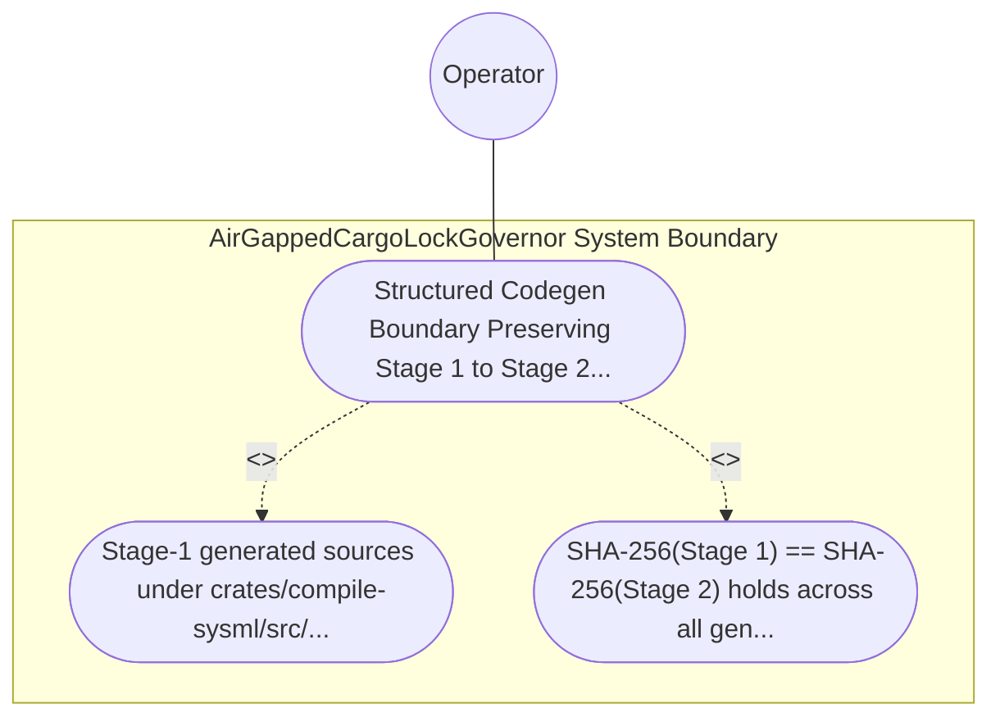

| Attribute | Specification Detail |
| :--- | :--- |
| **Issue ID** | #770 |
| **Title** | Use Case 42: Structured Codegen Boundary Preserving Stage 1 to Stage 2 Metacircular SHA 256 Fixed Point |
| **Type** | use-case |
| **Primary Actor** | Operator |
| **Scope** | AirGappedCargoLockGovernor |
| **Level** | User Goal |
| **Generation Mode** | subagent |
| **Specification Source** | [schema/model.sysml](../../schema/model.sysml) |

# Use Case 42: Structured Codegen Boundary Preserving Stage 1 to Stage 2 Metacircular SHA 256 Fixed Point

## UML Diagrams

## 1. Actors
- `Operator`

## 2. Preconditions
- The self-hosting modular codegen schema .pipeline/upstream/schema/modular_codegen.sysml lowered through syn + proc-macro2 + quote + prettyplease inside crates/compile-sysml/src/modular_codegen/.

## 3. Trigger
- Stage-1 generated sources under crates/compile-sysml/src/modular_codegen/generated/ are re-emitted into an isolated Stage-2 directory and verified for SHA-256 tree parity.

## 4. Main Success Scenario
1. `Operator` invokes `StructuredModularCodegenSynthesizer` (`in_process_prettyplease = true`, `stage_fixed_point_mismatch_files = 0`) on `.pipeline/upstream/schema/modular_codegen.sysml` via `lowered_ir_in`.
2. `StructuredModularCodegenSynthesizer` synthesizes all generated Rust compilation units via `proc-macro2`, `quote::quote!`, `syn::parse2::<syn::File>`, and in-process `prettyplease::unparse` inside `< 380` exec SLOC submodules (`crates/compile-sysml/src/modular_codegen/`), maintaining a strict boundary from hand-authored CST codemod tools.
3. `StructuredModularCodegenSynthesizer` emits the Stage-2 compilation tree on `formatted_rust_out` into an isolated temporary directory without invoking external `rustfmt` subprocesses on generated code.
4. `StructuredModularCodegenSynthesizer` executes `verify_stage_fixed_point` to compare the Stage-1 committed tree under `crates/compile-sysml/src/modular_codegen/generated/` against the Stage-2 emitted tree across all relative paths and SHA-256 digests.
5. `StructuredModularCodegenSynthesizer` verifies `SHA-256(Stage 1) == SHA-256(Stage 2)` with `stage_fixed_point_mismatch_files == 0` (`C_CST_04`) under `Invariant_REQ_0608_SC_03` and exits with code 0.

## 5. Alternate and Exception Flows
- 3a. Any generated compilation unit fails `syn::parse2::<syn::File>` validation (`Diagnostic: E0704`):
  - `StructuredModularCodegenSynthesizer` aborts code generation, emits a single-line JSON diagnostic via `UnifiedRustcJsonDiagnosticEmitter`, and exits fail-closed with code 1.
- 4a. Injected formatting mutation or AST divergence causes `SHA-256(Stage 1) != SHA-256(Stage 2)` (`stage_fixed_point_mismatch_files > 0`, `Diagnostic: E0705`):
  - `StructuredModularCodegenSynthesizer` fails closed with exit code 1 and emits diagnostic `E0705` listing every diverging relative path.
- 5a. Codemod tool attempts to rewrite files inside `crates/compile-sysml/src/modular_codegen/generated/`:
  - `ZeroTokenRustSpanCodemodEngine` enforces `skip_generated_tree = true`, preserves Stage-1 fixed-point identity, and reports status to `Operator`.

## 6. Postconditions
- SHA-256(Stage 1) == SHA-256(Stage 2) holds across all generated relative paths (**C-CST-04** stage_fixed_point_mismatch_files == 0), whereas any injected formatting or AST divergence fails closed.

## 8. Realization Matrix
| Specification Item | Type | Link / Reference |
| :--- | :--- | :--- |
| **TBD** | User Story | [User Story 57: format ndjson line](../user-stories/US-57-format_ndjson_line.md) |
| **TBD** | Feature | [Feature 36: [BP 08 Lossless Rust CST Codemod Engine and Unified rustc Compatible JSON Diagnostics] AirGappedCargoLockGovernor](../features/FEAT-36-AirGappedCargoLockGovernor.md) |

## Source References
Use case operational flows and lifecycle activity references:
- System Architecture Model: `schema/model.sysml`
- Normative Systems Engineering Standard: ISO/IEC/IEEE 29148:2018 §6.4.2 Concept of Operations

Operational use case realization and traceability links derive from `schema/model.sysml` pursuant to ISO/IEC/IEEE 29148.
