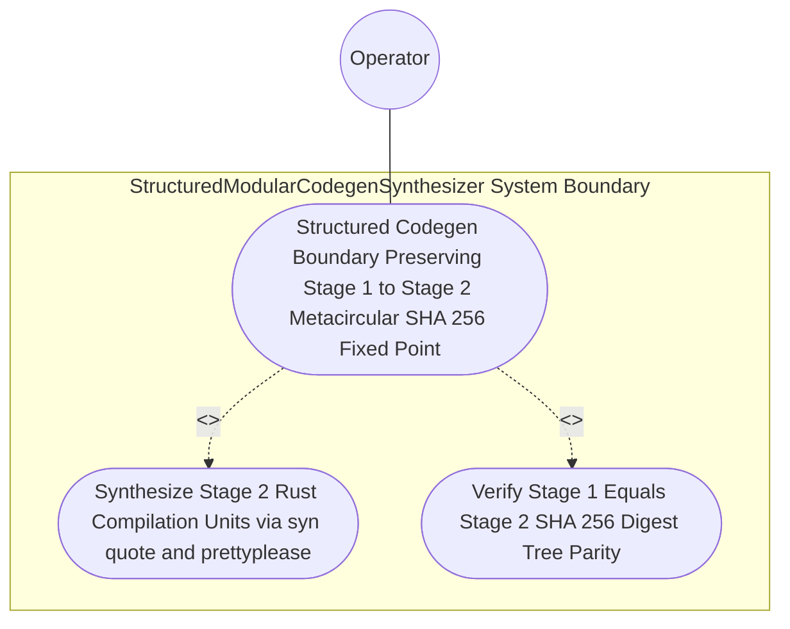

| Attribute | Specification Detail |
| :--- | :--- |
| **Issue ID** | #771 |
| **Title** | Use Case 42: Structured Codegen Boundary Preserving Stage 1 to Stage 2 Metacircular SHA 256 Fixed Point |
| **Type** | use-case |
| **Primary Actor** | Operator |
| **Scope** | AirGappedCargoLockGovernor |
| **Level** | User Goal |
| **Generation Mode** | subagent |
| **Specification Source** | [schema/model.sysml](../../schema/model.sysml) |

# Use Case 42: Structured Codegen Boundary Preserving Stage 1 to Stage 2 Metacircular SHA 256 Fixed Point

## UML Diagrams

### Use Case Diagram


### State Machine Diagram
```sysml
stateDiagram-v2
    [*] --> RewritingCheck37Paths
    RewritingCheck37Paths --> VerifyingSelfHostFixedPoint : "atomicFilesCommitted"
    VerifyingSelfHostFixedPoint --> EmittingJsonDiagnostics : "rejectFixedPointDriftE0705"
    VerifyingSelfHostFixedPoint --> VerifiedClean : "stage1EqualsStage2Sha256"
    EmittingJsonDiagnostics --> [*]
    VerifiedClean --> [*]
```

## 1. Actors
- `Operator`

## 2. Preconditions
- The self-hosting modular codegen schema .pipeline/upstream/schema/modular_codegen.sysml lowered through syn + proc-macro2 + quote + prettyplease inside crates/compile-sysml/src/modular_codegen/.

## 3. Trigger
- Stage-1 generated sources under crates/compile-sysml/src/modular_codegen/generated/ are re-emitted into an isolated Stage-2 directory and verified for SHA-256 tree parity.

## 4. Main Success Scenario
1. `Operator` invokes `StructuredModularCodegenSynthesizer` (`in_process_prettyplease = true`, `stage_fixed_point_mismatch_files = 0`) on `.pipeline/upstream/schema/modular_codegen.sysml` via `lowered_ir_in`.
2. `StructuredModularCodegenSynthesizer` synthesizes all generated Rust compilation units via `proc-macro2`, `quote::quote!`, `syn::parse2::<syn::File>`, and in-process `prettyplease::unparse` inside `< 380` exec SLOC submodules (`crates/compile-sysml/src/modular_codegen/`), maintaining a strict boundary from hand-authored CST codemod tools.
3. `StructuredModularCodegenSynthesizer` emits the Stage-2 compilation tree on `formatted_rust_out` into an isolated temporary directory without invoking external `rustfmt` subprocesses on generated code.
4. `StructuredModularCodegenSynthesizer` executes `verify_stage_fixed_point` to compare the Stage-1 committed tree under `crates/compile-sysml/src/modular_codegen/generated/` against the Stage-2 emitted tree across all relative paths and SHA-256 digests.
5. `StructuredModularCodegenSynthesizer` verifies `SHA-256(Stage 1) == SHA-256(Stage 2)` with `stage_fixed_point_mismatch_files == 0` (`C_CST_04`) under `Invariant_REQ_0608_SC_03` and exits with code 0.

## 5. Alternate and Exception Flows
- 3a. Any generated compilation unit fails `syn::parse2::<syn::File>` validation (`Diagnostic: E0704`):
  - `StructuredModularCodegenSynthesizer` aborts code generation, emits a single-line JSON diagnostic via `UnifiedRustcJsonDiagnosticEmitter`, and exits fail-closed with code 1.
- 4a. Injected formatting mutation or AST divergence causes `SHA-256(Stage 1) != SHA-256(Stage 2)` (`stage_fixed_point_mismatch_files > 0`, `Diagnostic: E0705`):
  - `StructuredModularCodegenSynthesizer` fails closed with exit code 1 and emits diagnostic `E0705` listing every diverging relative path.
- 5a. Codemod tool attempts to rewrite files inside `crates/compile-sysml/src/modular_codegen/generated/`:
  - `ZeroTokenRustSpanCodemodEngine` enforces `skip_generated_tree = true`, preserves Stage-1 fixed-point identity, and reports status to `Operator`.

## 6. Postconditions
- **Success Guarantee:** `SHA-256(Stage 1) == SHA-256(Stage 2)` holds across all generated relative paths (`C_CST_04` `stage_fixed_point_mismatch_files == 0`) inside `< 380`-SLOC submodules (`crates/compile-sysml/src/modular_codegen/`).
- **Failure Guarantee:** Any injected formatting mutation or AST divergence (`stage_fixed_point_mismatch_files > 0`) fails closed with exit code 1 and emits diagnostic `E0705`.

## 7. Operational Context
- **Contract A (100% Normative OMG SysML v2.0 + KerML 1.0 Grammar Coverage)**: Lowers the full OMG SysML v2.0 and KerML 1.0 grammar (`package`, `library package`, `standard library package`, `import`, `metadata def` / `@Metadata` / `#capability` / `#hazard` / `#risk` / `#rt_loop` / `#dal` / `#fls`, `part def`/`part`, `item def`/`item`, `attribute def`/`attribute`, `enum def`/`enum`, `port def`/`port`, `interface def`/`interface`, `connection def`/`connection`, `flow def`/`flow`, `allocation def`/`allocation`, `occurrence def`/`occurrence`, `action def`/`action`, `state def`/`state`, `calc def`/`calc`, `constraint def`/`constraint`, `requirement def`/`requirement`, `concern def`/`concern`, `use case def`/`use case`, `analysis def`/`analysis`, `verification def`/`verification`, `test case def`/`test case`, `interaction def`/`interaction`, `view def`/`view`, `viewpoint def`/`viewpoint`, `rendering def`/`rendering`, `variation`/`variant`, and KerML specialization/expressions with zero 16-construct caps).
- **Contract B (Official Rust Compiler, Codegen & `rust-analyzer` Crate Stack)**: Enforces a strict boundary between `syn`, `proc-macro2`, `quote`, and `prettyplease` (for deterministic codegen from `.sysml` IR) and `ra_ap_syntax`, `ra_ap_vfs`, `ra_ap_paths`, `ra_ap_line_index`, `ra_ap_text_edit`, `rowan`, `camino`, `ignore`, `pulldown-cmark`, `pulldown-cmark-to-cmark`, `cargo-lock`, `cargo_metadata`, `cargo-util-schemas`, `cargo-platform`, and `toml_edit` (for hand-authored CST codemods), alongside explicit net-negative deletion of ~19,700+ lines of hand-rolled scanners.
- **3-Layer Definition of Done (DoD)**:
  - **Layer 1 (Domain State & Data Model)**: `proc_macro2::TokenStream`, `syn::File`, and Stage-1/Stage-2 SHA-256 tree manifests.
  - **Layer 2 (Logic & State Management)**: In-process `prettyplease::unparse` formatting and `verify_stage_fixed_point` evaluation (`C_CST_04` `stage_fixed_point_mismatch_files == 0`, `Invariant_REQ_0608_SC_03`) inside `< 380`-SLOC submodules (`crates/compile-sysml/src/modular_codegen/`).
  - **Layer 3 (Presentation & Actuator Interface Binding)**: Binds `lowered_ir_in` and `formatted_rust_out` on `StructuredModularCodegenSynthesizer`.

## 8. Realization Matrix
| Specification Item | Type | Link / Reference |
| :--- | :--- | :--- |
| **#806** | User Story | [User Story 56: Verify Stage Fixed Point](../user-stories/US-56-verify_stage_fixed_point.md) |
| **#836** | Feature | [Feature 38: [BP 08 Lossless Rust CST Codemod Engine and Unified rustc Compatible JSON Diagnostics] StructuredModularCodegenSynthesizer](../features/FEAT-38-StructuredModularCodegenSynthesizer.md) |
| **#838** | Feature | [Feature 40: [BP 08 Lossless Rust CST Codemod Engine and Unified rustc Compatible JSON Diagnostics] ZeroTokenRustSpanCodemodEngine](../features/FEAT-40-ZeroTokenRustSpanCodemodEngine.md) |

### Required User Stories
- [ ] #806 - [User Story 56: Verify Stage Fixed Point](../user-stories/US-56-verify_stage_fixed_point.md) (verifies `SHA-256(Stage 1) == SHA-256(Stage 2)` fixed-point parity across generated Rust modules)

### Required Features
- [ ] #836 - [Feature 38: [BP 08 Lossless Rust CST Codemod Engine and Unified rustc Compatible JSON Diagnostics] StructuredModularCodegenSynthesizer](../features/FEAT-38-StructuredModularCodegenSynthesizer.md) (synthesizes Stage-1/Stage-2 modules via `syn`, `proc-macro2`, `quote`, and `prettyplease`)
- [ ] #838 - [Feature 40: [BP 08 Lossless Rust CST Codemod Engine and Unified rustc Compatible JSON Diagnostics] ZeroTokenRustSpanCodemodEngine](../features/FEAT-40-ZeroTokenRustSpanCodemodEngine.md) (enforces `skip_generated_tree = true` so codemods never mutate Stage-1 generated sources)

## Source References
Use case operational flows and lifecycle activity references:
- System Architecture Model: `schema/model.sysml`
- Normative Systems Engineering Standard: ISO/IEC/IEEE 29148:2018 §6.4.2 Concept of Operations

Operational use case realization and traceability links derive from `schema/model.sysml` pursuant to ISO/IEC/IEEE 29148.
