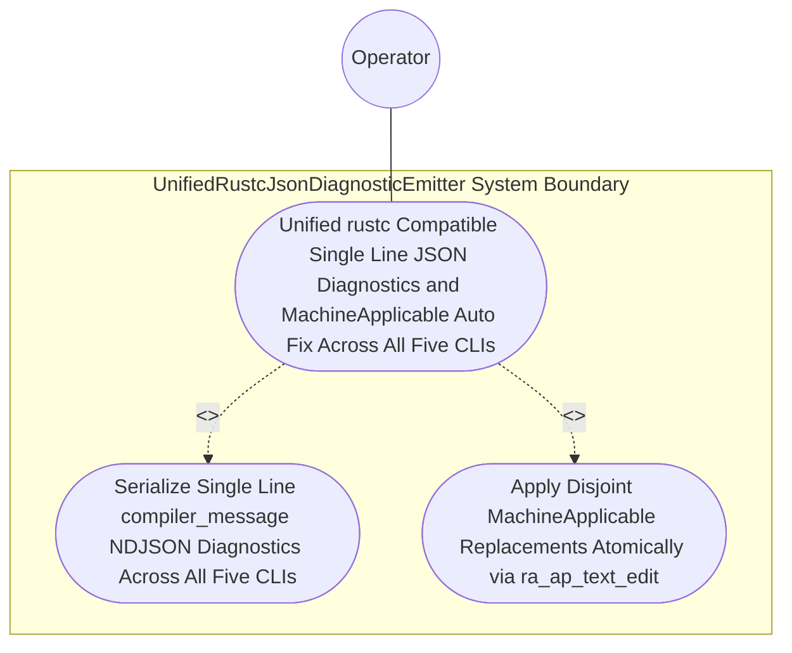
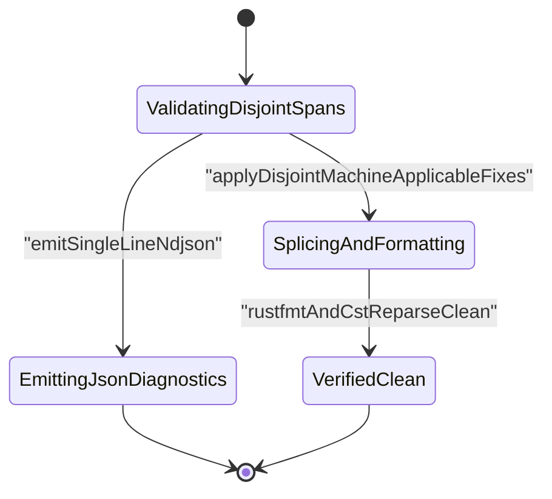

| Attribute | Specification Detail |
| :--- | :--- |
| **Issue ID** | #771 |
| **Title** | Use Case 43: Unified rustc Compatible Single Line JSON Diagnostics and Machine Applicable Auto Fix Across All Five CLIs |
| **Type** | use-case |
| **Primary Actor** | Operator |
| **Scope** | AirGappedCargoLockGovernor |
| **Level** | User Goal |
| **Generation Mode** | subagent |
| **Specification Source** | [schema/model.sysml](../../schema/model.sysml) |

# Use Case 43: Unified rustc Compatible Single Line JSON Diagnostics and Machine Applicable Auto Fix Across All Five CLIs

## UML Diagrams

### Use Case Diagram

### State Machine Diagram

## 1. Actors
- `Operator`

## 2. Preconditions
- Validation failures triggered across compile-sysml, verify-baseline, ingest-sysml, assemble-conops, and reconcile-backlog with --message-format=json, including diagnostics carrying both \"MachineApplicable\" and \"MaybeIncorrect\" child replacement spans.

## 3. Trigger
- Standard output is parsed line-by-line as JSON and --apply-machine-fixes is subsequently invoked on the offending workspace fixture.

## 4. Main Success Scenario
1. `Operator` invokes `compile-sysml`, `verify-baseline`, `ingest-sysml`, `assemble-conops`, and `reconcile-backlog` (`cli_binary_count = 5`) with `--message-format=json` on workspace fixtures containing validation failures.
2. `UnifiedRustcJsonDiagnosticEmitter` receives structured findings on `finding_in` (`zero_ansi_in_json_mode = true`, `envelope_reason = "compiler-message"`) inside `< 380` exec SLOC submodules (`crates/deap-core/src/json_diag/`).
3. `UnifiedRustcJsonDiagnosticEmitter` invokes `format_ndjson_line` to serialize each finding on `ndjson_out` as a strictly single-line NDJSON object with `reason: "compiler-message"`, `message.code.code` prefixed with `"DEAP-E"`, exact UTF-8 `byte_start`/`byte_end` and 1-based line/column spans, and zero ANSI escape codes (`C_CST_05`).
4. `Operator` subsequently invokes `--apply-machine-fixes` on `UnifiedRustcJsonDiagnosticEmitter` (`machine_applicable_only = true`) via `machine_fix_inout`.
5. `UnifiedRustcJsonDiagnosticEmitter` filters exclusively for disjoint child suggestions tagged `"MachineApplicable"` (ignoring `"MaybeIncorrect"` spans), applies them in reverse byte order, verifies post-splice CST syntax via `ra_ap_syntax`, and commits the repaired files atomically with exit code 0.

## 5. Alternate and Exception Flows
- 3a. Any CLI emits multi-line unstructured text or ANSI escape sequences while `--message-format=json` is active under `Invariant_REQ_0608_SC_04`:
  - NDJSON schema verification fails closed with exit code 1 and flags the non-compliant CLI output stream.
- 4a. Two `"MachineApplicable"` child replacement spans overlap in byte range (`Diagnostic: DEAP-E0802`):
  - `UnifiedRustcJsonDiagnosticEmitter` aborts `--apply-machine-fixes` without mutating any file, emits single-line JSON diagnostic `DEAP-E0802`, and exits fail-closed with code 1.
- 5a. Applying a `"MachineApplicable"` replacement introduces a CST syntax error (`Diagnostic: DEAP-E0803`):
  - `UnifiedRustcJsonDiagnosticEmitter` rolls back the in-memory replacement buffer, preserves prior verified file contents, and exits fail-closed with code 1.

## 6. Postconditions
- **Success Guarantee:** Every CLI (`compile-sysml`, `verify-baseline`, `ingest-sysml`, `assemble-conops`, `reconcile-backlog`) emits strictly single-line NDJSON objects with `reason: "compiler-message"`, `message.code.code` prefixed with `"DEAP-E"`, and exact UTF-8 `byte_start`/`byte_end` spans, and `--apply-machine-fixes` atomically applies only disjoint `"MachineApplicable"` suggestions.
- **Failure Guarantee:** Overlapping `"MachineApplicable"` spans (`DEAP-E0802`) or post-splice CST syntax errors (`DEAP-E0803`) roll back without mutating disk files and exit fail-closed with code 1.

## 7. Operational Context
- **Contract A (100% Normative OMG SysML v2.0 + KerML 1.0 Grammar Coverage)**: Preserves full Definition and Usage symmetry across the OMG SysML v2.0 and KerML 1.0 textual grammar with zero 16-construct caps.
- **Contract B (Official Rust Compiler, Cargo, `rust-analyzer` & Markdown AST Crate Stack)**: Uses `ra_ap_syntax`, `ra_ap_vfs`, `ra_ap_paths`, `ra_ap_line_index`, `ra_ap_text_edit`, `rowan`, `camino`, `ignore`, `pulldown-cmark`, `pulldown-cmark-to-cmark`, `cargo-lock`, `cargo_metadata`, `cargo-util-schemas`, `cargo-platform`, and `toml_edit` with explicit net-negative deletion of ~19,700+ lines of hand-rolled scanners and unstructured multi-line diagnostic formatters.
- **3-Layer Definition of Done (DoD)**:
  - **Layer 1 (Domain State & Data Model)**: `RustcJsonEnvelope` (`reason: "compiler-message"`), `RustcDiagnosticSpan` (`ra_ap_line_index::LineIndex`), and `suggestion_applicability`.
  - **Layer 2 (Logic & State Management)**: Single-line NDJSON serialization (`zero_ansi_in_json_mode = true`), `"MachineApplicable"` filtering (`machine_applicable_only = true`), and reverse-byte-order `ra_ap_text_edit::TextEdit` splicing (`Invariant_REQ_0608_SC_04_REQ_0608`, `C_CST_05`) inside `< 380`-SLOC submodules (`crates/deap-core/src/json_diag/`, `crates/deap-core/src/rust_cst/diagnostics_ndjson.rs`).
  - **Layer 3 (Presentation & Actuator Interface Binding)**: Binds `finding_in`, `ndjson_out`, and `machine_fix_inout` on `UnifiedRustcJsonDiagnosticEmitter` across all 5 CLI binaries.

## 8. Realization Matrix
| Specification Item | Type | Link / Reference |
| :--- | :--- | :--- |
| **#806** | User Story | [User Story 57: format ndjson line](../user-stories/US-57-format_ndjson_line.md) |
| **#745** | Feature | [Feature 39: [BP 08 Lossless Rust CST Codemod Engine and Unified rustc Compatible JSON Diagnostics] UnifiedRustcJsonDiagnosticEmitter](../features/FEAT-39-UnifiedRustcJsonDiagnosticEmitter.md) |
| **#746** | Feature | [Feature 40: [BP 08 Lossless Rust CST Codemod Engine and Unified rustc Compatible JSON Diagnostics] ZeroTokenRustSpanCodemodEngine](../features/FEAT-40-ZeroTokenRustSpanCodemodEngine.md) |

### Required User Stories
- [ ] #806 - [User Story 57: format ndjson line](../user-stories/US-57-format_ndjson_line.md) (serializes structured findings into single-line `rustc`-compatible NDJSON lines with `ra_ap_line_index` byte/line/col spans)

### Required Features
- [ ] #745 - [Feature 39: [BP 08 Lossless Rust CST Codemod Engine and Unified rustc Compatible JSON Diagnostics] UnifiedRustcJsonDiagnosticEmitter](../features/FEAT-39-UnifiedRustcJsonDiagnosticEmitter.md) (provides the unified NDJSON diagnostic emitter and `MachineApplicable` auto-fix engine across all 5 CLIs)
- [ ] #746 - [Feature 40: [BP 08 Lossless Rust CST Codemod Engine and Unified rustc Compatible JSON Diagnostics] ZeroTokenRustSpanCodemodEngine](../features/FEAT-40-ZeroTokenRustSpanCodemodEngine.md) (enforces disjoint `TextRange` span validation and post-splice `ra_ap_syntax` CST verification)

## Source References
Use case operational flows and lifecycle activity references:
- System Architecture Model: `schema/model.sysml`
- Normative Systems Engineering Standard: ISO/IEC/IEEE 29148:2018 §6.4.2 Concept of Operations

Operational use case realization and traceability links derive from `schema/model.sysml` pursuant to ISO/IEC/IEEE 29148.
