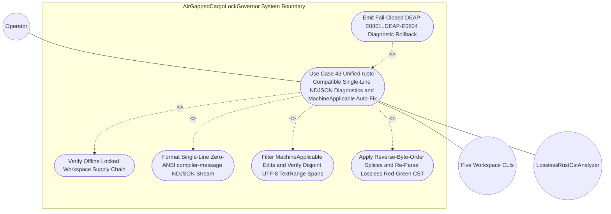

| Attribute | Specification Detail |
| :--- | :--- |
| **Issue ID** | TBD |
| **Title** | Use Case 43: Unified rustc Compatible Single Line JSON Diagnostics and Machine Applicable Auto Fix Across All Five CLIs |
| **Type** | use-case |
| **Parent Epic** | [EPIC-08: BP 08 Lossless Rust CST Codemod Engine and Unified rustc Compatible JSON Diagnostics](../epics/EPIC-08-BP_08_Lossless_Rust_CST_Codemod_Engine_and_Unified_rustc_Compatible_JSON_Diagnostics.md) |
| **Schema Containers** | `BP_08_Lossless_Rust_CST_Codemod_Engine_and_Unified_rustc_Compatible_JSON_Diagnostics::UC_AC_06_Unified_rustc_Compatible_Single_Line_JSON_Diagnostics_and_MachineApplicable_Auto_Fix_Across_All_Five_CLIs` |
| **Primary Actor** | Operator |
| **Scope** | AirGappedCargoLockGovernor |
| **Level** | User Goal |
| **Generation Mode** | subagent |
| **Specification Source** | [schema/model.sysml](../../schema/model.sysml) |

# Use Case 43: Unified rustc Compatible Single Line JSON Diagnostics and Machine Applicable Auto Fix Across All Five CLIs

## UML Diagrams

## 1. Actors
- **Primary Actor:** `Operator` (automated CI/CD verification pipeline, IDE diagnostic consumer, or deterministic codemod runner invoking workspace binaries with `--message-format=json` and `--apply-machine-fixes`).
- **Secondary Actors:**
  - `UnifiedRustcJsonDiagnosticEmitter` (`crates/deap-core/src/diagnostics.rs`, bound to `finding_in`, `ndjson_out`, and `machine_fix_inout` ports across `cli_binary_count == 5`).
  - `Five Workspace CLI Drivers` (`compile-sysml` at `crates/compile-sysml/src/main.rs`, `verify-baseline` at `crates/verify-baseline/src/main.rs`, `ingest-sysml` at `crates/ingest-sysml/src/main.rs`, `assemble-conops` at `crates/assemble-conops/src/main.rs`, and `reconcile-backlog` at `crates/reconcile-backlog/src/main.rs`).
  - `LosslessRustCstAnalyzer` (`crates/deap-core/src/source_ast.rs`, bound to `rust_source_in` and `metrics_report_out` for `ra_ap_syntax` + `rowan` lossless Red/Green CST re-parse verification).
  - `AirGappedCargoLockGovernor` (governing subject `part def` verifying `--offline --locked` workspace integrity via `manifest_lock_in` and `lock_receipt_out`).

## 2. Preconditions
- `AirGappedCargoLockGovernor` has verified `offline_locked_enforced == true` and `vendor_bundle_supported == true` against pinned `Cargo.toml` and `Cargo.lock` SHA-256 package checksums, sealing `SupplyChainVerificationReceipt` on `lock_receipt_out` while the lifecycle state machine resides in `Idle`.
- All five workspace CLI binaries (`compile-sysml`, `verify-baseline`, `ingest-sysml`, `assemble-conops`, and `reconcile-backlog`) bind to the shared `UnifiedRustcJsonDiagnosticEmitter` contract in `crates/deap-core/src/diagnostics.rs` with `cli_binary_count == 5`, `envelope_reason == "compiler-message"`, `zero_ansi_in_json_mode == true`, and `machine_applicable_only == true`.
- Target workspace `.rs`, `.sysml` (`crates/deap-core/src/sysml_ast/mod.rs`), and `.md` specification fixtures contain valid UTF-8 byte streams where diagnostic findings include both `"MachineApplicable"` and `"MaybeIncorrect"` child replacement spans.

## 3. Trigger
- `Operator` executes one or more of the five workspace CLIs (`compile-sysml`, `verify-baseline`, `ingest-sysml`, `assemble-conops`, or `reconcile-backlog`) with `--message-format=json` to stream structured validation diagnostics on standard output, and subsequently invokes `--apply-machine-fixes` to execute deterministic reverse-byte-order `TextRange` remediation on the workspace fixture.

## 4. Main Success Scenario
1. `Operator` invokes `compile-sysml`, `verify-baseline`, `ingest-sysml`, `assemble-conops`, or `reconcile-backlog` with `--message-format=json` on a target workspace after `AirGappedCargoLockGovernor` completes `verifyOfflineLockedBuild` and returns `reply_SupplyChainVerificationReceipt`.
2. The invoked CLI driver evaluates its domain pipeline (`crates/deap-core/src/sysml_ast/mod.rs`, `crates/deap-core/src/source_ast.rs`, and `crates/deap-core/src/error.rs`) and emits typed `DeapDiagnosticFinding` records onto `UnifiedRustcJsonDiagnosticEmitter::finding_in` containing `"DEAP-E"` diagnostic codes, canonical severity `level` values (`"error"`, `"warning"`, `"note"`, `"help"`), primary UTF-8 `TextRange` spans, and child suggestion spans tagged `"MachineApplicable"` or `"MaybeIncorrect"`.
3. `UnifiedRustcJsonDiagnosticEmitter` validates finding invariants at `finding_in` (`cli_binary_count == 5`, `envelope_reason == "compiler-message"`, `"DEAP-E"` prefix on `code`, `0 <= byte_start <= byte_end <= source.len()`, and `str::is_char_boundary` at both endpoints via panic-free `.get(byte_start..byte_end)` slice access), resolving 1-based `line_start`, `line_end`, `column_start`, and `column_end` coordinates via precomputed `O(N)` line-start byte tables and `O(log N)` binary search within `MAX_AST_DEPTH = 64`.
4. `UnifiedRustcJsonDiagnosticEmitter` executes `formatNdjsonLine` (`crates/deap-core/src/diagnostics.rs`) to encode each finding as a single-line `rustc`-compatible JSON object (`{"reason":"compiler-message","message":{"code":{"code":"DEAP-E..."},"level":"...","spans":[...],"children":[...]}}`) verified free of embedded `0x0A` newline and `0x1B` ANSI escape bytes (`zero_ansi_in_json_mode == true`), writing `reply_RustcNdjsonLineStream` to `ndjson_out` under an exclusive line-atomic stdout lock while suppressing all unstructured human banners.
5. `Operator` parses the standard output stream line-by-line as strict NDJSON and invokes `--apply-machine-fixes` (paired with `--message-format=json`) on the workspace fixture, driving the lifecycle state machine through `ParsingLosslessCst` (`parseRustCst` -> `losslessRedGreenTreeReady`) and `AnalyzingMetricsAndTiers` (`planCodemodOrMachineFix`) into `ValidatingDisjointSpans` on port `machine_fix_inout` (`AtomicSpanFixTransaction`).
6. `UnifiedRustcJsonDiagnosticEmitter` enforces `machine_applicable_only == true` by filtering child replacement spans exclusively to `suggestion_applicability == "MachineApplicable"` (retaining `"MaybeIncorrect"`, `"HasPlaceholders"`, and `"Unspecified"` spans as read-only diagnostics without mutation), inserts candidate edits into a deterministic `BTreeMap<(PathBuf, usize, usize), SpanReplacement>`, and verifies pairwise non-overlapping `TextRange` intervals (`b_i <= a_{i+1}`) to trigger `disjointUtf8SpansVerified` into `SplicingAndFormatting`.
7. Inside `SplicingAndFormatting`, `UnifiedRustcJsonDiagnosticEmitter` applies all `"MachineApplicable"` `suggested_replacement` patches per target file strictly in reverse byte-offset order (`byte_start` descending) using checked and `saturating_*` buffer capacity arithmetic (`runtime_llm_token_count == 0`), preserving exact upstream UTF-8 byte offsets across length-changing replacements.
8. `UnifiedRustcJsonDiagnosticEmitter` dispatches `analyzeMetrics` to `LosslessRustCstAnalyzer` (`crates/deap-core/src/source_ast.rs`) on every spliced `.rs` buffer to verify lossless `ra_ap_syntax` + `rowan` Red/Green CST re-parse integrity (`errors().is_empty()`, `rustfmtAndCstReparseClean`), `#![forbid(unsafe_code)]` preservation, and `DocTier` bounds (`<= 50` target / `<= 80` ceiling exec SLOC, `<= 5` params, `0` mutable `bool` flags) with `cfg(test)` unit-test module subtrees cleanly excluded from production accumulators.
9. Upon receiving clean `reply_DeapV2AstMetrics`, `UnifiedRustcJsonDiagnosticEmitter` stages each patched buffer into a sibling temporary file, executes atomic rename commit (`atomicFilesCommitted`) through `RewritingCheck37Paths` and `VerifyingSelfHostFixedPoint` (`stage1EqualsStage2Sha256`) into `VerifiedClean`, and returns deterministic exit code `0` to `Operator`.

## 5. Alternate and Exception Flows
- 5a. **Malformed Diagnostic Record or Non-UTF-8 Mid-Codepoint `TextRange` Boundary (`FM-BP08-013` / `DEAP-E0801` / `SC-BP08-13`, Failure Category I - Input and Boundary Syntax, Branches from Main Success Scenario step 3):**
  1. `UnifiedRustcJsonDiagnosticEmitter` inspects an incoming `DeapDiagnosticFinding` on `finding_in` and detects a missing `"DEAP-E"` code prefix, an unrecognized `level` string, mutated emitter invariants (`cli_binary_count != 5`, `envelope_reason != "compiler-message"`, `zero_ansi_in_json_mode == false`, or `machine_applicable_only == false`), inverted offsets (`byte_start > byte_end`), out-of-bounds `byte_end > source.len()`, or a mid-codepoint UTF-8 offset failing `str::is_char_boundary` / `.get(byte_start..byte_end)`.
  2. `UnifiedRustcJsonDiagnosticEmitter` refuses raw byte slicing, transitions directly to `EmittingJsonDiagnostics`, and serializes a single-line fail-closed `DEAP-E0801` (`SC-BP08-13`) `compiler-message` NDJSON diagnostic onto `ndjson_out`.
  3. The active CLI aborts before opening `machine_fix_inout`, leaves 100% of on-disk workspace files unmodified, and terminates with exit code `1`.
- 5b. **Overlapping `MachineApplicable` `TextRange` Collision or Unlocked Stdout Contention (`FM-BP08-014` / `DEAP-E0802` / `SC-BP08-14`, Failure Category II - State, Concurrency, and Ordering, Branches from Main Success Scenario step 4 and step 6):**
  1. While constructing the `BTreeMap`-ordered `AtomicSpanFixTransaction` in `ValidatingDisjointSpans` (after discarding `"MaybeIncorrect"` spans), `UnifiedRustcJsonDiagnosticEmitter` detects two `"MachineApplicable"` `suggested_replacement` intervals in the same file where `prev_byte_end > next_byte_start` (or intercepts an unsorted forward-offset patch list).
  2. `UnifiedRustcJsonDiagnosticEmitter` triggers transition `rejectSpanCollisionOrMissingSymbol` into `EmittingJsonDiagnostics`, acquires the exclusive line-atomic stdout lock (blocking any concurrent banner writes when `--message-format=json` is active), and flushes a single-line `DEAP-E0802` (`SC-BP08-14`) `compiler-message` NDJSON diagnostic on `ndjson_out`.
  3. `UnifiedRustcJsonDiagnosticEmitter` discards the in-memory `AtomicSpanFixTransaction` without mutating any source buffer or disk file and returns exit code `1` to `Operator`.
- 5c. **Diagnostic Child-Tree Depth Breach or Coordinate/Buffer Arithmetic Exhaustion (`FM-BP08-015` / `DEAP-E0804` / `SC-BP08-15`, Failure Category III - Resource, Depth, and Arithmetic Exhaustion, Branches from Main Success Scenario step 3 and step 7):**
  1. During nested `children` traversal or reverse-byte-order buffer reservation, `UnifiedRustcJsonDiagnosticEmitter` detects `children` nesting depth exceeding `MAX_AST_DEPTH = 64` levels, aggregate `suggested_replacement` byte length exceeding configured memory budgets, or checked arithmetic failure (`checked_sub` / `checked_add` / `saturating_*` guard trigger) on span deltas and 1-based line/column coordinates.
  2. `UnifiedRustcJsonDiagnosticEmitter` halts traversal immediately to preserve `O(N + M log M)` time and `O(N + M)` space bounds (**Invariant_REQ_0608_SC_04_REQ_0608**), transitions to `EmittingJsonDiagnostics`, and emits a single-line `DEAP-E0804` (`SC-BP08-15`) `compiler-message` NDJSON diagnostic on `ndjson_out`.
  3. The active CLI releases transient buffers cleanly with zero partial writes on `machine_fix_inout` and returns exit code `1` to `Operator`.
- 5d. **Raw Newline/ANSI Escape Serialization Breach or Post-Splice Lossless CST Syntax Error (`FM-BP08-016` / `DEAP-E0803` / `SC-BP08-16`, Failure Category IV - Output, Serialization, and Partial-Write Integrity, Branches from Main Success Scenario step 4 and step 8):**
  1. After reverse-byte-order `MachineApplicable` patching in `SplicingAndFormatting`, `LosslessRustCstAnalyzer` re-parses the candidate UTF-8 buffer via `ra_ap_syntax::SourceFile::parse` and reports one or more CST syntax errors (`!errors().is_empty()`), or the NDJSON serializer detects an unescaped `0x0A` newline or `0x1B` ANSI escape byte before flushing `ndjson_out` (or Stage-1 vs Stage-2 verification detects `DEAP-E0705` drift in `VerifyingSelfHostFixedPoint`).
  2. `UnifiedRustcJsonDiagnosticEmitter` fires `rejectPostSpliceSyntaxError` (or `rejectFixedPointDriftE0705`) into `EmittingJsonDiagnostics`, unlinks any staged sibling temporary file before atomic rename, and sanitizes/validates the outbound error frame to guarantee zero `0x0A` and `0x1B` bytes.
  3. `UnifiedRustcJsonDiagnosticEmitter` emits a single-line `DEAP-E0803` (`SC-BP08-16`) or `DEAP-E0705` `compiler-message` NDJSON diagnostic on `ndjson_out`, preserves the prior verified workspace files bit-for-bit on disk, and exits fail-closed with exit code `1`.

## 6. Postconditions
- **Success Guarantee:**
  - All five workspace CLIs (`compile-sysml`, `verify-baseline`, `ingest-sysml`, `assemble-conops`, `reconcile-backlog`) emit strictly single-line `rustc`-compatible NDJSON records (`reason: "compiler-message"`, `"DEAP-E"` prefixed `message.code.code`, canonical `level`, exact UTF-8 `byte_start`/`byte_end` and 1-based line/column `spans`, zero `0x0A` internal newlines, and zero `0x1B` ANSI escape sequences).
  - Under `--apply-machine-fixes`, 100% of disjoint `"MachineApplicable"` `suggested_replacement` spans are applied in reverse byte order, `"MaybeIncorrect"` spans remain untouched, spliced `.rs` buffers pass lossless `ra_ap_syntax` Red/Green CST re-parsing with zero syntax errors, and modified files are persisted via atomic temp-file rename into `VerifiedClean` with `runtime_llm_token_count == 0`.
- **Failure Guarantee:**
  - On any malformed diagnostic input (`DEAP-E0801`), overlapping `TextRange` span collision (`DEAP-E0802`), post-splice CST syntax error or serialization violation (`DEAP-E0803`), resource/depth ceiling breach (`DEAP-E0804`), or self-host fixed-point drift (`DEAP-E0705`), execution aborts fail-closed in `EmittingJsonDiagnostics` with exit code `1`, unlinks all temporary staging artifacts, and leaves every target workspace file bit-for-bit identical to its pre-invocation state.

## 7. Operational Context
`UnifiedRustcJsonDiagnosticEmitter` (**REQ-0608** / **BP-08**, `DEAP-BP-DET-08`) unifies machine-readable error reporting and deterministic zero-LLM-token auto-remediation across all five release binaries (`compile-sysml`, `verify-baseline`, `ingest-sysml`, `assemble-conops`, and `reconcile-backlog`). By mirroring `rustc` and `cargo check --message-format=json` single-line NDJSON framing alongside reverse-byte-order `TextRange` splicing verified by `LosslessRustCstAnalyzer`, automated verification harnesses consume diagnostics deterministically in air-gapped DO-178C Level A / DO-330 TQL-4 build environments without brittle multi-line text scraping or partial-write corruption.

### Mathematical Formulations and Safety Invariants

$$
\begin{aligned}
0 \le a_i \le b_i &\le L_S \\
b_i &\le a_{i+1} \\
C_{0\text{x0A}}(d_j) + C_{0\text{x1B}}(d_j) &= 0 \\
E_{\text{cst}}(S_{\text{spliced}}) &= 0 \\
T_{\text{emit}}(N, M) &= O(N + M \log M) \\
M_{\text{space}}(N, M) &= O(N + M) \\
K_{\text{LLM}} &= 0
\end{aligned}
$$

- Parameter Definitions & Engineering Units:
- $a_i, b_i$: Validated UTF-8 character-boundary start (`byte_start`) and end (`byte_end`) offsets of the $i$-th sorted `"MachineApplicable"` `TextRange` span in bytes (`0 <= a_i <= b_i <= L_S`, pairwise disjoint $b_i \le a_{i+1}$ for $1 \le i < M$).
- $L_S$: Total byte length of the input UTF-8 source buffer $S$ in bytes.
- $d_j$: Encoded single-line JSON byte record of the $j$-th `compiler-message` diagnostic envelope prior to the trailing NDJSON line separator.
- $C_{0\text{x0A}}(d_j)$: Count of embedded raw newline bytes (`0x0A` bytes) inside encoded diagnostic record $d_j$ (mandated equal to `0` bytes).
- $C_{0\text{x1B}}(d_j)$: Count of ANSI terminal escape bytes (`0x1B` bytes) inside encoded diagnostic record $d_j$ (mandated equal to `0` bytes when `--message-format=json` is active).
- $E_{\text{cst}}(S_{\text{spliced}})$: Syntax error count returned by `ra_ap_syntax::SourceFile::parse` on the reverse-byte-order spliced buffer $S_{\text{spliced}}$ (mandated equal to `0` errors prior to atomic rename).
- $N, M$: Source buffer size $N$ in bytes and candidate diagnostic/replacement span count $M$ in spans.
- $T_{\text{emit}}(N, M), M_{\text{space}}(N, M)$: Asymptotic time complexity $O(N + M \log M)$ and auxiliary memory complexity $O(N + M)$ for line-table indexing, `BTreeMap` span sorting, reverse splicing, and NDJSON serialization.
- $K_{\text{LLM}}$: Runtime large-language-model token consumption during diagnostic emission and `MachineApplicable` span patching (mandated equal to `0` tokens per **C_CST_05**).

## 8. Realization Matrix

| Use Case | User Story | Feature | Parent Epic | Verification Test Case (`cfg(test)`) | Traceability & Semantic Realization Justification |
| :--- | :--- | :--- | :--- | :--- | :--- |
| `Use Case 43` (`UC_AC_06`) | [US-55: formatNdjsonLine](../user-stories/US-55-formatNdjsonLine.md) | [FEAT-44: UnifiedRustcJsonDiagnosticEmitter](../features/FEAT-44-UnifiedRustcJsonDiagnosticEmitter.md) | [EPIC-08: BP 08 Lossless Rust CST Codemod Engine and Unified rustc Compatible JSON Diagnostics](../epics/EPIC-08-BP_08_Lossless_Rust_CST_Codemod_Engine_and_Unified_rustc_Compatible_JSON_Diagnostics.md) | `TEST-BP08-AC06-NDJSON-FIVE-CLIS` | Verifies single-line `reason: "compiler-message"` NDJSON serialization (`formatNdjsonLine`), `"DEAP-E"` diagnostic code prefixes, canonical `level` values, exact UTF-8 `spans`, and zero `0x0A`/`0x1B` bytes across `compile-sysml`, `verify-baseline`, `ingest-sysml`, `assemble-conops`, and `reconcile-backlog` (**AC-06**, `SC-BP08-13`, `SC-BP08-16`). |
| `Use Case 43` (`UC_AC_06`) | [US-55: formatNdjsonLine](../user-stories/US-55-formatNdjsonLine.md) | [FEAT-44: UnifiedRustcJsonDiagnosticEmitter](../features/FEAT-44-UnifiedRustcJsonDiagnosticEmitter.md) | [EPIC-08: BP 08 Lossless Rust CST Codemod Engine and Unified rustc Compatible JSON Diagnostics](../epics/EPIC-08-BP_08_Lossless_Rust_CST_Codemod_Engine_and_Unified_rustc_Compatible_JSON_Diagnostics.md) | `TEST-BP08-AC06-MACHINE-APPLICABLE-SPLICE` | Verifies `machine_applicable_only == true` filtering (skipping `"MaybeIncorrect"` child spans), deterministic `BTreeMap` reverse-byte-order `suggested_replacement` UTF-8 `TextRange` patching, post-splice `LosslessRustCstAnalyzer` zero-error re-parse, and atomic temp-file rename (**AC-06**, `SC-BP08-14`, `SC-BP08-16`). |
| `Use Case 43` (`UC_AC_06`) | [US-55: formatNdjsonLine](../user-stories/US-55-formatNdjsonLine.md) | [FEAT-44: UnifiedRustcJsonDiagnosticEmitter](../features/FEAT-44-UnifiedRustcJsonDiagnosticEmitter.md) | [EPIC-08: BP 08 Lossless Rust CST Codemod Engine and Unified rustc Compatible JSON Diagnostics](../epics/EPIC-08-BP_08_Lossless_Rust_CST_Codemod_Engine_and_Unified_rustc_Compatible_JSON_Diagnostics.md) | `TEST-BP08-FM013-016-FAIL-CLOSED-GUARDS` | Verifies fail-closed exit code `1` and zero disk mutation on malformed/mid-codepoint spans (`FM-BP08-013` / `DEAP-E0801`), overlapping `TextRange` collisions (`FM-BP08-014` / `DEAP-E0802`), post-splice CST syntax errors (`FM-BP08-016` / `DEAP-E0803`), and `MAX_AST_DEPTH = 64` levels or checked-arithmetic overflow (`FM-BP08-015` / `DEAP-E0804`). |

## 9. Three-Layer Definition of Done
1. **Layer 1 -- Domain State and Data Model (`crates/deap-core/src/diagnostics.rs`, `crates/deap-core/src/error.rs`, `crates/deap-core/src/sysml_ast/mod.rs`):**
   - Define immutable, `#![forbid(unsafe_code)]`-compliant diagnostic and auto-fix domain structures (`DeapDiagnosticFinding`, `RustcCompilerMessageEnvelope`, `RustcDiagnosticCode`, `RustcDiagnosticLevel`, `RustcDiagnosticSpan`, `SuggestionApplicability`, and `AtomicSpanFixTransaction`) backed by exhaustive typed error enums (`DiagnosticEmitError` and `SpanFixError` mapping deterministically to `DEAP-E0801`, `DEAP-E0802`, `DEAP-E0803`, `DEAP-E0804`, and `DEAP-E0705`) with zero `Result<T, String>` signatures.
   - Store multi-file replacement plans and touched-file manifests exclusively in deterministic `BTreeMap` and `BTreeSet` containers keyed by canonical workspace-relative paths and UTF-8 `TextRange` coordinates.
2. **Layer 2 -- Logic and State Management (`crates/deap-core/src/diagnostics.rs`, `crates/deap-core/src/source_ast.rs`):**
   - Implement total validation, `O(N)` line-table binary-search coordinate lookup, `MachineApplicable` span filtering, and reverse-byte-order splicing functions obeying `<= 50` target (`<= 80` hard ceiling) executable SLOC per function (**C_CST_01**), `<= 5` formal parameters excluding receiver arguments (**C_CST_02**), `0` mutable local boolean flags (**C_CST_03**), and iterative child-tree traversal bounded by `MAX_AST_DEPTH = 64` levels.
   - Enforce panic-free `.get(byte_start..byte_end)` slice indexing guarded by `str::is_char_boundary`, checked and `saturating_*` integer arithmetic (`checked_sub`, `checked_add`, `saturating_add`) across all byte-offset deltas, in-memory `ra_ap_syntax::SourceFile::parse` post-splice verification (excluding `cfg(test)` unit-test module subtrees from production `DocTier` metrics), and sibling temporary-file staging with atomic rename rollback.
3. **Layer 3 -- Presentation and CLI `--message-format=json` NDJSON Interface Binding (`crates/compile-sysml/src/main.rs`, `crates/verify-baseline/src/main.rs`, `crates/ingest-sysml/src/main.rs`, `crates/assemble-conops/src/main.rs`, `crates/reconcile-backlog/src/main.rs`):**
   - Bind `--message-format=json` and `--apply-machine-fixes` CLI flags uniformly across all five release binaries (`cli_binary_count == 5`), routing every validation, parser, codemod, and baseline finding through `UnifiedRustcJsonDiagnosticEmitter`.
   - Enforce exclusive line-atomic stdout flushing of single-line `reason: "compiler-message"` NDJSON records (`0` internal `0x0A` bytes, `0` `0x1B` ANSI escape codes, human banners suppressed) and deterministic process exit status (`0` on verified clean or committed `MachineApplicable` fixes; `1` on fail-closed diagnostic rejection).

## Source References
Use case operational flows, failure mode mitigations, and lifecycle activity references:
- System Architecture Model: [schema/model.sysml](../../schema/model.sysml) and `docs/designs/blueprint-08-rust-analyzer-cst-refactoring-and-json-diagnostics.sysml`
- Component Failure Mode Registry: [FAILURE_MODE_REGISTRY.md](../research/FAILURE_MODE_REGISTRY.md) (`FM-BP08-013`, `FM-BP08-014`, `FM-BP08-015`, `FM-BP08-016`)
- Core Implementation Boundaries: `crates/deap-core/src/diagnostics.rs`, `crates/deap-core/src/error.rs`, `crates/deap-core/src/source_ast.rs`, `crates/deap-core/src/sysml_ast/mod.rs`
- Normative Systems Engineering Standard: ISO/IEC/IEEE 29148:2018 Section 6.4.2 Concept of Operations and DO-178C Level A / DO-330 TQL-4 Tool Qualification

Operational use case realization and traceability links derive from `schema/model.sysml` pursuant to ISO/IEC/IEEE 29148:2018.
