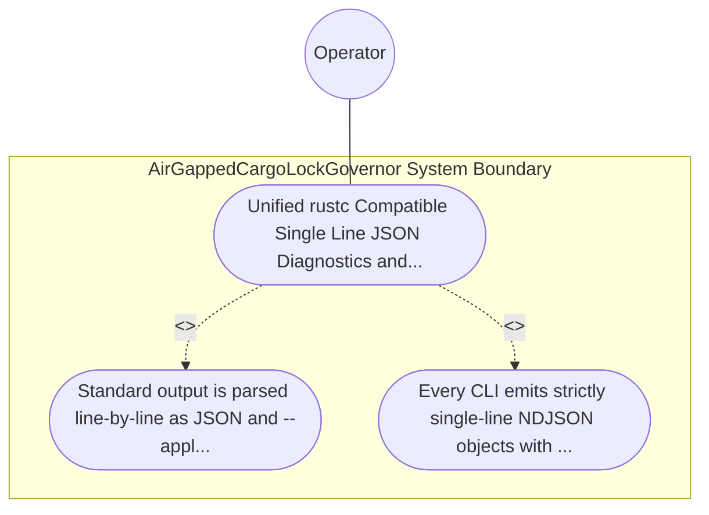

| Attribute | Specification Detail |
| :--- | :--- |
| **Issue ID** | TBD |
| **Title** | Use Case 43: Unified rustc Compatible Single Line JSON Diagnostics and Machine Applicable Auto Fix Across All Five CLIs |
| **Type** | use-case |
| **Primary Actor** | Operator |
| **Scope** | AirGappedCargoLockGovernor |
| **Level** | User Goal |
| **Generation Mode** | subagent |
| **Specification Source** | [schema/model.sysml](../../schema/model.sysml) |

# Use Case 43: Unified rustc Compatible Single Line JSON Diagnostics and Machine Applicable Auto Fix Across All Five CLIs

## UML Diagrams

## 1. Actors
- `Operator`

## 2. Preconditions
- Validation failures triggered across compile-sysml, verify-baseline, ingest-sysml, assemble-conops, and reconcile-backlog with --message-format=json, including diagnostics carrying both \"MachineApplicable\" and \"MaybeIncorrect\" child replacement spans.

## 3. Trigger
- Standard output is parsed line-by-line as JSON and --apply-machine-fixes is subsequently invoked on the offending workspace fixture.

## 4. Main Success Scenario
1. Standard output is parsed line-by-line as JSON and --apply-machine-fixes is subsequently invoked on the offending workspace fixture.
2. Every CLI emits strictly single-line NDJSON objects with reason: \"compiler-message\", message.code.code prefixed with \"DEAP-E\", exact UTF-8 byte_start/byte_end and.

## 5. Alternate and Exception Flows
- Precondition guard failure in `AirGappedCargoLockGovernor`:
  - `AirGappedCargoLockGovernor` rejects the `Unified rustc Compatible Single Line JSON Diagnostics and Machine Applicable Auto Fix Across All Five CLIs` request without partial state mutation and reports diagnostic status to `Operator`.
- Invariant violation while enforcing `Unified rustc Compatible Single Line JSON Diagnostics and MachineApplicable Auto Fix Across All Five CLIs`:
  - `AirGappedCargoLockGovernor` aborts `Unified rustc Compatible Single Line JSON Diagnostics and Machine Applicable Auto Fix Across All Five CLIs` execution, preserves prior verified state, and notifies `Operator`.

## 6. Postconditions
- Every CLI emits strictly single-line NDJSON objects with reason: \"compiler-message\", message.code.code prefixed with \"DEAP-E\", exact UTF-8 byte_start/byte_end and.

## 8. Realization Matrix
| Specification Item | Type | Link / Reference |
| :--- | :--- | :--- |
| **TBD** | User Story | [User Story 56: analyze Metrics](../user-stories/US-56-analyzeMetrics.md) |
| **TBD** | Feature | [Feature 41: [BP 08 Lossless Rust CST Codemod Engine and Unified rustc Compatible JSON Diagnostics] AirGappedCargoLockGovernor](../features/FEAT-41-AirGappedCargoLockGovernor.md) |

## Source References
Use case operational flows and lifecycle activity references:
- System Architecture Model: `schema/model.sysml`
- Normative Systems Engineering Standard: ISO/IEC/IEEE 29148:2018 §6.4.2 Concept of Operations

Operational use case realization and traceability links derive from `schema/model.sysml` pursuant to ISO/IEC/IEEE 29148.
