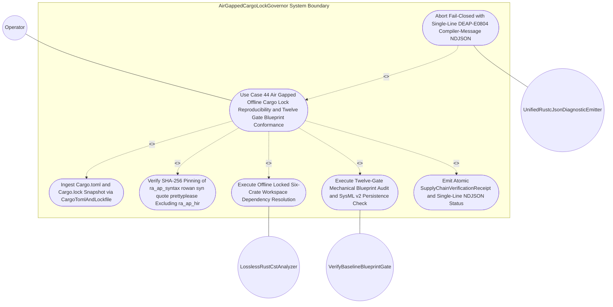

| Attribute | Specification Detail |
| :--- | :--- |
| **Issue ID** | TBD |
| **Title** | Use Case 44: Air Gapped Offline Cargo Lock Reproducibility and Twelve Gate Blueprint Conformance |
| **Type** | use-case |
| **Parent Epic** | [Epic 08: BP 08 Lossless Rust CST Codemod Engine and Unified rustc Compatible JSON Diagnostics](../epics/EPIC-08-BP_08_Lossless_Rust_CST_Codemod_Engine_and_Unified_rustc_Compatible_JSON_Diagnostics.md) |
| **Primary Actor** | Operator |
| **Scope** | AirGappedCargoLockGovernor |
| **Schema Containers** | `BP_08_Lossless_Rust_CST_Codemod_Engine_and_Unified_rustc_Compatible_JSON_Diagnostics::UC_AC_07_Air_Gapped_Offline_Cargo_Lock_Reproducibility_and_Twelve_Gate_Blueprint_Conformance` |
| **Level** | User Goal |
| **Generation Mode** | subagent |
| **Specification Source** | [schema/model.sysml](../../schema/model.sysml) |

# Use Case 44: Air Gapped Offline Cargo Lock Reproducibility and Twelve Gate Blueprint Conformance

## Parent Epic
- [ ] [EPIC-08: BP 08 Lossless Rust CST Codemod Engine and Unified rustc Compatible JSON Diagnostics](../epics/EPIC-08-BP_08_Lossless_Rust_CST_Codemod_Engine_and_Unified_rustc_Compatible_JSON_Diagnostics.md) (governs **REQ-0608** / **BP-08** air-gapped DO-330 TQL-4 dependency lock reproducibility, lossless Concrete Syntax Tree refactoring, and 12-gate mechanical blueprint conformance)

## UML Diagrams

### Use Case Diagram

## 1. Actors
- **Primary Actor:** `Operator` (release verification engineer or air-gapped DO-330 TQL-4 continuous integration runner invoking offline locked workspace checks and 12-gate blueprint verification).
- **Secondary Actors:**
  - `LosslessRustCstAnalyzer` (downstream **BP-08** syntax-tree analyzer bound via `verifyOfflineLockedBuild` and `reply_SupplyChainVerificationReceipt` interaction lifelines in `crates/deap-core/src/source_ast.rs`).
  - `VerifyBaselineBlueprintGate` (mechanical 12-gate blueprint conformance engine in `crates/verify-baseline/src/blueprint_gate.rs` validating `docs/designs/blueprint-08-rust-analyzer-cst-refactoring-and-json-diagnostics.md` and SysML v2 persistence parity).
  - `UnifiedRustcJsonDiagnosticEmitter` (single-line zero-ANSI `rustc`-compatible NDJSON diagnostic serializer in `crates/deap-core/src/diagnostics.rs` enforcing `envelope_reason == "compiler-message"` across all workspace CLIs).

## 2. Preconditions
- `AirGappedCargoLockGovernor` is initialized in the `Idle` lifecycle state with immutable governance attributes `offline_locked_enforced == true` and `vendor_bundle_supported == true` (**REQ-0608**, **SC-BP08-01**).
- Workspace `Cargo.toml` and `Cargo.lock` (optionally paired with a deterministic `cargo vendor` directory bundle) are pre-populated on local storage with zero external network connectivity required, pinning exact crate versions and 64-hex-digit SHA-256 checksums for `ra_ap_syntax`, `rowan`, `syn`, `proc-macro2`, `quote`, and `prettyplease` while excluding `ra_ap_hir`.
- All six workspace crates (`crates/deap-core`, `crates/compile-sysml`, `crates/verify-baseline`, `crates/ingest-sysml`, `crates/assemble-conops`, and `crates/reconcile-backlog`) and the target engineering blueprint `docs/designs/blueprint-08-rust-analyzer-cst-refactoring-and-json-diagnostics.md` (alongside its persisted SysML v2 model `docs/designs/blueprint-08-rust-analyzer-cst-refactoring-and-json-diagnostics.sysml`) reside on canonical workspace-relative paths.
- Compiled release binary `./target/release/verify-baseline` is present and ready to evaluate `check-blueprint` and `--message-format=json` contracts.

## 3. Trigger
- `Operator` initiates `verifyOfflineLockedBuild` over input port `manifest_lock_in` (`manifest_lock_in_flow`, protocol `CargoTomlAndLockfile`) by executing offline locked workspace resolution (`cargo check --workspace --offline --locked`) followed by `./target/release/verify-baseline check-blueprint docs/designs/blueprint-08-rust-analyzer-cst-refactoring-and-json-diagnostics.md` (with optional `--message-format=json` NDJSON diagnostic streaming).

## 4. Main Success Scenario
1. `Operator` invokes offline locked supply-chain and 12-gate blueprint verification against the air-gapped workspace root, delivering the workspace `Cargo.toml` and `Cargo.lock` paths onto `AirGappedCargoLockGovernor::manifest_lock_in` (`CargoTomlAndLockfile` protocol).
2. `AirGappedCargoLockGovernor` transitions from `Idle` to `ParsingLosslessCst`, verifies `offline_locked_enforced == true` and `vendor_bundle_supported == true`, enforces deterministic byte-size ceilings on `Cargo.toml` and `Cargo.lock`, and parses both manifests into an immutable `BTreeMap`-indexed `SupplyChainLockSnapshot` in `crates/deap-core/src/workspace.rs` and `crates/deap-core/src/source_ast.rs`.
3. `AirGappedCargoLockGovernor` traverses the `[[package]]` dependency graph iteratively within `MAX_AST_DEPTH = 64` using `BTreeSet` cycle guards and `checked_add` / `saturating_add` package counters, verifying that every third-party package carries an exact 64-lowercase-hex-digit SHA-256 `checksum`, zero wildcard or unpinned git dependencies exist, `ra_ap_syntax`, `rowan`, `syn`, `proc-macro2`, `quote`, and `prettyplease` are deterministically pinned, and heavyweight semantic crate `ra_ap_hir` is completely absent from the transitive closure.
4. `AirGappedCargoLockGovernor` transitions to `AnalyzingMetricsAndTiers` and dispatches `verifyOfflineLockedBuild` to `LosslessRustCstAnalyzer`, confirming zero-network `--offline --locked` (and `cargo vendor`-compatible) dependency resolution across all six workspace crates (`crates/deap-core`, `crates/compile-sysml`, `crates/verify-baseline`, `crates/ingest-sysml`, `crates/assemble-conops`, and `crates/reconcile-backlog`) without mutating `Cargo.lock`.
5. `LosslessRustCstAnalyzer` returns `reply_SupplyChainVerificationReceipt` confirming that the locked dependency graph compiles cleanly under `#![forbid(unsafe_code)]` domain isolation and satisfies **BP-08** structural complexity invariants (`C_CST_01` `max_fn_exec_sloc <= 50` within the workspace `<= 80` exec SLOC ceiling, `C_CST_02` `max_fn_param_count <= 5`, `C_CST_03` `max_mut_bool_flags == 0`, `C_CST_04` `stage_fixed_point_mismatch_files == 0`, `C_CST_05` `runtime_llm_token_count == 0`, and `C_CST_06` `tier_bc_max_doc_lines == 2`).
6. `AirGappedCargoLockGovernor` transitions to `VerifyingSelfHostFixedPoint` and invokes `VerifyBaselineBlueprintGate` (`./target/release/verify-baseline check-blueprint docs/designs/blueprint-08-rust-analyzer-cst-refactoring-and-json-diagnostics.md` in `crates/verify-baseline/src/blueprint_gate.rs`) to evaluate all twelve mechanical blueprint conformance gates: (a) metadata frontmatter completeness, (b) mandatory eight-part blueprint skeleton, (c) five-column STPA/FMECA Derivation-Annotation Contract parity, (d) pure symbolic KaTeX `$$ \begin{aligned}...\end{aligned} $$` equation separation, (e) quoted zero-brace Mermaid UML diagram validity, (f) `C_CST_01`..`C_CST_06` assert constraint coverage, (g) Check-37 crate module path existence (`crates/deap-core/src/source_ast.rs`, `crates/deap-core/src/sysml_ast/mod.rs`, `crates/verify-baseline/src/blueprint_gate.rs`), (h) Given-When-Then acceptance criteria (`AC-01`..`AC-07`) completeness, (i) printable ASCII and zero em/en-dash hygiene, (j) zero prohibited script or heuristic scanner dependencies, (k) `cfg(test)`-excluded `DocTier` and `REQ-0608` traceability bindings, and (l) deterministic SysML v2 metamodel persistence parity (`docs/designs/blueprint-08-rust-analyzer-cst-refactoring-and-json-diagnostics.sysml`).
7. `VerifyBaselineBlueprintGate` confirms that all twelve mechanical blueprint verification gates pass with `0` findings and bit-for-bit deterministic SysML v2 metamodel persistence.
8. `AirGappedCargoLockGovernor` atomically emits the sealed `SupplyChainVerificationReceipt` over output port `lock_receipt_out` (`lock_receipt_out_flow`), formats any requested `--message-format=json` status stream through `UnifiedRustcJsonDiagnosticEmitter` as single-line zero-ANSI NDJSON (`0 bytes` of embedded `0x0A` newlines and `0 bytes` of `0x1B` ANSI escapes), transitions to `VerifiedClean`, and returns exit code `0` to `Operator`.

## 5. Alternate and Exception Flows
- 5a. **Unlocked Manifest, Forbidden `ra_ap_hir` Dependency, or Invalid SHA-256 Package Checksum (`FM-BP08-001` / `SC-BP08-01`, Dimension 1: Input/Boundary and Malformed Syntax) (Branches from Main Success Scenario step 2):**
  1. `AirGappedCargoLockGovernor` detects `offline_locked_enforced == false`, `vendor_bundle_supported == false`, malformed TOML syntax on `manifest_lock_in`, an unpinned git or wildcard version specifier, presence of the forbidden `ra_ap_hir` crate in the `Cargo.lock` dependency closure, or a `[[package]]` entry whose `checksum` is missing or fails 64-hex-digit SHA-256 validation.
  2. `AirGappedCargoLockGovernor` aborts `verifyOfflineLockedBuild` fail-closed before invoking `LosslessRustCstAnalyzer` or any codemod pass, transitions immediately to `EmittingJsonDiagnostics`, and suppresses emission on `lock_receipt_out`.
  3. `UnifiedRustcJsonDiagnosticEmitter` emits a single-line zero-ANSI `rustc`-compatible NDJSON diagnostic (`reason: "compiler-message"`, `code: "DEAP-E0804"`) identifying the offending manifest span, preserves all workspace files untouched, and returns exit code `1` to `Operator`.
- 5b. **Out-of-Order Lifecycle Dispatch or Concurrent `Cargo.lock` / Vendor Bundle TOCTOU Drift (`FM-BP08-002` / `SC-BP08-02`, Dimension 2: State/Concurrency and Ordering) (Branches from Main Success Scenario step 4):**
  1. `AirGappedCargoLockGovernor` detects an out-of-order lifecycle call attempting to run `LosslessRustCstAnalyzer` or codemod splices prior to `reply_SupplyChainVerificationReceipt`, or `--offline --locked` resolution detects manifest-to-lockfile drift or concurrent TOCTOU modification across `Cargo.toml`, `Cargo.lock`, or the `cargo vendor` bundle.
  2. `AirGappedCargoLockGovernor` halts workspace execution prior to CST analysis or blueprint persistence, discards the unverified in-memory snapshot, and transitions to `EmittingJsonDiagnostics`.
  3. `UnifiedRustcJsonDiagnosticEmitter` serializes a single-line `DEAP-E0804` `compiler-message` NDJSON diagnostic reporting the lockfile drift or lifecycle ordering violation, leaves `Cargo.lock` and target artifacts unmodified, and terminates with exit code `1`.
- 5c. **Cyclic Lockfile Dependency Graph, Oversized Manifest Buffer, or Package Counter Overflow (`FM-BP08-003` / `SC-BP08-03`, Dimension 3: Resource/Depth/Arithmetic Exhaustion) (Branches from Main Success Scenario step 3):**
  1. During `[[package]]` validation on `manifest_lock_in`, `AirGappedCargoLockGovernor` encounters a `Cargo.toml` or `Cargo.lock` buffer exceeding configured byte ceilings, a cyclic package dependency chain or nesting depth exceeding `MAX_AST_DEPTH = 64`, or an integer overflow flagged by `checked_add` (bounded with `saturating_add` diagnostic telemetry) while accumulating package counts or vendored archive byte totals.
  2. `AirGappedCargoLockGovernor` terminates iterative traversal deterministically without recursion or unbounded heap growth and transitions to `EmittingJsonDiagnostics`.
  3. `UnifiedRustcJsonDiagnosticEmitter` emits a single-line zero-ANSI `DEAP-E0804` NDJSON diagnostic specifying the exhausted resource or arithmetic bound, prevents any partial write, and returns exit code `1` to `Operator`.
- 5d. **Premature Receipt Emission, NDJSON Byte Contamination, or Twelve-Gate Blueprint Conformance Failure (`FM-BP08-004` / `SC-BP08-04`, Dimension 4: Output/Serialization and Partial-Write Integrity) (Branches from Main Success Scenario step 6):**
  1. `VerifyBaselineBlueprintGate` reports one or more violations across the twelve mechanical blueprint gates on `docs/designs/blueprint-08-rust-analyzer-cst-refactoring-and-json-diagnostics.md` (such as missing five-column STPA/FMECA annotations, broken Check-37 crate paths, or SysML v2 metamodel persistence drift), or `AirGappedCargoLockGovernor` detects an incomplete six-crate verification set or raw `0x0A` / `0x1B` byte contamination in a buffered JSON diagnostic line.
  2. `AirGappedCargoLockGovernor` withholds `SupplyChainVerificationReceipt` emission on `lock_receipt_out`, discards any uncommitted `.sysml` staging buffer so zero partial writes reach disk, and transitions to `EmittingJsonDiagnostics`.
  3. `UnifiedRustcJsonDiagnosticEmitter` flushes sanitized single-line zero-ANSI `compiler-message` NDJSON findings (`DEAP-E0804` and gate-specific `DEAP-E*` codes) under an exclusive stdout line lock and exits fail-closed with code `1`.

## 6. Postconditions
- **Success Guarantee:**
  - Offline locked dependency resolution (`--offline --locked`, compatible with `cargo vendor`) succeeds with zero network access across all six workspace crates (`deap-core`, `compile-sysml`, `verify-baseline`, `ingest-sysml`, `assemble-conops`, `reconcile-backlog`), confirming 64-hex-digit SHA-256 `Cargo.lock` pinning of `ra_ap_syntax`, `rowan`, `syn`, `proc-macro2`, `quote`, and `prettyplease` with `ra_ap_hir` excluded.
  - All 12 mechanical blueprint verification gates in `./target/release/verify-baseline check-blueprint docs/designs/blueprint-08-rust-analyzer-cst-refactoring-and-json-diagnostics.md` pass with `0` findings and exit code `0`, confirming deterministic SysML v2 metamodel parity in `docs/designs/blueprint-08-rust-analyzer-cst-refactoring-and-json-diagnostics.sysml`.
  - `AirGappedCargoLockGovernor` transitions to `VerifiedClean` and emits an atomic `SupplyChainVerificationReceipt` on `lock_receipt_out`.
- **Failure Guarantee:**
  - On any `FM-BP08-001`..`FM-BP08-004` supply-chain breach or 12-gate blueprint conformance violation, execution aborts fail-closed with exit code `1`, `SupplyChainVerificationReceipt` is never emitted, zero partial or unverified files are written to disk (`Cargo.toml`, `Cargo.lock`, and `.sysml` artifacts remain bit-for-bit unchanged), and a single-line zero-ANSI `rustc`-compatible NDJSON diagnostic (`DEAP-E0804`) is delivered to `Operator`.

## 7. Operational Context
`AirGappedCargoLockGovernor` anchors **REQ-0608** (**BP-08** / `DEAP-BP-DET-08`, UUIDv5 `6ba7b810-9dad-11d1-80b4-00c04fd430c8`) inside DO-178C Level A, DO-330 TQL-4, ISO 26262 ASIL D, and ECSS-E-ST-40C qualification environments where build runners operate behind strict air-gapped firewalls without internet access. By sealing `Cargo.lock` SHA-256 package checksums for lossless syntax-tree and structured codegen crates (`ra_ap_syntax`, `rowan`, `syn`, `proc-macro2`, `quote`, `prettyplease`) while excluding `ra_ap_hir`, and coupling supply-chain verification with the 12-gate `verify-baseline check-blueprint` audit, the compiler toolchain guarantees bit-for-bit reproducible builds and verified specification-to-metamodel parity before any CST refactoring or self-hosted codegen executes.

### Mathematical Formulations & Safety Invariants
$$
\begin{aligned}
V_{\text{lock}}(P, L) &= \prod_{p \in P} \mathbb{I}\left(p \in L \land \lvert H_{256}(p) \rvert = 64 \land p \notin P_{\text{forbidden}}\right) \\
G_{\text{total}}(B) &= \sum_{g=1}^{12} \mathbb{I}\left(\text{gate}(B, g) = 0\right) \\
A_{\text{release}}(P, L, B) &\iff V_{\text{lock}}(P, L) = 1 \land G_{\text{total}}(B) = 12 \land \Delta_{\text{stage}} = 0 \\
\forall d_j \in D_{\text{json}}, \quad C_{10}(d_j) &= 0 \land C_{27}(d_j) = 0 \land D_{\text{cst}} \le D_{\max}
\end{aligned}
$$

- Parameter Definitions & Engineering Units:
- $P$: Finite set of resolved third-party dependency packages across the 6 workspace crates (unitless set).
- $L$: Immutable `Cargo.lock` package inventory ingested on `manifest_lock_in` under `--offline --locked` rules (unitless set).
- $H_{256}(p)$: Lowercase hexadecimal SHA-256 package archive digest recorded for package $p$ in `Cargo.lock`, required to have exact length `64` hex characters.
- $P_{\text{forbidden}}$: Disallowed heavyweight dependency set explicitly containing `ra_ap_hir`, wildcard version specifiers, and unpinned git sources (unitless set).
- $V_{\text{lock}}(P, L)$: Binary supply-chain lock reproducibility indicator equal to `1` when every package in $P$ is pinned in $L$ with a valid 64-hex-digit SHA-256 checksum and disjoint from $P_{\text{forbidden}}$, and `0` otherwise (boolean flag).
- $B$: Target engineering design blueprint artifact `docs/designs/blueprint-08-rust-analyzer-cst-refactoring-and-json-diagnostics.md` paired with its persisted `.sysml` metamodel.
- $G_{\text{total}}(B)$: Count of passing mechanical blueprint verification gates evaluated by `./target/release/verify-baseline check-blueprint`, required to equal `12` gates (`0` findings per gate).
- $\Delta_{\text{stage}}$: Stage-1 versus Stage-2 metacircular SHA-256 file mismatch count (`stage_fixed_point_mismatch_files`), constrained to `0` files under **C-CST-04**.
- $A_{\text{release}}(P, L, B)$: Admissibility predicate gating atomic emission of `SupplyChainVerificationReceipt` on `lock_receipt_out` (boolean predicate).
- $D_{\text{json}}$: Stream of serialized `compiler-message` JSON diagnostic records emitted when `--message-format=json` is active (records).
- $C_{10}(d_j)$: Count of raw embedded `0x0A` newline bytes inside serialized NDJSON record $d_j$, constrained to `0` bytes (**Invariant_REQ_0608_SC_04_REQ_0608**).
- $C_{27}(d_j)$: Count of raw `0x1B` ANSI escape bytes inside serialized NDJSON record $d_j$, constrained to `0` bytes (**Invariant_REQ_0608_SC_04_REQ_0608**).
- $D_{\text{cst}}$: Active syntax-tree and dependency-graph traversal depth, bounded by $D_{\max} = 64$ levels (`MAX_AST_DEPTH = 64`).

### Three-Layer Definition of Done Closure
1. **Layer 1 -- Domain State & Data Model (`crates/deap-core/src/source_ast.rs`, `crates/deap-core/src/error.rs`, `crates/deap-core/src/sysml_ast/mod.rs`):**
   - Defines `#![forbid(unsafe_code)]` immutable value types `SupplyChainLockSnapshot`, `PinnedPackageChecksum`, `SupplyChainVerificationReceipt`, and `BlueprintGateSummary` backed exclusively by deterministic `BTreeMap<String, PinnedPackageChecksum>` and `BTreeSet<String>` collections (zero `HashMap` or `HashSet` non-determinism).
   - Models all failure conditions (`FM-BP08-001`..`FM-BP08-004`) via exhaustive `Debug`, `Clone`, `PartialEq`, and `Eq` typed error enums (`SupplyChainLockError` mapping deterministically to diagnostic code `DEAP-E0804` inside `DeapError`), enforcing zero `Result<T, String>` signatures across domain and verification APIs.
2. **Layer 2 -- Logic & State Management (`crates/deap-core/src/workspace.rs`, `crates/verify-baseline/src/blueprint_gate.rs`, `crates/verify-baseline/src/runner.rs`):**
   - Implements total, side-effect-isolated verification transitions (`Idle -> ParsingLosslessCst -> AnalyzingMetricsAndTiers -> VerifyingSelfHostFixedPoint -> VerifiedClean | EmittingJsonDiagnostics`) where every production function obeys `<= 50` executable SLOC (**C-CST-01**, strictly within the workspace `<= 80` executable SLOC modularity ceiling), `<= 5` formal parameters (**C-CST-02**, excluding `self`, `&self`, and `&mut self`), and `0` mutable boolean flags (**C-CST-03**), with `cfg(test)` modules and unit-test items excluded from production `DocTier` and SLOC accumulators.
   - Enforces iterative traversal capped at `MAX_AST_DEPTH = 64`, bounds-safe `.get()` slice and `BTreeMap` lookups (zero panicking `[index]` accesses, `.unwrap()`, or `.expect()`), checked arithmetic (`checked_add`, `checked_sub`) paired with `saturating_add` / `saturating_sub` diagnostic counters, and atomic temp-file staging so aborted checks produce zero partial disk mutations.
3. **Layer 3 -- Presentation & CLI / `--message-format=json` NDJSON Interface Binding (`crates/deap-core/src/diagnostics.rs`, `crates/verify-baseline/src/main.rs`, `crates/compile-sysml/src/cli.rs`):**
   - Binds `AirGappedCargoLockGovernor` and the twelve-gate `verify-baseline check-blueprint` subcommand to the unified CLI surface across `compile-sysml`, `verify-baseline`, `ingest-sysml`, `assemble-conops`, and `reconcile-backlog`.
   - Under `--message-format=json`, routes every `SupplyChainVerificationReceipt` status and `DEAP-E0804` failure through `UnifiedRustcJsonDiagnosticEmitter` (`formatNdjsonLine` on `ndjson_out`) as strictly single-line, zero-ANSI (`zero_ansi_in_json_mode == true`) `rustc`-compatible NDJSON objects carrying `reason: "compiler-message"`, exact UTF-8 `byte_start`/`byte_end` coordinates, and deterministic process exit codes (`0` on `VerifiedClean`, `1` on fail-closed rejection).

## 8. Realization Matrix

### End-to-End Traceability Chain (`Use Case -> User Story -> Feature -> Epic -> Test`)
| Use Case | User Story | Feature | Parent Epic | Verification Test Cases |
| :--- | :--- | :--- | :--- | :--- |
| Use Case 44 (`UC_AC_07_Air_Gapped_Offline_Cargo_Lock_Reproducibility_and_Twelve_Gate_Blueprint_Conformance`) | [US-51: verify Offline Locked Build](../user-stories/US-51-verifyOfflineLockedBuild.md) | [FEAT-41: AirGappedCargoLockGovernor](../features/FEAT-41-AirGappedCargoLockGovernor.md) | [EPIC-08: BP 08 Lossless Rust CST Codemod Engine and Unified rustc Compatible JSON Diagnostics](../epics/EPIC-08-BP_08_Lossless_Rust_CST_Codemod_Engine_and_Unified_rustc_Compatible_JSON_Diagnostics.md) | `TEST-BP08-AC07-001` (Rust unit test verifying offline `--locked` 64-hex SHA-256 pinning of `ra_ap_syntax`, `rowan`, `syn`, `quote`, `prettyplease` and `ra_ap_hir` exclusion); `TEST-BP08-AC07-002` (Rust unit test verifying `FM-BP08-001`..`FM-BP08-003` fail-closed `DEAP-E0804` rejection on drift, unpinned checksum, or `MAX_AST_DEPTH = 64` ceiling breach); `TEST-BP08-AC07-003` (Rust unit test verifying `FM-BP08-004` twelve-gate `check-blueprint` conformance and single-line zero-ANSI `--message-format=json` NDJSON contract) |

### Linked Backlog Artifacts
| Specification Item | Type | Link / Reference |
| :--- | :--- | :--- |
| `US-51` | User Story | [User Story 51: verify Offline Locked Build](../user-stories/US-51-verifyOfflineLockedBuild.md) (realizes `verifyOfflineLockedBuild` -> `reply_SupplyChainVerificationReceipt` interaction and `--offline --locked` `Cargo.lock` SHA-256 validation) |
| `FEAT-41` | Feature | [Feature 41: AirGappedCargoLockGovernor](../features/FEAT-41-AirGappedCargoLockGovernor.md) (realizes `part def AirGappedCargoLockGovernor` ports `manifest_lock_in` / `lock_receipt_out` and safety constraints `SC-BP08-01`..`SC-BP08-04`) |
| `EPIC-08` | Epic | [Epic 08: BP 08 Lossless Rust CST Codemod Engine and Unified rustc Compatible JSON Diagnostics](../epics/EPIC-08-BP_08_Lossless_Rust_CST_Codemod_Engine_and_Unified_rustc_Compatible_JSON_Diagnostics.md) (realizes **REQ-0608** / **BP-08** across all six workspace crates and 12 mechanical blueprint gates) |

## Source References
Use case operational flows and lifecycle activity references:
- System Architecture Model: `schema/model.sysml` (`BP_08_Lossless_Rust_CST_Codemod_Engine_and_Unified_rustc_Compatible_JSON_Diagnostics::UC_AC_07_Air_Gapped_Offline_Cargo_Lock_Reproducibility_and_Twelve_Gate_Blueprint_Conformance`)
- Engineering Blueprint Metamodel: `docs/designs/blueprint-08-rust-analyzer-cst-refactoring-and-json-diagnostics.sysml`
- Component Failure Mode Registry: `docs/research/FAILURE_MODE_REGISTRY.md` (`FM-BP08-001`, `FM-BP08-002`, `FM-BP08-003`, `FM-BP08-004`)
- Normative Systems Engineering Standard: ISO/IEC/IEEE 29148:2018 Section 6.4.2 Concept of Operations and RTCA DO-330 TQL-4 Tool Qualification Considerations

Operational use case realization and traceability links derive from `schema/model.sysml` pursuant to ISO/IEC/IEEE 29148.
