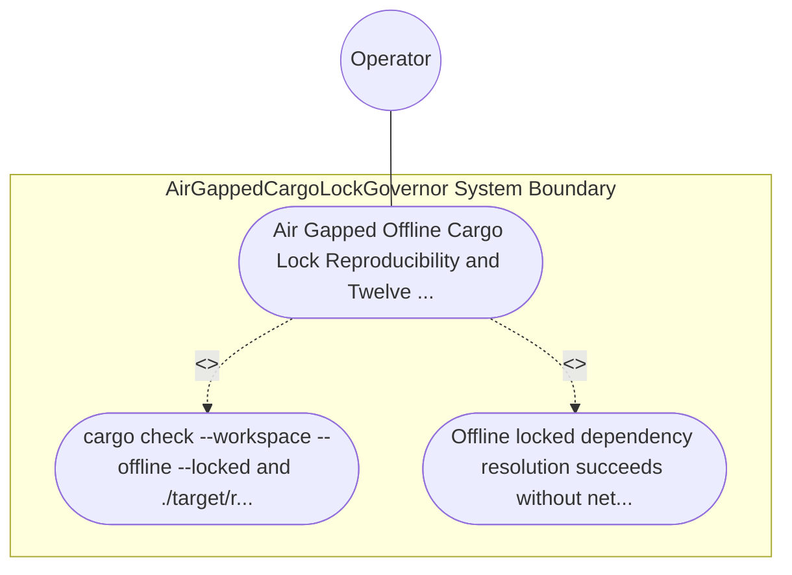

| Attribute | Specification Detail |
| :--- | :--- |
| **Issue ID** | #772 |
| **Title** | Use Case 44: Air Gapped Offline Cargo Lock Reproducibility and Twelve Gate Blueprint Conformance |
| **Type** | use-case |
| **Primary Actor** | Operator |
| **Scope** | AirGappedCargoLockGovernor |
| **Level** | User Goal |
| **Generation Mode** | subagent |
| **Specification Source** | [schema/model.sysml](../../schema/model.sysml) |

# Use Case 44: Air Gapped Offline Cargo Lock Reproducibility and Twelve Gate Blueprint Conformance

## UML Diagrams

## 1. Actors
- `Operator`

## 2. Preconditions
- Workspace Cargo.toml and Cargo.lock populated via cargo fetch alongside docs/designs/blueprint-08-rust-analyzer-cst-refactoring-and-json-diagnostics.md.

## 3. Trigger
- cargo check --workspace --offline --locked and ./target/release/verify-baseline check-blueprint docs/designs/blueprint-08-rust-analyzer-cst-refactoring-and-json-diagnostics.md are executed.

## 4. Main Success Scenario
1. `Operator` invokes `verify_offline_locked_build` (`cargo check --workspace --offline --locked`) on `AirGappedCargoLockGovernor` (`offline_locked_enforced = true`, `vendor_bundle_supported = true`) via `manifest_lock_in`.
2. `AirGappedCargoLockGovernor` validates workspace `Cargo.toml` and `Cargo.lock` dependency versions and SHA-256 package checksums without network access (`cargo vendor`-compatible) and emits `SupplyChainReceipt` on `lock_receipt_out`.
3. `Operator` executes `./target/release/verify-baseline check-blueprint docs/designs/blueprint-08-rust-analyzer-cst-refactoring-and-json-diagnostics.md` to validate all 12 mechanical blueprint verification gates.
4. `ingest-sysml` and `compile-sysml` extract and compile `BP_08_Lossless_Rust_CST_Codemod_Engine_and_Unified_rustc_Compatible_JSON_Diagnostics` (`REQ-0608`, `C_CST_01..07`), verifying bijective SysML v2 AST roundtrip parity.
5. Offline locked compilation and all 12 blueprint verification gates succeed with exit code 0, persisting `.sysml` and `.digest.json` artifacts and recording verified supply-chain and blueprint conformance for `Operator`.

## 5. Alternate and Exception Flows
- 3a. `Cargo.lock` is out of sync with `Cargo.toml` or requires network access under `--offline --locked` (`Diagnostic: DEAP-E0804`):
  - `AirGappedCargoLockGovernor` transitions to `RejectedFailClosed`, emits single-line JSON diagnostic `DEAP-E0804`, and exits fail-closed with code 1.
- 4a. Any of the 12 mechanical blueprint verification gates fails on `blueprint-08-rust-analyzer-cst-refactoring-and-json-diagnostics.md`:
  - `verify-baseline check-blueprint` aborts artifact persistence, reports the exact gate failure, and terminates fail-closed with exit code 1.
- 5a. Invariant violation while enforcing `C_CST_01` through `C_CST_07` in `AirGappedCargoLockGovernor`:
  - `AirGappedCargoLockGovernor` aborts execution without partial state mutation, preserves prior verified state, and notifies `Operator`.

## 6. Postconditions
- Offline locked dependency resolution succeeds without network access (`cargo vendor`-compatible), and all 12 mechanical blueprint verification gates pass with exit code 0, persisting `.sysml` and `.digest.json` artifacts.

## 8. Realization Matrix
| Specification Item | Type | Link / Reference |
| :--- | :--- | :--- |
| **TBD** | User Story | [User Story 53: verify offline locked build](../user-stories/US-53-verify_offline_locked_build.md) |
| **TBD** | Feature | [Feature 36: [BP 08 Lossless Rust CST Codemod Engine and Unified rustc Compatible JSON Diagnostics] AirGappedCargoLockGovernor](../features/FEAT-36-AirGappedCargoLockGovernor.md) |

## Source References
Use case operational flows and lifecycle activity references:
- System Architecture Model: `schema/model.sysml`
- Normative Systems Engineering Standard: ISO/IEC/IEEE 29148:2018 §6.4.2 Concept of Operations

Operational use case realization and traceability links derive from `schema/model.sysml` pursuant to ISO/IEC/IEEE 29148.
