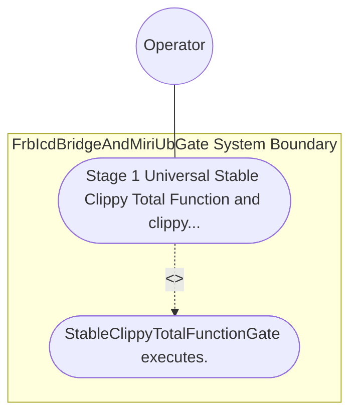

| Attribute | Specification Detail |
| :--- | :--- |
| **Issue ID** | TBD |
| **Title** | Use Case 45: Stage 1 Universal Stable Clippy Total Function and clippy toml Threshold Enforcement |
| **Type** | use-case |
| **Primary Actor** | Operator |
| **Scope** | FrbIcdBridgeAndMiriUbGate |
| **Level** | User Goal |
| **Generation Mode** | subagent |
| **Specification Source** | [schema/model.sysml](../../schema/model.sysml) |

# Use Case 45: Stage 1 Universal Stable Clippy Total Function and clippy toml Threshold Enforcement

## UML Diagrams

## 1. Actors
- `Operator`

## 2. Preconditions
- An upstream or generated downstream Rust workspace configured with [workspace.lints.clippy] enforcing all 14 total-function, arithmetic, cast, unsafe-doc, and complexity denials plus root clippy.toml (too-many-lines-threshold = 80, too-many-arguments-threshold = 5, and disallowed-types banning non-deterministic HashMap / HashSet and backtracking pattern-matching types), alongside a negative fixture containing unchecked + arithmetic, direct slice indexing, an 81-line function, a 6-argument function, or std::collections::HashMap.

## 3. Trigger
- StableClippyTotalFunctionGate executes.

## 4. Main Success Scenario
1. StableClippyTotalFunctionGate executes.

## 5. Alternate and Exception Flows
- Precondition guard failure in `FrbIcdBridgeAndMiriUbGate`:
  - `FrbIcdBridgeAndMiriUbGate` rejects the `Stage 1 Universal Stable Clippy Total Function and clippy toml Threshold Enforcement` request without partial state mutation and reports diagnostic status to `Operator`.
- Invariant violation while enforcing `Stage 1 Universal Stable Clippy Total Function and clippy toml Threshold Enforcement`:
  - `FrbIcdBridgeAndMiriUbGate` aborts `Stage 1 Universal Stable Clippy Total Function and clippy toml Threshold Enforcement` execution, preserves prior verified state, and notifies `Operator`.

## 6. Postconditions
- `FrbIcdBridgeAndMiriUbGate` satisfies declared objective `Stage 1 Universal Stable Clippy Total Function and clippy toml Threshold Enforcement` with all subsystem invariants intact.
- Verified `Stage 1 Universal Stable Clippy Total Function and clippy toml Threshold Enforcement` completion status is recorded for `Operator`.

## 8. Realization Matrix
| Specification Item | Type | Link / Reference |
| :--- | :--- | :--- |
| **TBD** | User Story | [User Story 57: run Stable Clippy Gate](../user-stories/US-57-runStableClippyGate.md) |
| **TBD** | Feature | [Feature 46: [BP 09 Multi Stage Compiler and Formal Verification Gatekeeper] FrbIcdBridgeAndMiriUbGate](../features/FEAT-46-FrbIcdBridgeAndMiriUbGate.md) |

## Source References
Use case operational flows and lifecycle activity references:
- System Architecture Model: `schema/model.sysml`
- Normative Systems Engineering Standard: ISO/IEC/IEEE 29148:2018 §6.4.2 Concept of Operations

Operational use case realization and traceability links derive from `schema/model.sysml` pursuant to ISO/IEC/IEEE 29148.
