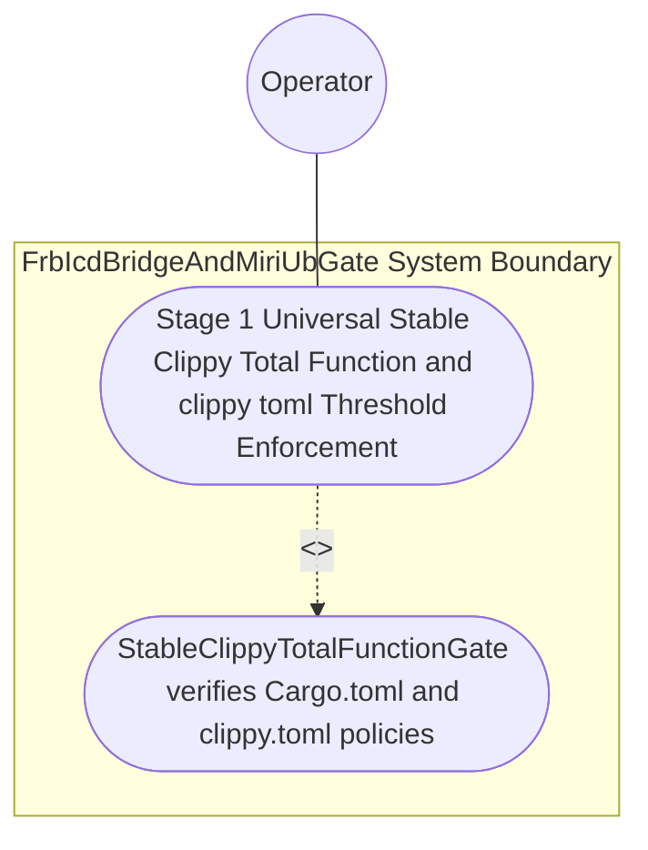
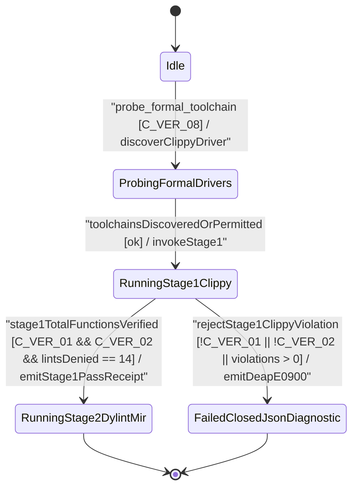

| Attribute | Specification Detail |
| :--- | :--- |
| **Issue ID** | #773 |
| **Title** | Use Case 45: Stage 1 Universal Stable Clippy Total Function and clippy toml Threshold Enforcement |
| **Type** | use-case |
| **Parent Epic** | #734 - [Epic 09: BP 09 Multi Stage Compiler and Formal Verification Gatekeeper](../epics/EPIC-09-BP_09_Multi_Stage_Compiler_and_Formal_Verification_Gatekeeper.md) |
| **Schema Containers** | `BP_09_Multi_Stage_Compiler_and_Formal_Verification_Gatekeeper::UC_BP_09_01_Stage_1_Universal_Stable_Clippy_Total_Function_and_clippy_toml_Threshold_Enforcement` |
| **Primary Actor** | Operator |
| **Scope** | FrbIcdBridgeAndMiriUbGate |
| **Level** | User Goal |
| **Generation Mode** | subagent |
| **Specification Source** | [schema/model.sysml](../../schema/model.sysml) |

# Use Case 45: Stage 1 Universal Stable Clippy Total Function and clippy toml Threshold Enforcement

## UML Diagrams

### Use Case Diagram

### State Machine Diagram

## 1. Actors
- **Primary Actor:** `Operator`
- **Secondary Actors:** `MultiStageVerificationOrchestrator`, `StableClippyTotalFunctionGate`, `FrbIcdBridgeAndMiriUbGate`

## 2. Preconditions
- An upstream or generated downstream Rust workspace configured with `[workspace.lints.clippy]` enforcing all 14 total-function, arithmetic, cast, unsafe-doc, and complexity denials plus root `./clippy.toml` (`too-many-lines-threshold = 80`, `too-many-arguments-threshold = 5`, and `disallowed-types` banning non-deterministic `std::collections::HashMap` / `std::collections::HashSet` and backtracking pattern-matching types), alongside a negative fixture containing unchecked `+` arithmetic, direct slice indexing, an 81-line function, a 6-argument function, or `std::collections::HashMap`.

## 3. Trigger
- `StableClippyTotalFunctionGate` executes via `MultiStageVerificationOrchestrator` in `RunningStage1Clippy`.

## 4. Main Success Scenario
1. `Operator` invokes `MultiStageVerificationOrchestrator` (`verification_stage_count = 4`, `fail_closed_short_circuit = true`), which probes formal drivers dynamically via runtime `PATH` (`std::env::consts::EXE_SUFFIX`, `camino::Utf8Path`, `C_VER_08`), transitions `BP_09_Multi_Stage_Compiler_and_Formal_Verification_Gatekeeper_LifecycleState` to `RunningStage1Clippy`, and invokes `verify_clippy_policy(policy, manifest_lints)` on `StableClippyTotalFunctionGate`.
2. `StableClippyTotalFunctionGate` loads `./Cargo.toml` and `./clippy.toml` on `workspace_manifest_in` via `cargo_metadata` and `toml_edit` inside `< 380` exec SLOC submodules (`./crates/verify-baseline/src/formal_gates/`, `C_VER_07` verified via `ra_ap_syntax`) with zero hand-rolled scanners, and verifies all `denied_clippy_lint_count = 14` total-function lints, `too_many_lines_threshold <= 80` (`C_VER_01`), `too_many_arguments_threshold <= 5` (`C_VER_02`), and `disallowed_types_count >= 3`.
3. `StableClippyTotalFunctionGate` executes `cargo clippy --workspace --all-targets --message-format=json` under `Invariant_REQ_0609_SC_01` and streams NDJSON results across `clippy_ndjson_out` (`BP_09_ClippyToOrchestratorConnection`).
4. For the compliant workspace, `StableClippyTotalFunctionGate` confirms zero total-function, arithmetic, cast, or complexity violations and transitions `BP_09_Multi_Stage_Compiler_and_Formal_Verification_Gatekeeper_LifecycleState` to `RunningStage2DylintMir`.
5. For the negative fixture, `StableClippyTotalFunctionGate` intercepts the lint failure, transitions to `FailedClosedJsonDiagnostic`, short-circuits Stage 2 promotion, and emits a single-line NDJSON diagnostic (`DEAP-E0900`) on `unified_gate_ndjson_out` with exit code 1.

## 5. Alternate and Exception Flows
- **3a. Root `./Cargo.toml` or `./clippy.toml` omits a required total-function denial or exceeds `C_VER_01` (`80` lines) / `C_VER_02` (`5` arguments) (`Diagnostic: DEAP-E0900`) (Branches from Basic Flow step 2):**
  1. `StableClippyTotalFunctionGate` detects the missing lint key or threshold violation via `toml_edit` and `cargo_metadata`.
  2. `StableClippyTotalFunctionGate` transitions to `FailedClosedJsonDiagnostic`, emits single-line NDJSON diagnostic `DEAP-E0900` on `clippy_ndjson_out`, and exits fail-closed with code 1.
- **4a. Target crate introduces unchecked arithmetic, direct slice indexing, or banned `std::collections::HashMap` under `Invariant_REQ_0609_SC_01` (Branches from Basic Flow step 3):**
  1. `StableClippyTotalFunctionGate` captures the compiler JSON diagnostic span from `cargo clippy --workspace --all-targets --message-format=json`.
  2. `StableClippyTotalFunctionGate` fails closed with non-zero exit status, halts downstream Stage 2..4 execution (`fail_closed_short_circuit = true`), and streams the exact span diagnostic (`DEAP-E0900`) to `Operator`.
- **5a. Precondition or manifest parse error in `FrbIcdBridgeAndMiriUbGate` / `StableClippyTotalFunctionGate` (Branches from Basic Flow step 1):**
  1. `StableClippyTotalFunctionGate` detects a malformed manifest or CST violation via `ra_ap_syntax`.
  2. `FrbIcdBridgeAndMiriUbGate` aborts execution without partial state mutation, preserves prior verified state, and notifies `Operator`.

## 6. Postconditions
- **Success Guarantee:** `FrbIcdBridgeAndMiriUbGate` and `StableClippyTotalFunctionGate` satisfy declared objective `Stage 1 Universal Stable Clippy Total Function and clippy toml Threshold Enforcement` with all subsystem invariants (`C_VER_01`, `C_VER_02`, `C_VER_07`, `Invariant_REQ_0609_SC_01`) intact.
- **Failure Guarantee:** Any violation of the 14 total-function lints or `./clippy.toml` thresholds halts Stage 2 promotion without partial state mutation and emits single-line NDJSON diagnostic `DEAP-E0900` with exit code 1.

## 7. Architectural Realization & Operational Context (Contracts A & B, 3-Layer DoD)
- **Contract A (100% OMG SysML v2.0 + KerML 1.0 Grammar Coverage)**: Enforces Stage 1 total-function guarantees across all crates parsing and compiling the full OMG SysML v2.0 and KerML 1.0 textual grammar (`package`/`library package`/`standard library package`, `import`, `metadata def`/`metadata`/`@Metadata`/`#user_keyword` (`#hazard`, `#risk`, `#capability`, `#rt_loop`, `#dal`, `#fls` and legacy `hazard def`/`risk def`/`capability def`), `part def`/`part`, `item def`/`item`, `attribute def`/`attribute`, `enum def`/`enum`, `port def`/`port`, `connection def`/`connection`, `interface def`/`interface`, `flow def`/`flow`, `allocation def`/`allocation`, `occurrence def`/`occurrence`, `action def`/`action`, `state def`/`state`, `calc def`/`calc`, `constraint def`/`constraint`, `requirement def`/`requirement`, `concern def`/`concern`, `use case def`/`use case`, `analysis def`/`analysis`, `verification def`/`verification`, `test case def`/`test case`, `interaction def`/`interaction`, `view def`/`view`, `viewpoint def`/`viewpoint`, `rendering def`/`rendering`, `variation`/`variant`, and KerML specialization/multiplicity/expressions) with zero 16-construct artificial caps.
- **Contract B (5-Stage Pipeline & Official Compiler Stack, Zero Hand-Rolled Scanners)**: Executes Stage 1 (`cargo_metadata` + `toml_edit` + `ra_ap_syntax` + `cargo clippy --message-format=json`) -> Stage 2 (excluded `./lints/deap-dylint-mir/`) -> Stage 3 (`cargo miri` + `flutter_rust_bridge`) -> Stage 4 (`cargo kani` `#[kani::proof]` synthesis via `syn` + `proc-macro2` + `quote` + `prettyplease`) -> Stage 5 (Ferrocene qualification) with dynamic runtime `PATH` discovery and zero hand-rolled scanners.
- **3-Layer Definition of Done**: Closes Layer 1 (`ClippyThresholdPolicy` domain state), Layer 2 (`verify_clippy_policy` inside `< 380`-SLOC submodules `./crates/verify-baseline/src/formal_gates/` with explicit deletion of legacy hand-rolled TOML/attribute string scanners), and Layer 3 (`workspace_manifest_in` and `clippy_ndjson_out` NDJSON binding).

## 8. Realization Matrix
| Specification Item | Type | Link / Reference |
| :--- | :--- | :--- |
| **#808** | User Story | [User Story 59: probe formal toolchain](../user-stories/US-59-probe_formal_toolchain.md) |
| **#809** | User Story | [User Story 60: verify clippy policy](../user-stories/US-60-verify_clippy_policy.md) |
| **#747** | Feature | [Feature 41: [BP 09 Multi Stage Compiler and Formal Verification Gatekeeper] FrbIcdBridgeAndMiriUbGate](../features/FEAT-41-FrbIcdBridgeAndMiriUbGate.md) |
| **#750** | Feature | [Feature 44: [BP 09 Multi Stage Compiler and Formal Verification Gatekeeper] MultiStageVerificationOrchestrator](../features/FEAT-44-MultiStageVerificationOrchestrator.md) |
| **#751** | Feature | [Feature 45: [BP 09 Multi Stage Compiler and Formal Verification Gatekeeper] StableClippyTotalFunctionGate](../features/FEAT-45-StableClippyTotalFunctionGate.md) |

### Required User Stories
- [ ] #808 - [User Story 59: probe formal toolchain](../user-stories/US-59-probe_formal_toolchain.md) (Discovers `cargo-clippy` dynamically via runtime `PATH` before Stage 1 policy evaluation)
- [ ] #809 - [User Story 60: verify clippy policy](../user-stories/US-60-verify_clippy_policy.md) (Verifies all 14 total-function Clippy lint denials and `./clippy.toml` thresholds `C_VER_01` and `C_VER_02`)

### Required Features
- [ ] #747 - [Feature 41: [BP 09 Multi Stage Compiler and Formal Verification Gatekeeper] FrbIcdBridgeAndMiriUbGate](../features/FEAT-41-FrbIcdBridgeAndMiriUbGate.md) (Coordinates subsystem invariant obligations `Invariant_REQ_0609_SC_01`..`Invariant_REQ_0609_SC_05`)
- [ ] #750 - [Feature 44: [BP 09 Multi Stage Compiler and Formal Verification Gatekeeper] MultiStageVerificationOrchestrator](../features/FEAT-44-MultiStageVerificationOrchestrator.md) (Orchestrates Stage 1 execution and fail-closed short-circuiting)
- [ ] #751 - [Feature 45: [BP 09 Multi Stage Compiler and Formal Verification Gatekeeper] StableClippyTotalFunctionGate](../features/FEAT-45-StableClippyTotalFunctionGate.md) (Implements Stage 1 `Cargo.toml` and `clippy.toml` verification and NDJSON diagnostic streaming)

## Source References
Use case operational flows and lifecycle activity references:
- System Architecture Model: `schema/model.sysml`
- Engineering Design Blueprint: `./docs/designs/blueprint-09-clippy-dylint-miri-kani-formal-verification-gate.md`
- Normative Systems Engineering Standard: ISO/IEC/IEEE 29148:2018 §6.4.2 Concept of Operations

Operational use case realization and traceability links derive from `schema/model.sysml` pursuant to ISO/IEC/IEEE 29148.
