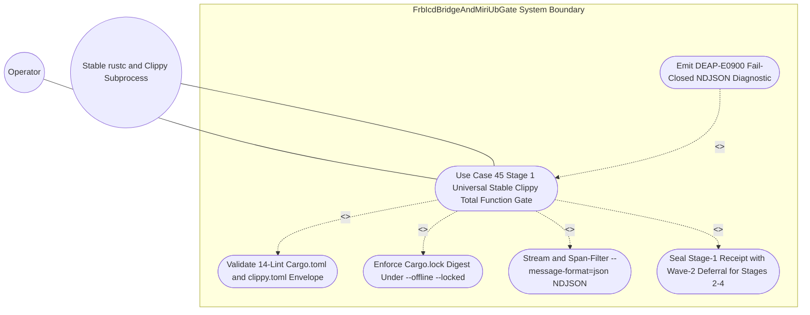

| Attribute | Specification Detail |
| :--- | :--- |
| **Issue ID** | TBD |
| **Title** | Use Case 45: Stage 1 Universal Stable Clippy Total Function and clippy toml Threshold Enforcement |
| **Type** | use-case |
| **Parent Epic** | [Epic 09: BP 09 Multi Stage Compiler and Formal Verification Gatekeeper](../epics/EPIC-09-BP_09_Multi_Stage_Compiler_and_Formal_Verification_Gatekeeper.md) |
| **Schema Containers** | `BP_09_Multi_Stage_Compiler_and_Formal_Verification_Gatekeeper::UC_AC_01_Stage_1_Universal_Stable_Clippy_Total_Function_and_clippy_toml_Threshold_Enforcement` |
| **Primary Actor** | Operator |
| **Scope** | FrbIcdBridgeAndMiriUbGate |
| **Level** | User Goal |
| **Generation Mode** | subagent |
| **Specification Source** | [schema/model.sysml](../../schema/model.sysml) |

# Use Case 45: Stage 1 Universal Stable Clippy Total Function and clippy toml Threshold Enforcement

## Parent Epic
- [ ] **TBD** - [Epic 09: BP 09 Multi Stage Compiler and Formal Verification Gatekeeper](../epics/EPIC-09-BP_09_Multi_Stage_Compiler_and_Formal_Verification_Gatekeeper.md) (Anchors Stage-1 universal stable Clippy total-function, deterministic container, and `clippy.toml` structural complexity enforcement under **REQ-0609** / `BP-09` while preserving explicit Wave-2 deferral boundaries for Stages 2-4.)

## UML Diagrams

## 1. Actors
- **Primary Actor:** `Operator` (Developer, autonomous TDD verification runner, or CI gate invoking `crates/verify-baseline/src/main.rs` or `crates/compile-sysml/src/cli.rs` via `MultiStageVerificationOrchestrator::gate_invocation_in`).
- **Secondary Actors:**
  - `MultiStageVerificationOrchestrator` (Orchestrates fail-closed stage transitions `Idle -> RunningStage1Clippy` with `fail_closed_short_circuit == true` and emits consolidated `RustcCompilerMessageNdjson` receipts on `unified_gate_ndjson_out`).
  - `StableClippyTotalFunctionGate` (Executes `runStableClippyGate` over `workspace_manifest_in` and streams span-filtered `DEAP-E0900` diagnostics on `clippy_ndjson_out`; bound in `schema/model.sysml` alongside AST `use case def` subject `FrbIcdBridgeAndMiriUbGate` within `BP_09_Multi_Stage_Compiler_and_Formal_Verification_Gatekeeper`).
  - `Stable rustc and Clippy Subprocess` (Hermetic local compiler backend executing `cargo clippy --workspace --all-targets --offline --locked --message-format=json`).

## 2. Preconditions
- `MultiStageVerificationOrchestrator` is in the `Idle` lifecycle state (`BP_09_Multi_Stage_Compiler_and_Formal_Verification_Gatekeeper_LifecycleState`) with `fail_closed_short_circuit == true`.
- An upstream (`crates/deap-core`, `crates/compile-sysml`, `crates/verify-baseline`) or generated downstream Rust workspace is present on disk with `Cargo.toml`, `Cargo.lock`, and root `clippy.toml` packaged as a `CargoAndClippyTomlBundle` on `workspace_manifest_in`.
- Root `Cargo.toml` defines `[workspace.lints.clippy]` enforcing all `denied_clippy_lint_count == 14` total-function, arithmetic, cast-safety, unsafe-doc, and structural complexity denials (`clippy::unwrap_used`, `clippy::expect_used`, `clippy::panic`, `clippy::todo`, `clippy::unimplemented`, `clippy::indexing_slicing`, `clippy::arithmetic_side_effects`, `clippy::cast_possible_truncation`, `clippy::cast_sign_loss`, `clippy::cast_possible_wrap`, `clippy::undocumented_unsafe_blocks`, `clippy::too_many_lines`, `clippy::too_many_arguments`, and `clippy::disallowed_types`, paired with `clippy::fn_params_excessive_bools` enforcing `<= 3` boolean parameters per `Invariant_REQ_0609_SC_01`), and every member crate inherits `[lints] workspace = true` without unauthorized `#![allow(...)]` or item-level `allow(...)` lint overrides.
- Root `clippy.toml` configures `too-many-lines-threshold = 80` (**C_VER_01**: `1 <= too_many_lines_threshold <= 80`), `too-many-arguments-threshold = 5` (**C_VER_02**: `0 <= too_many_arguments_threshold <= 5`), and `disallowed-types` (`disallowed_types_count >= 3`) banning non-deterministic `std::collections::HashMap`, `std::collections::HashSet`, and backtracking pattern-matching engine types in favor of `BTreeMap`, `BTreeSet`, and linear-time scanners.
- Verification test suites include both compliant `#![forbid(unsafe_code)]` workspace modules and negative fixtures containing unchecked `+` arithmetic, direct slice indexing, an `81`-line function, a `6`-argument function, or `std::collections::HashMap`.
- Wave-1 operational scope restricts active execution to Stage 1 (`StableClippyTotalFunctionGate`) on the stable Rust toolchain, while Stages 2-4 (`IsolatedDylintMirAllocationGate`, `FrbIcdBridgeAndMiriUbGate`, and `KaniCbmcProofSynthesizer`) remain explicitly deferred to Wave-2 behind stage-orchestrator boundaries so root stable `Cargo.toml` carries zero nightly `rustc_private`, Miri, or CBMC coupling.

## 3. Trigger
- `Operator` invokes `runAllVerificationStages` / `runStableClippyGate(workspacePath)` on `MultiStageVerificationOrchestrator::gate_invocation_in` via `verify-baseline` or `compile-sysml`, transitioning the gatekeeper FSM from `Idle` into `RunningStage1Clippy`.

## 4. Main Success Scenario
1. `Operator` dispatches `runStableClippyGate(workspacePath)` to `MultiStageVerificationOrchestrator` on `gate_invocation_in`, transitioning lifecycle state from `Idle` to `RunningStage1Clippy` and forwarding the `CargoAndClippyTomlBundle` (`Cargo.toml`, `Cargo.lock`, `clippy.toml`, and member crate paths) to `StableClippyTotalFunctionGate` over `workspace_manifest_in` (`workspace_manifest_in_flow`).
2. `StableClippyTotalFunctionGate` parses the workspace manifest bundle into deterministic `BTreeMap` and `BTreeSet` models (`crates/deap-core/src/workspace.rs`, `crates/deap-core/src/diagnostics.rs`) using typed error enums (zero `Result<T, String>`), verifying `deterministic_uuid == "6ba7b810-9dad-11d1-80b4-00c04fd430c9"`, `json_diagnostic_stream == true`, all `denied_clippy_lint_count == 14` `[workspace.lints.clippy]` denials, `[lints] workspace = true` inheritance across all member crates, and zero unauthorized `#![allow(...)]` or item-level `allow(...)` suppression attributes.
3. `StableClippyTotalFunctionGate` validates root `clippy.toml` against **C_VER_01** (`too-many-lines-threshold = 80`, within `1..=80` lines), **C_VER_02** (`too-many-arguments-threshold = 5`, within `0..=5` parameters), and `disallowed_types_count >= 3` confirming that `std::collections::HashMap`, `std::collections::HashSet`, and backtracking pattern-matching engine types are actively denied.
4. `StableClippyTotalFunctionGate` computes the combined SHA-256 fingerprint digest over `Cargo.toml`, `Cargo.lock`, and `clippy.toml` to bind incremental cache validity (`SC-BP09-18`), acquires an isolated build lock on the workspace target directory, and spawns `cargo clippy --workspace --all-targets --offline --locked --message-format=json` under stable `rustc` with a `120 s` subprocess wall-clock timeout ceiling.
5. `StableClippyTotalFunctionGate` reads the subprocess `--message-format=json` stream line-by-line through a bounded `BufRead` reader (`crates/verify-baseline/src/runner.rs`), enforcing `MAX_AST_DEPTH = 64` JSON recursion bounds, fallible `.get()` slice indexing, and checked/saturating integer counters (`checked_add`, `saturating_add`).
6. For each `compiler-message` NDJSON record, the span filter resolves both primary spans and macro-expansion or `include!` call-site spans across library, binary, and `cfg(test)` `--all-targets` compilation units to workspace-relative crate roots, confirming zero violations of `Invariant_REQ_0609_SC_01` (`<= 80` executable HIR SLOC, `<= 5` parameters, `<= 3` boolean parameters, checked/saturating arithmetic, fallible `.get()` indexing, lossless casts, and zero banned types).
7. After `cargo clippy` terminates with exit status `0` and `0` `compiler-message` error frames, `StableClippyTotalFunctionGate` re-computes the `Cargo.lock` SHA-256 digest to confirm byte-identical lockfile preservation under `--offline --locked` (`SC-BP09-16`, `SC-BP09-20`), emits a schema-validated single-line `RustcCompilerMessageNdjson` pass record on `clippy_ndjson_out`, and sends `reply_StageGateReceipt` (`stage1TotalFunctionsVerified`) to `MultiStageVerificationOrchestrator`.
8. `MultiStageVerificationOrchestrator` flushes the single-line `StageGateReceipt` to `unified_gate_ndjson_out` (`crates/verify-baseline/src/output_integrity.rs`), records explicit Wave-2 deferral status for Stage 2 (`IsolatedDylintMirAllocationGate`), Stage 3 (`FrbIcdBridgeAndMiriUbGate`), and Stage 4 (`KaniCbmcProofSynthesizer`) when running in Wave-1 stable-only mode (or transitions to `RunningStage2DylintMir` once Wave-2 gates are active), and exits with code `0` to `Operator`.

## 5. Alternate and Exception Flows
- 5a. **Malformed Manifest Bundle, Weakened 14-Lint Table, Unauthorized Attribute Override, or Out-of-Envelope `clippy.toml` Thresholds (`FM-BP09-017` -- Input, Boundary, and Malformed Syntax) (Branches from Basic Flow steps 2-3):**
  1. `StableClippyTotalFunctionGate` detects a protocol-mismatched `CargoAndClippyTomlBundle` on `workspace_manifest_in`, fewer than `denied_clippy_lint_count == 14` denied lints in `[workspace.lints.clippy]`, a member crate omitting `[lints] workspace = true`, an unauthorized `#![allow(...)]` or item-level `allow(...)` override, `too_many_lines_threshold` outside `1..=80` (**C_VER_01**), `too_many_arguments_threshold` outside `0..=5` (**C_VER_02**), `disallowed_types_count < 3` in `clippy.toml`, `json_diagnostic_stream == false`, or `deterministic_uuid != "6ba7b810-9dad-11d1-80b4-00c04fd430c9"`.
  2. `StableClippyTotalFunctionGate` aborts prior to Clippy subprocess invocation, emits a single-line `DEAP-E0900` (`SC-BP09-17`) `RustcCompilerMessageNdjson` diagnostic identifying the offending manifest file and span on `clippy_ndjson_out`, triggers `rejectStage1ClippyViolation` to transition `MultiStageVerificationOrchestrator` fail-closed into `FailedClosedJsonDiagnostic`, and returns a non-zero exit code to `Operator` without mutating workspace files.
- 5b. **Total-Function, Arithmetic, Indexing, Complexity, or `disallowed-types` Lint Violation in Workspace or Negative Fixture (`AC-01` / `Invariant_REQ_0609_SC_01`) (Branches from Basic Flow step 6):**
  1. The `--message-format=json` span filter captures one or more denied Clippy diagnostics in a workspace crate or negative test fixture, including unchecked `+` arithmetic (`clippy::arithmetic_side_effects`), direct slice indexing (`clippy::indexing_slicing`), `.unwrap()` / `.expect()` calls, an `81`-line function exceeding `too-many-lines-threshold = 80` (`clippy::too_many_lines`), a `6`-argument function exceeding `too-many-arguments-threshold = 5` (`clippy::too_many_arguments`), `> 3` boolean parameters (`clippy::fn_params_excessive_bools`), or `std::collections::HashMap` / `HashSet` / backtracking pattern-matching type usage (`clippy::disallowed_types`).
  2. `StableClippyTotalFunctionGate` serializes each workspace-scoped finding as a single-line `DEAP-E0900` `RustcCompilerMessageNdjson` record preserving lint `code`, workspace-relative primary and macro call-site `spans`, and machine-applicable `suggested_replacement` payloads on `clippy_ndjson_out`, fires `rejectStage1ClippyViolation` to enter `FailedClosedJsonDiagnostic`, blocks downstream stage promotion, and exits non-zero to `Operator`.
- 5c. **Stale Fingerprint Cache, Macro/Test Span Misclassification, Target Lock Contention, or `Cargo.lock` Drift Under `--offline --locked` (`FM-BP09-018` & `FM-BP09-016` -- State, Concurrency, and Ordering) (Branches from Basic Flow steps 4 and 6-7):**
  1. `StableClippyTotalFunctionGate` detects stale incremental target fingerprints after a `Cargo.toml`, `Cargo.lock`, or `clippy.toml` SHA-256 digest change, encounters `--offline --locked` dependency drift or concurrent `target/` lock contention, detects an unmapped macro-expanded / `include!` / `cfg(test)` call-site span originating from a workspace member crate, or observes a post-run `Cargo.lock` SHA-256 mismatch.
  2. `StableClippyTotalFunctionGate` invalidates stale target-cache fingerprints before execution (or aborts immediately after a `30 s` lock-acquisition timeout, `--offline --locked` failure, or post-run `Cargo.lock` mutation), emits a single-line `DEAP-E0900` (`SC-BP09-18`) or `DEAP-E0905` (`SC-BP09-16`) diagnostic on `clippy_ndjson_out` and `unified_gate_ndjson_out`, withholds `stage1TotalFunctionsVerified`, transitions to `FailedClosedJsonDiagnostic`, and notifies `Operator`.
- 5d. **NDJSON Stream Buffer Overflow, JSON Recursion Ceiling Breach, Subprocess Runtime Breach, or Counter Overflow (`FM-BP09-019` -- Resource, Depth, and Arithmetic Exhaustion) (Branches from Basic Flow steps 4-6):**
  1. While consuming `cargo clippy --message-format=json` stdout, `StableClippyTotalFunctionGate` encounters a single-line frame exceeding the bounded `BufRead` allocation cap, nested `children` / `spans` JSON depth exceeding `MAX_AST_DEPTH = 64`, or `checked_add` overflow on violation tallies or span byte offsets.
  2. Alternatively, subprocess execution exceeds the `120 s` timeout budget across `--all-targets`.
  3. `StableClippyTotalFunctionGate` terminates the `cargo clippy` subprocess cleanly, saturates diagnostic counters via `saturating_add` so non-zero counts never wrap around to zero, emits a fail-closed single-line `DEAP-E0900` (`SC-BP09-19`) diagnostic on `clippy_ndjson_out`, transitions `MultiStageVerificationOrchestrator` to `FailedClosedJsonDiagnostic`, and returns a non-zero exit status to `Operator`.
- 5e. **Truncated/Non-JSON Subprocess Output or Fatal `rustc` Compile Failure With Zero `clippy::*` Lint Codes (`FM-BP09-020` -- Output, Serialization, and Partial-Write Integrity) (Branches from Basic Flow steps 6-7):**
  1. `StableClippyTotalFunctionGate` detects truncated, multi-line interleaved, or malformed JSON bytes on subprocess stdout, missing mandatory `RustcCompilerMessageNdjson` fields (`code` or primary `spans`), or a non-zero `cargo clippy` exit code triggered by an underlying `rustc` parse/type error that emitted zero `clippy::*` lint codes.
  2. `StableClippyTotalFunctionGate` blocks emission of `reply_StageGateReceipt` (`stage1TotalFunctionsVerified`), encapsulates the underlying compiler or serialization failure into a well-formed single-line `DEAP-E0900` (`SC-BP09-20`) `RustcCompilerMessageNdjson` record on `clippy_ndjson_out`, transitions fail-closed to `FailedClosedJsonDiagnostic`, and halts stage promotion.

## 6. Postconditions
- **Success Guarantee:**
  - Every crate and `--all-targets` unit (including `cfg(test)` targets) in the Rust workspace is verified against all `14` `[workspace.lints.clippy]` denials and root `clippy.toml` bounds (`too-many-lines-threshold = 80` per **C_VER_01**, `too-many-arguments-threshold = 5` per **C_VER_02**, `<= 3` boolean parameters, and `disallowed_types_count >= 3` deterministic container rules) satisfying `Invariant_REQ_0609_SC_01` with `0` violations.
  - `Cargo.lock` SHA-256 digest is verified byte-identical before and after `cargo clippy --workspace --all-targets --offline --locked --message-format=json`.
  - A schema-validated single-line `StageGateReceipt` (`stage1TotalFunctionsVerified`) is emitted on `clippy_ndjson_out` and `unified_gate_ndjson_out` with explicit Wave-2 deferral metadata recorded for Stages 2-4 (`IsolatedDylintMirAllocationGate`, `FrbIcdBridgeAndMiriUbGate`, and `KaniCbmcProofSynthesizer`).
- **Failure Guarantee:**
  - On any manifest tampering, threshold breach, lint violation, stale cache / lockfile drift, resource/depth ceiling breach (`MAX_AST_DEPTH = 64` levels), or `rustc` compile failure, `MultiStageVerificationOrchestrator` short-circuits fail-closed (`fail_closed_short_circuit == true`) into `FailedClosedJsonDiagnostic`, emits complete single-line `DEAP-E0900` (or `DEAP-E0905`) `RustcCompilerMessageNdjson` diagnostics without partial file writes or `Cargo.lock` mutation, withholds `stage1TotalFunctionsVerified`, and returns a non-zero exit code to `Operator`.

## 7. Operational Context
Use Case 45 operationalizes Stage 1 (`StableClippyTotalFunctionGate` / `runStableClippyGate`) of **REQ-0609** (`docs/designs/blueprint-09-clippy-dylint-miri-kani-formal-verification-gate.sysml`) across `crates/deap-core`, `crates/compile-sysml`, `crates/verify-baseline`, and generated downstream Rust workspaces. Within Wave-1 delivery, Stage 1 provides immediate hermetic total-function enforcement on stable `rustc` without introducing nightly compiler plugin instability into root `Cargo.toml`, while Stages 2-4 (nightly Dylint MIR `rt_loop` zero-heap analysis and `realises("REQ-0609")` digest checking, `flutter_rust_bridge` FFI boundary guard synthesis with Miri `-Zmiri-tree-borrows` verification, and `cfg(kani)` CBMC proof synthesis) are explicitly deferred to Wave-2 behind `MultiStageVerificationOrchestrator` stage gates.

### 3-Layer Architecture and Definition of Done Closure
1. **Layer 1 -- Domain State & Data Model** (`crates/deap-core/src/sysml_ast/mod.rs`, `crates/deap-core/src/diagnostics.rs`, `crates/deap-core/src/error.rs`, `crates/deap-core/src/workspace.rs`): Defines `#![forbid(unsafe_code)]` typed domain structs and error enums (`CargoAndClippyTomlBundle`, `ClippyThresholdEnvelope`, `SpanFilteredDiagnostic`, `StageGateReceipt`, `Stage1ClippyGateError`) using deterministic `BTreeMap` and `BTreeSet` collections, zero `HashMap` / `HashSet` containers, and zero `Result<T, String>` signatures.
2. **Layer 2 -- Logic & State Management** (`crates/verify-baseline/src/runner.rs`, `crates/verify-baseline/src/checks/codebase.rs`, `crates/compile-sysml/src/driver.rs`): Implements total, panic-free manifest validation, SHA-256 fingerprint binding, `--offline --locked` subprocess execution, and workspace-relative `--message-format=json` span filtering where every function obeys `<= 80` executable HIR SLOC (**C_VER_01**), `<= 5` parameters (**C_VER_02**), `<= 3` boolean parameters, `MAX_AST_DEPTH = 64` levels of recursion, fallible `.get()` slice indexing (zero `[]`, `.unwrap()`, `.expect()`, or `panic!()`), and checked/saturating arithmetic (`checked_add`, `saturating_add`).
3. **Layer 3 -- Presentation & Actuator / CLI NDJSON Interface Binding** (`crates/verify-baseline/src/main.rs`, `crates/verify-baseline/src/output_integrity.rs`, `crates/compile-sysml/src/cli.rs`): Binds CLI invocation flags and `clippy_ndjson_out` / `unified_gate_ndjson_out` streams to single-line `RustcCompilerMessageNdjson` (`DEAP-E0900`) output preserving primary spans, lint codes, machine-applicable `suggested_replacement` edits, Wave-2 deferral status for Stages 2-4, and deterministic process exit codes (`0` on `stage1TotalFunctionsVerified`, non-zero on `FailedClosedJsonDiagnostic`).

### Mathematical Formulations & Safety Invariants
$$
\begin{aligned}
\text{Stage1Pass}(\mathcal{W}) &\iff \forall C \in \mathcal{W}, \quad \forall \ell \in \mathcal{L}_{\text{deny}}, \quad \text{Violations}_{\ell}(C) = \emptyset \land \text{Types}(C) \cap \mathcal{T}_{\text{banned}} = \emptyset \\
\forall f \in \text{Fns}(\mathcal{W}), \quad \text{Lines}_{\text{HIR}}(f) &\le L_{\max} \land \lvert \text{Args}_{\text{HIR}}(f) \rvert \le A_{\max} \land \text{BoolParams}_{\text{HIR}}(f) \le B_{\max} \\
\text{Depth}_{\text{JSON}}(m) &\le D_{\max} \land H_{\text{pre}}(\mathcal{K}) = H_{\text{post}}(\mathcal{K})
\end{aligned}
$$

- Parameter Definitions & Engineering Units:
- $\mathcal{W}$: Set of member Rust crates and `--all-targets` compilation units in the target workspace.
- $\mathcal{L}_{\text{deny}}$: Mandatory `[workspace.lints.clippy]` denial set with cardinality `denied_clippy_lint_count = 14` lints.
- $\mathcal{T}_{\text{banned}}$: Disallowed non-deterministic container and backtracking pattern-engine type set in `clippy.toml` (`disallowed_types_count >= 3` types).
- $L_{\max}$: Maximum executable HIR line count per function enforced by **C_VER_01** (`too-many-lines-threshold = 80` lines).
- $A_{\max}$: Maximum parameter count per callable enforced by **C_VER_02** (`too-many-arguments-threshold = 5` parameters).
- $B_{\max}$: Maximum boolean parameter count per callable enforced by `Invariant_REQ_0609_SC_01` (`3` boolean parameters).
- $D_{\max}$: Maximum permitted NDJSON and AST recursion depth (`MAX_AST_DEPTH = 64` levels) enforced during `--message-format=json` streaming (`SC-BP09-19`).
- $H_{\text{pre}}(\mathcal{K}), H_{\text{post}}(\mathcal{K})$: Pre-execution and post-execution SHA-256 digests of `Cargo.lock` ($\mathcal{K}$) verified identical under `--offline --locked` (`SC-BP09-16`, `SC-BP09-18`).

## 8. Realization Matrix
| Traceability Hop | Specification Identifier | Artifact / Test Binding | Traceability Rationale |
| :--- | :--- | :--- | :--- |
| **Use Case** | **Use Case 45** (`TBD`) | `UC-45-Stage_1_Universal_Stable_Clippy_Total_Function_and_clippy_toml_Threshold_Enforcement.md` | Realizes `UC_AC_01_Stage_1_Universal_Stable_Clippy_Total_Function_and_clippy_toml_Threshold_Enforcement` in `schema/model.sysml`. |
| **User Story** | **US-57** (`TBD`) | [User Story 57: run Stable Clippy Gate](../user-stories/US-57-runStableClippyGate.md) | Defines the `MultiStageVerificationOrchestrator -> StableClippyTotalFunctionGate` `runStableClippyGate` and `reply_StageGateReceipt` interaction contract. |
| **Feature** | **FEAT-50** (`TBD`) | [Feature 50: StableClippyTotalFunctionGate](../features/FEAT-50-StableClippyTotalFunctionGate.md) | Implements the `14`-lint `[workspace.lints.clippy]` validator, `clippy.toml` `80`-SLOC / `5`-arg / `disallowed-types` gate, `--offline --locked` digest check, and `--message-format=json` NDJSON span filter (co-anchored with AST `use case def` subject [Feature 46: FrbIcdBridgeAndMiriUbGate](../features/FEAT-46-FrbIcdBridgeAndMiriUbGate.md)). |
| **Epic** | **EPIC-09** (`TBD`) | [Epic 09: BP 09 Multi Stage Compiler and Formal Verification Gatekeeper](../epics/EPIC-09-BP_09_Multi_Stage_Compiler_and_Formal_Verification_Gatekeeper.md) | Governs **REQ-0609** (`BP-09`) 4-stage verification lifecycle (`RunningStage1Clippy` active in Wave-1; Stages 2-4 deferred to Wave-2). |
| **Verification Test** | **TEST-BP09-S1-001** | `AC_01_Stage_1_Universal_Stable_Clippy_Total_Function_and_clippy_toml_Threshold_Enforcement` (`crates/verify-baseline/src/checks/codebase.rs`) | Verifies clean `#![forbid(unsafe_code)]` workspace pass (`0` violations, unchanged `Cargo.lock` SHA-256 under `--offline --locked`, single-line `stage1TotalFunctionsVerified` NDJSON receipt, exit `0`). |
| **Verification Test** | **TEST-BP09-S1-002** | `test_stage1_clippy_rejects_negative_fixture_violations` (`crates/verify-baseline/src/runner.rs`) | Verifies fail-closed `DEAP-E0900` NDJSON emission and non-zero exit on unchecked `+` arithmetic, direct slice indexing, `81`-line function, `6`-argument function, and `std::collections::HashMap`. |
| **Verification Test** | **TEST-BP09-S1-003** | `test_stage1_clippy_failure_modes_fm_bp09_017_to_020` (`crates/verify-baseline/src/output_integrity.rs`) | Exercises `FM-BP09-017` (weakened lint table / `#![allow(...)]` override / out-of-range `clippy.toml`), `FM-BP09-018` (SHA-256 cache fingerprint & macro/test span filter), `FM-BP09-019` (`MAX_AST_DEPTH = 64` levels & saturating counters), and `FM-BP09-020` (fatal `rustc` error with `0` `clippy::*` codes failing closed). |

## Source References
Use case operational flows and lifecycle activity references:
- System Architecture Model: `schema/model.sysml` and `docs/designs/blueprint-09-clippy-dylint-miri-kani-formal-verification-gate.sysml`
- Failure Mode Registry: `docs/research/FAILURE_MODE_REGISTRY.md` (`FM-BP09-017`..`FM-BP09-020`, `FM-BP09-016`)
- Normative Systems Engineering Standard: ISO/IEC/IEEE 29148:2018 Section 6.4.2 Concept of Operations

Operational use case realization and traceability links derive from `schema/model.sysml` pursuant to ISO/IEC/IEEE 29148.
