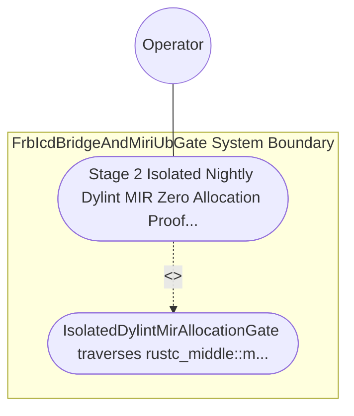

| Attribute | Specification Detail |
| :--- | :--- |
| **Issue ID** | TBD |
| **Title** | Use Case 46: Stage 2 Isolated Nightly Dylint MIR Zero Allocation Proof on Real Time Control Loops |
| **Type** | use-case |
| **Primary Actor** | Operator |
| **Scope** | FrbIcdBridgeAndMiriUbGate |
| **Level** | User Goal |
| **Generation Mode** | subagent |
| **Specification Source** | [schema/model.sysml](../../schema/model.sysml) |

# Use Case 46: Stage 2 Isolated Nightly Dylint MIR Zero Allocation Proof on Real Time Control Loops

## UML Diagrams

## 1. Actors
- `Operator`

## 2. Preconditions
- A standalone nightly Dylint MIR lint workspace isolated from root stable Cargo.toml, evaluating two #[rt_loop] control functions: one pure stack-only total function and one negative fixture that transitively invokes Box::new, Vec::push growth, format! heap allocation, or dynamic drop-glue deallocation through an indirect helper function.

## 3. Trigger
- IsolatedDylintMirAllocationGate traverses rustc_middle::mir::Body basic-block call and drop terminators across the #[rt_loop] call graph while stable cargo check --workspace --offline --locked runs independently on the root workspace.

## 4. Main Success Scenario
1. IsolatedDylintMirAllocationGate traverses rustc_middle::mir::Body basic-block call and drop terminators across the #[rt_loop] call graph while stable cargo check --workspace --offline --locked runs independently on the root workspace.

## 5. Alternate and Exception Flows
- Precondition guard failure in `FrbIcdBridgeAndMiriUbGate`:
  - `FrbIcdBridgeAndMiriUbGate` rejects the `Stage 2 Isolated Nightly Dylint MIR Zero Allocation Proof on Real Time Control Loops` request without partial state mutation and reports diagnostic status to `Operator`.
- Invariant violation while enforcing `Stage 2 Isolated Nightly Dylint MIR Zero Allocation Proof on Real Time Control Loops`:
  - `FrbIcdBridgeAndMiriUbGate` aborts `Stage 2 Isolated Nightly Dylint MIR Zero Allocation Proof on Real Time Control Loops` execution, preserves prior verified state, and notifies `Operator`.

## 6. Postconditions
- `FrbIcdBridgeAndMiriUbGate` satisfies declared objective `Stage 2 Isolated Nightly Dylint MIR Zero Allocation Proof on Real Time Control Loops` with all subsystem invariants intact.
- Verified `Stage 2 Isolated Nightly Dylint MIR Zero Allocation Proof on Real Time Control Loops` completion status is recorded for `Operator`.

## 8. Realization Matrix
| Specification Item | Type | Link / Reference |
| :--- | :--- | :--- |
| **TBD** | User Story | [User Story 58: verify Mir Allocations And Reqs](../user-stories/US-58-verifyMirAllocationsAndReqs.md) |
| **TBD** | Feature | [Feature 46: [BP 09 Multi Stage Compiler and Formal Verification Gatekeeper] FrbIcdBridgeAndMiriUbGate](../features/FEAT-46-FrbIcdBridgeAndMiriUbGate.md) |

## Source References
Use case operational flows and lifecycle activity references:
- System Architecture Model: `schema/model.sysml`
- Normative Systems Engineering Standard: ISO/IEC/IEEE 29148:2018 §6.4.2 Concept of Operations

Operational use case realization and traceability links derive from `schema/model.sysml` pursuant to ISO/IEC/IEEE 29148.
