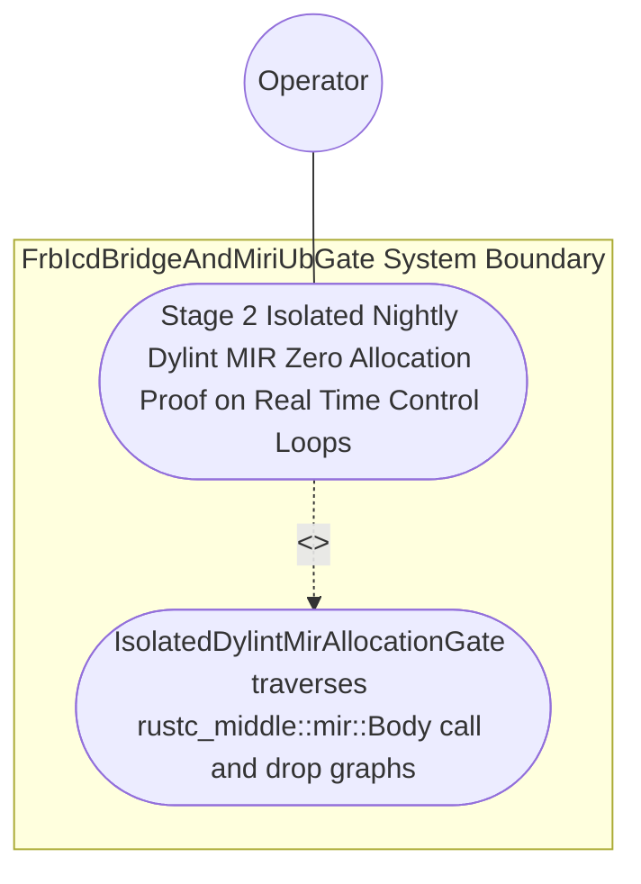

| Attribute | Specification Detail |
| :--- | :--- |
| **Issue ID** | #775 |
| **Title** | Use Case 46: Stage 2 Isolated Nightly Dylint MIR Zero Allocation Proof on Real Time Control Loops |
| **Type** | use-case |
| **Parent Epic** | #854 - [Epic 09: BP 09 Multi Stage Compiler and Formal Verification Gatekeeper](../epics/EPIC-09-BP_09_Multi_Stage_Compiler_and_Formal_Verification_Gatekeeper.md) |
| **Schema Containers** | `BP_09_Multi_Stage_Compiler_and_Formal_Verification_Gatekeeper::UC_BP_09_02_Stage_2_Isolated_Nightly_Dylint_MIR_Zero_Allocation_Proof_on_Real_Time_Control_Loops` |
| **Primary Actor** | Operator |
| **Scope** | FrbIcdBridgeAndMiriUbGate |
| **Level** | User Goal |
| **Generation Mode** | subagent |
| **Specification Source** | [schema/model.sysml](../../schema/model.sysml) |

# Use Case 46: Stage 2 Isolated Nightly Dylint MIR Zero Allocation Proof on Real Time Control Loops

## UML Diagrams

### Use Case Diagram


### State Machine Diagram
```sysml
stateDiagram-v2
    [*] --> RunningStage1Clippy
    RunningStage1Clippy --> RunningStage2DylintMir : "stage1TotalFunctionsVerified [ok] / invokeStage2Dylint"
    RunningStage2DylintMir --> RunningStage3FrbAndMiri : "stage2ZeroRtAllocVerified [C_VER_03 && isolated_nightly_workspace] / emitStage2PassReceipt"
    RunningStage2DylintMir --> FailedClosedJsonDiagnostic : "rejectMirHeapAllocOrDanglingReq [rtHeapAllocs > 0] / emitDeapE0901"
    RunningStage3FrbAndMiri --> [*]
    FailedClosedJsonDiagnostic --> [*]
```

## 1. Actors
- **Primary Actor:** `Operator`
- **Secondary Actors:** `MultiStageVerificationOrchestrator`, `IsolatedDylintMirAllocationGate`, `FrbIcdBridgeAndMiriUbGate`

## 2. Preconditions
- A standalone nightly Dylint MIR lint workspace at `./lints/deap-dylint-mir/` isolated and excluded from the root stable `./Cargo.toml`, evaluating two `#rt_loop` (`outer rt_loop`) control functions: one pure stack-only total function and one negative fixture that transitively invokes `Box::new`, `Vec::push` growth, `format!` heap allocation, or dynamic drop-glue deallocation through an indirect helper function.

## 3. Trigger
- `IsolatedDylintMirAllocationGate` traverses `rustc_middle::mir::Body` basic-block call and drop terminators across the `#rt_loop` call graph inside `./lints/deap-dylint-mir/` while stable `cargo check --workspace --offline --locked` runs independently on the root workspace.

## 4. Main Success Scenario
1. `MultiStageVerificationOrchestrator` transitions from `RunningStage1Clippy` to `RunningStage2DylintMir` on `stage1TotalFunctionsVerified` and invokes `evaluate_stage2_dylint_mir(input)` on `IsolatedDylintMirAllocationGate` (`max_rt_heap_allocations = 0`, `isolated_nightly_workspace = true`).
2. `IsolatedDylintMirAllocationGate` verifies via `verify_in_process_cst_syntax(module_path, max_exec_sloc)` (`ra_ap_syntax` `SourceFile::parse`) that the isolated nightly plugin workspace `./lints/deap-dylint-mir/` is excluded from the root stable `./Cargo.toml` and bounded within `< 380` exec SLOC (`C_VER_07`).
3. `IsolatedDylintMirAllocationGate` receives lowered `rustc_middle::mir::Body` basic-block graphs on `mir_body_graph_in` and computes the transitive call and drop terminator closure reachable from every `#rt_loop` (`outer rt_loop`) entrypoint under `Invariant_REQ_0609_SC_02`.
4. For the pure stack-only control function, `IsolatedDylintMirAllocationGate` confirms `max_rt_heap_allocations == 0` (`C_VER_03`) while stable `cargo check --workspace --offline --locked` succeeds independently on the root workspace, transitioning to `RunningStage3FrbAndMiri`.
5. For the negative fixture, `IsolatedDylintMirAllocationGate` detects the transitive `Box::new` / `Vec::push` / `format!` / drop-glue call chain, transitions to `FailedClosedJsonDiagnostic`, and emits single-line JSON diagnostic `DEAP-E0901` on `dylint_ndjson_out` with exit code 1.

## 5. Alternate and Exception Flows
- 3a. Transitive heap allocation (`__rust_alloc`, `exchange_malloc`, `Vec::push`, `format!`) or dynamic drop terminator reachable from an `#rt_loop` function (`Diagnostic: DEAP-E0901`) (Branches from Basic Flow step 3):
  1. `IsolatedDylintMirAllocationGate` identifies the reachable allocation primitive or drop terminator in `rustc_middle::mir::Body`.
  2. `IsolatedDylintMirAllocationGate` transitions to `FailedClosedJsonDiagnostic`, emits single-line NDJSON diagnostic `DEAP-E0901` on `dylint_ndjson_out` with the full call chain, and exits fail-closed with code 1.
- 4a. Nightly `rustc_private` dependency leaks into root stable `./Cargo.toml` (`isolated_nightly_workspace == false`) (Branches from Basic Flow step 2):
  1. `verify_in_process_cst_syntax` and `cargo_metadata` detect `./lints/deap-dylint-mir/` unexcluded in the root workspace manifest.
  2. `IsolatedDylintMirAllocationGate` rejects the manifest configuration, emits `DEAP-E0901`, and terminates fail-closed with exit code 1.
- 5a. Invariant violation while enforcing `C_VER_03` or `C_VER_07` (`max_module_exec_sloc <= 380`) (Branches from Basic Flow step 2):
  1. `IsolatedDylintMirAllocationGate` detects a submodule exceeding `380` executable SLOC via `ra_ap_syntax`.
  2. `FrbIcdBridgeAndMiriUbGate` aborts execution without partial state mutation, preserves prior verified state, and notifies `Operator`.

## 6. Postconditions
- **Success Guarantee:** `FrbIcdBridgeAndMiriUbGate` and `IsolatedDylintMirAllocationGate` satisfy declared objective `Stage 2 Isolated Nightly Dylint MIR Zero Allocation Proof on Real Time Control Loops` with `C_VER_03` (`max_rt_heap_allocations == 0`) and `Invariant_REQ_0609_SC_02` intact.
- **Failure Guarantee:** Any transitive heap allocation or dynamic drop terminator in an `#rt_loop` control loop halts Stage 3 promotion and emits `DEAP-E0901` with exit code 1.

## 7. Architectural Realization & Operational Context (Contracts A & B, 3-Layer DoD)
- **Contract A (100% OMG SysML v2.0 + KerML 1.0 Grammar Coverage)**: Extracts `#rt_loop` / `@RtLoop`, `#dal`, `#fls`, `#hazard`, `#risk`, `#capability` metadata usages (`metadata def` / `metadata` / `@Metadata` / `#user_keyword` and legacy `hazard def` / `risk def` / `capability def`), `action def`/`action`, `state def`/`state`, and `part def`/`part` definitions across the full OMG SysML v2.0 and KerML 1.0 grammar with zero 16-construct artificial caps.
- **Contract B (Excluded `./lints/deap-dylint-mir/` in 5-Stage Pipeline, Zero Hand-Rolled Scanners)**: Isolates `#![feature(rustc_private)]` and `rustc_middle::mir` inside `./lints/deap-dylint-mir/` (excluded from root `./Cargo.toml`) within the 5-Stage pipeline (Stage 1 Clippy -> Stage 2 excluded `./lints/deap-dylint-mir/` -> Stage 3 Miri + `flutter_rust_bridge` -> Stage 4 Kani `outer kani::proof` synthesis via `syn`+`proc-macro2`+`quote`+`prettyplease` -> Stage 5 Ferrocene qualification) using dynamic runtime `PATH` discovery and `ra_ap_syntax` with zero hand-rolled scanners.
- **3-Layer Definition of Done**: Closes Layer 1 (`Stage2MirEvalInput` and `MirCallEdge` domain models), Layer 2 (`evaluate_stage2_dylint_mir` inside `< 380`-SLOC submodules `./crates/verify-baseline/src/formal_gates/` and `./lints/deap-dylint-mir/` with explicit deletion of legacy hand-rolled call-graph string scanners), and Layer 3 (`mir_body_graph_in` and `dylint_ndjson_out` NDJSON binding).

## 8. Realization Matrix
| Specification Item | Type | Link / Reference |
| :--- | :--- | :--- |
| **#810** | User Story | [User Story 60: Verify Clippy Policy](../user-stories/US-60-verify_clippy_policy.md) |
| **#811** | User Story | [User Story 61: Evaluate Stage2 Dylint Mir](../user-stories/US-61-evaluate_stage2_dylint_mir.md) |
| **#812** | User Story | [User Story 62: Verify In Process Cst Syntax](../user-stories/US-62-verify_in_process_cst_syntax.md) |
| **#839** | Feature | [Feature 41: [BP 09 Multi Stage Compiler and Formal Verification Gatekeeper] FrbIcdBridgeAndMiriUbGate](../features/FEAT-41-FrbIcdBridgeAndMiriUbGate.md) |
| **#840** | Feature | [Feature 42: [BP 09 Multi Stage Compiler and Formal Verification Gatekeeper] IsolatedDylintMirAllocationGate](../features/FEAT-42-IsolatedDylintMirAllocationGate.md) |

### Required User Stories
- [ ] #810 - [User Story 60: Verify Clippy Policy](../user-stories/US-60-verify_clippy_policy.md) (Supplies verified Stage 1 manifest and total-function preconditions)
- [ ] #811 - [User Story 61: Evaluate Stage2 Dylint Mir](../user-stories/US-61-evaluate_stage2_dylint_mir.md) (Executes transitive `rustc_middle::mir::Body` zero-allocation analysis across `#rt_loop` functions)
- [ ] #812 - [User Story 62: Verify In Process Cst Syntax](../user-stories/US-62-verify_in_process_cst_syntax.md) (Enforces lossless `ra_ap_syntax` CST validation and `<= 380` exec SLOC per submodule)

### Required Features
- [ ] #839 - [Feature 41: [BP 09 Multi Stage Compiler and Formal Verification Gatekeeper] FrbIcdBridgeAndMiriUbGate](../features/FEAT-41-FrbIcdBridgeAndMiriUbGate.md) (Coordinates `Invariant_REQ_0609_SC_02` across the formal verification subsystem)
- [ ] #840 - [Feature 42: [BP 09 Multi Stage Compiler and Formal Verification Gatekeeper] IsolatedDylintMirAllocationGate](../features/FEAT-42-IsolatedDylintMirAllocationGate.md) (Implements the excluded `./lints/deap-dylint-mir/` zero-allocation verification gate)

## Source References
Use case operational flows and lifecycle activity references:
- System Architecture Model: `schema/model.sysml`
- Engineering Design Blueprint: `./docs/designs/blueprint-09-clippy-dylint-miri-kani-formal-verification-gate.md`
- Normative Systems Engineering Standard: ISO/IEC/IEEE 29148:2018 §6.4.2 Concept of Operations

Operational use case realization and traceability links derive from `schema/model.sysml` pursuant to ISO/IEC/IEEE 29148.
