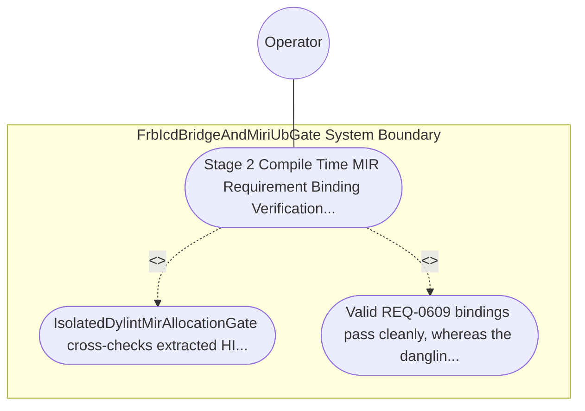

| Attribute | Specification Detail |
| :--- | :--- |
| **Issue ID** | #775 |
| **Title** | Use Case 47: Stage 2 Compile Time MIR Requirement Binding Verification Against Active SysML Digests |
| **Type** | use-case |
| **Primary Actor** | Operator |
| **Scope** | FrbIcdBridgeAndMiriUbGate |
| **Level** | User Goal |
| **Generation Mode** | subagent |
| **Specification Source** | [schema/model.sysml](../../schema/model.sysml) |

# Use Case 47: Stage 2 Compile Time MIR Requirement Binding Verification Against Active SysML Digests

## UML Diagrams

## 1. Actors
- `Operator`

## 2. Preconditions
- Rust items annotated with outer `realises("REQ-0609")` or `/// Realises: (REQ-0609)` verified against an active `.digest.json` compiled from `.sysml`, plus a negative fixture referencing a non-existent or retired identifier `REQ-9999`.

## 3. Trigger
- IsolatedDylintMirAllocationGate cross-checks extracted HIR/MIR DefId requirement bindings against the active SysML requirement digest inventory.

## 4. Main Success Scenario
1. `MultiStageVerificationOrchestrator` invokes `evaluate_stage2_dylint_mir(input)` on `IsolatedDylintMirAllocationGate` (`max_unverified_req_links = 0`) with lowered HIR/MIR `DefId` attributes and the active `.digest.json` inventory on `mir_body_graph_in`.
2. `IsolatedDylintMirAllocationGate` extracts every outer `realises("REQ-*")` and `/// Realises: (REQ-*)` binding across crate items inside `< 380` exec SLOC submodules (`crates/verify-baseline/src/formal_gates/`).
3. `IsolatedDylintMirAllocationGate` cross-checks the extracted requirement identifier set against the compiled SysML requirement digest inventory (`Q_sysml`) under `Invariant_REQ_0609_SC_02`.
4. Valid `REQ-0609` bindings resolve cleanly with `max_unverified_req_links == 0`, emitting a verified `StageGateReceipt` to `MultiStageVerificationOrchestrator`.
5. For the negative fixture referencing `REQ-9999`, `IsolatedDylintMirAllocationGate` transitions `BP_09_Multi_Stage_Compiler_and_Formal_Verification_Gatekeeper_LifecycleState` to `FailedClosedJsonDiagnostic` and emits single-line JSON diagnostic `DEAP-E0902` on `dylint_ndjson_out` with exit code 1.

## 5. Alternate and Exception Flows
- 3a. Annotated item cites a non-existent or retired requirement ID such as `REQ-9999` (`max_unverified_req_links > 0`, `Diagnostic: DEAP-E0902`):
  - `IsolatedDylintMirAllocationGate` transitions to `FailedClosedJsonDiagnostic`, emits single-line NDJSON diagnostic `DEAP-E0902` on `dylint_ndjson_out`, and exits fail-closed with code 1.
- 4a. Active `.digest.json` is missing or fails schema deserialization (`Diagnostic: DEAP-E0902`):
  - `IsolatedDylintMirAllocationGate` aborts Stage 2 verification, emits `DEAP-E0902`, and terminates fail-closed with exit code 1.
- 5a. Invariant violation while enforcing `Invariant_REQ_0609_SC_02` in `FrbIcdBridgeAndMiriUbGate`:
  - `FrbIcdBridgeAndMiriUbGate` aborts execution without partial state mutation, preserves prior verified state, and notifies `Operator`.

## 6. Postconditions
- Valid REQ-0609 bindings pass cleanly, whereas the dangling REQ-9999 annotation fails closed with non-zero exit status and single-line JSON diagnostic DEAP-E0902.

## 8. Realization Matrix
| Specification Item | Type | Link / Reference |
| :--- | :--- | :--- |
| **TBD** | User Story | [User Story 61: evaluate stage2 dylint mir](../user-stories/US-61-evaluate_stage2_dylint_mir.md) |
| **TBD** | Feature | [Feature 41: [BP 09 Multi Stage Compiler and Formal Verification Gatekeeper] FrbIcdBridgeAndMiriUbGate](../features/FEAT-41-FrbIcdBridgeAndMiriUbGate.md) |

## Source References
Use case operational flows and lifecycle activity references:
- System Architecture Model: `schema/model.sysml`
- Normative Systems Engineering Standard: ISO/IEC/IEEE 29148:2018 §6.4.2 Concept of Operations

Operational use case realization and traceability links derive from `schema/model.sysml` pursuant to ISO/IEC/IEEE 29148.
