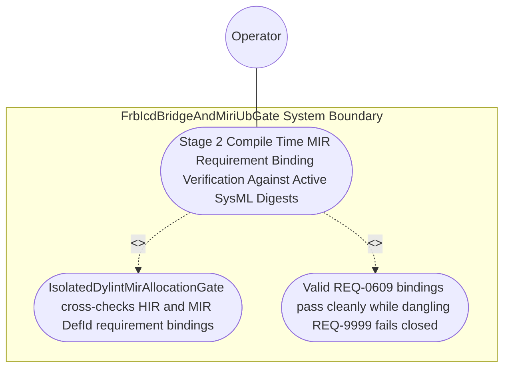

| Attribute | Specification Detail |
| :--- | :--- |
| **Issue ID** | #776 |
| **Title** | Use Case 47: Stage 2 Compile Time MIR Requirement Binding Verification Against Active SysML Digests |
| **Type** | use-case |
| **Parent Epic** | #854 - [Epic 09: BP 09 Multi Stage Compiler and Formal Verification Gatekeeper](../epics/EPIC-09-BP_09_Multi_Stage_Compiler_and_Formal_Verification_Gatekeeper.md) |
| **Schema Containers** | `BP_09_Multi_Stage_Compiler_and_Formal_Verification_Gatekeeper::UC_BP_09_03_Stage_2_Compile_Time_MIR_Requirement_Binding_Verification_Against_Active_SysML_Digests` |
| **Primary Actor** | Operator |
| **Scope** | FrbIcdBridgeAndMiriUbGate |
| **Level** | User Goal |
| **Generation Mode** | subagent |
| **Specification Source** | [schema/model.sysml](../../schema/model.sysml) |

# Use Case 47: Stage 2 Compile Time MIR Requirement Binding Verification Against Active SysML Digests

## UML Diagrams

### Use Case Diagram


### State Machine Diagram
```sysml
stateDiagram-v2
    [*] --> RunningStage2DylintMir
    RunningStage2DylintMir --> RunningStage3FrbAndMiri : "stage2ZeroRtAllocVerified [max_unverified_req_links == 0 && C_VER_03] / emitStage2PassReceipt"
    RunningStage2DylintMir --> FailedClosedJsonDiagnostic : "rejectMirHeapAllocOrDanglingReq [max_unverified_req_links > 0] / emitDeapE0902"
    RunningStage3FrbAndMiri --> [*]
    FailedClosedJsonDiagnostic --> [*]
```

## 1. Actors
- **Primary Actor:** `Operator`
- **Secondary Actors:** `MultiStageVerificationOrchestrator`, `IsolatedDylintMirAllocationGate`, `FrbIcdBridgeAndMiriUbGate`

## 2. Preconditions
- Rust items annotated with outer `realises("REQ-0609")` or `/// Realises: [REQ-0609]` verified against an active `.digest.json` compiled from `.sysml`, plus a negative fixture referencing a non-existent or retired identifier `REQ-9999`.

## 3. Trigger
- `IsolatedDylintMirAllocationGate` cross-checks extracted HIR/MIR `DefId` requirement bindings against the active SysML requirement digest inventory inside excluded `./lints/deap-dylint-mir/`.

## 4. Main Success Scenario
1. `MultiStageVerificationOrchestrator` invokes `evaluate_stage2_dylint_mir(input)` on `IsolatedDylintMirAllocationGate` (`max_unverified_req_links = 0`) with lowered HIR/MIR `DefId` attributes and the active `.digest.json` inventory on `mir_body_graph_in`.
2. `IsolatedDylintMirAllocationGate` extracts every outer `realises("REQ-*")` and `/// Realises: [REQ-*]` binding across crate items via `ra_ap_syntax` (`ast::HasDocComments`, `ast::HasAttrs`) and HIR/MIR `DefId` inspection inside `< 380` exec SLOC submodules (`./crates/verify-baseline/src/formal_gates/` and excluded `./lints/deap-dylint-mir/`) with zero hand-rolled scanners.
3. `IsolatedDylintMirAllocationGate` cross-checks the extracted requirement identifier set against the compiled SysML requirement digest inventory (`Q_sysml`) under `Invariant_REQ_0609_SC_02`.
4. Valid `REQ-0609` bindings resolve cleanly with `max_unverified_req_links == 0`, emitting a verified `StageGateReceipt` to `MultiStageVerificationOrchestrator`.
5. For the negative fixture referencing `REQ-9999`, `IsolatedDylintMirAllocationGate` transitions `BP_09_Multi_Stage_Compiler_and_Formal_Verification_Gatekeeper_LifecycleState` to `FailedClosedJsonDiagnostic` and emits single-line JSON diagnostic `DEAP-E0902` on `dylint_ndjson_out` with exit code 1.

## 5. Alternate and Exception Flows
- 3a. Annotated item cites a non-existent or retired requirement ID such as `REQ-9999` (`max_unverified_req_links > 0`, `Diagnostic: DEAP-E0902`) (Branches from Basic Flow step 3):
  1. `IsolatedDylintMirAllocationGate` identifies the unverified requirement identifier (`REQ-9999` not in `Q_sysml`).
  2. `IsolatedDylintMirAllocationGate` transitions to `FailedClosedJsonDiagnostic`, emits single-line NDJSON diagnostic `DEAP-E0902` on `dylint_ndjson_out`, and exits fail-closed with code 1.
- 4a. Active `.digest.json` is missing or fails typed `serde_json` schema deserialization (`Diagnostic: DEAP-E0902`) (Branches from Basic Flow step 1):
  1. `IsolatedDylintMirAllocationGate` detects the missing or corrupted SysML digest inventory.
  2. `IsolatedDylintMirAllocationGate` aborts Stage 2 verification, emits `DEAP-E0902`, and terminates fail-closed with exit code 1.
- 5a. Invariant violation while enforcing `Invariant_REQ_0609_SC_02` in `FrbIcdBridgeAndMiriUbGate` (Branches from Basic Flow step 3):
  1. `FrbIcdBridgeAndMiriUbGate` detects a structural invariant failure during Stage 2 evaluation.
  2. `FrbIcdBridgeAndMiriUbGate` aborts execution without partial state mutation, preserves prior verified state, and notifies `Operator`.

## 6. Postconditions
- **Success Guarantee:** Valid `REQ-0609` bindings pass cleanly with `max_unverified_req_links == 0` under `Invariant_REQ_0609_SC_02`.
- **Failure Guarantee:** Dangling `REQ-9999` annotations fail closed with non-zero exit status and single-line JSON diagnostic `DEAP-E0902`.

## 7. Architectural Realization & Operational Context (Contracts A & B, 3-Layer DoD)
- **Contract A (100% OMG SysML v2.0 + KerML 1.0 Grammar Coverage)**: Resolves `requirement def`/`requirement` (`subject`, `actor`, `stakeholder`, `framed concern`, `satisfy ... by ...`), `concern def`/`concern`, `verification def`/`verification` (`verify requirement`), `test case def`/`test case`, and `#hazard`/`#risk`/`#capability`/`#rt_loop`/`#dal`/`#fls` metadata usages across the full OMG SysML v2.0 and KerML 1.0 textual grammar with zero 16-construct artificial caps.
- **Contract B (Excluded `./lints/deap-dylint-mir/` & `ra_ap_syntax` in 5-Stage Pipeline, Zero Hand-Rolled Scanners)**: Uses `ra_ap_syntax` (`ast::HasDocComments`, `ast::HasAttrs`), `rustc_middle::mir`, and typed `serde_json` `.digest.json` parsing inside the 5-Stage pipeline (Stage 1 Clippy -> Stage 2 excluded `./lints/deap-dylint-mir/` -> Stage 3 Miri + `flutter_rust_bridge` -> Stage 4 Kani `outer kani::proof` synthesis via `syn`+`proc-macro2`+`quote`+`prettyplease` -> Stage 5 Ferrocene qualification) with dynamic runtime `PATH` discovery and zero hand-rolled scanners.
- **3-Layer Definition of Done**: Closes Layer 1 (`Stage2MirEvalInput` `claimed_req_ids` / `valid_sysml_req_ids` domain state), Layer 2 (`evaluate_stage2_dylint_mir` inside `< 380`-SLOC submodules `./crates/verify-baseline/src/formal_gates/` and `./lints/deap-dylint-mir/` with explicit deletion of legacy hand-rolled docstring/attribute scanners), and Layer 3 (`mir_body_graph_in` and `dylint_ndjson_out` NDJSON binding).

## 8. Realization Matrix
| Specification Item | Type | Link / Reference |
| :--- | :--- | :--- |
| **#811** | User Story | [User Story 61: Evaluate Stage2 Dylint Mir](../user-stories/US-61-evaluate_stage2_dylint_mir.md) |
| **#812** | User Story | [User Story 62: Verify In Process Cst Syntax](../user-stories/US-62-verify_in_process_cst_syntax.md) |
| **#839** | Feature | [Feature 41: [BP 09 Multi Stage Compiler and Formal Verification Gatekeeper] FrbIcdBridgeAndMiriUbGate](../features/FEAT-41-FrbIcdBridgeAndMiriUbGate.md) |
| **#840** | Feature | [Feature 42: [BP 09 Multi Stage Compiler and Formal Verification Gatekeeper] IsolatedDylintMirAllocationGate](../features/FEAT-42-IsolatedDylintMirAllocationGate.md) |

### Required User Stories
- [ ] #811 - [User Story 61: Evaluate Stage2 Dylint Mir](../user-stories/US-61-evaluate_stage2_dylint_mir.md) (Verifies compile-time HIR/MIR `REQ-*` requirement bindings against active `.digest.json` inventories)
- [ ] #812 - [User Story 62: Verify In Process Cst Syntax](../user-stories/US-62-verify_in_process_cst_syntax.md) (Extracts lossless `ra_ap_syntax` attribute/docstring AST nodes and enforces `<= 380` exec SLOC)

### Required Features
- [ ] #839 - [Feature 41: [BP 09 Multi Stage Compiler and Formal Verification Gatekeeper] FrbIcdBridgeAndMiriUbGate](../features/FEAT-41-FrbIcdBridgeAndMiriUbGate.md) (Coordinates `Invariant_REQ_0609_SC_02` enforcement across the verification gatekeeper)
- [ ] #840 - [Feature 42: [BP 09 Multi Stage Compiler and Formal Verification Gatekeeper] IsolatedDylintMirAllocationGate](../features/FEAT-42-IsolatedDylintMirAllocationGate.md) (Implements Stage 2 `max_unverified_req_links == 0` verification and `DEAP-E0902` diagnostics)

## Source References
Use case operational flows and lifecycle activity references:
- System Architecture Model: `schema/model.sysml`
- Engineering Design Blueprint: `./docs/designs/blueprint-09-clippy-dylint-miri-kani-formal-verification-gate.md`
- Normative Systems Engineering Standard: ISO/IEC/IEEE 29148:2018 §6.4.2 Concept of Operations

Operational use case realization and traceability links derive from `schema/model.sysml` pursuant to ISO/IEC/IEEE 29148.
