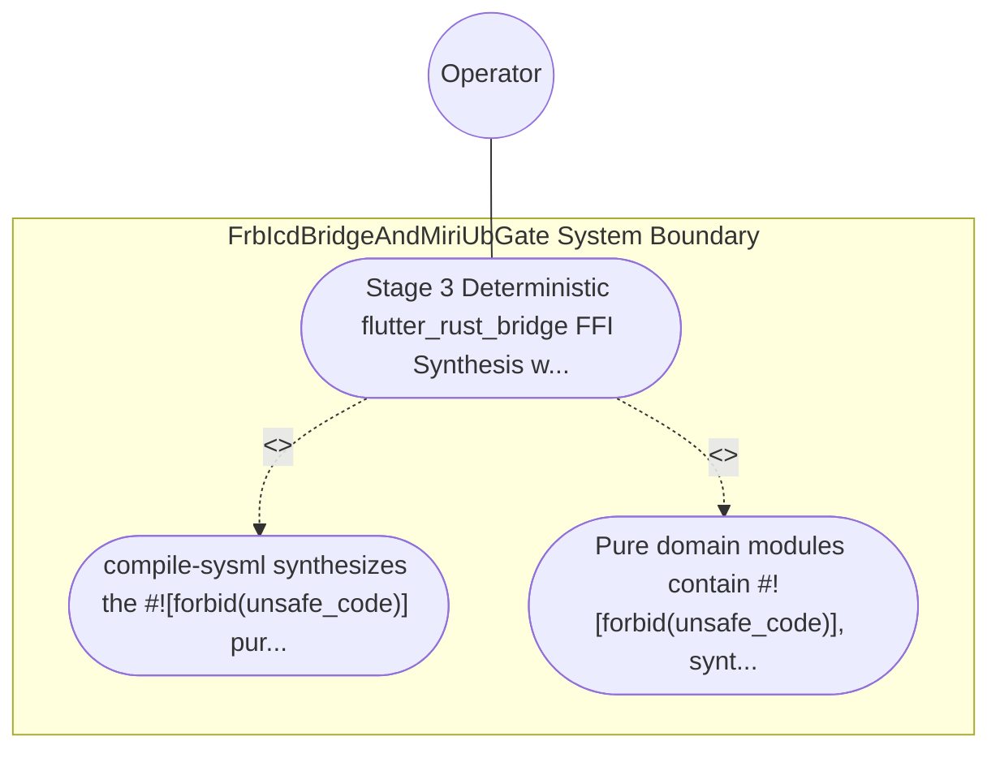

| Attribute | Specification Detail |
| :--- | :--- |
| **Issue ID** | #776 |
| **Title** | Use Case 48: Stage 3 Deterministic flutter_rust_bridge FFI Synthesis with Fail Closed ICD Boundary Guards |
| **Type** | use-case |
| **Primary Actor** | Operator |
| **Scope** | FrbIcdBridgeAndMiriUbGate |
| **Level** | User Goal |
| **Generation Mode** | subagent |
| **Specification Source** | [schema/model.sysml](../../schema/model.sysml) |

# Use Case 48: Stage 3 Deterministic flutter_rust_bridge FFI Synthesis with Fail Closed ICD Boundary Guards

## UML Diagrams

## 1. Actors
- `Operator`

## 2. Preconditions
- A SysML v2 package and `ICD_01` / `ICD_02` specification declaring `port def` and `item flow` signals with numeric `(min..max)` bounds and admissible `state def` operational modes, lowered by `crates/compile-sysml/src/modular_codegen/`.

## 3. Trigger
- compile-sysml synthesizes the inner forbid(unsafe_code) pure domain crate, the isolated flutter_rust_bridge FFI boundary facade, and the Dart DTO/binding modules, and executes inbound FFI boundary tests alongside dart analyze --fatal-infos.

## 4. Main Success Scenario
1. `MultiStageVerificationOrchestrator` transitions from `RunningStage2DylintMir` to `RunningStage3FrbAndMiri` on `stage2ZeroRtAllocVerified` and routes `sysml_icd_ast_in` to `FrbIcdBridgeAndMiriUbGate` (`forbid_unsafe_in_domain = true`, `max_dart_analyze_infos = 0`).
2. `FrbIcdBridgeAndMiriUbGate` synthesizes the pure domain crate enforcing inner `forbid(unsafe_code)`, the isolated `flutter_rust_bridge` FFI boundary facade, and strongly-typed Dart DTO/binding modules on `frb_facade_and_dart_out` inside `< 380` exec SLOC submodules (`crates/compile-sysml/src/frb_guard/`).
3. `FrbIcdBridgeAndMiriUbGate` invokes `guard_inbound_frb_f64(spec, raw_value, active_fsm_state)` across every inbound FFI entrypoint to enforce IEEE 754 finiteness (`is_finite`), closed interval `(p_min..p_max)` range checks, and `state def` operational mode preconditions under `Invariant_REQ_0609_SC_03`.
4. `FrbIcdBridgeAndMiriUbGate` executes `dart analyze --fatal-infos` across all synthesized Dart contract modules, confirming `max_dart_analyze_infos == 0`.
5. Compliant inbound FFI signals forward cleanly into the pure domain state machine, whereas out-of-range, `NaN`, or invalid-mode payloads return `Err(DEAP_E0903)` without panicking across the FFI boundary.

## 5. Alternate and Exception Flows
- 3a. Inbound FFI signal is `NaN`, infinite, outside `(p_min..p_max)`, or arrives in a disallowed `state def` mode (`Diagnostic: DEAP-E0903`):
  - `guard_inbound_frb_f64` rejects the payload fail-closed before invoking domain logic, emits `DEAP-E0903` on `miri_and_dart_receipt_out`, and preserves domain state.
- 4a. Pure domain crate contains an `unsafe` block or synthesized Dart bindings fail `dart analyze --fatal-infos` (`Diagnostic: DEAP-E0903`):
  - `FrbIcdBridgeAndMiriUbGate` transitions to `FailedClosedJsonDiagnostic`, emits single-line NDJSON diagnostic `DEAP-E0903`, and exits fail-closed with code 1.
- 5a. Invariant violation while enforcing `Invariant_REQ_0609_SC_03` in `FrbIcdBridgeAndMiriUbGate`:
  - `FrbIcdBridgeAndMiriUbGate` aborts execution without partial state mutation, preserves prior verified state, and notifies `Operator`.

## 6. Postconditions
- Pure domain modules enforce inner `forbid(unsafe_code)`, synthesized Dart bindings pass `dart analyze --fatal-infos` with zero findings, and inbound FFI boundary guards reject invalid payloads fail-closed with `DEAP-E0903`.

## 8. Realization Matrix
| Specification Item | Type | Link / Reference |
| :--- | :--- | :--- |
| **TBD** | User Story | [User Story 62: verify in process cst syntax](../user-stories/US-62-verify_in_process_cst_syntax.md) |
| **TBD** | Feature | [Feature 41: [BP 09 Multi Stage Compiler and Formal Verification Gatekeeper] FrbIcdBridgeAndMiriUbGate](../features/FEAT-41-FrbIcdBridgeAndMiriUbGate.md) |

## Source References
Use case operational flows and lifecycle activity references:
- System Architecture Model: `schema/model.sysml`
- Normative Systems Engineering Standard: ISO/IEC/IEEE 29148:2018 §6.4.2 Concept of Operations

Operational use case realization and traceability links derive from `schema/model.sysml` pursuant to ISO/IEC/IEEE 29148.
