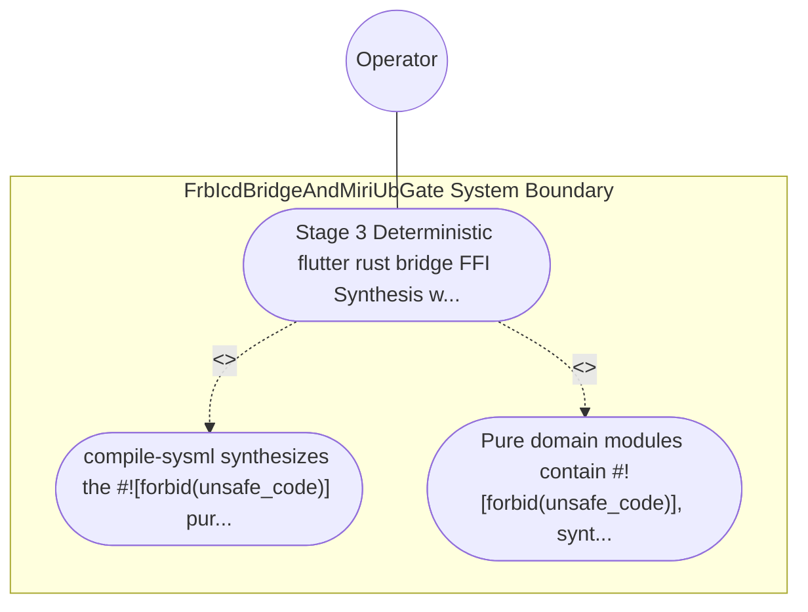

| Attribute | Specification Detail |
| :--- | :--- |
| **Issue ID** | TBD |
| **Title** | Use Case 48: Stage 3 Deterministic flutter rust bridge FFI Synthesis with Fail Closed ICD Boundary Guards |
| **Type** | use-case |
| **Primary Actor** | Operator |
| **Scope** | FrbIcdBridgeAndMiriUbGate |
| **Level** | User Goal |
| **Generation Mode** | subagent |
| **Specification Source** | [schema/model.sysml](../../schema/model.sysml) |

# Use Case 48: Stage 3 Deterministic flutter rust bridge FFI Synthesis with Fail Closed ICD Boundary Guards

## UML Diagrams

## 1. Actors
- `Operator`

## 2. Preconditions
- A SysML v2 package and ICD_01 / ICD_02 specification declaring port def and item flow signals with numeric [min..max] bounds and admissible state def operational modes, lowered by crates/compile-sysml/src/modular_codegen/.

## 3. Trigger
- compile-sysml synthesizes the #![forbid(unsafe_code)] pure domain crate, the isolated flutter_rust_bridge FFI boundary facade, and the Dart DTO/binding modules, and executes inbound FFI boundary tests alongside dart analyze --fatal-infos.

## 4. Main Success Scenario
1. compile-sysml synthesizes the #![forbid(unsafe_code)] pure domain crate, the isolated flutter_rust_bridge FFI boundary facade, and the Dart DTO/binding modules, and executes inbound FFI boundary tests alongside dart analyze --fatal-infos.
2. Pure domain modules contain #![forbid(unsafe_code)], synthesized Dart bindings pass dart analyze.

## 5. Alternate and Exception Flows
- Precondition guard failure in `FrbIcdBridgeAndMiriUbGate`:
  - `FrbIcdBridgeAndMiriUbGate` rejects the `Stage 3 Deterministic flutter rust bridge FFI Synthesis with Fail Closed ICD Boundary Guards` request without partial state mutation and reports diagnostic status to `Operator`.
- Invariant violation while enforcing `Stage 3 Deterministic flutter rust bridge FFI Synthesis with Fail Closed ICD Boundary Guards`:
  - `FrbIcdBridgeAndMiriUbGate` aborts `Stage 3 Deterministic flutter rust bridge FFI Synthesis with Fail Closed ICD Boundary Guards` execution, preserves prior verified state, and notifies `Operator`.

## 6. Postconditions
- Pure domain modules contain #![forbid(unsafe_code)], synthesized Dart bindings pass dart analyze.

## 8. Realization Matrix
| Specification Item | Type | Link / Reference |
| :--- | :--- | :--- |
| **TBD** | User Story | [User Story 60: run Miri And Dart Gate](../user-stories/US-60-runMiriAndDartGate.md) |
| **TBD** | Feature | [Feature 46: [BP 09 Multi Stage Compiler and Formal Verification Gatekeeper] FrbIcdBridgeAndMiriUbGate](../features/FEAT-46-FrbIcdBridgeAndMiriUbGate.md) |

## Source References
Use case operational flows and lifecycle activity references:
- System Architecture Model: `schema/model.sysml`
- Normative Systems Engineering Standard: ISO/IEC/IEEE 29148:2018 §6.4.2 Concept of Operations

Operational use case realization and traceability links derive from `schema/model.sysml` pursuant to ISO/IEC/IEEE 29148.
