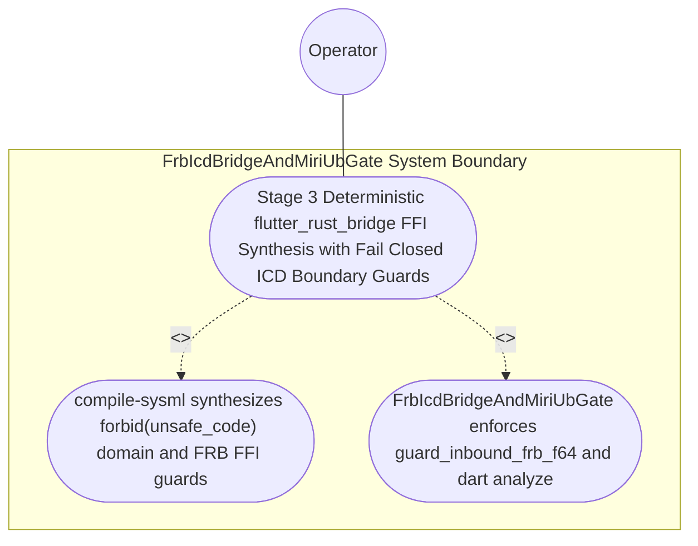

| Attribute | Specification Detail |
| :--- | :--- |
| **Issue ID** | #777 |
| **Title** | Use Case 48: Stage 3 Deterministic flutter_rust_bridge FFI Synthesis with Fail Closed ICD Boundary Guards |
| **Type** | use-case |
| **Parent Epic** | #854 - [Epic 09: BP 09 Multi Stage Compiler and Formal Verification Gatekeeper](../epics/EPIC-09-BP_09_Multi_Stage_Compiler_and_Formal_Verification_Gatekeeper.md) |
| **Schema Containers** | `BP_09_Multi_Stage_Compiler_and_Formal_Verification_Gatekeeper::UC_BP_09_04_Stage_3_Deterministic_flutter_rust_bridge_FFI_Synthesis_with_Fail_Closed_ICD_Boundary_Guards` |
| **Primary Actor** | Operator |
| **Scope** | FrbIcdBridgeAndMiriUbGate |
| **Level** | User Goal |
| **Generation Mode** | subagent |
| **Specification Source** | [schema/model.sysml](../../schema/model.sysml) |

# Use Case 48: Stage 3 Deterministic flutter_rust_bridge FFI Synthesis with Fail Closed ICD Boundary Guards

## UML Diagrams

### Use Case Diagram


### State Machine Diagram
```sysml
stateDiagram-v2
    [*] --> RunningStage2DylintMir
    RunningStage2DylintMir --> RunningStage3FrbAndMiri : "stage2ZeroRtAllocVerified [ok] / invokeStage3FrbGuard"
    RunningStage3FrbAndMiri --> RunningStage4KaniCbmc : "stage3FrbMiriAndDartVerified [isFinite && inRange && validState && dartInfos == 0] / emitStage3PassReceipt"
    RunningStage3FrbAndMiri --> FailedClosedJsonDiagnostic : "rejectMiriTreeBorrowsOrDartFatalInfo [!isFinite || !inRange || !validState || dartInfos > 0] / emitDeapE0903"
    RunningStage4KaniCbmc --> [*]
    FailedClosedJsonDiagnostic --> [*]
```

## 1. Actors
- **Primary Actor:** `Operator`
- **Secondary Actors:** `MultiStageVerificationOrchestrator`, `FrbIcdBridgeAndMiriUbGate`

## 2. Preconditions
- A SysML v2 package and `ICD_01` / `ICD_02` specification declaring `port def`/`port`, `item def`/`item`, and `flow def`/`flow` signals with numeric `[min..max]` bounds and admissible `state def`/`state` operational modes, lowered by `./crates/compile-sysml/src/frb_guard/`.

## 3. Trigger
- `compile-sysml` synthesizes the `#![forbid(unsafe_code)]` pure domain crate, the isolated `flutter_rust_bridge` FFI boundary facade, and the Dart DTO/binding modules, and executes inbound FFI boundary tests alongside `dart analyze --fatal-infos`.

## 4. Main Success Scenario
1. `MultiStageVerificationOrchestrator` transitions from `RunningStage2DylintMir` to `RunningStage3FrbAndMiri` on `stage2ZeroRtAllocVerified` and routes `sysml_icd_ast_in` to `FrbIcdBridgeAndMiriUbGate` (`forbid_unsafe_in_domain = true`, `max_dart_analyze_infos = 0`).
2. `FrbIcdBridgeAndMiriUbGate` synthesizes the pure domain crate enforcing `#![forbid(unsafe_code)]`, the isolated `flutter_rust_bridge` FFI boundary facade via `syn` + `proc-macro2` + `quote` + `prettyplease`, and strongly-typed Dart DTO/binding modules on `frb_facade_and_dart_out` inside `< 380` exec SLOC submodules (`./crates/compile-sysml/src/frb_guard/`, `C_VER_07`).
3. `FrbIcdBridgeAndMiriUbGate` invokes `guard_inbound_frb_f64(spec, raw_value, active_fsm_state)` across every inbound FFI entrypoint to enforce IEEE 754 finiteness (`is_finite`), closed interval `[p_min..p_max]` range checks, and `state def` operational mode preconditions under `Invariant_REQ_0609_SC_03`.
4. `FrbIcdBridgeAndMiriUbGate` parses generated Dart bindings via `deap_core::dart_cst` (`logos` + `rowan`) and executes `dart analyze --fatal-infos` across all synthesized Dart contract modules, confirming `max_dart_analyze_infos == 0`.
5. Compliant inbound FFI signals forward cleanly into the pure domain state machine, whereas out-of-range, `NaN`, or invalid-mode payloads return `Err(DEAP_E0903)` without panicking across the FFI boundary.

## 5. Alternate and Exception Flows
- 3a. Inbound FFI signal is `NaN`, infinite, outside `[p_min..p_max]`, or arrives in a disallowed `state def` mode (`Diagnostic: DEAP-E0903`) (Branches from Basic Flow step 3):
  1. `guard_inbound_frb_f64` intercepts the non-finite, out-of-range, or invalid-state payload before domain state mutation.
  2. `guard_inbound_frb_f64` rejects the payload fail-closed, emits `DEAP-E0903` on `miri_and_dart_receipt_out`, and preserves domain state.
- 4a. Pure domain crate contains an `unsafe` block or synthesized Dart bindings fail `dart analyze --fatal-infos` (`Diagnostic: DEAP-E0903`) (Branches from Basic Flow step 4):
  1. `FrbIcdBridgeAndMiriUbGate` detects the `#![forbid(unsafe_code)]` breach via `ra_ap_syntax` or non-zero `dart analyze --fatal-infos` findings.
  2. `FrbIcdBridgeAndMiriUbGate` transitions to `FailedClosedJsonDiagnostic`, emits single-line NDJSON diagnostic `DEAP-E0903`, and exits fail-closed with code 1.
- 5a. Invariant violation while enforcing `Invariant_REQ_0609_SC_03` in `FrbIcdBridgeAndMiriUbGate` (Branches from Basic Flow step 2):
  1. `FrbIcdBridgeAndMiriUbGate` detects a structural or `< 380`-SLOC modularity violation (`C_VER_07`).
  2. `FrbIcdBridgeAndMiriUbGate` aborts execution without partial state mutation, preserves prior verified state, and notifies `Operator`.

## 6. Postconditions
- **Success Guarantee:** Pure domain modules enforce `#![forbid(unsafe_code)]`, synthesized Dart bindings pass `dart analyze --fatal-infos` with zero findings, and inbound FFI boundary guards reject invalid payloads fail-closed with `DEAP-E0903`.
- **Failure Guarantee:** Any unguarded FFI entrypoint, `unsafe` block in a pure domain crate, or `dart analyze --fatal-infos` finding halts Stage 4 promotion and exits fail-closed with `DEAP-E0903`.

## 7. Architectural Realization & Operational Context (Contracts A & B, 3-Layer DoD)
- **Contract A (100% OMG SysML v2.0 + KerML 1.0 Grammar Coverage)**: Lowers `port def`/`port` (`in`, `out`, `inout`, `~`), `item def`/`item`, `flow def`/`flow` (`of ... from ... to ...`), `interface def`/`interface`, `connection def`/`connection`, `state def`/`state`, `constraint def`/`constraint`, and `ISQ`/`SI`/`ScalarValues` `[lo..hi]` bounds across the full OMG SysML v2.0 and KerML 1.0 textual grammar with zero 16-construct artificial caps.
- **Contract B (Stage 3 `flutter_rust_bridge` + `deap_core::dart_cst` in 5-Stage Pipeline, Zero Hand-Rolled Scanners)**: Synthesizes FFI facades via `syn` + `proc-macro2` + `quote` + `prettyplease` and validates Dart CSTs via `deap_core::dart_cst` (`logos` + `rowan`) inside the 5-Stage pipeline (Stage 1 Clippy -> Stage 2 excluded `./lints/deap-dylint-mir/` -> Stage 3 Miri + `flutter_rust_bridge` -> Stage 4 Kani `outer kani::proof` -> Stage 5 Ferrocene qualification) with dynamic runtime `PATH` discovery and zero hand-rolled scanners.
- **3-Layer Definition of Done**: Closes Layer 1 (`IcdSignalGuardSpec` domain model), Layer 2 (`guard_inbound_frb_f64` inside `< 380`-SLOC submodules `./crates/compile-sysml/src/frb_guard/` and `./crates/verify-baseline/src/formal_gates/` with explicit deletion of legacy unguarded FFI emitters and hand-rolled Dart scanners), and Layer 3 (`sysml_icd_ast_in`, `frb_facade_and_dart_out`, and `miri_and_dart_receipt_out` port bindings).

## 8. Realization Matrix
| Specification Item | Type | Link / Reference |
| :--- | :--- | :--- |
| **#812** | User Story | [User Story 62: verify in process cst syntax](../user-stories/US-62-verify_in_process_cst_syntax.md) |
| **#813** | User Story | [User Story 63: guard inbound frb f64](../user-stories/US-63-guard_inbound_frb_f64.md) |
| **#839** | Feature | [Feature 41: [BP 09 Multi Stage Compiler and Formal Verification Gatekeeper] FrbIcdBridgeAndMiriUbGate](../features/FEAT-41-FrbIcdBridgeAndMiriUbGate.md) |
| **#842** | Feature | [Feature 44: [BP 09 Multi Stage Compiler and Formal Verification Gatekeeper] MultiStageVerificationOrchestrator](../features/FEAT-44-MultiStageVerificationOrchestrator.md) |

### Required User Stories
- [ ] #812 - [User Story 62: verify in process cst syntax](../user-stories/US-62-verify_in_process_cst_syntax.md) (Verifies lossless `ra_ap_syntax` CST syntax and `<= 380` exec SLOC across `./crates/compile-sysml/src/frb_guard/`)
- [ ] #813 - [User Story 63: guard inbound frb f64](../user-stories/US-63-guard_inbound_frb_f64.md) (Enforces `guard_inbound_frb_f64(spec, raw_value, active_fsm_state)` across inbound FFI boundaries)

### Required Features
- [ ] #839 - [Feature 41: [BP 09 Multi Stage Compiler and Formal Verification Gatekeeper] FrbIcdBridgeAndMiriUbGate](../features/FEAT-41-FrbIcdBridgeAndMiriUbGate.md) (Implements Stage 3 `flutter_rust_bridge` FFI boundary guard synthesis and `dart analyze --fatal-infos` verification)
- [ ] #842 - [Feature 44: [BP 09 Multi Stage Compiler and Formal Verification Gatekeeper] MultiStageVerificationOrchestrator](../features/FEAT-44-MultiStageVerificationOrchestrator.md) (Coordinates Stage 3 execution and fail-closed `DEAP-E0903` short-circuiting)

## Source References
Use case operational flows and lifecycle activity references:
- System Architecture Model: `schema/model.sysml`
- Engineering Design Blueprint: `./docs/designs/blueprint-09-clippy-dylint-miri-kani-formal-verification-gate.md`
- Normative Systems Engineering Standard: ISO/IEC/IEEE 29148:2018 §6.4.2 Concept of Operations

Operational use case realization and traceability links derive from `schema/model.sysml` pursuant to ISO/IEC/IEEE 29148.
