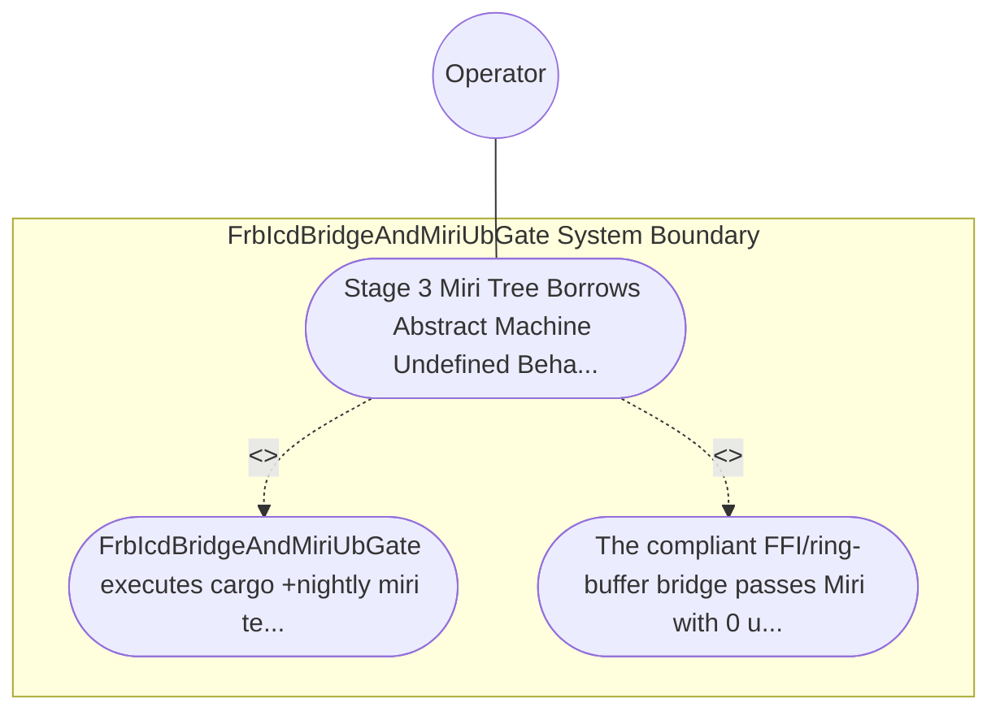

| Attribute | Specification Detail |
| :--- | :--- |
| **Issue ID** | #777 |
| **Title** | Use Case 49: Stage 3 Miri Tree Borrows Abstract Machine Undefined Behavior Rejection on FFI and Ring Buffer Bridges |
| **Type** | use-case |
| **Primary Actor** | Operator |
| **Scope** | FrbIcdBridgeAndMiriUbGate |
| **Level** | User Goal |
| **Generation Mode** | subagent |
| **Specification Source** | [schema/model.sysml](../../schema/model.sysml) |

# Use Case 49: Stage 3 Miri Tree Borrows Abstract Machine Undefined Behavior Rejection on FFI and Ring Buffer Bridges

## UML Diagrams

## 1. Actors
- `Operator`

## 2. Preconditions
- An isolated Stage-3 FFI marshaling and lock-free SPSC ring-buffer bridge module containing documented // SAFETY: blocks, paired with a negative mutation probe introducing a Tree Borrows pointer-aliasing violation or uninitialized byte read.

## 3. Trigger
- FrbIcdBridgeAndMiriUbGate executes cargo +nightly miri test with MIRIFLAGS=\"-Zmiri-tree-borrows\".

## 4. Main Success Scenario
1. `MultiStageVerificationOrchestrator` invokes `FrbIcdBridgeAndMiriUbGate` (`max_miri_ub_violations = 0`, `miri_aliasing_model = "-Zmiri-tree-borrows"`) during `RunningStage3FrbAndMiri`.
2. `FrbIcdBridgeAndMiriUbGate` verifies that all `unsafe` FFI marshaling and lock-free SPSC ring-buffer blocks reside strictly inside the isolated boundary module (`< 380` exec SLOC) and carry mandatory `// SAFETY:` precondition comments.
3. `FrbIcdBridgeAndMiriUbGate` executes `cargo +nightly miri test` with `MIRIFLAGS="-Zmiri-tree-borrows"` across the FFI marshaling and SPSC ring-buffer test suite under `Invariant_REQ_0609_SC_03`.
4. The compliant FFI/ring-buffer bridge passes Miri abstract-machine interpretation with `max_miri_ub_violations == 0` (`C_VER_04`) and zero leaked allocations, transitioning `BP_09_Multi_Stage_Compiler_and_Formal_Verification_Gatekeeper_LifecycleState` to `RunningStage4KaniCbmc`.
5. For the negative mutation probe introducing a Tree Borrows pointer-aliasing violation or uninitialized byte read, `FrbIcdBridgeAndMiriUbGate` transitions to `FailedClosedJsonDiagnostic` and emits single-line NDJSON diagnostic `DEAP-E0903` on `miri_and_dart_receipt_out` with exit code 1.

## 5. Alternate and Exception Flows
- 3a. Miri detects a Tree Borrows pointer-aliasing violation, out-of-bounds pointer arithmetic, uninitialized memory read, or memory leak (`max_miri_ub_violations > 0`, `Diagnostic: DEAP-E0903`):
  - `FrbIcdBridgeAndMiriUbGate` transitions to `FailedClosedJsonDiagnostic`, emits single-line JSON diagnostic `DEAP-E0903` on `miri_and_dart_receipt_out`, and terminates fail-closed with exit code 1.
- 4a. Any `unsafe` block in the FFI bridge lacks a preceding `// SAFETY:` justification comment (`Diagnostic: DEAP-E0900`):
  - `StableClippyTotalFunctionGate` (`undocumented_unsafe_blocks = "deny"`) rejects the module and halts promotion before Stage 3 completes.
- 5a. Invariant violation while enforcing `C_VER_04` or `Invariant_REQ_0609_SC_03`:
  - `FrbIcdBridgeAndMiriUbGate` aborts execution without partial state mutation, preserves prior verified state, and notifies `Operator`.

## 6. Postconditions
- The compliant FFI/ring-buffer bridge passes Miri with 0 undefined-behavior findings (`C_VER_04`) and 0 leaked allocations, whereas the mutated aliasing/uninitialized probe fails closed with exit code 1 and `DEAP-E0903`.

## 8. Realization Matrix
| Specification Item | Type | Link / Reference |
| :--- | :--- | :--- |
| **TBD** | User Story | [User Story 63: guard inbound frb f64](../user-stories/US-63-guard_inbound_frb_f64.md) |
| **TBD** | Feature | [Feature 41: [BP 09 Multi Stage Compiler and Formal Verification Gatekeeper] FrbIcdBridgeAndMiriUbGate](../features/FEAT-41-FrbIcdBridgeAndMiriUbGate.md) |

## Source References
Use case operational flows and lifecycle activity references:
- System Architecture Model: `schema/model.sysml`
- Normative Systems Engineering Standard: ISO/IEC/IEEE 29148:2018 §6.4.2 Concept of Operations

Operational use case realization and traceability links derive from `schema/model.sysml` pursuant to ISO/IEC/IEEE 29148.
