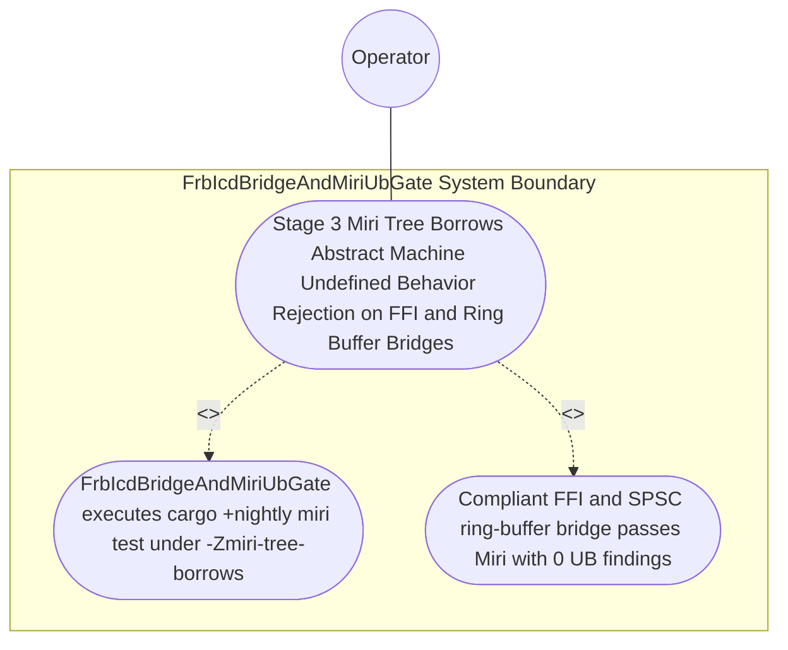
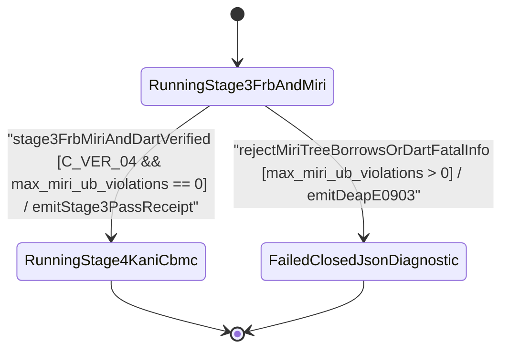

| Attribute | Specification Detail |
| :--- | :--- |
| **Issue ID** | #777 |
| **Title** | Use Case 49: Stage 3 Miri Tree Borrows Abstract Machine Undefined Behavior Rejection on FFI and Ring Buffer Bridges |
| **Type** | use-case |
| **Parent Epic** | #734 - [Epic 09: BP 09 Multi Stage Compiler and Formal Verification Gatekeeper](../epics/EPIC-09-BP_09_Multi_Stage_Compiler_and_Formal_Verification_Gatekeeper.md) |
| **Schema Containers** | `BP_09_Multi_Stage_Compiler_and_Formal_Verification_Gatekeeper::UC_BP_09_05_Stage_3_Miri_Tree_Borrows_Abstract_Machine_Undefined_Behavior_Rejection_on_FFI_and_Ring_Buffer_Bridges` |
| **Primary Actor** | Operator |
| **Scope** | FrbIcdBridgeAndMiriUbGate |
| **Level** | User Goal |
| **Generation Mode** | subagent |
| **Specification Source** | [schema/model.sysml](../../schema/model.sysml) |

# Use Case 49: Stage 3 Miri Tree Borrows Abstract Machine Undefined Behavior Rejection on FFI and Ring Buffer Bridges

## UML Diagrams

### Use Case Diagram

### State Machine Diagram

## 1. Actors
- **Primary Actor:** `Operator`
- **Secondary Actors:** `MultiStageVerificationOrchestrator`, `FrbIcdBridgeAndMiriUbGate`, `StableClippyTotalFunctionGate`

## 2. Preconditions
- An isolated Stage 3 `flutter_rust_bridge` FFI marshaling and lock-free SPSC ring-buffer bridge module containing documented `// SAFETY:` blocks, paired with a negative mutation probe introducing a Tree Borrows pointer-aliasing violation or uninitialized byte read.

## 3. Trigger
- `FrbIcdBridgeAndMiriUbGate` executes `cargo +nightly miri test` with `MIRIFLAGS="-Zmiri-tree-borrows"`.

## 4. Main Success Scenario
1. `MultiStageVerificationOrchestrator` invokes `FrbIcdBridgeAndMiriUbGate` (`max_miri_ub_violations = 0`, `miri_aliasing_model = "-Zmiri-tree-borrows"`) during `RunningStage3FrbAndMiri`.
2. `FrbIcdBridgeAndMiriUbGate` verifies via `ra_ap_syntax` CST inspection that all `unsafe` FFI marshaling and lock-free SPSC ring-buffer blocks reside strictly inside the isolated boundary module (`< 380` exec SLOC, `C_VER_07`) and carry mandatory `// SAFETY:` precondition comments.
3. `FrbIcdBridgeAndMiriUbGate` executes `cargo +nightly miri test` with `MIRIFLAGS="-Zmiri-tree-borrows"` across the FFI marshaling and SPSC ring-buffer test suite under `Invariant_REQ_0609_SC_03`.
4. The compliant FFI/ring-buffer bridge passes Miri abstract-machine interpretation with `max_miri_ub_violations == 0` (`C_VER_04`) and zero leaked allocations, transitioning `BP_09_Multi_Stage_Compiler_and_Formal_Verification_Gatekeeper_LifecycleState` to `RunningStage4KaniCbmc`.
5. For the negative mutation probe introducing a Tree Borrows pointer-aliasing violation or uninitialized byte read, `FrbIcdBridgeAndMiriUbGate` transitions to `FailedClosedJsonDiagnostic` and emits single-line NDJSON diagnostic `DEAP-E0903` on `miri_and_dart_receipt_out` with exit code 1.

## 5. Alternate and Exception Flows
- **3a. Miri detects a Tree Borrows pointer-aliasing violation, out-of-bounds pointer arithmetic, uninitialized memory read, or memory leak (`max_miri_ub_violations > 0`, `Diagnostic: DEAP-E0903`) (Branches from Basic Flow step 3):**
  1. `FrbIcdBridgeAndMiriUbGate` captures the Miri abstract-machine violation trace.
  2. `FrbIcdBridgeAndMiriUbGate` transitions to `FailedClosedJsonDiagnostic`, emits single-line JSON diagnostic `DEAP-E0903` on `miri_and_dart_receipt_out`, and terminates fail-closed with exit code 1.
- **4a. Any `unsafe` block in the FFI bridge lacks a preceding `// SAFETY:` justification comment (`Diagnostic: DEAP-E0900`) (Branches from Basic Flow step 2):**
  1. `StableClippyTotalFunctionGate` (`undocumented_unsafe_blocks = "deny"`) detects the undocumented `unsafe` block.
  2. `StableClippyTotalFunctionGate` rejects the module with `DEAP-E0900` and halts promotion before Stage 3 completes.
- **5a. Invariant violation while enforcing `C_VER_04` or `Invariant_REQ_0609_SC_03` (Branches from Basic Flow step 4):**
  1. `FrbIcdBridgeAndMiriUbGate` detects a violated Miri aliasing model or postcondition invariant.
  2. `FrbIcdBridgeAndMiriUbGate` aborts execution without partial state mutation, preserves prior verified state, and notifies `Operator`.

## 6. Postconditions
- **Success Guarantee:** The compliant FFI/ring-buffer bridge passes Miri with `0` undefined-behavior findings (`C_VER_04`) and `0` leaked allocations.
- **Failure Guarantee:** The mutated aliasing or uninitialized memory probe fails closed with exit code 1 and `DEAP-E0903`.

## 7. Architectural Realization & Operational Context (Contracts A & B, 3-Layer DoD)
- **Contract A (100% OMG SysML v2.0 + KerML 1.0 Grammar Coverage)**: Verifies memory and aliasing safety across FFI and ring-buffer channels derived from full OMG SysML v2.0 and KerML 1.0 `port def`/`port`, `item def`/`item`, `flow def`/`flow`, `connection def`/`connection`, `interface def`/`interface`, `allocation def`/`allocation`, `occurrence def`/`occurrence`, and `#rt_loop`/`#dal`/`#fls` metadata usages with zero 16-construct artificial caps.
- **Contract B (Stage 3 Miri `-Zmiri-tree-borrows` + `flutter_rust_bridge` in 5-Stage Pipeline, Zero Hand-Rolled Scanners)**: Executes `cargo +nightly miri test` under `MIRIFLAGS="-Zmiri-tree-borrows"` inside the 5-Stage pipeline (Stage 1 Clippy -> Stage 2 excluded `./lints/deap-dylint-mir/` -> Stage 3 Miri + `flutter_rust_bridge` -> Stage 4 Kani `#[kani::proof]` synthesis via `syn`+`proc-macro2`+`quote`+`prettyplease` -> Stage 5 Ferrocene qualification) with dynamic runtime `PATH` discovery and `ra_ap_syntax` CST inspection (zero hand-rolled scanners).
- **3-Layer Definition of Done**: Closes Layer 1 (`miri_aliasing_model` and `max_miri_ub_violations` domain state), Layer 2 (Miri `-Zmiri-tree-borrows` evaluation inside `< 380`-SLOC submodules `./crates/verify-baseline/src/formal_gates/` and `./crates/compile-sysml/src/frb_guard/` with explicit deletion of legacy hand-rolled `unsafe` string scanners), and Layer 3 (`miri_and_dart_receipt_out` NDJSON binding).

## 8. Realization Matrix
| Specification Item | Type | Link / Reference |
| :--- | :--- | :--- |
| **#812** | User Story | [User Story 63: guard inbound frb f64](../user-stories/US-63-guard_inbound_frb_f64.md) |
| **#814** | User Story | [User Story 65: evaluate four stage gatekeeper](../user-stories/US-65-evaluate_four_stage_gatekeeper.md) |
| **#747** | Feature | [Feature 41: [BP 09 Multi Stage Compiler and Formal Verification Gatekeeper] FrbIcdBridgeAndMiriUbGate](../features/FEAT-41-FrbIcdBridgeAndMiriUbGate.md) |
| **#751** | Feature | [Feature 45: [BP 09 Multi Stage Compiler and Formal Verification Gatekeeper] StableClippyTotalFunctionGate](../features/FEAT-45-StableClippyTotalFunctionGate.md) |

### Required User Stories
- [ ] #812 - [User Story 63: guard inbound frb f64](../user-stories/US-63-guard_inbound_frb_f64.md) (Executes Stage 3 FFI boundary guard and Miri `-Zmiri-tree-borrows` verification)
- [ ] #814 - [User Story 65: evaluate four stage gatekeeper](../user-stories/US-65-evaluate_four_stage_gatekeeper.md) (Consolidates Stage 3 Miri receipts and short-circuits Stage 4 on `DEAP-E0903`)

### Required Features
- [ ] #747 - [Feature 41: [BP 09 Multi Stage Compiler and Formal Verification Gatekeeper] FrbIcdBridgeAndMiriUbGate](../features/FEAT-41-FrbIcdBridgeAndMiriUbGate.md) (Implements Stage 3 Miri `-Zmiri-tree-borrows` abstract-machine UB verification)
- [ ] #751 - [Feature 45: [BP 09 Multi Stage Compiler and Formal Verification Gatekeeper] StableClippyTotalFunctionGate](../features/FEAT-45-StableClippyTotalFunctionGate.md) (Enforces `undocumented_unsafe_blocks = "deny"` on isolated FFI and ring-buffer `unsafe` blocks)

## Source References
Use case operational flows and lifecycle activity references:
- System Architecture Model: `schema/model.sysml`
- Engineering Design Blueprint: `./docs/designs/blueprint-09-clippy-dylint-miri-kani-formal-verification-gate.md`
- Normative Systems Engineering Standard: ISO/IEC/IEEE 29148:2018 §6.4.2 Concept of Operations

Operational use case realization and traceability links derive from `schema/model.sysml` pursuant to ISO/IEC/IEEE 29148.
