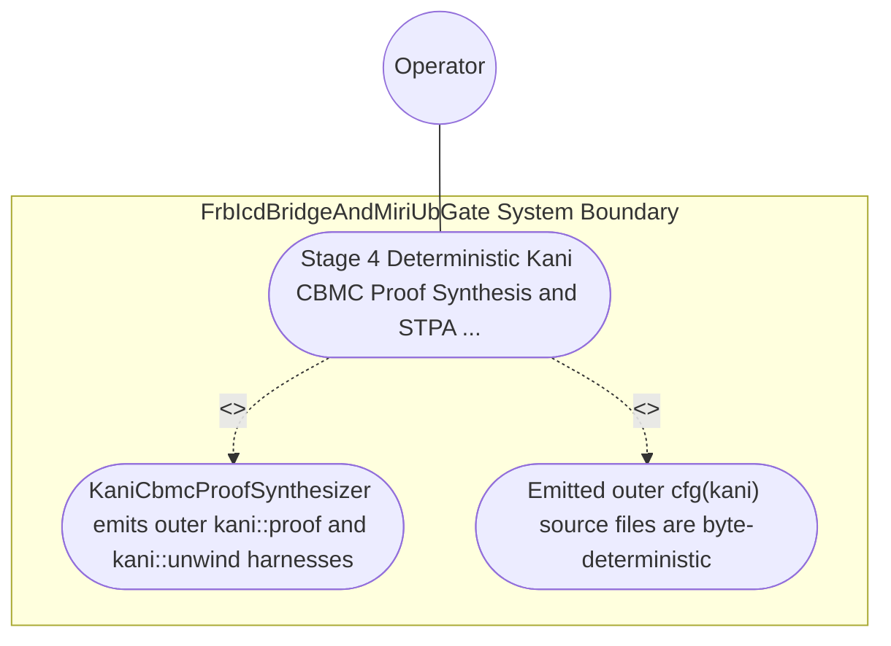

| Attribute | Specification Detail |
| :--- | :--- |
| **Issue ID** | #778 |
| **Title** | Use Case 50: Stage 4 Deterministic Kani CBMC Proof Synthesis and STPA Unsafe Control Action Falsification |
| **Type** | use-case |
| **Primary Actor** | Operator |
| **Scope** | FrbIcdBridgeAndMiriUbGate |
| **Level** | User Goal |
| **Generation Mode** | subagent |
| **Specification Source** | [schema/model.sysml](../../schema/model.sysml) |

# Use Case 50: Stage 4 Deterministic Kani CBMC Proof Synthesis and STPA Unsafe Control Action Falsification

## UML Diagrams

## 1. Actors
- `Operator`

## 2. Preconditions
- SysML `constraint def` invariants, `port def` `(min..max)` intervals, `state def` transition tables, and STPA **UCA-01** / **SC-01** safety constraints lowered into outer `cfg(kani)` modules via `syn` + `quote` + `prettyplease` across `deap-core`, `compile-sysml`, and a generated downstream crate, plus a negative mutation weakening an overflow check or STPA state guard.

## 3. Trigger
- KaniCbmcProofSynthesizer emits the outer kani::proof and kani::unwind(N) harnesses (kani::any() + kani::assume(...) + assert!(...)) and executes cargo kani.

## 4. Main Success Scenario
1. `MultiStageVerificationOrchestrator` transitions from `RunningStage3FrbAndMiri` to `RunningStage4KaniCbmc` on `stage3FrbMiriAndDartVerified` and routes `sysml_safety_ast_in` to `KaniCbmcProofSynthesizer` (`max_kani_counterexamples = 0`, `default_kani_unwind_bound = 16`, `structured_prettyplease_codegen = true`).
2. `KaniCbmcProofSynthesizer` invokes `validate_kani_harness_spec(spec)` inside `< 380` exec SLOC submodules (`crates/compile-sysml/src/kani_synth/`) to verify non-empty `kani::assume(...)` precondition domains, STPA `UCA-*` falsification assertions, and finite `default_kani_unwind_bound` (`1 <= N <= 64`, `C_VER_06`).
3. `KaniCbmcProofSynthesizer` synthesizes byte-deterministic outer `cfg(kani)` proof modules via `syn`, `quote`, and `prettyplease` on `kani_proof_module_out` without raw string-template concatenation.
4. `KaniCbmcProofSynthesizer` executes `cargo kani` symbolic CBMC model checking under `Invariant_REQ_0609_SC_04`, proving all verification conditions `UNSAT` (`max_kani_counterexamples == 0`, `C_VER_05`) and transitioning to `VerifiedAllFourStages`.
5. For the negative mutation weakening an overflow check or STPA state guard, CBMC finds a concrete counterexample (`SAT`), transitions to `FailedClosedJsonDiagnostic`, and emits single-line NDJSON diagnostic `DEAP-E0904` on `cbmc_proof_receipt_out` with exit code 1.

## 5. Alternate and Exception Flows
- 3a. CBMC symbolic model checker discovers a reachable panic, arithmetic overflow, out-of-bounds access, or STPA `UCA-*` breach (`max_kani_counterexamples > 0`, `Diagnostic: DEAP-E0904`):
  - `KaniCbmcProofSynthesizer` transitions to `FailedClosedJsonDiagnostic`, emits single-line JSON diagnostic `DEAP-E0904` on `cbmc_proof_receipt_out` with the counterexample trace, and exits fail-closed with code 1.
- 4a. Harness specification has an empty `kani::assume` precondition or unwind bound outside `C_VER_06` (`1..64`) (`Diagnostic: DEAP-E0904`):
  - `validate_kani_harness_spec` rejects the harness before CBMC execution, emits `DEAP-E0904`, and terminates fail-closed with exit code 1.
- 5a. Invariant violation while enforcing `C_VER_05`, `C_VER_06`, or `Invariant_REQ_0609_SC_04`:
  - `FrbIcdBridgeAndMiriUbGate` aborts execution without partial state mutation, preserves prior verified state, and notifies `Operator`.

## 6. Postconditions
- Emitted outer `cfg(kani)` source files are byte-deterministic, compliant proof harnesses pass CBMC with `max_kani_counterexamples == 0` (`C_VER_05`), and mutated STPA/overflow probes fail closed with `DEAP-E0904`.

## 8. Realization Matrix
| Specification Item | Type | Link / Reference |
| :--- | :--- | :--- |
| **TBD** | User Story | [User Story 64: validate kani harness spec](../user-stories/US-64-validate_kani_harness_spec.md) |
| **TBD** | Feature | [Feature 41: [BP 09 Multi Stage Compiler and Formal Verification Gatekeeper] FrbIcdBridgeAndMiriUbGate](../features/FEAT-41-FrbIcdBridgeAndMiriUbGate.md) |

## Source References
Use case operational flows and lifecycle activity references:
- System Architecture Model: `schema/model.sysml`
- Normative Systems Engineering Standard: ISO/IEC/IEEE 29148:2018 §6.4.2 Concept of Operations

Operational use case realization and traceability links derive from `schema/model.sysml` pursuant to ISO/IEC/IEEE 29148.
