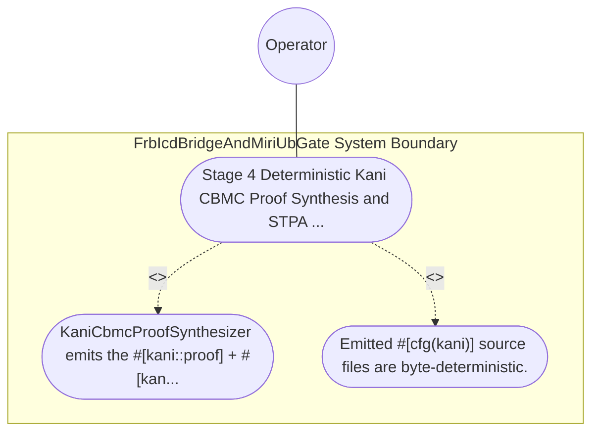

| Attribute | Specification Detail |
| :--- | :--- |
| **Issue ID** | TBD |
| **Title** | Use Case 50: Stage 4 Deterministic Kani CBMC Proof Synthesis and STPA Unsafe Control Action Falsification |
| **Type** | use-case |
| **Primary Actor** | Operator |
| **Scope** | FrbIcdBridgeAndMiriUbGate |
| **Level** | User Goal |
| **Generation Mode** | subagent |
| **Specification Source** | [schema/model.sysml](../../schema/model.sysml) |

# Use Case 50: Stage 4 Deterministic Kani CBMC Proof Synthesis and STPA Unsafe Control Action Falsification

## UML Diagrams

## 1. Actors
- `Operator`

## 2. Preconditions
- SysML constraint def invariants, port def [min..max] intervals, state def transition tables, and STPA **UCA-01** / **SC-01** safety constraints lowered into #[cfg(kani)] modules via syn + quote + prettyplease across deap-core, compile-sysml, and a generated downstream crate, plus a negative mutation weakening an overflow check or STPA state guard.

## 3. Trigger
- KaniCbmcProofSynthesizer emits the #[kani::proof] + #[kani::unwind(N)] harnesses (kani::any() + kani::assume(...) + assert!(...)) and executes cargo kani.

## 4. Main Success Scenario
1. KaniCbmcProofSynthesizer emits the #[kani::proof] + #[kani::unwind(N)] harnesses (kani::any() + kani::assume(...) + assert!(...)) and executes cargo kani.
2. Emitted #[cfg(kani)] source files are byte-deterministic.

## 5. Alternate and Exception Flows
- Precondition guard failure in `FrbIcdBridgeAndMiriUbGate`:
  - `FrbIcdBridgeAndMiriUbGate` rejects the `Stage 4 Deterministic Kani CBMC Proof Synthesis and STPA Unsafe Control Action Falsification` request without partial state mutation and reports diagnostic status to `Operator`.
- Invariant violation while enforcing `Stage 4 Deterministic Kani CBMC Proof Synthesis and STPA Unsafe Control Action Falsification`:
  - `FrbIcdBridgeAndMiriUbGate` aborts `Stage 4 Deterministic Kani CBMC Proof Synthesis and STPA Unsafe Control Action Falsification` execution, preserves prior verified state, and notifies `Operator`.

## 6. Postconditions
- Emitted #[cfg(kani)] source files are byte-deterministic.

## 8. Realization Matrix
| Specification Item | Type | Link / Reference |
| :--- | :--- | :--- |
| **TBD** | User Story | [User Story 62: run Kani Cbmc Proofs](../user-stories/US-62-runKaniCbmcProofs.md) |
| **TBD** | Feature | [Feature 46: [BP 09 Multi Stage Compiler and Formal Verification Gatekeeper] FrbIcdBridgeAndMiriUbGate](../features/FEAT-46-FrbIcdBridgeAndMiriUbGate.md) |

## Source References
Use case operational flows and lifecycle activity references:
- System Architecture Model: `schema/model.sysml`
- Normative Systems Engineering Standard: ISO/IEC/IEEE 29148:2018 §6.4.2 Concept of Operations

Operational use case realization and traceability links derive from `schema/model.sysml` pursuant to ISO/IEC/IEEE 29148.
