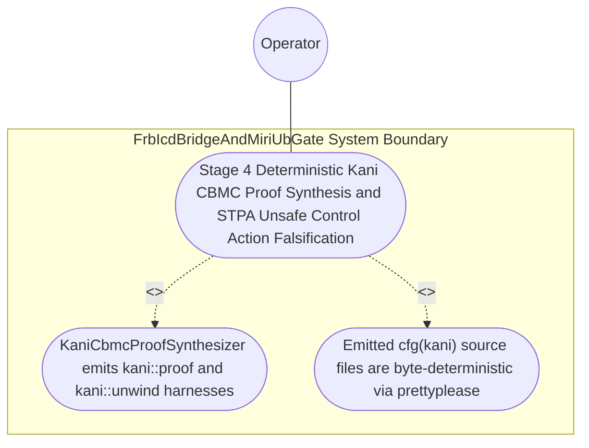
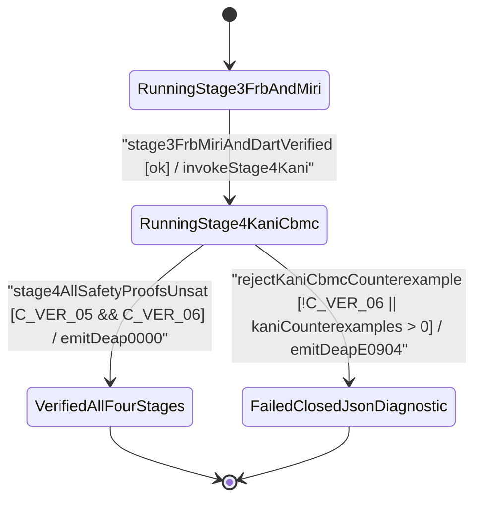

| Attribute | Specification Detail |
| :--- | :--- |
| **Issue ID** | #778 |
| **Title** | Use Case 50: Stage 4 Deterministic Kani CBMC Proof Synthesis and STPA Unsafe Control Action Falsification |
| **Type** | use-case |
| **Parent Epic** | #734 - [Epic 09: BP 09 Multi Stage Compiler and Formal Verification Gatekeeper](../epics/EPIC-09-BP_09_Multi_Stage_Compiler_and_Formal_Verification_Gatekeeper.md) |
| **Schema Containers** | `BP_09_Multi_Stage_Compiler_and_Formal_Verification_Gatekeeper::UC_BP_09_06_Stage_4_Deterministic_Kani_CBMC_Proof_Synthesis_and_STPA_Unsafe_Control_Action_Falsification` |
| **Primary Actor** | Operator |
| **Scope** | FrbIcdBridgeAndMiriUbGate |
| **Level** | User Goal |
| **Generation Mode** | subagent |
| **Specification Source** | [schema/model.sysml](../../schema/model.sysml) |

# Use Case 50: Stage 4 Deterministic Kani CBMC Proof Synthesis and STPA Unsafe Control Action Falsification

## UML Diagrams

### Use Case Diagram

### State Machine Diagram

## 1. Actors
- **Primary Actor:** `Operator`
- **Secondary Actors:** `MultiStageVerificationOrchestrator`, `KaniCbmcProofSynthesizer`, `FrbIcdBridgeAndMiriUbGate`

## 2. Preconditions
- SysML `constraint def` invariants, `port def` `[min..max]` intervals, `state def` transition tables, and STPA **UCA-01** / **SC-01** safety constraints lowered into outer `#[cfg(kani)]` modules via `syn` + `proc-macro2` + `quote` + `prettyplease` across `deap-core`, `compile-sysml`, and a generated downstream crate, plus a negative mutation weakening an overflow check or STPA state guard.

## 3. Trigger
- `KaniCbmcProofSynthesizer` emits the outer `#[kani::proof]` and `#[kani::unwind(N)]` harnesses (`kani::any()` + `kani::assume(...)` + `assert!(...)`) and executes `cargo kani`.

## 4. Main Success Scenario
1. `MultiStageVerificationOrchestrator` transitions from `RunningStage3FrbAndMiri` to `RunningStage4KaniCbmc` on `stage3FrbMiriAndDartVerified` and routes `sysml_safety_ast_in` to `KaniCbmcProofSynthesizer` (`max_kani_counterexamples = 0`, `default_kani_unwind_bound = 16`, `structured_prettyplease_codegen = true`).
2. `KaniCbmcProofSynthesizer` invokes `validate_kani_harness_spec(spec)` inside `< 380` exec SLOC submodules (`./crates/compile-sysml/src/kani_synth/`, `C_VER_07`) to verify non-empty `kani::assume(...)` precondition domains, STPA `UCA-*` falsification assertions, and finite `default_kani_unwind_bound` (`1 <= N <= 64`, `C_VER_06`).
3. `KaniCbmcProofSynthesizer` synthesizes byte-deterministic outer `#[cfg(kani)]` `#[kani::proof]` and `#[kani::unwind(N)]` proof modules via `syn`, `proc-macro2`, `quote`, and `prettyplease` on `kani_proof_module_out` without raw `format!` string-template concatenation.
4. `KaniCbmcProofSynthesizer` executes `cargo kani` symbolic CBMC model checking under `Invariant_REQ_0609_SC_04`, proving all verification conditions `UNSAT` (`max_kani_counterexamples == 0`, `C_VER_05`) and transitioning to `VerifiedAllFourStages`.
5. For the negative mutation weakening an overflow check or STPA state guard, CBMC finds a concrete counterexample (`SAT`), transitions to `FailedClosedJsonDiagnostic`, and emits single-line NDJSON diagnostic `DEAP-E0904` on `cbmc_proof_receipt_out` with exit code 1.

## 5. Alternate and Exception Flows
- **3a. CBMC symbolic model checker discovers a reachable panic, arithmetic overflow, out-of-bounds access, or STPA `UCA-*` breach (`max_kani_counterexamples > 0`, `Diagnostic: DEAP-E0904`) (Branches from Basic Flow step 4):**
  1. `KaniCbmcProofSynthesizer` captures the CBMC counterexample witness trace.
  2. `KaniCbmcProofSynthesizer` transitions to `FailedClosedJsonDiagnostic`, emits single-line JSON diagnostic `DEAP-E0904` on `cbmc_proof_receipt_out` with the counterexample trace, and exits fail-closed with code 1.
- **4a. Harness specification has an empty `kani::assume` precondition or unwind bound outside `C_VER_06` (`1..=64`) (`Diagnostic: DEAP-E0904`) (Branches from Basic Flow step 2):**
  1. `validate_kani_harness_spec` detects the empty assumption or invalid unwind bound before CBMC execution.
  2. `KaniCbmcProofSynthesizer` rejects the harness, emits `DEAP-E0904`, and terminates fail-closed with exit code 1.
- **5a. Invariant violation while enforcing `C_VER_05`, `C_VER_06`, or `Invariant_REQ_0609_SC_04` (Branches from Basic Flow step 3):**
  1. `FrbIcdBridgeAndMiriUbGate` detects a non-deterministic emission or structural invariant failure.
  2. `FrbIcdBridgeAndMiriUbGate` aborts execution without partial state mutation, preserves prior verified state, and notifies `Operator`.

## 6. Postconditions
- **Success Guarantee:** Emitted outer `#[cfg(kani)]` source files are byte-deterministic via `syn` + `proc-macro2` + `quote` + `prettyplease`, and compliant proof harnesses pass CBMC with `max_kani_counterexamples == 0` (`C_VER_05`).
- **Failure Guarantee:** Mutated STPA or arithmetic overflow probes fail closed with `DEAP-E0904` and exit code 1.

## 7. Architectural Realization & Operational Context (Contracts A & B, 3-Layer DoD)
- **Contract A (100% OMG SysML v2.0 + KerML 1.0 Grammar Coverage)**: Lowers `constraint def`/`constraint` (`assert`, `assume`, `require`), `calc def`/`calc` (`return`), `port def`/`port`, `state def`/`state`, `action def`/`action`, `requirement def`/`requirement`, `verification def`/`verification` (`verify requirement`), `test case def`/`test case`, `#hazard`/`#risk`/`#dal`/`#fls`/`#rt_loop` metadata usages, and KerML logical/relational/arithmetic expressions (`implies`, `xor`, `??`, `->`, `collect`, `select`, `forAll`, `exists`, `[lo..hi]`, `ISQ`/`SI`/`ScalarValues`) across the full OMG SysML v2.0 and KerML 1.0 grammar with zero 16-construct artificial caps.
- **Contract B (Stage 4 `#[kani::proof]` Synthesis via `syn` + `proc-macro2` + `quote` + `prettyplease` in 5-Stage Pipeline, Zero Hand-Rolled Scanners)**: Synthesizes `#[cfg(kani)]` `#[kani::proof]` modules using `syn` + `proc-macro2` + `quote` + `prettyplease` inside the 5-Stage pipeline (Stage 1 Clippy -> Stage 2 excluded `./lints/deap-dylint-mir/` -> Stage 3 Miri + `flutter_rust_bridge` -> Stage 4 Kani `#[kani::proof]` -> Stage 5 Ferrocene qualification) with dynamic runtime `PATH` discovery and zero hand-rolled scanners.
- **3-Layer Definition of Done**: Closes Layer 1 (`KaniProofHarnessSpec` domain model), Layer 2 (`validate_kani_harness_spec` and `syn`+`proc-macro2`+`quote`+`prettyplease` synthesis inside `< 380`-SLOC submodules `./crates/compile-sysml/src/kani_synth/` and `./crates/verify-baseline/src/formal_gates/` with explicit deletion of legacy raw `format!` string-template harness emitters), and Layer 3 (`sysml_safety_ast_in`, `kani_proof_module_out`, and `cbmc_proof_receipt_out` port bindings).

## 8. Realization Matrix
| Specification Item | Type | Link / Reference |
| :--- | :--- | :--- |
| **#813** | User Story | [User Story 64: validate kani harness spec](../user-stories/US-64-validate_kani_harness_spec.md) |
| **#814** | User Story | [User Story 65: evaluate four stage gatekeeper](../user-stories/US-65-evaluate_four_stage_gatekeeper.md) |
| **#747** | Feature | [Feature 41: [BP 09 Multi Stage Compiler and Formal Verification Gatekeeper] FrbIcdBridgeAndMiriUbGate](../features/FEAT-41-FrbIcdBridgeAndMiriUbGate.md) |
| **#749** | Feature | [Feature 43: [BP 09 Multi Stage Compiler and Formal Verification Gatekeeper] KaniCbmcProofSynthesizer](../features/FEAT-43-KaniCbmcProofSynthesizer.md) |

### Required User Stories
- [ ] #813 - [User Story 64: validate kani harness spec](../user-stories/US-64-validate_kani_harness_spec.md) (Validates `KaniProofHarnessSpec` and synthesizes `#[kani::proof]` harnesses via `syn` + `proc-macro2` + `quote` + `prettyplease`)
- [ ] #814 - [User Story 65: evaluate four stage gatekeeper](../user-stories/US-65-evaluate_four_stage_gatekeeper.md) (Consolidates Stage 4 CBMC proof receipts into `VerifiedAllFourStages`)

### Required Features
- [ ] #747 - [Feature 41: [BP 09 Multi Stage Compiler and Formal Verification Gatekeeper] FrbIcdBridgeAndMiriUbGate](../features/FEAT-41-FrbIcdBridgeAndMiriUbGate.md) (Coordinates `Invariant_REQ_0609_SC_04` across the formal verification subsystem)
- [ ] #749 - [Feature 43: [BP 09 Multi Stage Compiler and Formal Verification Gatekeeper] KaniCbmcProofSynthesizer](../features/FEAT-43-KaniCbmcProofSynthesizer.md) (Implements Stage 4 `#[kani::proof]` synthesis and CBMC `UNSAT` proof verification)

## Source References
Use case operational flows and lifecycle activity references:
- System Architecture Model: `schema/model.sysml`
- Engineering Design Blueprint: `./docs/designs/blueprint-09-clippy-dylint-miri-kani-formal-verification-gate.md`
- Normative Systems Engineering Standard: ISO/IEC/IEEE 29148:2018 §6.4.2 Concept of Operations

Operational use case realization and traceability links derive from `schema/model.sysml` pursuant to ISO/IEC/IEEE 29148.
