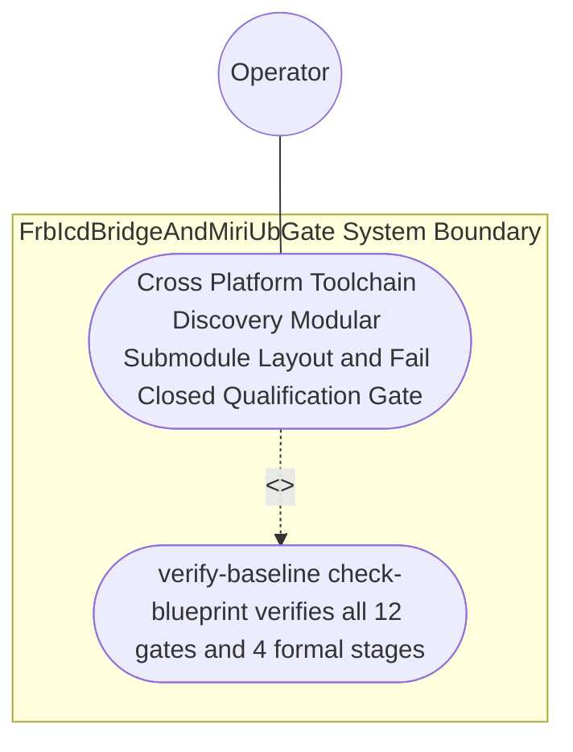
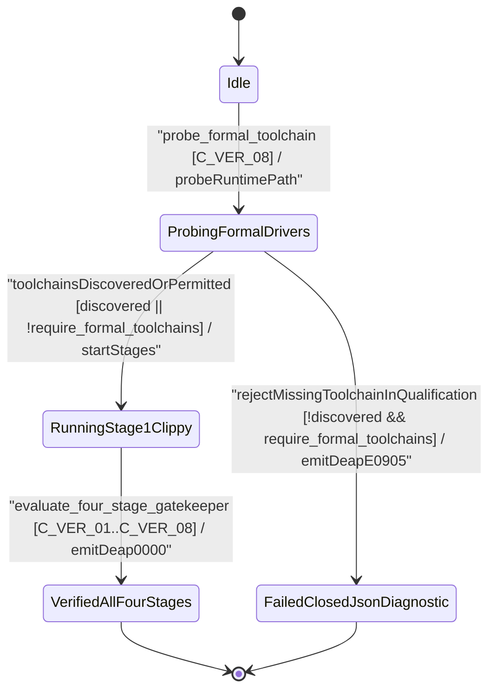

| Attribute | Specification Detail |
| :--- | :--- |
| **Issue ID** | #779 |
| **Title** | Use Case 51: Cross Platform Toolchain Discovery Modular Submodule Layout and Fail Closed Qualification Gate |
| **Type** | use-case |
| **Parent Epic** | #734 - [Epic 09: BP 09 Multi Stage Compiler and Formal Verification Gatekeeper](../epics/EPIC-09-BP_09_Multi_Stage_Compiler_and_Formal_Verification_Gatekeeper.md) |
| **Schema Containers** | `BP_09_Multi_Stage_Compiler_and_Formal_Verification_Gatekeeper::UC_BP_09_07_Cross_Platform_Toolchain_Discovery_Modular_Submodule_Layout_and_Fail_Closed_Qualification_Gate` |
| **Primary Actor** | Operator |
| **Scope** | FrbIcdBridgeAndMiriUbGate |
| **Level** | User Goal |
| **Generation Mode** | subagent |
| **Specification Source** | [schema/model.sysml](../../schema/model.sysml) |

# Use Case 51: Cross Platform Toolchain Discovery Modular Submodule Layout and Fail Closed Qualification Gate

## UML Diagrams

### Use Case Diagram

### State Machine Diagram

## 1. Actors
- **Primary Actor:** `Operator`
- **Secondary Actors:** `MultiStageVerificationOrchestrator`, `IsolatedDylintMirAllocationGate`, `FrbIcdBridgeAndMiriUbGate`, `KaniCbmcProofSynthesizer`, `StableClippyTotalFunctionGate`

## 2. Preconditions
- `./docs/designs/blueprint-09-clippy-dylint-miri-kani-formal-verification-gate.md` specifying dynamic cross-platform driver probing across macOS, Linux, and Windows (`std::env::consts::{DLL_PREFIX, DLL_SUFFIX, EXE_SUFFIX}`, `camino::Utf8Path`), modular submodules under `< 380` SLOC (**C-VER-07**), excluded `./lints/deap-dylint-mir/`, and the `--require-formal-toolchains` qualification flag, evaluated in an environment where a required driver is absent versus present.

## 3. Trigger
- `./target/release/verify-baseline check-blueprint ./docs/designs/blueprint-09-clippy-dylint-miri-kani-formal-verification-gate.md` and `MultiStageVerificationOrchestrator` execute.

## 4. Main Success Scenario
1. `Operator` invokes `probe_formal_toolchain(config)` on `MultiStageVerificationOrchestrator` via `gate_invocation_in`, transitioning `BP_09_Multi_Stage_Compiler_and_Formal_Verification_Gatekeeper_LifecycleState` from `Idle` to `ProbingFormalDrivers`.
2. `MultiStageVerificationOrchestrator` probes cross-platform driver paths (`min_toolchain_discovery_probes` in `1..=3`, `C_VER_08`) across macOS, Linux, and Windows using `std::env::consts::{DLL_PREFIX, DLL_SUFFIX, EXE_SUFFIX}` and `camino::Utf8Path` via runtime `PATH`, `CARGO_HOME`, and `RUSTUP_HOME` discovery without hardcoded host paths.
3. `IsolatedDylintMirAllocationGate` invokes `verify_in_process_cst_syntax(module_path, max_exec_sloc)` via `ra_ap_syntax` across all formal verification submodules (`./crates/verify-baseline/src/formal_gates/`, `./crates/compile-sysml/src/kani_synth/`, `./crates/compile-sysml/src/frb_guard/`, and excluded `./lints/deap-dylint-mir/`) to confirm `max_module_exec_sloc <= 380` (`C_VER_07`) and zero CST syntax errors under `Invariant_REQ_0609_SC_05`.
4. `MultiStageVerificationOrchestrator` executes `evaluate_four_stage_gatekeeper(receipts)` across Stages 1 through 4 and runs `./target/release/verify-baseline check-blueprint ./docs/designs/blueprint-09-clippy-dylint-miri-kani-formal-verification-gate.md`.
5. All 12 mechanical blueprint verification gates and all 4 verification stages pass with exit code 0, emitting a consolidated NDJSON verification receipt (`DEAP-0000`) on `unified_gate_ndjson_out`.

## 5. Alternate and Exception Flows
- **3a. Required formal driver (`dylint`, `miri`, or `kani`) is absent while `require_formal_toolchains == true` (`Diagnostic: DEAP-E0905`) (Branches from Basic Flow step 2):**
  1. `MultiStageVerificationOrchestrator` detects `discovered == false` when `require_formal_toolchains == true`.
  2. `MultiStageVerificationOrchestrator` transitions from `ProbingFormalDrivers` to `FailedClosedJsonDiagnostic` on `rejectMissingToolchainInQualification`, emits single-line NDJSON diagnostic `DEAP-E0905`, and exits fail-closed with code 1.
- **4a. Any formal verification submodule exceeds `380` exec SLOC (`C_VER_07`) or contains CST syntax errors (`Diagnostic: DEAP-E0905`) (Branches from Basic Flow step 3):**
  1. `verify_in_process_cst_syntax` detects `exec_sloc > 380` or non-empty `cst.errors()` via `ra_ap_syntax`.
  2. `verify_in_process_cst_syntax` rejects the module, emits `DEAP-E0905` on `unified_gate_ndjson_out`, and terminates fail-closed with exit code 1.
- **5a. Any of the 12 mechanical blueprint verification gates fails on `./docs/designs/blueprint-09-clippy-dylint-miri-kani-formal-verification-gate.md` (Branches from Basic Flow step 4):**
  1. `verify-baseline check-blueprint` detects a mechanical gate violation.
  2. `verify-baseline check-blueprint` aborts artifact persistence, preserves prior verified state, and exits fail-closed with code 1.

## 6. Postconditions
- **Success Guarantee:** `FrbIcdBridgeAndMiriUbGate` and `MultiStageVerificationOrchestrator` satisfy declared objective `Cross Platform Toolchain Discovery Modular Submodule Layout and Fail Closed Qualification Gate` with all subsystem invariants (`C_VER_01`..`C_VER_08`, `Invariant_REQ_0609_SC_01`..`Invariant_REQ_0609_SC_05`) intact.
- **Failure Guarantee:** Any missing driver during `--require-formal-toolchains` qualification or any submodule exceeding `380` exec SLOC fails closed with `DEAP-E0905` and exit code 1.

## 7. Architectural Realization & Operational Context (Contracts A & B, 3-Layer DoD)
- **Contract A (100% OMG SysML v2.0 + KerML 1.0 Grammar Coverage)**: Verifies complete OMG SysML v2.0 and KerML 1.0 Definition and Usage symmetry (`package`/`library package`/`standard library package`, `import`, `metadata def`/`metadata`/`@Metadata`/`#user_keyword` (`#hazard`, `#risk`, `#capability`, `#rt_loop`, `#dal`, `#fls` and legacy `hazard def`/`risk def`/`capability def`), `part def`/`part`, `item def`/`item`, `attribute def`/`attribute`, `enum def`/`enum`, `port def`/`port`, `connection def`/`connection`, `interface def`/`interface`, `flow def`/`flow`, `allocation def`/`allocation`, `occurrence def`/`occurrence`, `action def`/`action`, `state def`/`state`, `calc def`/`calc`, `constraint def`/`constraint`, `requirement def`/`requirement`, `concern def`/`concern`, `use case def`/`use case`, `analysis def`/`analysis`, `verification def`/`verification`, `test case def`/`test case`, `interaction def`/`interaction`, `view def`/`view`, `viewpoint def`/`viewpoint`, `rendering def`/`rendering`, `variation`/`variant`, and KerML specialization/multiplicity/expressions) with zero 16-construct artificial caps.
- **Contract B (Cross-Platform 5-Stage Pipeline & Dynamic Runtime `PATH` Discovery, Zero Hand-Rolled Scanners)**: Coordinates Stage 1 (`cargo clippy --message-format=json` via `cargo_metadata` + `toml_edit` + `ra_ap_syntax`) -> Stage 2 (excluded `./lints/deap-dylint-mir/`) -> Stage 3 (`cargo miri` + `flutter_rust_bridge` + `deap_core::dart_cst`) -> Stage 4 (`cargo kani` `#[kani::proof]` synthesis via `syn` + `proc-macro2` + `quote` + `prettyplease`) -> Stage 5 (Ferrocene qualification) with dynamic runtime `PATH` discovery (`std::env::consts::{DLL_PREFIX, DLL_SUFFIX, EXE_SUFFIX}`, `camino::Utf8Path`) and zero hand-rolled scanners.
- **3-Layer Definition of Done**: Closes Layer 1 (`FormalToolchainProbeConfig`, `ToolchainDiscoveryReceipt`, and `StageGateReceipt` domain models), Layer 2 (`probe_formal_toolchain`, `verify_in_process_cst_syntax`, and `evaluate_four_stage_gatekeeper` inside `< 380`-SLOC submodules `./crates/verify-baseline/src/formal_gates/`, `./crates/compile-sysml/src/kani_synth/`, `./crates/compile-sysml/src/frb_guard/`, and excluded `./lints/deap-dylint-mir/` with explicit deletion of legacy hand-rolled scanners), and Layer 3 (`gate_invocation_in` and `unified_gate_ndjson_out` NDJSON binding).

## 8. Realization Matrix
| Specification Item | Type | Link / Reference |
| :--- | :--- | :--- |
| **#808** | User Story | [User Story 59: probe formal toolchain](../user-stories/US-59-probe_formal_toolchain.md) |
| **#811** | User Story | [User Story 62: verify in process cst syntax](../user-stories/US-62-verify_in_process_cst_syntax.md) |
| **#814** | User Story | [User Story 65: evaluate four stage gatekeeper](../user-stories/US-65-evaluate_four_stage_gatekeeper.md) |
| **#747** | Feature | [Feature 41: [BP 09 Multi Stage Compiler and Formal Verification Gatekeeper] FrbIcdBridgeAndMiriUbGate](../features/FEAT-41-FrbIcdBridgeAndMiriUbGate.md) |
| **#748** | Feature | [Feature 42: [BP 09 Multi Stage Compiler and Formal Verification Gatekeeper] IsolatedDylintMirAllocationGate](../features/FEAT-42-IsolatedDylintMirAllocationGate.md) |
| **#749** | Feature | [Feature 43: [BP 09 Multi Stage Compiler and Formal Verification Gatekeeper] KaniCbmcProofSynthesizer](../features/FEAT-43-KaniCbmcProofSynthesizer.md) |
| **#750** | Feature | [Feature 44: [BP 09 Multi Stage Compiler and Formal Verification Gatekeeper] MultiStageVerificationOrchestrator](../features/FEAT-44-MultiStageVerificationOrchestrator.md) |
| **#751** | Feature | [Feature 45: [BP 09 Multi Stage Compiler and Formal Verification Gatekeeper] StableClippyTotalFunctionGate](../features/FEAT-45-StableClippyTotalFunctionGate.md) |

### Required User Stories
- [ ] #808 - [User Story 59: probe formal toolchain](../user-stories/US-59-probe_formal_toolchain.md) (Probes cross-platform formal verification drivers dynamically via runtime `PATH`)
- [ ] #811 - [User Story 62: verify in process cst syntax](../user-stories/US-62-verify_in_process_cst_syntax.md) (Enforces lossless `ra_ap_syntax` CST parse integrity and `<= 380` exec SLOC submodule ceilings)
- [ ] #814 - [User Story 65: evaluate four stage gatekeeper](../user-stories/US-65-evaluate_four_stage_gatekeeper.md) (Orchestrates all 4 stages with fail-closed short-circuiting and Stage 5 Ferrocene readiness)

### Required Features
- [ ] #747 - [Feature 41: [BP 09 Multi Stage Compiler and Formal Verification Gatekeeper] FrbIcdBridgeAndMiriUbGate](../features/FEAT-41-FrbIcdBridgeAndMiriUbGate.md) (Enforces Stage 3 FFI boundary guards and Miri `-Zmiri-tree-borrows`)
- [ ] #748 - [Feature 42: [BP 09 Multi Stage Compiler and Formal Verification Gatekeeper] IsolatedDylintMirAllocationGate](../features/FEAT-42-IsolatedDylintMirAllocationGate.md) (Enforces Stage 2 excluded `./lints/deap-dylint-mir/` MIR zero-allocation and CST SLOC limits)
- [ ] #749 - [Feature 43: [BP 09 Multi Stage Compiler and Formal Verification Gatekeeper] KaniCbmcProofSynthesizer](../features/FEAT-43-KaniCbmcProofSynthesizer.md) (Enforces Stage 4 `#[kani::proof]` synthesis via `syn` + `proc-macro2` + `quote` + `prettyplease`)
- [ ] #750 - [Feature 44: [BP 09 Multi Stage Compiler and Formal Verification Gatekeeper] MultiStageVerificationOrchestrator](../features/FEAT-44-MultiStageVerificationOrchestrator.md) (Implements cross-platform runtime `PATH` probing and 4-stage gatekeeper orchestration)
- [ ] #751 - [Feature 45: [BP 09 Multi Stage Compiler and Formal Verification Gatekeeper] StableClippyTotalFunctionGate](../features/FEAT-45-StableClippyTotalFunctionGate.md) (Enforces Stage 1 total-function Clippy policy and `./clippy.toml` thresholds)

## Source References
Use case operational flows and lifecycle activity references:
- System Architecture Model: `schema/model.sysml`
- Engineering Design Blueprint: `./docs/designs/blueprint-09-clippy-dylint-miri-kani-formal-verification-gate.md`
- Normative Systems Engineering Standard: ISO/IEC/IEEE 29148:2018 §6.4.2 Concept of Operations

Operational use case realization and traceability links derive from `schema/model.sysml` pursuant to ISO/IEC/IEEE 29148.
