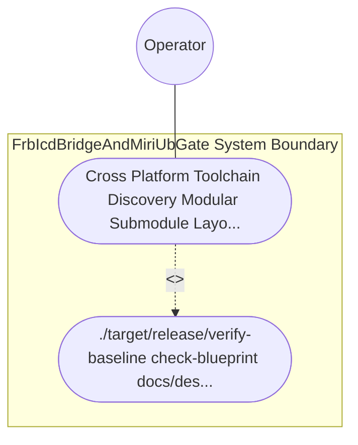

| Attribute | Specification Detail |
| :--- | :--- |
| **Issue ID** | #779 |
| **Title** | Use Case 51: Cross Platform Toolchain Discovery Modular Submodule Layout and Fail Closed Qualification Gate |
| **Type** | use-case |
| **Primary Actor** | Operator |
| **Scope** | FrbIcdBridgeAndMiriUbGate |
| **Level** | User Goal |
| **Generation Mode** | subagent |
| **Specification Source** | [schema/model.sysml](../../schema/model.sysml) |

# Use Case 51: Cross Platform Toolchain Discovery Modular Submodule Layout and Fail Closed Qualification Gate

## UML Diagrams

## 1. Actors
- `Operator`

## 2. Preconditions
- docs/designs/blueprint-09-clippy-dylint-miri-kani-formal-verification-gate.md specifying dynamic cross-platform driver probing across macOS, Linux, and Windows (std::env::consts::{DLL_PREFIX, DLL_SUFFIX, EXE_SUFFIX}, camino::Utf8Path), modular submodules under < 380 SLOC (**C-VER-07**), and the --require-formal-toolchains qualification flag, evaluated in an environment where a required driver is absent versus present.

## 3. Trigger
- ./target/release/verify-baseline check-blueprint docs/designs/blueprint-09-clippy-dylint-miri-kani-formal-verification-gate.md and.

## 4. Main Success Scenario
1. `Operator` invokes `probe_formal_toolchain(config)` on `MultiStageVerificationOrchestrator` via `gate_invocation_in`, transitioning `BP_09_Multi_Stage_Compiler_and_Formal_Verification_Gatekeeper_LifecycleState` from `Idle` to `ProbingFormalDrivers`.
2. `MultiStageVerificationOrchestrator` probes cross-platform driver paths (`min_toolchain_discovery_probes` in `1..3`, `C_VER_08`) across macOS, Linux, and Windows using `std::env::consts::{DLL_PREFIX, DLL_SUFFIX, EXE_SUFFIX}` and `camino::Utf8Path` without hardcoded host paths.
3. `IsolatedDylintMirAllocationGate` invokes `verify_in_process_cst_syntax(module_path, max_exec_sloc)` across all formal verification submodules (`crates/verify-baseline/src/formal_gates/`, `crates/compile-sysml/src/kani_synth/`, `crates/compile-sysml/src/frb_guard/`) to confirm `max_module_exec_sloc <= 380` (`C_VER_07`) and zero CST syntax errors under `Invariant_REQ_0609_SC_05`.
4. `MultiStageVerificationOrchestrator` executes `evaluate_four_stage_gatekeeper(receipts)` across Stages 1 through 4 and runs `./target/release/verify-baseline check-blueprint docs/designs/blueprint-09-clippy-dylint-miri-kani-formal-verification-gate.md`.
5. All 12 mechanical blueprint verification gates and all 4 verification stages pass with exit code 0, emitting a consolidated NDJSON verification receipt on `unified_gate_ndjson_out`.

## 5. Alternate and Exception Flows
- 3a. Required formal driver (`dylint`, `miri`, or `kani`) is absent while `require_formal_toolchains == true` (`Diagnostic: DEAP-E0905`):
  - `MultiStageVerificationOrchestrator` transitions from `ProbingFormalDrivers` to `FailedClosedJsonDiagnostic` on `rejectMissingToolchainInQualification`, emits single-line NDJSON diagnostic `DEAP-E0905`, and exits fail-closed with code 1.
- 4a. Any formal verification submodule exceeds `380` exec SLOC (`C_VER_07`) or contains CST syntax errors (`Diagnostic: DEAP-E0905`):
  - `verify_in_process_cst_syntax` rejects the module, emits `DEAP-E0905` on `unified_gate_ndjson_out`, and terminates fail-closed with exit code 1.
- 5a. Any of the 12 mechanical blueprint verification gates fails on `blueprint-09-clippy-dylint-miri-kani-formal-verification-gate.md`:
  - `verify-baseline check-blueprint` aborts artifact persistence, preserves prior verified state, and exits fail-closed with code 1.

## 6. Postconditions
- `FrbIcdBridgeAndMiriUbGate` satisfies declared objective `Cross Platform Toolchain Discovery Modular Submodule Layout and Fail Closed Qualification Gate` with all subsystem invariants intact.
- Verified `Cross Platform Toolchain Discovery Modular Submodule Layout and Fail Closed Qualification Gate` completion status is recorded for `Operator`.

## 8. Realization Matrix
| Specification Item | Type | Link / Reference |
| :--- | :--- | :--- |
| **TBD** | User Story | [User Story 65: evaluate four stage gatekeeper](../user-stories/US-65-evaluate_four_stage_gatekeeper.md) |
| **TBD** | Feature | [Feature 41: [BP 09 Multi Stage Compiler and Formal Verification Gatekeeper] FrbIcdBridgeAndMiriUbGate](../features/FEAT-41-FrbIcdBridgeAndMiriUbGate.md) |

## Source References
Use case operational flows and lifecycle activity references:
- System Architecture Model: `schema/model.sysml`
- Normative Systems Engineering Standard: ISO/IEC/IEEE 29148:2018 §6.4.2 Concept of Operations

Operational use case realization and traceability links derive from `schema/model.sysml` pursuant to ISO/IEC/IEEE 29148.
