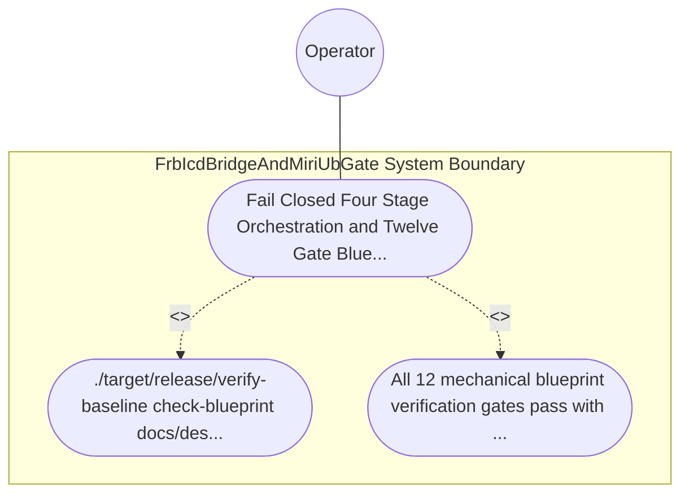

| Attribute | Specification Detail |
| :--- | :--- |
| **Issue ID** | TBD |
| **Title** | Use Case 51: Fail Closed Four Stage Orchestration and Twelve Gate Blueprint Bijective SysML Persistence |
| **Type** | use-case |
| **Primary Actor** | Operator |
| **Scope** | FrbIcdBridgeAndMiriUbGate |
| **Level** | User Goal |
| **Generation Mode** | subagent |
| **Specification Source** | [schema/model.sysml](../../schema/model.sysml) |

# Use Case 51: Fail Closed Four Stage Orchestration and Twelve Gate Blueprint Bijective SysML Persistence

## UML Diagrams

## 1. Actors
- `Operator`

## 2. Preconditions
- docs/designs/blueprint-09-clippy-dylint-miri-kani-formal-verification-gate.md specifying all 4 stages across deap-core, compile-sysml, and verify-baseline.

## 3. Trigger
- ./target/release/verify-baseline check-blueprint docs/designs/blueprint-09-clippy-dylint-miri-kani-formal-verification-gate.md and ./target/release/compile-sysml execute over the blueprint and emitted .sysml metamodel.

## 4. Main Success Scenario
1. ./target/release/verify-baseline check-blueprint docs/designs/blueprint-09-clippy-dylint-miri-kani-formal-verification-gate.md and ./target/release/compile-sysml execute over the blueprint and emitted .sysml metamodel.
2. All 12 mechanical blueprint verification gates pass with exit code 0, bijective SysML v2 roundtrip parity holds with zero semantic errors, and.

## 5. Alternate and Exception Flows
- Precondition guard failure in `FrbIcdBridgeAndMiriUbGate`:
  - `FrbIcdBridgeAndMiriUbGate` rejects the `Fail Closed Four Stage Orchestration and Twelve Gate Blueprint Bijective SysML Persistence` request without partial state mutation and reports diagnostic status to `Operator`.
- Invariant violation while enforcing `Fail Closed Four Stage Orchestration and Twelve Gate Blueprint Bijective SysML Persistence`:
  - `FrbIcdBridgeAndMiriUbGate` aborts `Fail Closed Four Stage Orchestration and Twelve Gate Blueprint Bijective SysML Persistence` execution, preserves prior verified state, and notifies `Operator`.

## 6. Postconditions
- All 12 mechanical blueprint verification gates pass with exit code 0, bijective SysML v2 roundtrip parity holds with zero semantic errors, and.

## 8. Realization Matrix
| Specification Item | Type | Link / Reference |
| :--- | :--- | :--- |
| **TBD** | User Story | [User Story 57: run Stable Clippy Gate](../user-stories/US-57-runStableClippyGate.md) |
| **TBD** | Feature | [Feature 46: [BP 09 Multi Stage Compiler and Formal Verification Gatekeeper] FrbIcdBridgeAndMiriUbGate](../features/FEAT-46-FrbIcdBridgeAndMiriUbGate.md) |

## Source References
Use case operational flows and lifecycle activity references:
- System Architecture Model: `schema/model.sysml`
- Normative Systems Engineering Standard: ISO/IEC/IEEE 29148:2018 §6.4.2 Concept of Operations

Operational use case realization and traceability links derive from `schema/model.sysml` pursuant to ISO/IEC/IEEE 29148.
