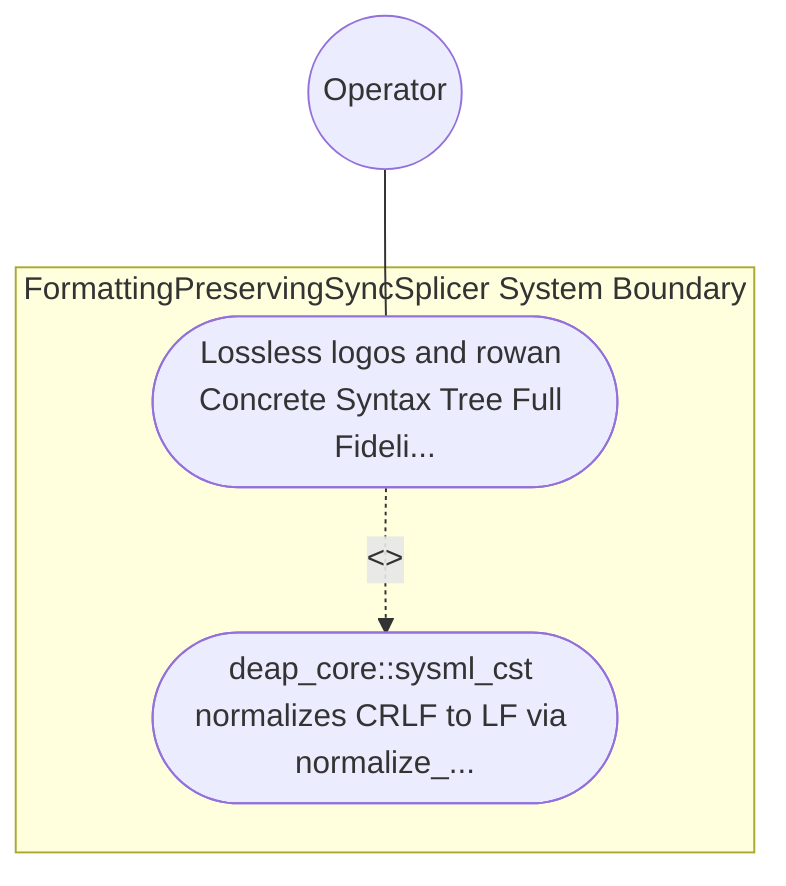

| Attribute | Specification Detail |
| :--- | :--- |
| **Issue ID** | #780 |
| **Title** | Use Case 52: Lossless logos and rowan Concrete Syntax Tree Full Fidelity Roundtrip and Cross Platform CRLF Normalization |
| **Type** | use-case |
| **Primary Actor** | Operator |
| **Scope** | FormattingPreservingSyncSplicer |
| **Level** | User Goal |
| **Generation Mode** | subagent |
| **Specification Source** | [schema/model.sysml](../../schema/model.sysml) |

# Use Case 52: Lossless logos and rowan Concrete Syntax Tree Full Fidelity Roundtrip and Cross Platform CRLF Normalization

## UML Diagrams

## 1. Actors
- `Operator`

## 2. Preconditions
- A .sysml fixture encoded with both LF and CRLF line endings containing nested package, part def, port def, action def, state def, transition, requirement def, and constraint def blocks interleaved with inline // comments, multi-line / * ... * / architect notes, doc / * ... * / specifications, @Safety and @Layer stereotypes, and custom vertical whitespace alignment.

## 3. Trigger
- deap_core::sysml_cst normalizes CRLF to LF via normalize_line_endings, lexes the buffer via logos, and constructs the SysmlLanguage Red/Green CST via rowan::GreenNodeBuilder (rowan pinned identically to.

## 4. Main Success Scenario
1. `Operator` supplies the `.sysml` buffer (with LF or CRLF line endings) to `SalsaIncrementalCompilerDatabase` on `source_revision_in`, which delegates `normalize_line_endings(raw)` to `LogosRowanSysmlCstEngine` (`lossless_trivia_preserved = true`, `max_ast_depth = 64`).
2. `LogosRowanSysmlCstEngine` normalizes CRLF to canonical LF across macOS, Linux, and Windows (`camino::Utf8Path`) and invokes `parse_lossless_sysml_cst(input)` inside `< 380` exec SLOC submodules (`crates/deap-core/src/sysml_cst/`) using the generated `logos` DFA lexer (`SysmlToken`).
3. `LogosRowanSysmlCstEngine` constructs the immutable `rowan::GreenNode` (`rowan` pinned identically to `ra_ap_syntax`) and typed `SysmlSyntaxNode` red-tree wrappers on `green_cst_out`, preserving 100% of whitespace, comments, and `doc /* ... */` blocks.
4. `LogosRowanSysmlCstEngine` executes `verify_lossless_cst_invariants(source, parsed)` under `Invariant_REQ_0610_SC_01` to verify that root `GreenNode` byte concatenation equals the LF-normalized UTF-8 input buffer byte-for-byte with zero `ErrorNode` spans.
5. `LogosRowanSysmlCstEngine` returns `CstParseReceipt` (`Ok`) to `SalsaIncrementalCompilerDatabase` with `stage_fixed_point_mismatch_files == 0` (`C_INC_03`).

## 5. Alternate and Exception Flows
- 3a. Root `rowan::GreenNode` byte projection diverges from the LF-normalized `.sysml` input buffer (`Diagnostic: DEAP-E1001`):
  - `verify_lossless_cst_invariants` fails closed, invokes `render_ariadne_diagnostic`, and emits `DEAP-E1001` on `syntax_diag_out` with exit code 1.
- 4a. Unrecognized lexical byte sequence encountered by `logos` DFA lexer (`Diagnostic: DEAP-E1001`):
  - `LogosRowanSysmlCstEngine` wraps the invalid bytes in `SysmlSyntaxKind::ErrorToken`, records the exact UTF-8 byte span, and rejects downstream lowering fail-closed.
- 5a. Invariant violation while enforcing `C_INC_01` (`max_ast_depth <= 64`) or `C_INC_03`:
  - `FormattingPreservingSyncSplicer` aborts execution without partial state mutation, preserves prior verified state, and notifies `Operator`.

## 6. Postconditions
- `FormattingPreservingSyncSplicer` satisfies declared objective `Lossless logos and rowan Concrete Syntax Tree Full Fidelity Roundtrip and Cross Platform CRLF Normalization` with all subsystem invariants intact.
- Verified `Lossless logos and rowan Concrete Syntax Tree Full Fidelity Roundtrip and Cross Platform CRLF Normalization` completion status is recorded for `Operator`.

## 8. Realization Matrix
| Specification Item | Type | Link / Reference |
| :--- | :--- | :--- |
| **TBD** | User Story | [User Story 66: resolve polyglot backend](../user-stories/US-66-resolve_polyglot_backend.md) |
| **TBD** | Feature | [Feature 46: [BP 10 Incremental Lossless SysML v2 and Polyglot Compiler Engine] FormattingPreservingSyncSplicer](../features/FEAT-46-FormattingPreservingSyncSplicer.md) |

## Source References
Use case operational flows and lifecycle activity references:
- System Architecture Model: `schema/model.sysml`
- Normative Systems Engineering Standard: ISO/IEC/IEEE 29148:2018 §6.4.2 Concept of Operations

Operational use case realization and traceability links derive from `schema/model.sysml` pursuant to ISO/IEC/IEEE 29148.
