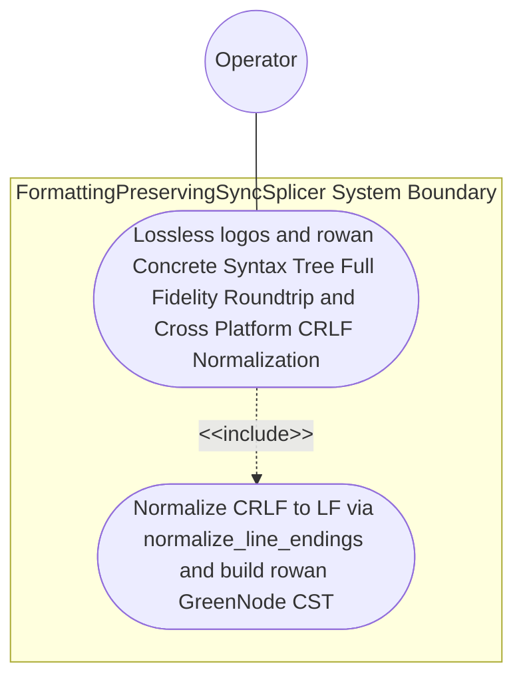

| Attribute | Specification Detail |
| :--- | :--- |
| **Issue ID** | #781 |
| **Title** | Use Case 52: Lossless logos and rowan Concrete Syntax Tree Full Fidelity Roundtrip and Cross Platform CRLF Normalization |
| **Type** | use-case |
| **Primary Actor** | Operator |
| **Scope** | FormattingPreservingSyncSplicer |
| **Level** | User Goal |
| **Generation Mode** | subagent |
| **Specification Source** | [schema/model.sysml](../../schema/model.sysml) |

# Use Case 52: Lossless logos and rowan Concrete Syntax Tree Full Fidelity Roundtrip and Cross Platform CRLF Normalization

## UML Diagrams

## 1. Actors
- `Operator`

## 2. Preconditions
- A `.sysml` fixture encoded with both LF and CRLF line endings containing nested `package`, `library package`, `standard library package`, `import`, `part def`/`part`, `port def`/`port`, `action def`/`action`, `state def`/`state`, `transition`, `requirement def`/`requirement`, `constraint def`/`constraint`, `calc def`/`calc`, `use case def`/`use case`, `verification def`/`verification`, `test case def`/`test case`, `interaction def`/`interaction`, `view def`/`view`, `variation`/`variant`, and `metadata def` (`#hazard`, `#risk`, `#capability`, `#rt_loop`, `#dal`, `#fls` plus backward-compatible legacy `hazard def`/`risk def`/`capability def`) blocks interleaved with inline `//` comments, multi-line `/* ... */` architect notes, `doc /* ... */` specifications, and custom vertical whitespace alignment (Contract A: 100% normative OMG SysML v2.0 + KerML 1.0 grammar coverage with zero 16-construct caps).

## 3. Trigger
- `deap_core::sysml_cst` normalizes CRLF to LF via `normalize_line_endings`, lexes the buffer via `logos`, and constructs the `SysmlLanguage` Red/Green CST via `rowan::GreenNodeBuilder` (`rowan` pinned identically to `ra_ap_syntax`) across 100% of the normative OMG SysML v2.0 + KerML 1.0 textual grammar with zero 16-construct caps and zero hand-rolled scanners (Contract B).

## 4. Main Success Scenario
1. `Operator` supplies the `.sysml` buffer (with LF or CRLF line endings) to `SalsaIncrementalCompilerDatabase` on `source_revision_in`, which delegates `normalize_line_endings(raw)` to `LogosRowanSysmlCstEngine` (`lossless_trivia_preserved = true`, `max_ast_depth = 64`).
2. `LogosRowanSysmlCstEngine` normalizes CRLF to canonical LF across macOS, Linux, and Windows (`camino::Utf8Path`) and invokes `parse_lossless_sysml_cst(input)` inside `< 380` exec SLOC submodules (`./crates/deap-core/src/sysml_cst/`) using the generated `logos` DFA lexer (`SysmlToken`) with explicit deletion of legacy hand-rolled scanners (`./crates/deap-core/src/sysml_ast/mod.rs` `-2,400+` SLOC, `./crates/compile-sysml/src/parser.rs` `-1,100+` SLOC, `./crates/ingest-sysml/src/extractors.rs` `-900+` SLOC).
3. `LogosRowanSysmlCstEngine` constructs the immutable `rowan::GreenNode` (`rowan` pinned identically to `ra_ap_syntax`) and typed `SysmlSyntaxNode` red-tree wrappers on `green_cst_out`, preserving 100% of whitespace, comments, `doc /* ... */` blocks, and all normative OMG SysML v2.0 + KerML 1.0 Definition and Usage constructs (Contract A: zero 16-construct caps).
4. `LogosRowanSysmlCstEngine` executes `verify_lossless_cst_invariants(source, parsed)` under `Invariant_REQ_0610_SC_01` to verify that root `GreenNode` byte concatenation equals the LF-normalized UTF-8 input buffer byte-for-byte with zero `ErrorNode` spans.
5. `LogosRowanSysmlCstEngine` returns `CstParseReceipt` (`Ok`) to `SalsaIncrementalCompilerDatabase` with `stage_fixed_point_mismatch_files == 0` (`C_INC_03`).

## 5. Alternate and Exception Flows
- 3a. Root `rowan::GreenNode` byte projection diverges from the LF-normalized `.sysml` input buffer (`Diagnostic: DEAP-E1001`):
  1. `verify_lossless_cst_invariants` fails closed and invokes `render_ariadne_diagnostic` inside `./crates/deap-core/src/sysml_cst/diagnostics.rs` (`< 380` exec SLOC).
  2. `LogosRowanSysmlCstEngine` emits `DEAP-E1001` (`ariadne` byte-span report + single-line NDJSON) on `syntax_diag_out` with exit code 1.
- 4a. Unrecognized lexical byte sequence encountered by `logos` DFA lexer (`Diagnostic: DEAP-E1001`):
  1. `LogosRowanSysmlCstEngine` wraps the invalid bytes in `SysmlSyntaxKind::ErrorToken` and records the exact UTF-8 byte span.
  2. `LogosRowanSysmlCstEngine` emits `DEAP-E1001` on `syntax_diag_out` and rejects downstream HIR lowering fail-closed.
- 5a. Invariant violation while enforcing `C_INC_01` (`max_ast_depth <= 64`) or `C_INC_03`:
  1. `FormattingPreservingSyncSplicer` detects the depth or fixed-point violation and aborts execution without partial state mutation.
  2. `FormattingPreservingSyncSplicer` preserves prior verified state and notifies `Operator` via `DEAP-E1002` / `DEAP-E1003`.

## 6. Postconditions
- **Success Guarantee:** `FormattingPreservingSyncSplicer` and `LogosRowanSysmlCstEngine` satisfy declared objective `Lossless logos and rowan Concrete Syntax Tree Full Fidelity Roundtrip and Cross Platform CRLF Normalization` across 100% of OMG SysML v2.0 + KerML 1.0 constructs (Contract A) and official `logos` + `rowan` + `salsa` + `ariadne` crates (Contract B) inside `< 380`-SLOC submodules (`./crates/deap-core/src/sysml_cst/`) with all subsystem invariants intact.
- **Failure Guarantee:** On any byte-roundtrip or lexical violation, downstream HIR lowering is aborted fail-closed with zero partial state mutation and deterministic `DEAP-E1001` diagnostics.

## 7. Architectural Realization (3-Layer Definition of Done)
- **Layer 1 (Domain State & Data Model):** Encapsulates LF-normalized UTF-8 source buffers, `SysmlToken` (`logos`), `SysmlSyntaxKind`, immutable `rowan::GreenNode`, and `CstParseReceipt` covering 100% of normative OMG SysML v2.0 + KerML 1.0 Definition and Usage clauses (zero 16-construct caps).
- **Layer 2 (Logic & State Management):** Executes `normalize_line_endings`, `parse_lossless_sysml_cst`, and `verify_lossless_cst_invariants` under `Invariant_REQ_0610_SC_01` and `C_INC_01..C_INC_03` inside `< 380`-SLOC submodules (`./crates/deap-core/src/sysml_cst/`) while explicitly deleting legacy hand-rolled scanners (`./crates/deap-core/src/sysml_ast/mod.rs` `-2,400+` SLOC, `./crates/compile-sysml/src/parser.rs` `-1,100+` SLOC, `./crates/ingest-sysml/src/extractors.rs` `-900+` SLOC).
- **Layer 3 (Presentation & Actuator Interface Binding):** Binds `source_revision_in`, `sysml_source_in`, `green_cst_out`, and `syntax_diag_out` to deterministic ANSI-free `ariadne` byte-span reports and `--message-format=json` NDJSON diagnostics (`DEAP-E1001`).

## 8. Realization Matrix
| Specification Item | Type | Link / Reference |
| :--- | :--- | :--- |
| **#817** | User Story | [User Story 67: Normalize Line Endings](../user-stories/US-67-normalize_line_endings.md) |
| **#818** | User Story | [User Story 68: Parse Lossless Sysml Cst](../user-stories/US-68-parse_lossless_sysml_cst.md) |
| **#819** | User Story | [User Story 69: Verify Lossless Cst Invariants](../user-stories/US-69-verify_lossless_cst_invariants.md) |
| **#845** | Feature | [Feature 47: [BP 10 Incremental Lossless SysML v2 and Polyglot Compiler Engine] LogosRowanSysmlCstEngine](../features/FEAT-47-LogosRowanSysmlCstEngine.md) |
| **#844** | Feature | [Feature 46: [BP 10 Incremental Lossless SysML v2 and Polyglot Compiler Engine] FormattingPreservingSyncSplicer](../features/FEAT-46-FormattingPreservingSyncSplicer.md) |

## Source References
Use case operational flows and lifecycle activity references:
- System Architecture Model: `schema/model.sysml`
- Normative Systems Engineering Standard: ISO/IEC/IEEE 29148:2018 §6.4.2 Concept of Operations

Operational use case realization and traceability links derive from `schema/model.sysml` pursuant to ISO/IEC/IEEE 29148.
