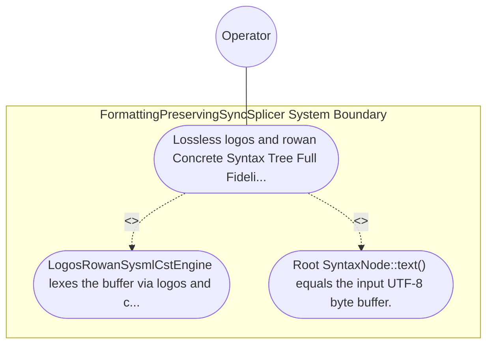

| Attribute | Specification Detail |
| :--- | :--- |
| **Issue ID** | TBD |
| **Title** | Use Case 52: Lossless logos and rowan Concrete Syntax Tree Full Fidelity Roundtrip and Trivia Preservation |
| **Type** | use-case |
| **Primary Actor** | Operator |
| **Scope** | FormattingPreservingSyncSplicer |
| **Level** | User Goal |
| **Generation Mode** | subagent |
| **Specification Source** | [schema/model.sysml](../../schema/model.sysml) |

# Use Case 52: Lossless logos and rowan Concrete Syntax Tree Full Fidelity Roundtrip and Trivia Preservation

## UML Diagrams

## 1. Actors
- `Operator`

## 2. Preconditions
- A .sysml fixture containing nested package, part def, port def, action def, state def, transition, requirement def, and constraint def blocks interleaved with inline // comments, multi-line / * ... * / architect notes, doc / * ... * / specifications, @Safety and @Layer stereotypes, composite generic types, and custom vertical whitespace alignment.

## 3. Trigger
- LogosRowanSysmlCstEngine lexes the buffer via logos and constructs the SysmlLanguage Red/Green concrete syntax tree via rowan::GreenNodeBuilder.

## 4. Main Success Scenario
1. LogosRowanSysmlCstEngine lexes the buffer via logos and constructs the SysmlLanguage Red/Green concrete syntax tree via rowan::GreenNodeBuilder.
2. Root SyntaxNode::text() equals the input UTF-8 byte buffer.

## 5. Alternate and Exception Flows
- Precondition guard failure in `FormattingPreservingSyncSplicer`:
  - `FormattingPreservingSyncSplicer` rejects the `Lossless logos and rowan Concrete Syntax Tree Full Fidelity Roundtrip and Trivia Preservation` request without partial state mutation and reports diagnostic status to `Operator`.
- Invariant violation while enforcing `Lossless logos and rowan Concrete Syntax Tree Full Fidelity Roundtrip and Trivia Preservation`:
  - `FormattingPreservingSyncSplicer` aborts `Lossless logos and rowan Concrete Syntax Tree Full Fidelity Roundtrip and Trivia Preservation` execution, preserves prior verified state, and notifies `Operator`.

## 6. Postconditions
- Root SyntaxNode::text() equals the input UTF-8 byte buffer.

## 8. Realization Matrix
| Specification Item | Type | Link / Reference |
| :--- | :--- | :--- |
| **TBD** | User Story | [User Story 63: ingest Polyglot To Hir](../user-stories/US-63-ingestPolyglotToHir.md) |
| **TBD** | Feature | [Feature 51: [BP 10 Incremental Lossless SysML v2 and Polyglot Compiler Engine] FormattingPreservingSyncSplicer](../features/FEAT-51-FormattingPreservingSyncSplicer.md) |

## Source References
Use case operational flows and lifecycle activity references:
- System Architecture Model: `schema/model.sysml`
- Normative Systems Engineering Standard: ISO/IEC/IEEE 29148:2018 §6.4.2 Concept of Operations

Operational use case realization and traceability links derive from `schema/model.sysml` pursuant to ISO/IEC/IEEE 29148.
