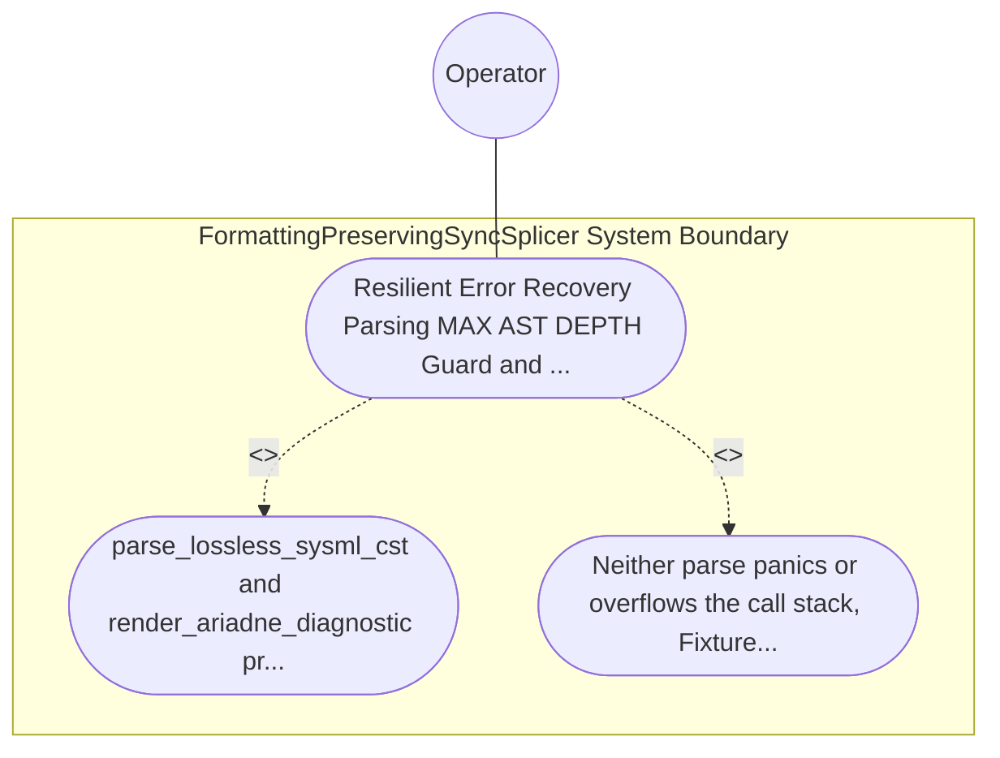

| Attribute | Specification Detail |
| :--- | :--- |
| **Issue ID** | #781 |
| **Title** | Use Case 53: Resilient Error Recovery Parsing MAX AST DEPTH Guard and Deterministic Ariadne Byte Span Diagnostics |
| **Type** | use-case |
| **Primary Actor** | Operator |
| **Scope** | FormattingPreservingSyncSplicer |
| **Level** | User Goal |
| **Generation Mode** | subagent |
| **Specification Source** | [schema/model.sysml](../../schema/model.sysml) |

# Use Case 53: Resilient Error Recovery Parsing MAX AST DEPTH Guard and Deterministic Ariadne Byte Span Diagnostics

## UML Diagrams

## 1. Actors
- `Operator`

## 2. Preconditions
- Two negative .sysml fixtures: Fixture A containing an unclosed part def attribute missing ; followed by a valid requirement def block, and Fixture B containing 65 nested package / part blocks exceeding MAX_AST_DEPTH = 64 (**C-INC-01**).

## 3. Trigger
- parse_lossless_sysml_cst and render_ariadne_diagnostic process Fixture A and Fixture B.

## 4. Main Success Scenario
1. `Operator` submits Fixture A (missing `;` on a `part def` attribute followed by a valid `requirement def`) and Fixture B (65 nested `package` / `part` blocks) to `LogosRowanSysmlCstEngine` (`resilient_error_recovery = true`, `max_ast_depth = 64`) via `sysml_source_in`.
2. For Fixture A, `parse_lossless_sysml_cst(input)` inside `crates/deap-core/src/sysml_cst/parser.rs` (`< 380` exec SLOC) wraps the malformed attribute span in `SysmlSyntaxKind::ErrorNode`, synchronizes at `;` / `}`, and recovers to parse the subsequent `requirement def` without panicking.
3. For Fixture B, `parse_lossless_sysml_cst(input)` enforces `MAX_AST_DEPTH = 64` (`C_INC_01`) under `Invariant_REQ_0610_SC_02`, halting deeper recursion at depth 65 without call-stack overflow and recording a depth violation span.
4. `SalsaIncrementalCompilerDatabase` invokes `render_ariadne_diagnostic` on both error receipts to produce deterministic, ANSI-free `ariadne` byte-span reports paired with single-line `--message-format=json` NDJSON objects.
5. `LogosRowanSysmlCstEngine` emits `DEAP-E1001` (Fixture A syntax error) and `DEAP-E1002` (Fixture B `MAX_AST_DEPTH` exceeded) on `syntax_diag_out` and rejects downstream codegen promotion fail-closed with exit code 1.

## 5. Alternate and Exception Flows
- 3a. Malformed `.sysml` token span encountered during recursive-descent CST construction (`Diagnostic: DEAP-E1001`):
  - `LogosRowanSysmlCstEngine` encapsulates the span inside `ErrorNode`, preserves 100% of source bytes in the `GreenNode`, and emits `DEAP-E1001` via `render_ariadne_diagnostic` and NDJSON.
- 4a. Structural nesting depth exceeds `max_ast_depth == 64` (`C_INC_01`, `Diagnostic: DEAP-E1002`):
  - `LogosRowanSysmlCstEngine` aborts deeper descent at depth 64, emits `DEAP-E1002` with exact opening-brace byte spans, and exits fail-closed with code 1.
- 5a. Diagnostic renderer attempts to emit non-deterministic ANSI color escapes in JSON mode:
  - `render_ariadne_diagnostic` enforces `Config::with_color(false)`, preserving deterministic byte-exact diagnostic output for `Operator`.

## 6. Postconditions
- Neither parse panics or overflows the call stack; Fixture A recovers via `SysmlSyntaxKind::ErrorNode` and emits `DEAP-E1001`, and Fixture B halts at depth 64 and emits `DEAP-E1002` via `ariadne` and single-line NDJSON.

## 8. Realization Matrix
| Specification Item | Type | Link / Reference |
| :--- | :--- | :--- |
| **TBD** | User Story | [User Story 67: normalize line endings](../user-stories/US-67-normalize_line_endings.md) |
| **TBD** | Feature | [Feature 46: [BP 10 Incremental Lossless SysML v2 and Polyglot Compiler Engine] FormattingPreservingSyncSplicer](../features/FEAT-46-FormattingPreservingSyncSplicer.md) |

## Source References
Use case operational flows and lifecycle activity references:
- System Architecture Model: `schema/model.sysml`
- Normative Systems Engineering Standard: ISO/IEC/IEEE 29148:2018 §6.4.2 Concept of Operations

Operational use case realization and traceability links derive from `schema/model.sysml` pursuant to ISO/IEC/IEEE 29148.
