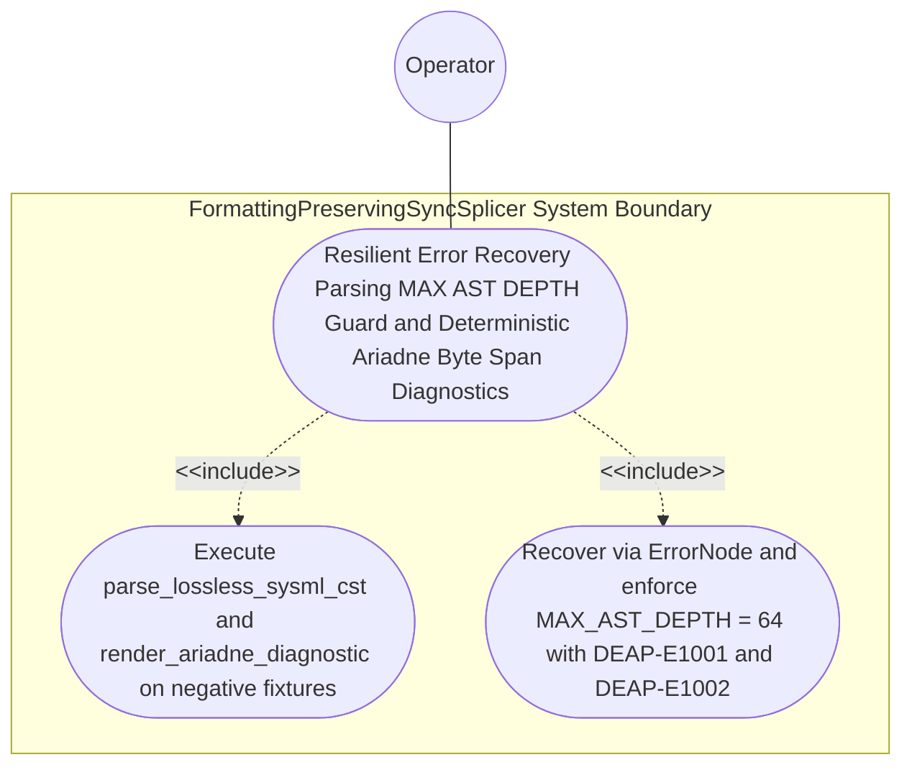

| Attribute | Specification Detail |
| :--- | :--- |
| **Issue ID** | #781 |
| **Title** | Use Case 53: Resilient Error Recovery Parsing MAX AST DEPTH Guard and Deterministic Ariadne Byte Span Diagnostics |
| **Type** | use-case |
| **Primary Actor** | Operator |
| **Scope** | FormattingPreservingSyncSplicer |
| **Level** | User Goal |
| **Generation Mode** | subagent |
| **Specification Source** | [schema/model.sysml](../../schema/model.sysml) |

# Use Case 53: Resilient Error Recovery Parsing MAX AST DEPTH Guard and Deterministic Ariadne Byte Span Diagnostics

## UML Diagrams

## 1. Actors
- `Operator`

## 2. Preconditions
- Two negative `.sysml` fixtures across the normative OMG SysML v2.0 + KerML 1.0 grammar (Contract A: zero 16-construct caps): Fixture A containing an unclosed `part def` attribute missing `;` followed by a valid `requirement def` block, and Fixture B containing 65 nested `package` / `part` blocks exceeding `MAX_AST_DEPTH = 64` (**C-INC-01**).

## 3. Trigger
- `parse_lossless_sysml_cst` and `render_ariadne_diagnostic` in `deap_core::sysml_cst` (Contract B: `logos` + `rowan` + `salsa` + `ariadne`, zero hand-rolled scanners) process Fixture A and Fixture B.

## 4. Main Success Scenario
1. `Operator` submits Fixture A (missing `;` on a `part def` attribute followed by a valid `requirement def`) and Fixture B (65 nested `package` / `part` blocks) to `LogosRowanSysmlCstEngine` (`resilient_error_recovery = true`, `max_ast_depth = 64`) via `sysml_source_in`.
2. For Fixture A, `parse_lossless_sysml_cst(input)` inside `./crates/deap-core/src/sysml_cst/parser.rs` (`< 380` exec SLOC, with legacy `./crates/deap-core/src/sysml_ast/mod.rs` `-2,400+` SLOC and `./crates/compile-sysml/src/parser.rs` `-1,100+` SLOC deleted) wraps the malformed attribute span in `SysmlSyntaxKind::ErrorNode`, synchronizes at `;` / `}`, and recovers to parse the subsequent `requirement def` without panicking across 100% of normative OMG SysML v2.0 + KerML 1.0 constructs.
3. For Fixture B, `parse_lossless_sysml_cst(input)` enforces `MAX_AST_DEPTH = 64` (`C_INC_01`) under `Invariant_REQ_0610_SC_02`, halting deeper recursion at depth 65 without call-stack overflow and recording a depth violation span.
4. `SalsaIncrementalCompilerDatabase` invokes `render_ariadne_diagnostic` inside `./crates/deap-core/src/sysml_cst/diagnostics.rs` (`< 380` exec SLOC) on both error receipts to produce deterministic, ANSI-free `ariadne` byte-span reports paired with single-line `--message-format=json` NDJSON objects.
5. `LogosRowanSysmlCstEngine` emits `DEAP-E1001` (Fixture A syntax error) and `DEAP-E1002` (Fixture B `MAX_AST_DEPTH` exceeded) on `syntax_diag_out` and rejects downstream codegen promotion fail-closed with exit code 1.

## 5. Alternate and Exception Flows
- 3a. Malformed `.sysml` token span encountered during recursive-descent CST construction (`Diagnostic: DEAP-E1001`):
  1. `LogosRowanSysmlCstEngine` encapsulates the span inside `SysmlSyntaxKind::ErrorNode` while preserving 100% of source bytes in the `rowan::GreenNode`.
  2. `LogosRowanSysmlCstEngine` emits `DEAP-E1001` via `render_ariadne_diagnostic` and single-line NDJSON on `syntax_diag_out`.
- 4a. Structural nesting depth exceeds `max_ast_depth == 64` (`C_INC_01`, `Diagnostic: DEAP-E1002`):
  1. `LogosRowanSysmlCstEngine` aborts deeper descent at depth 64 without stack overflow and records exact opening-brace byte spans.
  2. `LogosRowanSysmlCstEngine` emits `DEAP-E1002` and exits fail-closed with code 1.
- 5a. Diagnostic renderer attempts to emit non-deterministic ANSI color escapes in JSON mode:
  1. `render_ariadne_diagnostic` enforces `Config::with_color(false)` to strip all ANSI escape sequences.
  2. `render_ariadne_diagnostic` returns deterministic byte-exact diagnostic output to `Operator`.

## 6. Postconditions
- **Success Guarantee:** Neither parse panics or overflows the call stack; Fixture A recovers via `SysmlSyntaxKind::ErrorNode` and emits `DEAP-E1001`, and Fixture B halts at depth 64 and emits `DEAP-E1002` via `ariadne` and single-line NDJSON.
- **Failure Guarantee:** Any CST containing `ErrorNode` or exceeding `MAX_AST_DEPTH = 64` is blocked fail-closed from downstream HIR codegen promotion.

## 7. Architectural Realization (3-Layer Definition of Done)
- **Layer 1 (Domain State & Data Model):** Encapsulates `SysmlSyntaxKind::ErrorNode`, `Utf8TextRange` error spans, `SysmlDiagnostic`, and `max_ast_depth = 64` (`C_INC_01`) across 100% of normative OMG SysML v2.0 + KerML 1.0 constructs (Contract A: zero 16-construct caps).
- **Layer 2 (Logic & State Management):** Executes resilient `ErrorNode` recovery (`parse_lossless_sysml_cst`) and `MAX_AST_DEPTH = 64` enforcement under `Invariant_REQ_0610_SC_02` inside `< 380`-SLOC submodules (`./crates/deap-core/src/sysml_cst/parser.rs`, `./crates/deap-core/src/sysml_cst/diagnostics.rs`) with explicit deletion of legacy hand-rolled scanners (`./crates/deap-core/src/sysml_ast/mod.rs` `-2,400+` SLOC, `./crates/compile-sysml/src/parser.rs` `-1,100+` SLOC, `./crates/ingest-sysml/src/extractors.rs` `-900+` SLOC).
- **Layer 3 (Presentation & Actuator Interface Binding):** Binds `sysml_source_in` and `syntax_diag_out` to deterministic ANSI-free `ariadne` byte-span reports and single-line `--message-format=json` NDJSON diagnostics (`DEAP-E1001`, `DEAP-E1002`).

## 8. Realization Matrix
| Specification Item | Type | Link / Reference |
| :--- | :--- | :--- |
| **#817** | User Story | [User Story 68: parse lossless sysml cst](../user-stories/US-68-parse_lossless_sysml_cst.md) |
| **#821** | User Story | [User Story 72: render ariadne diagnostic](../user-stories/US-72-render_ariadne_diagnostic.md) |
| **#753** | Feature | [Feature 47: [BP 10 Incremental Lossless SysML v2 and Polyglot Compiler Engine] LogosRowanSysmlCstEngine](../features/FEAT-47-LogosRowanSysmlCstEngine.md) |
| **#752** | Feature | [Feature 46: [BP 10 Incremental Lossless SysML v2 and Polyglot Compiler Engine] FormattingPreservingSyncSplicer](../features/FEAT-46-FormattingPreservingSyncSplicer.md) |

## Source References
Use case operational flows and lifecycle activity references:
- System Architecture Model: `schema/model.sysml`
- Normative Systems Engineering Standard: ISO/IEC/IEEE 29148:2018 §6.4.2 Concept of Operations

Operational use case realization and traceability links derive from `schema/model.sysml` pursuant to ISO/IEC/IEEE 29148.
