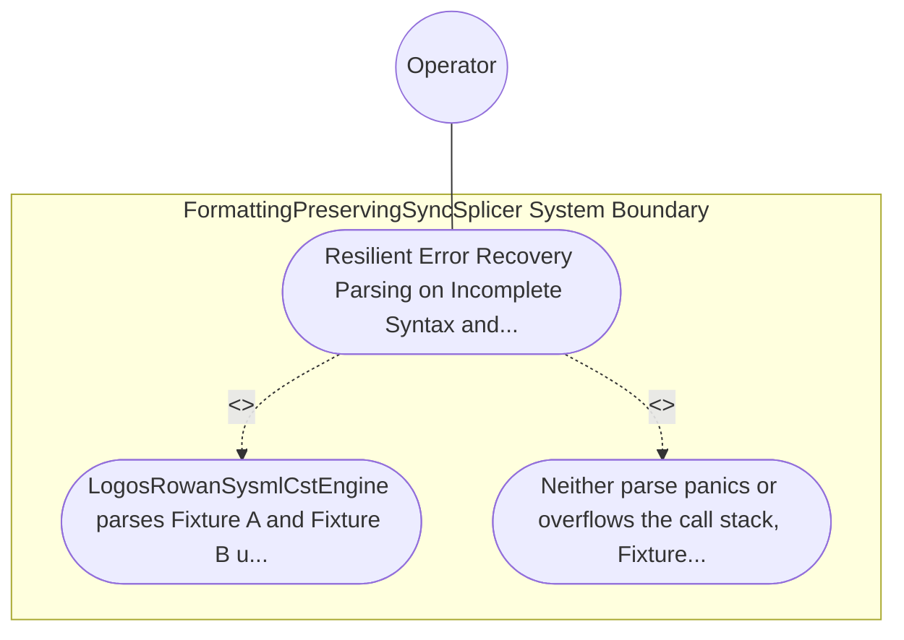

| Attribute | Specification Detail |
| :--- | :--- |
| **Issue ID** | TBD |
| **Title** | Use Case 53: Resilient Error Recovery Parsing on Incomplete Syntax and Fail Closed MAX AST DEPTH Guard |
| **Type** | use-case |
| **Primary Actor** | Operator |
| **Scope** | FormattingPreservingSyncSplicer |
| **Level** | User Goal |
| **Generation Mode** | subagent |
| **Specification Source** | [schema/model.sysml](../../schema/model.sysml) |

# Use Case 53: Resilient Error Recovery Parsing on Incomplete Syntax and Fail Closed MAX AST DEPTH Guard

## UML Diagrams

## 1. Actors
- `Operator`

## 2. Preconditions
- Two negative .sysml fixtures: Fixture A containing an unclosed part def attribute missing ; followed by a valid requirement def block (simulating mid-keystroke IDE/agent editing), and Fixture B containing 65 nested package / part blocks exceeding MAX_AST_DEPTH = 64 (**C-INC-01**).

## 3. Trigger
- LogosRowanSysmlCstEngine parses Fixture A and Fixture B under --message-format=json.

## 4. Main Success Scenario
1. LogosRowanSysmlCstEngine parses Fixture A and Fixture B under --message-format=json.
2. Neither parse panics or overflows the call stack; Fixture A wraps the malformed attribute in SysmlSyntaxKind::ERROR_NODE, recovers cleanly to parse the subsequent requirement def into a valid red.

## 5. Alternate and Exception Flows
- Precondition guard failure in `FormattingPreservingSyncSplicer`:
  - `FormattingPreservingSyncSplicer` rejects the `Resilient Error Recovery Parsing on Incomplete Syntax and Fail Closed MAX AST DEPTH Guard` request without partial state mutation and reports diagnostic status to `Operator`.
- Invariant violation while enforcing `Resilient Error Recovery Parsing on Incomplete Syntax and Fail Closed MAX AST DEPTH Guard`:
  - `FormattingPreservingSyncSplicer` aborts `Resilient Error Recovery Parsing on Incomplete Syntax and Fail Closed MAX AST DEPTH Guard` execution, preserves prior verified state, and notifies `Operator`.

## 6. Postconditions
- Neither parse panics or overflows the call stack; Fixture A wraps the malformed attribute in SysmlSyntaxKind::ERROR_NODE, recovers cleanly to parse the subsequent requirement def into a valid red.

## 8. Realization Matrix
| Specification Item | Type | Link / Reference |
| :--- | :--- | :--- |
| **TBD** | User Story | [User Story 64: parse Lossless Sysml Cst](../user-stories/US-64-parseLosslessSysmlCst.md) |
| **TBD** | Feature | [Feature 51: [BP 10 Incremental Lossless SysML v2 and Polyglot Compiler Engine] FormattingPreservingSyncSplicer](../features/FEAT-51-FormattingPreservingSyncSplicer.md) |

## Source References
Use case operational flows and lifecycle activity references:
- System Architecture Model: `schema/model.sysml`
- Normative Systems Engineering Standard: ISO/IEC/IEEE 29148:2018 §6.4.2 Concept of Operations

Operational use case realization and traceability links derive from `schema/model.sysml` pursuant to ISO/IEC/IEEE 29148.
