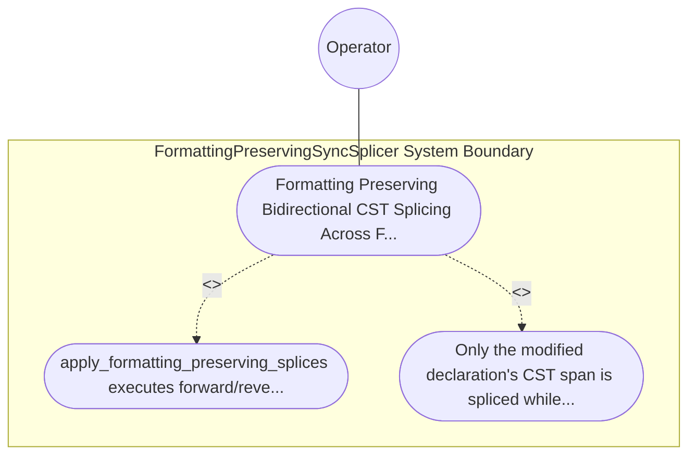

| Attribute | Specification Detail |
| :--- | :--- |
| **Issue ID** | #782 |
| **Title** | Use Case 54: Formatting Preserving Bidirectional CST Splicing Across Forward and Reverse Sync |
| **Type** | use-case |
| **Primary Actor** | Operator |
| **Scope** | FormattingPreservingSyncSplicer |
| **Level** | User Goal |
| **Generation Mode** | subagent |
| **Specification Source** | [schema/model.sysml](../../schema/model.sysml) |

# Use Case 54: Formatting Preserving Bidirectional CST Splicing Across Forward and Reverse Sync

## UML Diagrams

## 1. Actors
- `Operator`

## 2. Preconditions
- An existing .sysml schema containing human-authored architectural comments, custom indentation, and three part def subsystems alongside synchronized docs/features/ and docs/epics/ Markdown specifications, where only one part def port signature is updated during reverse sync, plus a negative splice request containing overlapping Utf8TextRange intervals.

## 3. Trigger
- apply_formatting_preserving_splices executes forward/reverse splice plans and evaluates the negative overlapping splice plan.

## 4. Main Success Scenario
1. `Operator` triggers forward or reverse synchronization on `FormattingPreservingSyncSplicer` (`untouched_trivia_mutation_bytes = 0`, `atomic_disjoint_splice = true`, `stage_fixed_point_mismatch_files = 0`) via `sync_delta_in`.
2. `FormattingPreservingSyncSplicer` locates the modified `part def` port declaration's exact `Utf8TextRange` in `HirSourceMap` inside `< 380` exec SLOC submodules (`crates/deap-core/src/sysml_cst/printer.rs`).
3. `FormattingPreservingSyncSplicer` invokes `apply_formatting_preserving_splices` to verify pairwise-disjoint `Utf8TextRange` intervals and splices only the modified declaration's `rowan` CST subtree in reverse byte order.
4. `FormattingPreservingSyncSplicer` re-parses the spliced `.sysml` and Markdown buffers via `parse_lossless_sysml_cst` to verify zero syntax errors and confirms `untouched_trivia_mutation_bytes == 0` (`C_INC_02`) across all unmodified comments, whitespace, and sibling declarations under `Invariant_REQ_0610_SC_03`.
5. `FormattingPreservingSyncSplicer` commits the spliced artifacts atomically on `spliced_artifact_out` while preserving `BP-03` bijective roundtrip and `BP-07` Stage-1 == Stage-2 fixed-point identity (`C_INC_03`).

## 5. Alternate and Exception Flows
- 3a. Negative splice plan contains overlapping or out-of-bounds `Utf8TextRange` intervals (`Diagnostic: DEAP-E1003`):
  - `apply_formatting_preserving_splices` aborts before mutating any file, emits `ariadne` and single-line NDJSON diagnostic `DEAP-E1003` on `splice_diag_out`, and exits fail-closed with code 1.
- 4a. Spliced candidate buffer introduces a post-splice CST syntax error (`Diagnostic: DEAP-E1003`):
  - `FormattingPreservingSyncSplicer` discards the candidate buffer in memory, emits `DEAP-E1003`, leaves disk files untouched, and terminates fail-closed with exit code 1.
- 5a. Any untouched comment or whitespace byte outside the target `Utf8TextRange` is mutated (`untouched_trivia_mutation_bytes > 0`, `C_INC_02`):
  - `FormattingPreservingSyncSplicer` rolls back the splice transaction, preserves prior verified state, and notifies `Operator`.

## 6. Postconditions
- Only the modified declaration's CST span is spliced while 100% of untouched comments, whitespace, and sibling declarations remain byte-for-byte identical (`untouched_trivia_mutation_bytes == 0`, `C_INC_02`).

## 8. Realization Matrix
| Specification Item | Type | Link / Reference |
| :--- | :--- | :--- |
| **TBD** | User Story | [User Story 68: parse lossless sysml cst](../user-stories/US-68-parse_lossless_sysml_cst.md) |
| **TBD** | Feature | [Feature 46: [BP 10 Incremental Lossless SysML v2 and Polyglot Compiler Engine] FormattingPreservingSyncSplicer](../features/FEAT-46-FormattingPreservingSyncSplicer.md) |

## Source References
Use case operational flows and lifecycle activity references:
- System Architecture Model: `schema/model.sysml`
- Normative Systems Engineering Standard: ISO/IEC/IEEE 29148:2018 §6.4.2 Concept of Operations

Operational use case realization and traceability links derive from `schema/model.sysml` pursuant to ISO/IEC/IEEE 29148.
