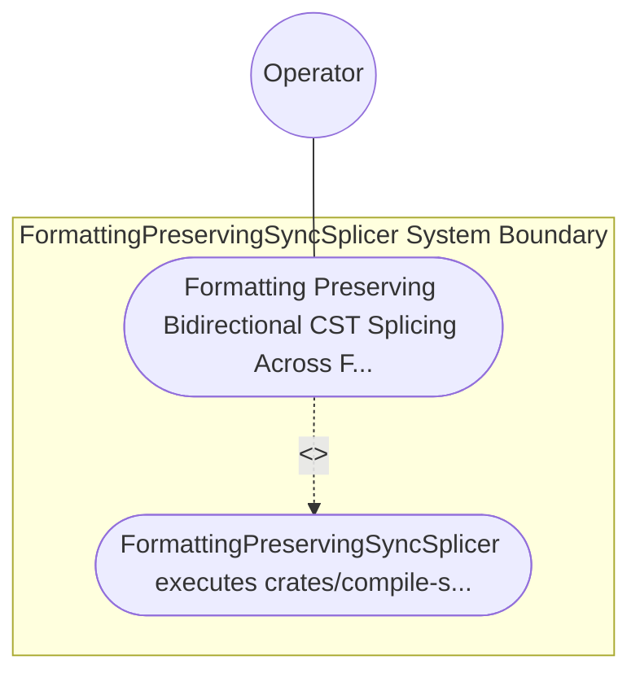

| Attribute | Specification Detail |
| :--- | :--- |
| **Issue ID** | TBD |
| **Title** | Use Case 54: Formatting Preserving Bidirectional CST Splicing Across Forward and Reverse Sync |
| **Type** | use-case |
| **Primary Actor** | Operator |
| **Scope** | FormattingPreservingSyncSplicer |
| **Level** | User Goal |
| **Generation Mode** | subagent |
| **Specification Source** | [schema/model.sysml](../../schema/model.sysml) |

# Use Case 54: Formatting Preserving Bidirectional CST Splicing Across Forward and Reverse Sync

## UML Diagrams

## 1. Actors
- `Operator`

## 2. Preconditions
- An existing .sysml schema containing human-authored architectural comments, custom indentation, and three part def subsystems alongside synchronized docs/features/ and docs/epics/ Markdown specifications, where only one part def port signature is updated in Markdown during reverse sync (and reciprocally one constraint def bound is updated in .sysml during forward sync), plus a negative splice request containing overlapping TextRange intervals.

## 3. Trigger
- FormattingPreservingSyncSplicer executes crates/compile-sysml/src/sync/reverse.rs and crates/compile-sysml/src/sync/forward/.

## 4. Main Success Scenario
1. FormattingPreservingSyncSplicer executes crates/compile-sysml/src/sync/reverse.rs and crates/compile-sysml/src/sync/forward/.

## 5. Alternate and Exception Flows
- Precondition guard failure in `FormattingPreservingSyncSplicer`:
  - `FormattingPreservingSyncSplicer` rejects the `Formatting Preserving Bidirectional CST Splicing Across Forward and Reverse Sync` request without partial state mutation and reports diagnostic status to `Operator`.
- Invariant violation while enforcing `Formatting Preserving Bidirectional CST Splicing Across Forward and Reverse Sync`:
  - `FormattingPreservingSyncSplicer` aborts `Formatting Preserving Bidirectional CST Splicing Across Forward and Reverse Sync` execution, preserves prior verified state, and notifies `Operator`.

## 6. Postconditions
- `FormattingPreservingSyncSplicer` satisfies declared objective `Formatting Preserving Bidirectional CST Splicing Across Forward and Reverse Sync` with all subsystem invariants intact.
- Verified `Formatting Preserving Bidirectional CST Splicing Across Forward and Reverse Sync` completion status is recorded for `Operator`.

## 8. Realization Matrix
| Specification Item | Type | Link / Reference |
| :--- | :--- | :--- |
| **TBD** | User Story | [User Story 65: evaluate Safety And Early Cutoff](../user-stories/US-65-evaluateSafetyAndEarlyCutoff.md) |
| **TBD** | Feature | [Feature 51: [BP 10 Incremental Lossless SysML v2 and Polyglot Compiler Engine] FormattingPreservingSyncSplicer](../features/FEAT-51-FormattingPreservingSyncSplicer.md) |

## Source References
Use case operational flows and lifecycle activity references:
- System Architecture Model: `schema/model.sysml`
- Normative Systems Engineering Standard: ISO/IEC/IEEE 29148:2018 §6.4.2 Concept of Operations

Operational use case realization and traceability links derive from `schema/model.sysml` pursuant to ISO/IEC/IEEE 29148.
