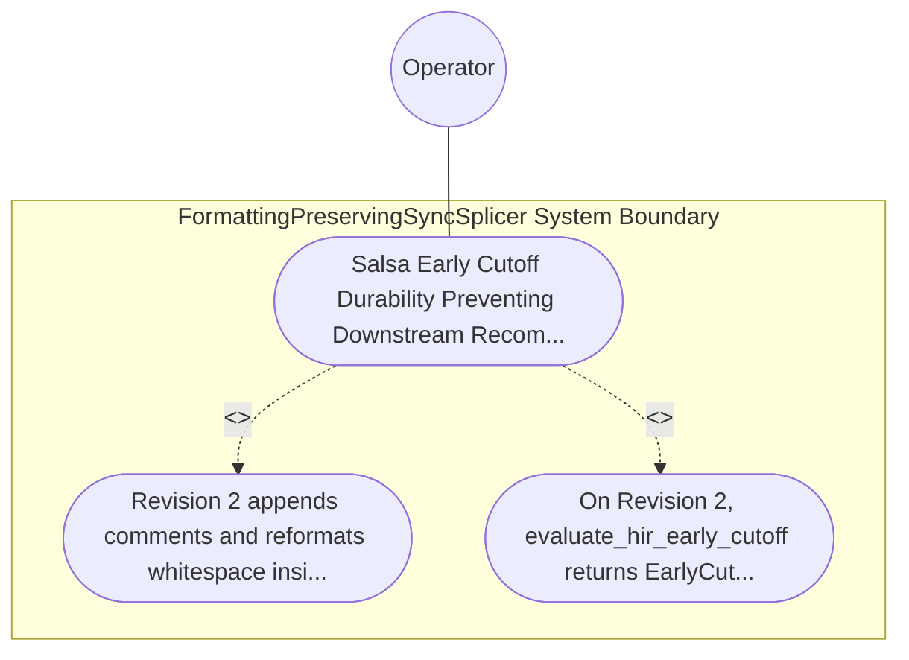

| Attribute | Specification Detail |
| :--- | :--- |
| **Issue ID** | #783 |
| **Title** | Use Case 55: Salsa Early Cutoff Durability Preventing Downstream Recomputations on Trivia Edits |
| **Type** | use-case |
| **Primary Actor** | Operator |
| **Scope** | FormattingPreservingSyncSplicer |
| **Level** | User Goal |
| **Generation Mode** | subagent |
| **Specification Source** | [schema/model.sysml](../../schema/model.sysml) |

# Use Case 55: Salsa Early Cutoff Durability Preventing Downstream Recomputations on Trivia Edits

## UML Diagrams

## 1. Actors
- `Operator`

## 2. Preconditions
- A multi-package .sysml workspace loaded into compile_sysml::salsa_db across all 4 query layers (SourceDatabase, CstDatabase, HirDatabase, SafetyVerificationDatabase) with query execution counters attached to CST, HIR, semantic validation, STPA/FMECA, and Kani queries.

## 3. Trigger
- Revision 2 appends comments and reformats whitespace inside one `.sysml` file without altering semantic declarations, followed by Revision 3 modifying a `port def` `(min..max)` bound inside that file.

## 4. Main Success Scenario
1. `Operator` loads the multi-package `.sysml` workspace into `SalsaIncrementalCompilerDatabase` (`query_layer_count = 4`, `trivia_edit_downstream_recomputations = 0`, `pure_deterministic_btreemap = true`) across `SourceDatabase`, `CstDatabase`, `HirDatabase`, and `SafetyVerificationDatabase` inside `< 380` exec SLOC submodules (`crates/compile-sysml/src/salsa_db/`).
2. On Revision 2 (whitespace and comment-only edits), `SalsaIncrementalCompilerDatabase` receives the updated buffer on `source_revision_in`, re-runs `CstDatabase` (`parse_lossless_sysml_cst`), and lowers the CST into a trivia-erased `HirPackageSummary` decoupled from `HirSourceMap` byte spans.
3. `SalsaIncrementalCompilerDatabase` invokes `evaluate_hir_early_cutoff(previous_hir, current_hir)` under `Invariant_REQ_0610_SC_04`, confirming `previous_hir == current_hir` and returning `EarlyCutoffDecision::CutoffPreservedDownstream`.
4. `Salsa` early-cutoff memoization prevents any recomputation of downstream semantic validation, STPA/FMECA, and Kani queries (`trivia_edit_downstream_recomputations == 0`, `C_INC_05`).
5. On Revision 3 (modifying a `port def` `(min..max)` bound), `evaluate_hir_early_cutoff` detects the semantic `HirPackageSummary` change and selectively recomputes only the affected package's downstream `HirDatabase` and `SafetyVerificationDatabase` queries on `hir_model_out` and `safety_verification_out`.

## 5. Alternate and Exception Flows
- 3a. Trivia-only edit leaks raw byte offsets into `HirPackageSummary` and triggers downstream query recomputation (`trivia_edit_downstream_recomputations > 0`, `C_INC_05`):
  - `SalsaIncrementalCompilerDatabase` fails the early-cutoff invariant check, emits a diagnostic on `safety_verification_out`, and exits fail-closed with code 1.
- 4a. Non-deterministic container (`HashMap` / `HashSet`) or I/O side effect attempted inside a derived `salsa` query (`pure_deterministic_btreemap == false`):
  - Stage-1 Clippy `disallowed_types` and `Check34AstPurityAndAntiGamingGate` reject the query implementation at compile/verification time.
- 5a. Invariant violation while enforcing `C_INC_04` (`query_layer_count == 4`) or `C_INC_05` in `FormattingPreservingSyncSplicer`:
  - `FormattingPreservingSyncSplicer` aborts execution without partial state mutation, preserves prior verified state, and notifies `Operator`.

## 6. Postconditions
- On Revision 2, `evaluate_hir_early_cutoff` returns `EarlyCutoffDecision::CutoffPreservedDownstream` with `trivia_edit_downstream_recomputations == 0` (`C_INC_05`), and Revision 3 recomputes only the semantically affected package queries.

## 8. Realization Matrix
| Specification Item | Type | Link / Reference |
| :--- | :--- | :--- |
| **TBD** | User Story | [User Story 69: verify lossless cst invariants](../user-stories/US-69-verify_lossless_cst_invariants.md) |
| **TBD** | Feature | [Feature 46: [BP 10 Incremental Lossless SysML v2 and Polyglot Compiler Engine] FormattingPreservingSyncSplicer](../features/FEAT-46-FormattingPreservingSyncSplicer.md) |

## Source References
Use case operational flows and lifecycle activity references:
- System Architecture Model: `schema/model.sysml`
- Normative Systems Engineering Standard: ISO/IEC/IEEE 29148:2018 §6.4.2 Concept of Operations

Operational use case realization and traceability links derive from `schema/model.sysml` pursuant to ISO/IEC/IEEE 29148.
