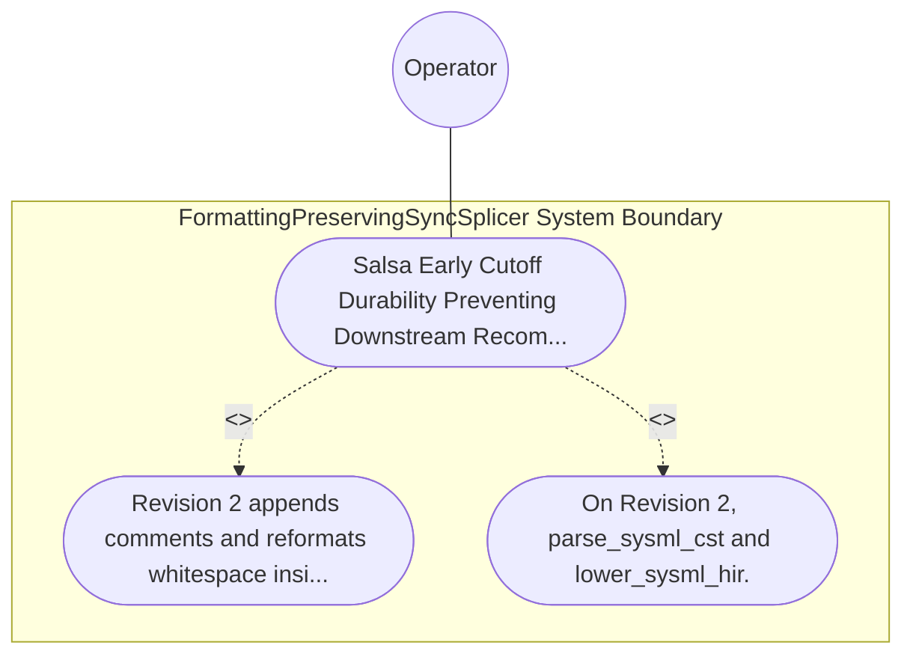

| Attribute | Specification Detail |
| :--- | :--- |
| **Issue ID** | TBD |
| **Title** | Use Case 55: Salsa Early Cutoff Durability Preventing Downstream Recomputations on Trivia Edits |
| **Type** | use-case |
| **Primary Actor** | Operator |
| **Scope** | FormattingPreservingSyncSplicer |
| **Level** | User Goal |
| **Generation Mode** | subagent |
| **Specification Source** | [schema/model.sysml](../../schema/model.sysml) |

# Use Case 55: Salsa Early Cutoff Durability Preventing Downstream Recomputations on Trivia Edits

## UML Diagrams

## 1. Actors
- `Operator`

## 2. Preconditions
- A multi-package .sysml workspace loaded into SalsaIncrementalCompilerDatabase across all 4 query layers (SourceDatabase, CstDatabase, HirDatabase, SafetyVerificationDatabase) with query execution counters attached to parse_sysml_cst, lower_sysml_hir, validate_semantics, derive_stpa_fmeca, and emit_kani_harnesses.

## 3. Trigger
- Revision 2 appends comments and reformats whitespace inside one .sysml file without altering semantic declarations, followed by Revision 3 modifying a port def [min..max] bound inside that file.

## 4. Main Success Scenario
1. Revision 2 appends comments and reformats whitespace inside one .sysml file without altering semantic declarations, followed by Revision 3 modifying a port def [min..max] bound inside that file.
2. On Revision 2, parse_sysml_cst and lower_sysml_hir.

## 5. Alternate and Exception Flows
- Precondition guard failure in `FormattingPreservingSyncSplicer`:
  - `FormattingPreservingSyncSplicer` rejects the `Salsa Early Cutoff Durability Preventing Downstream Recomputations on Trivia Edits` request without partial state mutation and reports diagnostic status to `Operator`.
- Invariant violation while enforcing `Salsa Early Cutoff Durability Preventing Downstream Recomputations on Trivia Edits`:
  - `FormattingPreservingSyncSplicer` aborts `Salsa Early Cutoff Durability Preventing Downstream Recomputations on Trivia Edits` execution, preserves prior verified state, and notifies `Operator`.

## 6. Postconditions
- On Revision 2, parse_sysml_cst and lower_sysml_hir.

## 8. Realization Matrix
| Specification Item | Type | Link / Reference |
| :--- | :--- | :--- |
| **TBD** | User Story | [User Story 66: compute Bidirectional Splice](../user-stories/US-66-computeBidirectionalSplice.md) |
| **TBD** | Feature | [Feature 51: [BP 10 Incremental Lossless SysML v2 and Polyglot Compiler Engine] FormattingPreservingSyncSplicer](../features/FEAT-51-FormattingPreservingSyncSplicer.md) |

## Source References
Use case operational flows and lifecycle activity references:
- System Architecture Model: `schema/model.sysml`
- Normative Systems Engineering Standard: ISO/IEC/IEEE 29148:2018 §6.4.2 Concept of Operations

Operational use case realization and traceability links derive from `schema/model.sysml` pursuant to ISO/IEC/IEEE 29148.
