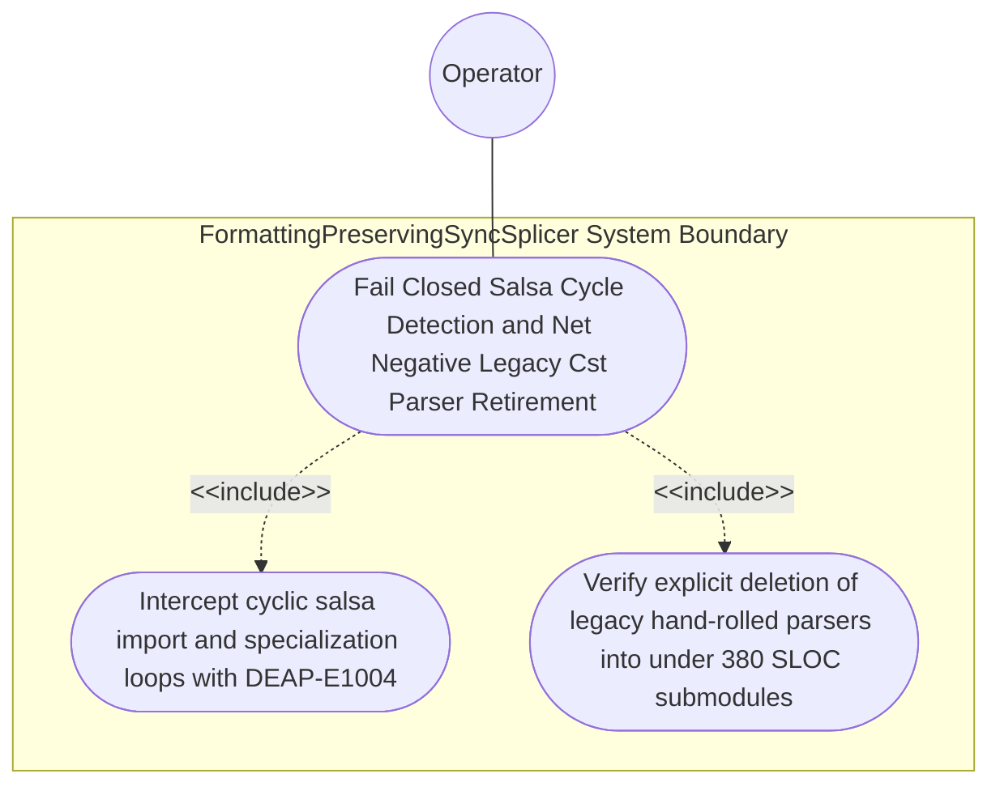

| Attribute | Specification Detail |
| :--- | :--- |
| **Issue ID** | #785 |
| **Title** | Use Case 56: Fail Closed Salsa Cycle Detection and Net Negative Legacy Cst Parser Retirement |
| **Type** | use-case |
| **Primary Actor** | Operator |
| **Scope** | FormattingPreservingSyncSplicer |
| **Level** | User Goal |
| **Generation Mode** | subagent |
| **Specification Source** | [schema/model.sysml](../../schema/model.sysml) |

# Use Case 56: Fail Closed Salsa Cycle Detection and Net Negative Legacy Cst Parser Retirement

## UML Diagrams

## 1. Actors
- `Operator`

## 2. Preconditions
- A negative multi-file `.sysml` fixture across the normative OMG SysML v2.0 + KerML 1.0 grammar (Contract A: zero 16-construct caps) introducing a cyclic `import` / cyclic `part def :> BasePart` specialization loop across two packages, alongside workspace SLOC and module-size audits.

## 3. Trigger
- `compile_sysml::salsa_db` evaluates scoped symbol resolution and `verify-baseline` audits legacy `cst_parser` deletion targets under Contract B (zero hand-rolled scanners).

## 4. Main Success Scenario
1. `Operator` submits the multi-file `.sysml` fixture containing a cyclic `import` or cyclic `part def :> BasePart` specialization loop to `SalsaIncrementalCompilerDatabase` (`cycle_recovery_fail_closed = true`) on `source_revision_in`.
2. `SalsaIncrementalCompilerDatabase` evaluates scoped symbol and specialization resolution across `HirDatabase` inside `< 380` exec SLOC submodules (`./crates/compile-sysml/src/salsa_db/`).
3. `Salsa` cycle recovery intercepts the dependency cycle deterministically without infinite recursion, stack overflow, or thread deadlock under `Invariant_REQ_0610_SC_04`.
4. `SalsaIncrementalCompilerDatabase` invokes `render_ariadne_diagnostic` and emits fail-closed diagnostic `DEAP-E1004` (`ariadne` byte-span report + single-line NDJSON) enumerating every cycle participant.
5. `verify-baseline` audits workspace modularity and confirms that legacy hand-rolled parsers in `./crates/deap-core/src/sysml_ast/mod.rs` (`-2,400+` SLOC), `./crates/compile-sysml/src/parser.rs` (`-1,100+` SLOC), and `./crates/ingest-sysml/src/extractors.rs` (`-900+` SLOC) are retired and deleted in favor of `< 380` exec SLOC CST/Salsa submodules (`./crates/deap-core/src/sysml_cst/`, `./crates/compile-sysml/src/salsa_db/`, `./crates/ingest-sysml/src/cst/`).

## 5. Alternate and Exception Flows
- 3a. Cyclic `import` or `part def :> BasePart` specialization loop detected in `HirDatabase` (`Diagnostic: DEAP-E1004`):
  1. `SalsaIncrementalCompilerDatabase` invokes its cycle-recovery handler to halt cyclic evaluation deterministically.
  2. `SalsaIncrementalCompilerDatabase` emits `DEAP-E1004` via `render_ariadne_diagnostic` and single-line NDJSON and exits fail-closed with code 1.
- 4a. Legacy hand-rolled recursive-descent parser or line-oriented extractor remains in `deap-core`, `compile-sysml`, or `ingest-sysml`:
  1. `verify-baseline` Check 34 and modularity gates detect the unretired scanner or `>= 380` SLOC submodule.
  2. `verify-baseline` fails closed with exit code 1 and reports the unretired monolith.
- 5a. Invariant violation while enforcing `Invariant_REQ_0610_SC_04` in `FormattingPreservingSyncSplicer`:
  1. `FormattingPreservingSyncSplicer` aborts execution without partial state mutation.
  2. `FormattingPreservingSyncSplicer` preserves prior verified state and notifies `Operator`.

## 6. Postconditions
- **Success Guarantee:** Cycle recovery intercepts the cycle deterministically without infinite recursion or thread deadlock and fails closed with `DEAP-E1004` (`ariadne` + NDJSON), while legacy hand-rolled parsers (`-4,400+` combined SLOC) are explicitly deleted and replaced by `< 380` exec SLOC submodules.
- **Failure Guarantee:** Any cyclic dependency or unretired hand-rolled scanner halts verification fail-closed with exit code 1.

## 7. Architectural Realization (3-Layer Definition of Done)
- **Layer 1 (Domain State & Data Model):** Encapsulates `HirDatabase` scoped symbol/import/specialization graphs (`:`, `:>`, `:>>`, `::>`, `~`) across 100% of normative OMG SysML v2.0 + KerML 1.0 constructs (Contract A: zero 16-construct caps) and `cycle_recovery_fail_closed = true`.
- **Layer 2 (Logic & State Management):** Executes deterministic `salsa` cycle recovery (`DEAP-E1004`) inside `< 380`-SLOC submodules (`./crates/compile-sysml/src/salsa_db/`) under Contract B (`logos` + `rowan` + `salsa` + `ariadne`, zero hand-rolled scanners) with explicit deletion of `./crates/deap-core/src/sysml_ast/mod.rs` (`-2,400+` SLOC), `./crates/compile-sysml/src/parser.rs` (`-1,100+` SLOC), and `./crates/ingest-sysml/src/extractors.rs` (`-900+` SLOC).
- **Layer 3 (Presentation & Actuator Interface Binding):** Binds `source_revision_in` and `safety_verification_out` to deterministic ANSI-free `ariadne` byte-span reports and single-line `--message-format=json` NDJSON diagnostics (`DEAP-E1004`).

## 8. Realization Matrix
| Specification Item | Type | Link / Reference |
| :--- | :--- | :--- |
| **#820** | User Story | [User Story 70: evaluate hir early cutoff](../user-stories/US-70-evaluate_hir_early_cutoff.md) |
| **#822** | User Story | [User Story 72: render ariadne diagnostic](../user-stories/US-72-render_ariadne_diagnostic.md) |
| **#846** | Feature | [Feature 48: [BP 10 Incremental Lossless SysML v2 and Polyglot Compiler Engine] SalsaIncrementalCompilerDatabase](../features/FEAT-48-SalsaIncrementalCompilerDatabase.md) |
| **#844** | Feature | [Feature 46: [BP 10 Incremental Lossless SysML v2 and Polyglot Compiler Engine] FormattingPreservingSyncSplicer](../features/FEAT-46-FormattingPreservingSyncSplicer.md) |

## Source References
Use case operational flows and lifecycle activity references:
- System Architecture Model: `schema/model.sysml`
- Normative Systems Engineering Standard: ISO/IEC/IEEE 29148:2018 §6.4.2 Concept of Operations

Operational use case realization and traceability links derive from `schema/model.sysml` pursuant to ISO/IEC/IEEE 29148.
