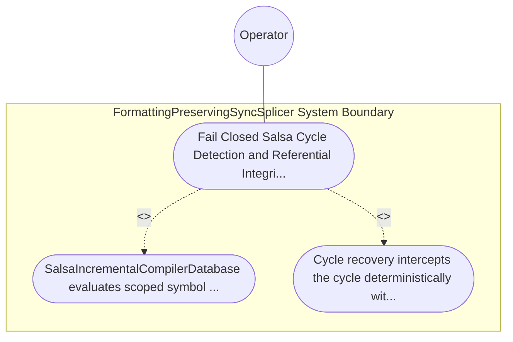

| Attribute | Specification Detail |
| :--- | :--- |
| **Issue ID** | TBD |
| **Title** | Use Case 56: Fail Closed Salsa Cycle Detection and Referential Integrity Verification |
| **Type** | use-case |
| **Primary Actor** | Operator |
| **Scope** | FormattingPreservingSyncSplicer |
| **Level** | User Goal |
| **Generation Mode** | subagent |
| **Specification Source** | [schema/model.sysml](../../schema/model.sysml) |

# Use Case 56: Fail Closed Salsa Cycle Detection and Referential Integrity Verification

## UML Diagrams

## 1. Actors
- `Operator`

## 2. Preconditions
- A negative multi-file .sysml fixture introducing a cyclic import / cyclic part def :> BasePart specialization loop across two packages in HirDatabase.

## 3. Trigger
- SalsaIncrementalCompilerDatabase evaluates scoped symbol resolution and HIR lowering for the cyclic workspace.

## 4. Main Success Scenario
1. SalsaIncrementalCompilerDatabase evaluates scoped symbol resolution and HIR lowering for the cyclic workspace.
2. Cycle recovery intercepts the cycle deterministically without infinite recursion or thread deadlock, fails closed with non-zero exit code, and emits a single-line --message-format=json diagnostic DEAP-E1004 listing the ordered cycle DefId chain and primary TextRange spans.

## 5. Alternate and Exception Flows
- Precondition guard failure in `FormattingPreservingSyncSplicer`:
  - `FormattingPreservingSyncSplicer` rejects the `Fail Closed Salsa Cycle Detection and Referential Integrity Verification` request without partial state mutation and reports diagnostic status to `Operator`.
- Invariant violation while enforcing `Fail Closed Salsa Cycle Detection and Referential Integrity Verification`:
  - `FormattingPreservingSyncSplicer` aborts `Fail Closed Salsa Cycle Detection and Referential Integrity Verification` execution, preserves prior verified state, and notifies `Operator`.

## 6. Postconditions
- Cycle recovery intercepts the cycle deterministically without infinite recursion or thread deadlock, fails closed with non-zero exit code, and emits a single-line --message-format=json diagnostic DEAP-E1004 listing the ordered cycle DefId chain and primary TextRange spans.

## 8. Realization Matrix
| Specification Item | Type | Link / Reference |
| :--- | :--- | :--- |
| **TBD** | User Story | [User Story 67: verify Post Splice Cst](../user-stories/US-67-verifyPostSpliceCst.md) |
| **TBD** | Feature | [Feature 51: [BP 10 Incremental Lossless SysML v2 and Polyglot Compiler Engine] FormattingPreservingSyncSplicer](../features/FEAT-51-FormattingPreservingSyncSplicer.md) |

## Source References
Use case operational flows and lifecycle activity references:
- System Architecture Model: `schema/model.sysml`
- Normative Systems Engineering Standard: ISO/IEC/IEEE 29148:2018 §6.4.2 Concept of Operations

Operational use case realization and traceability links derive from `schema/model.sysml` pursuant to ISO/IEC/IEEE 29148.
