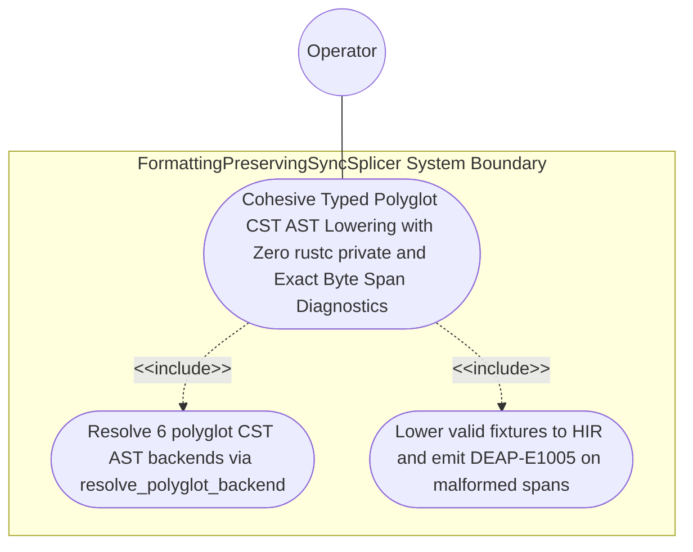

| Attribute | Specification Detail |
| :--- | :--- |
| **Issue ID** | #785 |
| **Title** | Use Case 57: Cohesive Typed Polyglot CST AST Lowering with Zero rustc private and Exact Byte Span Diagnostics |
| **Type** | use-case |
| **Primary Actor** | Operator |
| **Scope** | FormattingPreservingSyncSplicer |
| **Level** | User Goal |
| **Generation Mode** | subagent |
| **Specification Source** | [schema/model.sysml](../../schema/model.sysml) |

# Use Case 57: Cohesive Typed Polyglot CST AST Lowering with Zero rustc private and Exact Byte Span Diagnostics

## UML Diagrams

## 1. Actors
- `Operator`

## 2. Preconditions
- Six valid polyglot specification fixtures under Contract B (Rust `.rs` via `ra_ap_syntax`, Dart `.dart` via `deap_core::dart_cst`, OpenAPI/JSON-Schema `.json` via typed `serde_json` AST, OMG IDL `.idl` and IETF YANG `.yang` via `logos` + `rowan` CSTs in `ingest_sysml::cst::{idl_cst, yang_cst}` / `ingest_sysml::polyglot_cst`, and Markdown `.md` via `pulldown-cmark` + `pulldown-cmark-to-cmark`) alongside malformed counterparts at known byte offsets.

## 3. Trigger
- `ingest_sysml::cst::{idl_cst, yang_cst}` and `ingest_sysml::polyglot_cst` resolve each backend via `resolve_polyglot_backend` and lower each fixture into `compile_sysml::salsa_db` across 100% of normative OMG SysML v2.0 + KerML 1.0 constructs (Contract A: zero 16-construct caps).

## 4. Main Success Scenario
1. `Operator` supplies the 6 polyglot specification fixtures (`.rs`, `.dart`, `.json`, `.idl`, `.yang`, `.md`) on `polyglot_source_in` to `TypedPolyglotIngestionFrontend` (`polyglot_frontend_count = 6`, `rustc_private_feature_count = 0`, `zero_backtracking_lexers = true`).
2. `TypedPolyglotIngestionFrontend` invokes `resolve_polyglot_backend(format)` inside `< 380` exec SLOC submodules (`./crates/ingest-sysml/src/cst/`, `./crates/ingest-sysml/src/polyglot_cst/`) to dispatch `.rs` to `ra_ap_syntax`, `.dart` to `deap_core::dart_cst`, `.json` to typed `serde_json` AST, `.idl` and `.yang` to `logos` + `rowan` CSTs in `ingest_sysml::cst::{idl_cst, yang_cst}`, and `.md` to `pulldown-cmark` + `pulldown-cmark-to-cmark`, explicitly deleting `-900+` SLOC of legacy hand-rolled scanners in `./crates/ingest-sysml/src/extractors.rs`.
3. `TypedPolyglotIngestionFrontend` lowers all 6 valid fixtures via `100%` typed CST/AST node projection (with zero `.syntax().text().contains(...)` string inspection and `rustc_private_feature_count == 0`, `C_INC_06` and `C_INC_07`) into canonical `HirPackageSummary` and `HirSourceMap` records across 100% of normative OMG SysML v2.0 + KerML 1.0 Definition and Usage constructs on `lowered_hir_out`.
4. For the 6 malformed counterparts, `TypedPolyglotIngestionFrontend` captures the exact offending UTF-8 `TextRange` / JSON pointer byte span under `Invariant_REQ_0610_SC_05`.
5. `TypedPolyglotIngestionFrontend` invokes `render_ariadne_diagnostic` and emits deterministic `ariadne` byte-span reports and single-line `DEAP-E1005` NDJSON diagnostics on `ingest_diag_out` with exit code 1.

## 5. Alternate and Exception Flows
- 3a. Malformed syntax or broken JSON pointer encountered in any of the 6 polyglot formats (`Diagnostic: DEAP-E1005`):
  1. `TypedPolyglotIngestionFrontend` aborts HIR lowering for the malformed input and records the exact UTF-8 byte span.
  2. `TypedPolyglotIngestionFrontend` emits `DEAP-E1005` on `ingest_diag_out` and exits fail-closed with code 1.
- 4a. Any workspace crate under `./crates/*` introduces `feature(rustc_private)` (`rustc_private_feature_count > 0`, `C_INC_07`):
  1. `verify-baseline` detects the `#![feature(rustc_private)]` attribute outside `./lints/deap-dylint-mir/`.
  2. `verify-baseline` rejects the crate manifest/root attribute and terminates fail-closed with exit code 1.
- 5a. Any polyglot frontend falls back to `.syntax().text().contains(...)` or hand-rolled line/backtracking regex lexing (`zero_backtracking_lexers == false`):
  1. `Check34AstPurityAndAntiGamingGate` flags the hand-rolled scanner or `.syntax().text().contains(...)` violation.
  2. Verification halts fail-closed with exit code 1.

## 6. Postconditions
- **Success Guarantee:** All 6 valid fixtures lower deterministically into canonical `HirPackageSummary` and `HirSourceMap` records with `rustc_private_feature_count == 0` (`C_INC_07`) and zero hand-rolled scanners, and malformed fixtures fail closed with exact `DEAP-E1005` `ariadne` and NDJSON byte-span diagnostics.
- **Failure Guarantee:** Any malformed polyglot input or `rustc_private` violation aborts lowering fail-closed with exit code 1.

## 7. Architectural Realization (3-Layer Definition of Done)
- **Layer 1 (Domain State & Data Model):** Encapsulates `PolyglotFormat`, `PolyglotBackend`, `HirPackageSummary`, and `HirSourceMap` across all 6 polyglot frontends and 100% of normative OMG SysML v2.0 + KerML 1.0 constructs (Contract A: zero 16-construct caps).
- **Layer 2 (Logic & State Management):** Executes `resolve_polyglot_backend` across `ra_ap_syntax`, `deap_core::dart_cst`, `serde_json`, `ingest_sysml::cst::{idl_cst, yang_cst}`, and `pulldown-cmark` inside `< 380`-SLOC submodules (`./crates/ingest-sysml/src/cst/`) under Contract B with explicit deletion of legacy `./crates/ingest-sysml/src/extractors.rs` (`-900+` SLOC), `./crates/deap-core/src/sysml_ast/mod.rs` (`-2,400+` SLOC), and `./crates/compile-sysml/src/parser.rs` (`-1,100+` SLOC).
- **Layer 3 (Presentation & Actuator Interface Binding):** Binds `polyglot_source_in`, `lowered_hir_out`, and `ingest_diag_out` to `SalsaIncrementalCompilerDatabase` and deterministic `ariadne` + `--message-format=json` NDJSON diagnostics (`DEAP-E1005`).

## 8. Realization Matrix
| Specification Item | Type | Link / Reference |
| :--- | :--- | :--- |
| **#815** | User Story | [User Story 66: resolve polyglot backend](../user-stories/US-66-resolve_polyglot_backend.md) |
| **#821** | User Story | [User Story 72: render ariadne diagnostic](../user-stories/US-72-render_ariadne_diagnostic.md) |
| **#755** | Feature | [Feature 49: [BP 10 Incremental Lossless SysML v2 and Polyglot Compiler Engine] TypedPolyglotIngestionFrontend](../features/FEAT-49-TypedPolyglotIngestionFrontend.md) |
| **#752** | Feature | [Feature 46: [BP 10 Incremental Lossless SysML v2 and Polyglot Compiler Engine] FormattingPreservingSyncSplicer](../features/FEAT-46-FormattingPreservingSyncSplicer.md) |

## Source References
Use case operational flows and lifecycle activity references:
- System Architecture Model: `schema/model.sysml`
- Normative Systems Engineering Standard: ISO/IEC/IEEE 29148:2018 §6.4.2 Concept of Operations

Operational use case realization and traceability links derive from `schema/model.sysml` pursuant to ISO/IEC/IEEE 29148.
