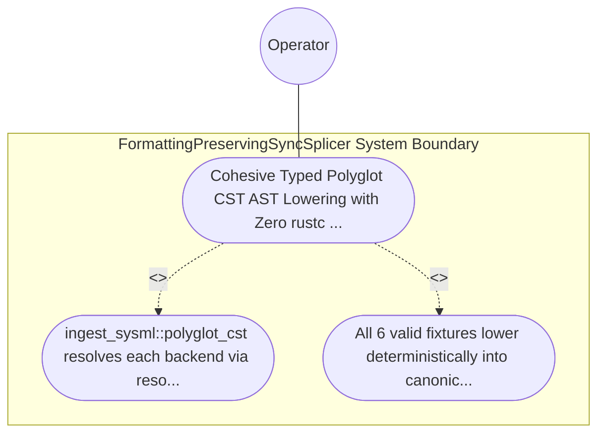

| Attribute | Specification Detail |
| :--- | :--- |
| **Issue ID** | #785 |
| **Title** | Use Case 57: Cohesive Typed Polyglot CST AST Lowering with Zero rustc private and Exact Byte Span Diagnostics |
| **Type** | use-case |
| **Primary Actor** | Operator |
| **Scope** | FormattingPreservingSyncSplicer |
| **Level** | User Goal |
| **Generation Mode** | subagent |
| **Specification Source** | [schema/model.sysml](../../schema/model.sysml) |

# Use Case 57: Cohesive Typed Polyglot CST AST Lowering with Zero rustc private and Exact Byte Span Diagnostics

## UML Diagrams

## 1. Actors
- `Operator`

## 2. Preconditions
- Six valid polyglot specification fixtures (Rust .rs via ra_ap_syntax, Dart .dart via deap_core::dart_cst, OpenAPI/JSON-Schema .json via typed serde_json AST, OMG IDL .idl, IETF YANG .yang, and Markdown .md via logos+rowan CSTs in ingest_sysml::polyglot_cst) alongside malformed counterparts at known byte offsets.

## 3. Trigger
- ingest_sysml::polyglot_cst resolves each backend via resolve_polyglot_backend and lowers each fixture into compile_sysml::salsa_db.

## 4. Main Success Scenario
1. `Operator` supplies the 6 polyglot specification fixtures (`.rs`, `.dart`, `.json`, `.idl`, `.yang`, `.md`) on `polyglot_source_in` to `TypedPolyglotIngestionFrontend` (`polyglot_frontend_count = 6`, `rustc_private_feature_count = 0`, `zero_backtracking_lexers = true`).
2. `TypedPolyglotIngestionFrontend` invokes `resolve_polyglot_backend(format)` inside `< 380` exec SLOC submodules (`crates/ingest-sysml/src/polyglot_cst/`) to dispatch `.rs` to `ra_ap_syntax`, `.dart` to `deap_core::dart_cst`, `.json` to typed `serde_json` AST, and `.idl` / `.yang` / `.md` to `logos` + `rowan` CSTs, retiring `-900+` SLOC in `extractors.rs`.
3. `TypedPolyglotIngestionFrontend` lowers all 6 valid fixtures via `100%` typed CST/AST node projection (with zero `.syntax().text().contains(...)` string inspection and `rustc_private_feature_count == 0`, `C_INC_06` and `C_INC_07`) into canonical `HirPackageSummary` and `HirSourceMap` records on `lowered_hir_out`.
4. For the 6 malformed counterparts, `TypedPolyglotIngestionFrontend` captures the exact offending UTF-8 `TextRange` / JSON pointer byte span under `Invariant_REQ_0610_SC_05`.
5. `TypedPolyglotIngestionFrontend` invokes `render_ariadne_diagnostic` and emits deterministic `ariadne` byte-span reports and single-line `DEAP-E1005` NDJSON diagnostics on `ingest_diag_out` with exit code 1.

## 5. Alternate and Exception Flows
- 3a. Malformed syntax or broken JSON pointer encountered in any of the 6 polyglot formats (`Diagnostic: DEAP-E1005`):
  - `TypedPolyglotIngestionFrontend` aborts HIR lowering for the malformed input, emits `DEAP-E1005` with exact byte spans on `ingest_diag_out`, and exits fail-closed with code 1.
- 4a. Any workspace crate under `./crates/*` introduces `feature(rustc_private)` (`rustc_private_feature_count > 0`, `C_INC_07`):
  - `verify-baseline` rejects the crate manifest/root attribute and terminates fail-closed with exit code 1.
- 5a. Any polyglot frontend falls back to `.syntax().text().contains(...)` or backtracking regex lexing (`zero_backtracking_lexers == false`):
  - `Check34AstPurityAndAntiGamingGate` flags the violation and halts verification with exit code 1.

## 6. Postconditions
- All 6 valid fixtures lower deterministically into canonical `HirPackageSummary` and `HirSourceMap` records with `rustc_private_feature_count == 0` (`C_INC_07`), and malformed fixtures fail closed with exact `DEAP-E1005` `ariadne` and NDJSON byte-span diagnostics.

## 8. Realization Matrix
| Specification Item | Type | Link / Reference |
| :--- | :--- | :--- |
| **TBD** | User Story | [User Story 71: apply formatting preserving splices](../user-stories/US-71-apply_formatting_preserving_splices.md) |
| **TBD** | Feature | [Feature 46: [BP 10 Incremental Lossless SysML v2 and Polyglot Compiler Engine] FormattingPreservingSyncSplicer](../features/FEAT-46-FormattingPreservingSyncSplicer.md) |

## Source References
Use case operational flows and lifecycle activity references:
- System Architecture Model: `schema/model.sysml`
- Normative Systems Engineering Standard: ISO/IEC/IEEE 29148:2018 §6.4.2 Concept of Operations

Operational use case realization and traceability links derive from `schema/model.sysml` pursuant to ISO/IEC/IEEE 29148.
