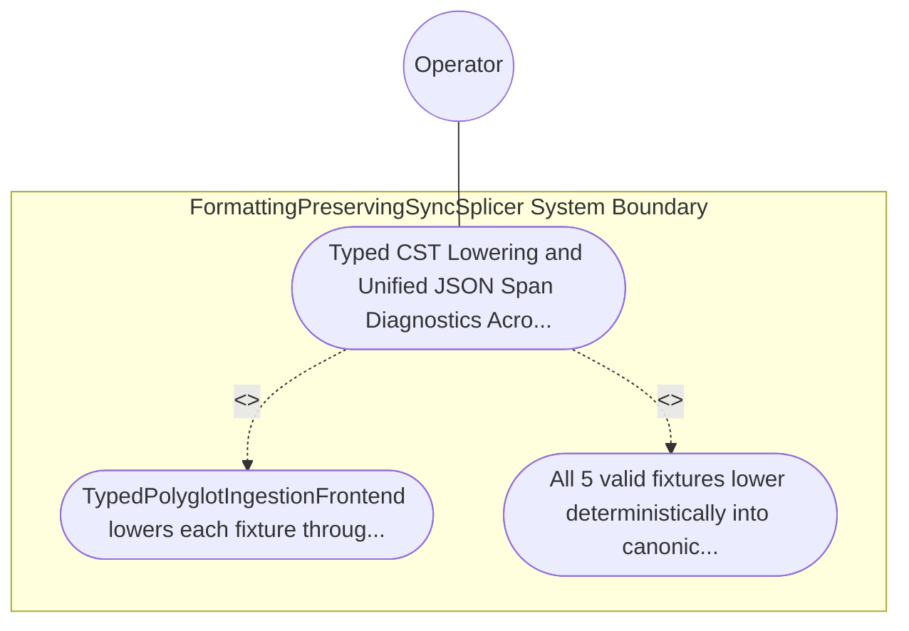

| Attribute | Specification Detail |
| :--- | :--- |
| **Issue ID** | TBD |
| **Title** | Use Case 57: Typed CST Lowering and Unified JSON Span Diagnostics Across All Five Polyglot Frontends |
| **Type** | use-case |
| **Primary Actor** | Operator |
| **Scope** | FormattingPreservingSyncSplicer |
| **Level** | User Goal |
| **Generation Mode** | subagent |
| **Specification Source** | [schema/model.sysml](../../schema/model.sysml) |

# Use Case 57: Typed CST Lowering and Unified JSON Span Diagnostics Across All Five Polyglot Frontends

## UML Diagrams

## 1. Actors
- `Operator`

## 2. Preconditions
- Five valid polyglot specification fixtures (Rust .rs, Markdown .md BOM/Port/Constraint tables, OMG IDL .idl, RFC 7950 YANG .yang, and OpenAPI 3.1 .json) alongside five malformed counterparts containing a syntax or unresolved schema-pointer error at a known byte offset.

## 3. Trigger
- TypedPolyglotIngestionFrontend lowers each fixture through its typed syntax tree (ra_ap_syntax, MdSyntaxKind, IdlSyntaxKind, YangSyntaxKind, OpenApiSyntaxKind) into HirDatabase with --message-format=json.

## 4. Main Success Scenario
1. TypedPolyglotIngestionFrontend lowers each fixture through its typed syntax tree (ra_ap_syntax, MdSyntaxKind, IdlSyntaxKind, YangSyntaxKind, OpenApiSyntaxKind) into HirDatabase with --message-format=json.
2. All 5 valid fixtures lower deterministically into canonical HirPackage and SourceMap.

## 5. Alternate and Exception Flows
- Precondition guard failure in `FormattingPreservingSyncSplicer`:
  - `FormattingPreservingSyncSplicer` rejects the `Typed CST Lowering and Unified JSON Span Diagnostics Across All Five Polyglot Frontends` request without partial state mutation and reports diagnostic status to `Operator`.
- Invariant violation while enforcing `Typed CST Lowering and Unified JSON Span Diagnostics Across All Five Polyglot Frontends`:
  - `FormattingPreservingSyncSplicer` aborts `Typed CST Lowering and Unified JSON Span Diagnostics Across All Five Polyglot Frontends` execution, preserves prior verified state, and notifies `Operator`.

## 6. Postconditions
- All 5 valid fixtures lower deterministically into canonical HirPackage and SourceMap.

## 8. Realization Matrix
| Specification Item | Type | Link / Reference |
| :--- | :--- | :--- |
| **TBD** | User Story | [User Story 63: ingest Polyglot To Hir](../user-stories/US-63-ingestPolyglotToHir.md) |
| **TBD** | Feature | [Feature 51: [BP 10 Incremental Lossless SysML v2 and Polyglot Compiler Engine] FormattingPreservingSyncSplicer](../features/FEAT-51-FormattingPreservingSyncSplicer.md) |

## Source References
Use case operational flows and lifecycle activity references:
- System Architecture Model: `schema/model.sysml`
- Normative Systems Engineering Standard: ISO/IEC/IEEE 29148:2018 §6.4.2 Concept of Operations

Operational use case realization and traceability links derive from `schema/model.sysml` pursuant to ISO/IEC/IEEE 29148.
