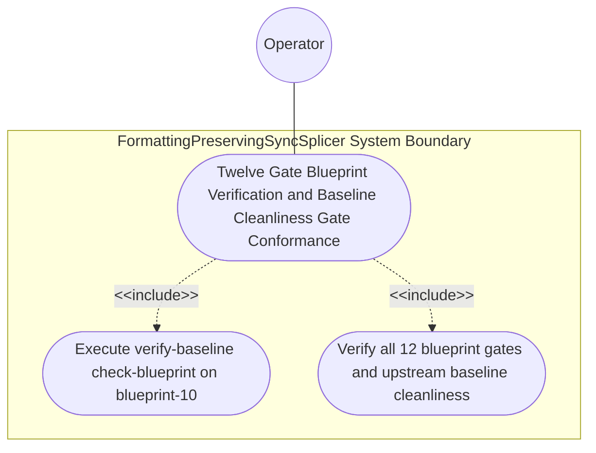

| Attribute | Specification Detail |
| :--- | :--- |
| **Issue ID** | #786 |
| **Title** | Use Case 58: Twelve Gate Blueprint Verification and Baseline Cleanliness Gate Conformance |
| **Type** | use-case |
| **Primary Actor** | Operator |
| **Scope** | FormattingPreservingSyncSplicer |
| **Level** | User Goal |
| **Generation Mode** | subagent |
| **Specification Source** | [schema/model.sysml](../../schema/model.sysml) |

# Use Case 58: Twelve Gate Blueprint Verification and Baseline Cleanliness Gate Conformance

## UML Diagrams

## 1. Actors
- `Operator`

## 2. Preconditions
- `./docs/designs/blueprint-10-rowan-salsa-incremental-sysml-compiler.md` residing in the upstream compiler repository alongside workspace governance rules enforcing Contract A (100% normative OMG SysML v2.0 + KerML 1.0 grammar coverage with zero 16-construct caps) and Contract B (`logos` + `rowan` + `salsa` + `ariadne`, `ra_ap_syntax`, `deap_core::dart_cst`, `serde_json`, `ingest_sysml::cst::{idl_cst, yang_cst}`, `pulldown-cmark`, zero hand-rolled scanners).

## 3. Trigger
- `./target/release/verify-baseline check-blueprint ./docs/designs/blueprint-10-rowan-salsa-incremental-sysml-compiler.md` and `./target/release/verify-baseline . --no-domain` are executed.

## 4. Main Success Scenario
1. `Operator` executes `./target/release/verify-baseline check-blueprint ./docs/designs/blueprint-10-rowan-salsa-incremental-sysml-compiler.md` on the upstream compiler blueprint.
2. `verify-baseline` evaluates all 12 mechanical blueprint verification gates (8-part structure, metadata table, 5-column STPA/FMECA table, KaTeX math blocks, Mermaid diagrams, and 7 Given-When-Then acceptance criteria).
3. `ingest-sysml` and `compile-sysml` extract and compile `BP_10_Incremental_Lossless_SysML_v2_and_Polyglot_Compiler_Engine` (`REQ-0610`, `C_INC_01..07`, `FormattingPreservingSyncSplicer`, `LogosRowanSysmlCstEngine`, `SalsaIncrementalCompilerDatabase`, `TypedPolyglotIngestionFrontend`) across 100% of normative OMG SysML v2.0 + KerML 1.0 constructs inside `< 380`-SLOC submodules (`./crates/deap-core/src/sysml_cst/`, `./crates/compile-sysml/src/salsa_db/`, `./crates/ingest-sysml/src/cst/`).
4. `Operator` executes `./target/release/verify-baseline . --no-domain` to verify upstream landing-zone cleanliness, Check 34 AST purity (zero hand-rolled scanners and explicit deletion of `./crates/deap-core/src/sysml_ast/mod.rs`, `./crates/compile-sysml/src/parser.rs`, and `./crates/ingest-sysml/src/extractors.rs`), Check 36 docstring completeness, and Check 37 path integrity.
5. All 12 mechanical blueprint verification gates and all upstream workspace baseline checks pass with exit code 0, persisting `./.pipeline/upstream/schema/model.sysml` and `./.pipeline/upstream/schema/model-digest.json`.

## 5. Alternate and Exception Flows
- 3a. Any of the 12 mechanical blueprint verification gates fails on `blueprint-10-rowan-salsa-incremental-sysml-compiler.md`:
  1. `verify-baseline check-blueprint` emits a structured diagnostic via `render_ariadne_diagnostic` and single-line NDJSON.
  2. `verify-baseline` aborts artifact persistence and exits fail-closed with code 1.
- 4a. Bijective roundtrip or constraint verification fails on `BP_10` (`Diagnostic: DEAP-E1001`):
  1. `compile-sysml` aborts schema persistence and preserves prior verified state.
  2. `compile-sysml` terminates fail-closed with exit code 1.
- 5a. Upstream baseline check (`verify-baseline . --no-domain`) detects any landing-zone or Check 34..37 violation:
  1. `verify-baseline` reports the exact finding on stderr/NDJSON.
  2. `verify-baseline` exits fail-closed with non-zero status code 1.

## 6. Postconditions
- **Success Guarantee:** All 12 mechanical blueprint verification gates and all upstream workspace baseline checks pass with exit code 0, atomically persisting `./.pipeline/upstream/schema/model.sysml` and `./.pipeline/upstream/schema/model-digest.json` artifacts.
- **Failure Guarantee:** Any gate failure aborts artifact persistence fail-closed with exit code 1 and deterministic `ariadne` + NDJSON diagnostics.

## 7. Architectural Realization (3-Layer Definition of Done)
- **Layer 1 (Domain State & Data Model):** Encapsulates `BP_10` AST/CST/HIR models (`FormattingPreservingSyncSplicer`, `LogosRowanSysmlCstEngine`, `SalsaIncrementalCompilerDatabase`, `TypedPolyglotIngestionFrontend`) and `C_INC_01..07` invariants across 100% of normative OMG SysML v2.0 + KerML 1.0 constructs (Contract A: zero 16-construct caps).
- **Layer 2 (Logic & State Management):** Enforces 12-gate blueprint verification, bijective roundtrip, and Check 34..37 AST purity inside `< 380`-SLOC submodules (`./crates/deap-core/src/sysml_cst/`, `./crates/compile-sysml/src/salsa_db/`, `./crates/ingest-sysml/src/cst/`) under Contract B with explicit deletion of legacy hand-rolled scanners (`./crates/deap-core/src/sysml_ast/mod.rs`, `./crates/compile-sysml/src/parser.rs`, `./crates/ingest-sysml/src/extractors.rs`).
- **Layer 3 (Presentation & Actuator Interface Binding):** Binds CLI verification gates (`verify-baseline check-blueprint`, `verify-baseline . --no-domain`) to deterministic `ariadne` byte-span reports and single-line `--message-format=json` NDJSON diagnostics.

## 8. Realization Matrix
| Specification Item | Type | Link / Reference |
| :--- | :--- | :--- |
| **#821** | User Story | [User Story 72: render ariadne diagnostic](../user-stories/US-72-render_ariadne_diagnostic.md) |
| **#820** | User Story | [User Story 71: apply formatting preserving splices](../user-stories/US-71-apply_formatting_preserving_splices.md) |
| **#752** | Feature | [Feature 46: [BP 10 Incremental Lossless SysML v2 and Polyglot Compiler Engine] FormattingPreservingSyncSplicer](../features/FEAT-46-FormattingPreservingSyncSplicer.md) |
| **#753** | Feature | [Feature 47: [BP 10 Incremental Lossless SysML v2 and Polyglot Compiler Engine] LogosRowanSysmlCstEngine](../features/FEAT-47-LogosRowanSysmlCstEngine.md) |
| **#754** | Feature | [Feature 48: [BP 10 Incremental Lossless SysML v2 and Polyglot Compiler Engine] SalsaIncrementalCompilerDatabase](../features/FEAT-48-SalsaIncrementalCompilerDatabase.md) |
| **#755** | Feature | [Feature 49: [BP 10 Incremental Lossless SysML v2 and Polyglot Compiler Engine] TypedPolyglotIngestionFrontend](../features/FEAT-49-TypedPolyglotIngestionFrontend.md) |

## Source References
Use case operational flows and lifecycle activity references:
- System Architecture Model: `schema/model.sysml`
- Normative Systems Engineering Standard: ISO/IEC/IEEE 29148:2018 §6.4.2 Concept of Operations

Operational use case realization and traceability links derive from `schema/model.sysml` pursuant to ISO/IEC/IEEE 29148.
