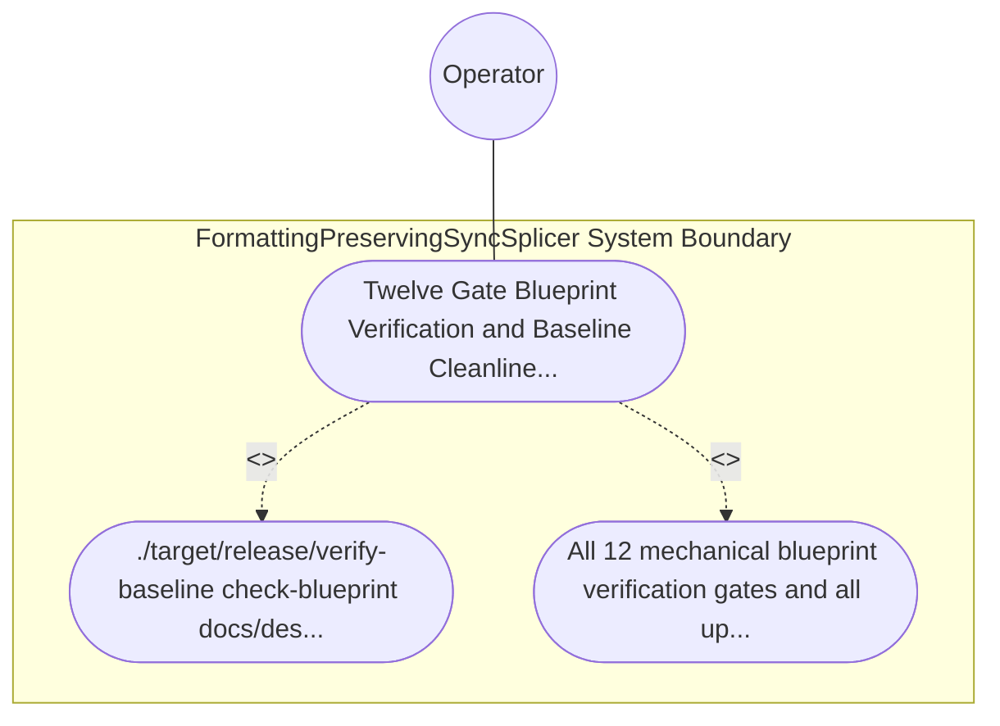

| Attribute | Specification Detail |
| :--- | :--- |
| **Issue ID** | TBD |
| **Title** | Use Case 58: Twelve Gate Blueprint Verification and Baseline Cleanliness Gate Conformance |
| **Type** | use-case |
| **Primary Actor** | Operator |
| **Scope** | FormattingPreservingSyncSplicer |
| **Level** | User Goal |
| **Generation Mode** | subagent |
| **Specification Source** | [schema/model.sysml](../../schema/model.sysml) |

# Use Case 58: Twelve Gate Blueprint Verification and Baseline Cleanliness Gate Conformance

## UML Diagrams

## 1. Actors
- `Operator`

## 2. Preconditions
- docs/designs/blueprint-10-rowan-salsa-incremental-sysml-compiler.md residing in the upstream compiler repository alongside workspace governance rules.

## 3. Trigger
- ./target/release/verify-baseline check-blueprint docs/designs/blueprint-10-rowan-salsa-incremental-sysml-compiler.md and ./target/release/verify-baseline . --no-domain are executed.

## 4. Main Success Scenario
1. ./target/release/verify-baseline check-blueprint docs/designs/blueprint-10-rowan-salsa-incremental-sysml-compiler.md and ./target/release/verify-baseline . --no-domain are executed.
2. All 12 mechanical blueprint verification gates and all upstream workspace baseline checks pass with exit code 0, atomically persisting docs/designs/blueprint-10-rowan-salsa-incremental-sysml-compiler.sysml and.

## 5. Alternate and Exception Flows
- Precondition guard failure in `FormattingPreservingSyncSplicer`:
  - `FormattingPreservingSyncSplicer` rejects the `Twelve Gate Blueprint Verification and Baseline Cleanliness Gate Conformance` request without partial state mutation and reports diagnostic status to `Operator`.
- Invariant violation while enforcing `Twelve Gate Blueprint Verification and Baseline Cleanliness Gate Conformance`:
  - `FormattingPreservingSyncSplicer` aborts `Twelve Gate Blueprint Verification and Baseline Cleanliness Gate Conformance` execution, preserves prior verified state, and notifies `Operator`.

## 6. Postconditions
- All 12 mechanical blueprint verification gates and all upstream workspace baseline checks pass with exit code 0, atomically persisting docs/designs/blueprint-10-rowan-salsa-incremental-sysml-compiler.sysml and.

## 8. Realization Matrix
| Specification Item | Type | Link / Reference |
| :--- | :--- | :--- |
| **TBD** | User Story | [User Story 63: ingest Polyglot To Hir](../user-stories/US-63-ingestPolyglotToHir.md) |
| **TBD** | Feature | [Feature 51: [BP 10 Incremental Lossless SysML v2 and Polyglot Compiler Engine] FormattingPreservingSyncSplicer](../features/FEAT-51-FormattingPreservingSyncSplicer.md) |

## Source References
Use case operational flows and lifecycle activity references:
- System Architecture Model: `schema/model.sysml`
- Normative Systems Engineering Standard: ISO/IEC/IEEE 29148:2018 §6.4.2 Concept of Operations

Operational use case realization and traceability links derive from `schema/model.sysml` pursuant to ISO/IEC/IEEE 29148.
